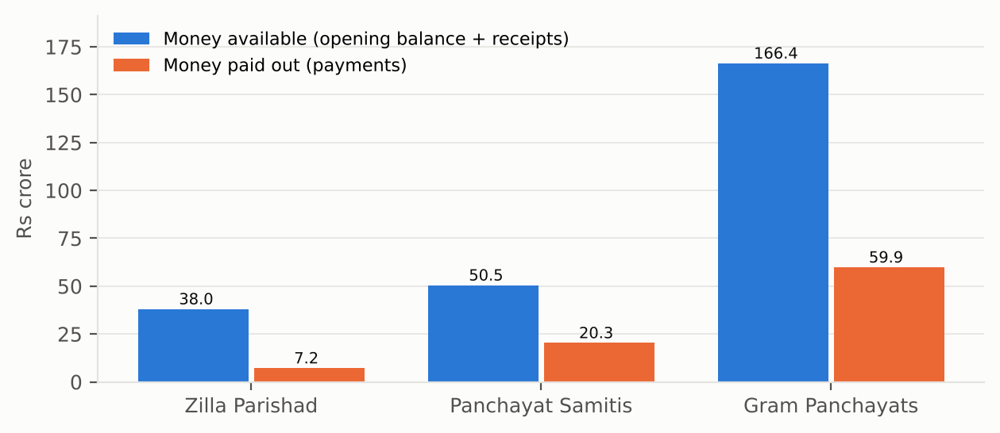
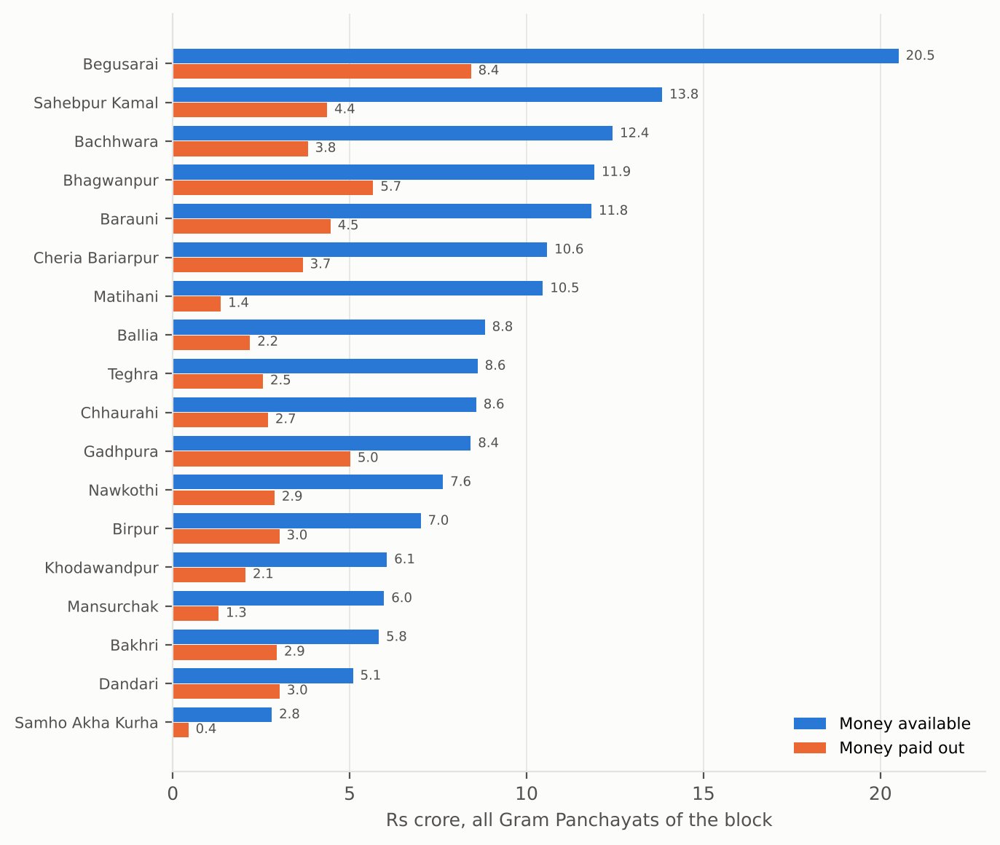
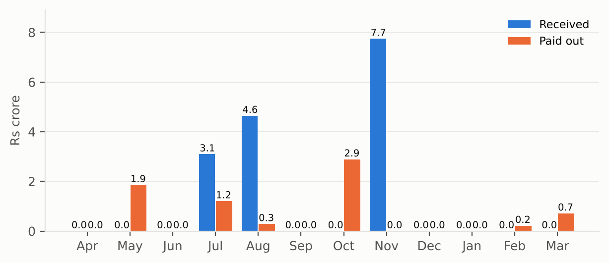

# Begusarai District: Panchayat Finances and Accounts, 2022-23

A plain-language district profile from the Government of India's eGramSwaraj system · India By Numbers · data as published by the portal (district statement generated October 23, 2024 12:54 AM)

## 1. The main points

- **Begusarai has 18 Panchayat Samitis (block councils) and 229 Gram Panchayats (village councils)** in the 2022-23 accounts, plus one Zilla Parishad (district council).
- **In 2022-23 its Panchayats together had Rs 254.89 crore available and paid out Rs 87.35 crore (34%).**
- **The Gram Panchayats had Rs 166.39 crore available and paid out Rs 59.85 crore (36%).** Rank among Bihar's districts: **16 of 38** for money available to Gram Panchayats, **24 of 38** for money paid out by them.
- **An average Gram Panchayat in Begusarai had about Rs 72.7 lakh available and paid out about Rs 26.1 lakh** in the year (district totals divided by 229 Gram Panchayats).
- **Almost all the money is the 15th Finance Commission grant** (scheme-wise statement, all levels). Sources listed for Begusarai: XV Finance Commission-XVFC 100.0%; own resources-OWN none; Fourteen Finance Commission-FFC none.
- **Annual accounts are not complete:** 217 of 229 Gram Panchayats, 18 of 18 Panchayat Samitis and the Zilla Parishad (closed) have closed their year book in the system.
- **Official village-by-village figures for this year are on the portal but not yet collected;** they are a planned follow-up collection.

## 2. How to read the money words

| Term | Meaning |
|---|---|
| **Money available** (portal: *OB + Receipts*) | Money left from last year (opening balance) plus money received during the year |
| **Money paid out** (portal: *Payments*) | Payments made from the Panchayat's own accounts during the year |
| **Crore / lakh** | 1 crore = 100 lakh = Rs 1,00,00,000 |

Payments are only what passed through Panchayat accounts. They are **not** all government spending in the district (state departments pay for many works directly).

## 3. Money at each level of Panchayat

| Level | Bodies | Money available (Rs crore) | Paid out (Rs crore) | Paid out as share | Begusarai's share of Bihar (available) |
|---|---|---|---|---|---|
| Zilla Parishad (district council) | 1 | 38.040 | 7.160 | 19% | 2% of Rs 1,524 crore |
| Panchayat Samitis (block councils) | 18 | 50.460 | 20.340 | 40% | 3% of Rs 1,636 crore |
| Gram Panchayats (village councils) | 229 | 166.390 | 59.850 | 36% | 3% of Rs 5,925 crore |
| **All levels** | | **254.890** | **87.350** | **34%** | |

Source: District wise Receipt and Payment Statement, 2022-23, Bihar (generated October 23, 2024 12:54 AM).

## 4. Block by block

Figures for the Panchayat Samiti (block council) itself and for all Gram Panchayats of the block together.

| Block | Gram Panchayats | Gram Panchayats: available (Rs crore) | Gram Panchayats: paid out | Share paid | Panchayat Samiti: available | Panchayat Samiti: paid out |
|---|---|---|---|---|---|---|
| Bachhwara | 18 | 12.432 | 3.818 | 31% | 3.905 | 2.229 |
| Bakhri | 8 | 5.824 | 2.941 | 51% | 2.507 | 0.739 |
| Ballia | 13 | 8.820 | 2.186 | 25% | 2.118 | 0.568 |
| Barauni | 15 | 11.834 | 4.459 | 38% | 4.144 | 1.822 |
| Begusarai | 25 | 20.512 | 8.429 | 41% | 5.173 | 1.412 |
| Bhagwanpur | 15 | 11.916 | 5.666 | 48% | 3.607 | 2.297 |
| Birpur | 8 | 7.008 | 3.014 | 43% | 2.036 | 0.879 |
| Cheria Bariarpur | 14 | 10.582 | 3.674 | 35% | 2.585 | 0.828 |
| Chhaurahi | 10 | 8.577 | 2.691 | 31% | 2.893 | 1.405 |
| Dandari | 8 | 5.093 | 3.021 | 59% | 1.829 | 0.739 |
| Gadhpura | 9 | 8.422 | 5.017 | 60% | 2.822 | 0.699 |
| Khodawandpur | 8 | 6.053 | 2.055 | 34% | 2.264 | 1.277 |
| Mansurchak | 8 | 5.971 | 1.294 | 22% | 1.673 | 0.349 |
| Matihani | 16 | 10.461 | 1.359 | 13% | 2.908 | 0.000 |
| Nawkothi | 9 | 7.638 | 2.875 | 38% | 2.257 | 1.653 |
| Sahebpur Kamal | 17 | 13.832 | 4.361 | 32% | 3.569 | 1.238 |
| Samho Akha Kurha | 3 | 2.799 | 0.442 | 16% | 1.027 | 0.153 |
| Teghra | 13 | 8.615 | 2.549 | 30% | 3.144 | 2.052 |

The blocks' Gram Panchayat figures add up to Rs 166.387 crore (district statement: Rs 166.390 crore). The largest is **Begusarai** (Rs 20.51 crore across 25 GPs), the smallest **Samho Akha Kurha** (Rs 2.80 crore). The share of money paid out ranges from 13% to 60% across the 18 blocks with money (middle block: 34%). Blocks differ in the number and size of their Panchayats, so a larger amount does not by itself mean better or worse performance.

## 5. The Zilla Parishad month by month

The district council (Zilla Parishad) started the year with **Rs 22.56 crore** carried over, received **Rs 15.48 crore** during the year and paid out **Rs 7.16 crore** (Rs 0.00 crore of payments were later cancelled or rejected, leaving Rs 7.16 crore). This matches the annual statement.

| Month | Received (Rs lakh) | Paid out (Rs lakh) | Payment vouchers |
|---|---|---|---|
| April, 2022 | 0.00 | 0.00 | 0 |
| May, 2022 | 0.00 | 185.50 | 574 |
| June, 2022 | 0.00 | 0.00 | 0 |
| July, 2022 | 309.41 | 120.48 | 336 |
| August, 2022 | 464.12 | 28.72 | 350 |
| September, 2022 | 0.00 | 0.00 | 0 |
| October, 2022 | 0.00 | 288.95 | 1079 |
| November, 2022 | 774.38 | 0.00 | 0 |
| December, 2022 | 0.00 | 0.00 | 0 |
| Januaury, 2023 | 0.00 | 0.00 | 0 |
| February, 2023 | 0.00 | 21.36 | 313 |
| March, 2023 | 0.00 | 71.17 | 115 |

Month names are shown exactly as the portal prints them.

The busiest month for payments was **October, 2022** (Rs 2.89 crore). Source: Month Wise Payment and Receipt Statement (generated October 23, 2024 10:01 AM) and Month wise Summary Report (generated October 23, 2024 1:10 PM).

## 6. Where the money comes from

| Source (as named by the portal) | Zilla Parishad | Panchayat Samitis | Gram Panchayats |
|---|---|---|---|
| XV Finance Commission-XVFC | 100% of receipts | 100% of receipts | 100% of receipts |
| own resources-OWN | 0 | 0 | 0 |
| Fourteen Finance Commission-FFC | 0 | 0 | 0 |

Only the 3 source(s) above are listed for the district. Shares are calculated from the scheme-wise statement (generated October 14, 2023 4:55 AM; April 23, 2023 8:05 AM; May 18, 2023 9:06 AM). The same report counts 1,604 receipt vouchers and 12,340 payment vouchers for Begusarai's Gram Panchayats under the XV FC grant.

## 7. How well the books are kept

| | Zilla Parishad | Panchayat Samitis | Gram Panchayats |
|---|---|---|---|
| Number | 1 | 18 | 229 |
| Masters and opening balance entered | yes / yes | 18 / 18 | 217 / 217 |
| Receipt vouchers recorded | 8 | 316 | 1,604 |
| Payment vouchers recorded | 2,767 | 3,491 | 12,340 |
| Day book closed | yes | 18 of 18 | 217 of 229 |
| Month book closed | yes | 18 of 18 | 217 of 229 |
| Year book (annual accounts) closed | yes | 18 of 18 | 217 of 229 |

On average each Gram Panchayat recorded about 54 payment vouchers in the year. Source: District Wise Summary Report (generated October 23, 2024 12:59 AM).

## 8. What this profile cannot tell you

| Not available | Why |
|---|---|
| Official figures for each Gram Panchayat in 2022-23 | Published on the portal; not yet collected (planned follow-up collection). |
| Population or households of the district's Panchayats | Not in any open eGramSwaraj report, so no per-person figures |
| Who each payment went to (the payee or vendor of each voucher) | On the individual voucher page, behind a security check (CAPTCHA); not collected. The public voucher lists (number, date, type, amount) are collected so far only for Patna; for this district they can be collected from India with `scripts/run_vouchers.py` |
| Elected members of this district | Collected for Bihar as a whole only; district figures are a planned follow-up |
| Value of approved development plans | Only whether a plan was uploaded is public |
| Money left unspent at year end | Not printed as an official figure |

## 9. About these figures

- Every figure is copied from the government's own eGramSwaraj reports and was checked against the original pages in the data validation (Task 5). Totals in this profile add up to the portal's own totals.
- Each report is a snapshot taken on the date shown; later reports for the same year can differ slightly because accounts keep being updated.
- District code 182; block and Gram Panchayat codes are the portal's own. Data collected November 2026 from egramswaraj.gov.in. Machine-readable tables: `data/validated/egs/`.
- Reports for Begusarai in other years: `docs/district_reports/begusarai/index.md`; all districts: `docs/district_reports/README.md`.

