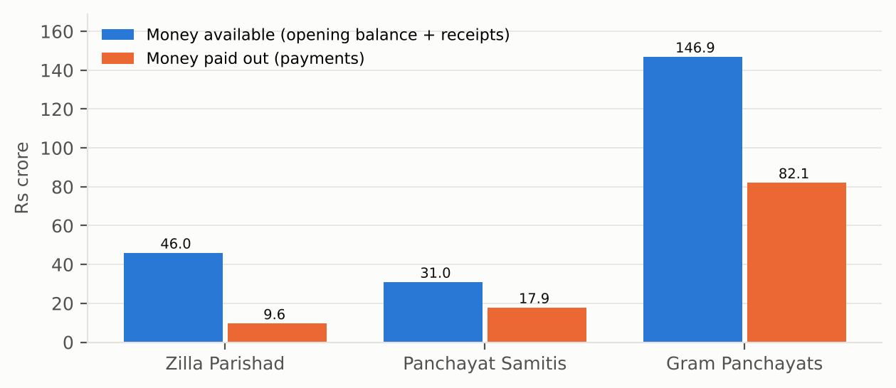
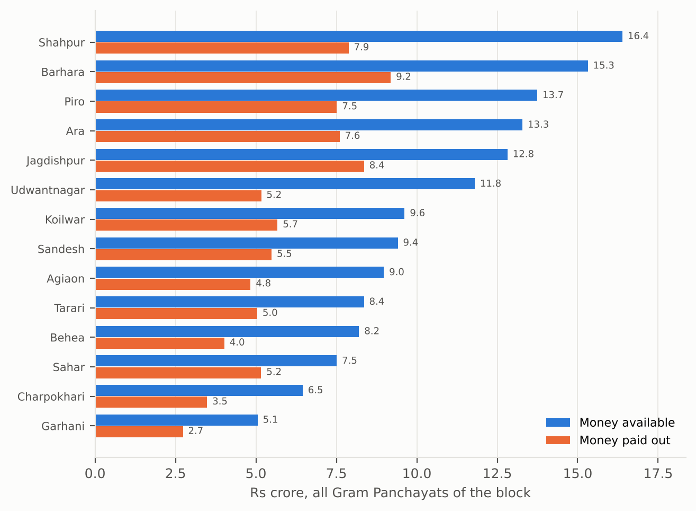
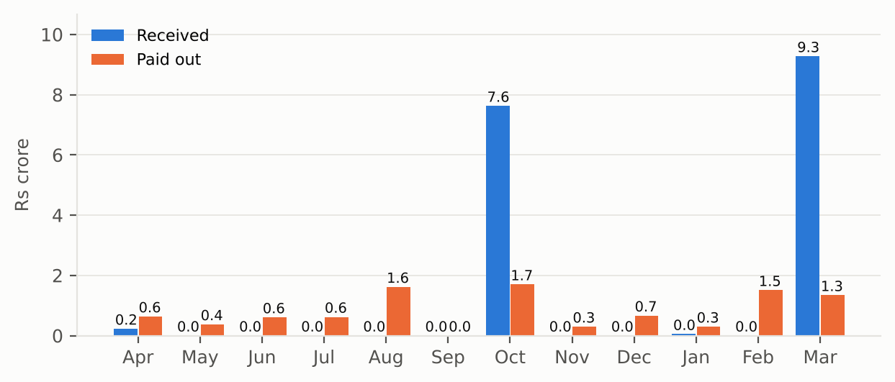

# Bhojpur District: Panchayat Finances and Accounts, 2023-24

A plain-language district profile from the Government of India's eGramSwaraj system · India By Numbers · data as published by the portal (district statement generated April 4, 2025 12:53 AM)

## 1. The main points

- **Bhojpur has 14 Panchayat Samitis (block councils) and 226 Gram Panchayats (village councils)** in the 2023-24 accounts, plus one Zilla Parishad (district council).
- **In 2023-24 its Panchayats together had Rs 223.96 crore available and paid out Rs 109.63 crore (49%).**
- **The Gram Panchayats had Rs 146.93 crore available and paid out Rs 82.13 crore (56%).** Rank among Bihar's districts: **20 of 38** for money available to Gram Panchayats, **17 of 38** for money paid out by them.
- **An average Gram Panchayat in Bhojpur had about Rs 65.0 lakh available and paid out about Rs 36.3 lakh** in the year (district totals divided by 226 Gram Panchayats).
- **Almost all the money is the 15th Finance Commission grant** (scheme-wise statement, all levels). Sources listed for Bhojpur: XV Finance Commission-XVFC 100.0%; own resources-OWN none.
- **Annual accounts are complete:** 226 of 226 Gram Panchayats, 14 of 14 Panchayat Samitis and the Zilla Parishad (closed) have closed their year book in the system.
- **Official village-by-village figures for this year are on the portal but not yet collected;** they are a planned follow-up collection.

## 2. How to read the money words

| Term | Meaning |
|---|---|
| **Money available** (portal: *OB + Receipts*) | Money left from last year (opening balance) plus money received during the year |
| **Money paid out** (portal: *Payments*) | Payments made from the Panchayat's own accounts during the year |
| **Crore / lakh** | 1 crore = 100 lakh = Rs 1,00,00,000 |

Payments are only what passed through Panchayat accounts. They are **not** all government spending in the district (state departments pay for many works directly).

## 3. Money at each level of Panchayat

| Level | Bodies | Money available (Rs crore) | Paid out (Rs crore) | Paid out as share | Bhojpur's share of Bihar (available) |
|---|---|---|---|---|---|
| Zilla Parishad (district council) | 1 | 46.030 | 9.633 | 21% | 2% of Rs 1,867 crore |
| Panchayat Samitis (block councils) | 14 | 31.003 | 17.866 | 58% | 2% of Rs 1,349 crore |
| Gram Panchayats (village councils) | 226 | 146.930 | 82.129 | 56% | 3% of Rs 5,736 crore |
| **All levels** | | **223.963** | **109.628** | **49%** | |

Source: District wise Receipt and Payment Statement, 2023-24, Bihar (generated April 4, 2025 12:53 AM).

## 4. Block by block

Figures for the Panchayat Samiti (block council) itself and for all Gram Panchayats of the block together.

| Block | Gram Panchayats | Gram Panchayats: available (Rs crore) | Gram Panchayats: paid out | Share paid | Panchayat Samiti: available | Panchayat Samiti: paid out |
|---|---|---|---|---|---|---|
| Agiaon | 15 | 8.975 | 4.833 | 54% | 1.344 | 0.832 |
| Ara | 19 | 13.283 | 7.602 | 57% | 3.813 | 1.911 |
| Barhara | 22 | 15.315 | 9.190 | 60% | 3.938 | 1.981 |
| Behea | 14 | 8.205 | 4.018 | 49% | 1.685 | 0.652 |
| Charpokhari | 11 | 6.452 | 3.482 | 54% | 1.207 | 0.797 |
| Garhani | 8 | 5.052 | 2.730 | 54% | 1.517 | 0.964 |
| Jagdishpur | 20 | 12.818 | 8.359 | 65% | 2.110 | 1.935 |
| Koilwar | 17 | 9.620 | 5.671 | 59% | 3.652 | 2.702 |
| Piro | 22 | 13.742 | 7.514 | 55% | 3.769 | 1.453 |
| Sahar | 12 | 7.510 | 5.162 | 69% | 0.617 | 0.204 |
| Sandesh | 11 | 9.409 | 5.485 | 58% | 2.291 | 1.396 |
| Shahpur | 20 | 16.391 | 7.880 | 48% | 2.398 | 1.475 |
| Tarari | 19 | 8.356 | 5.040 | 60% | 1.237 | 0.940 |
| Udwantnagar | 16 | 11.801 | 5.164 | 44% | 1.426 | 0.624 |

The blocks' Gram Panchayat figures add up to Rs 146.930 crore (district statement: Rs 146.930 crore). The largest is **Shahpur** (Rs 16.39 crore across 20 GPs), the smallest **Garhani** (Rs 5.05 crore). The share of money paid out ranges from 44% to 69% across the 14 blocks with money (middle block: 56%). Blocks differ in the number and size of their Panchayats, so a larger amount does not by itself mean better or worse performance.

## 5. The Zilla Parishad month by month

The district council (Zilla Parishad) started the year with **Rs 28.85 crore** carried over, received **Rs 17.18 crore** during the year and paid out **Rs 9.66 crore** (Rs 0.03 crore of payments were later cancelled or rejected, leaving Rs 9.63 crore). This matches the annual statement.

| Month | Received (Rs lakh) | Paid out (Rs lakh) | Payment vouchers |
|---|---|---|---|
| April, 2023 | 22.68 | 63.61 | 33 |
| May, 2023 | 0.00 | 37.38 | 7 |
| June, 2023 | 0.00 | 60.62 | 16 |
| July, 2023 | 0.00 | 62.20 | 15 |
| August, 2023 | 0.00 | 161.62 | 155 |
| September, 2023 | 0.00 | 0.00 | 0 |
| October, 2023 | 762.41 | 169.93 | 142 |
| November, 2023 | 0.00 | 29.67 | 7 |
| December, 2023 | 0.00 | 66.53 | 32 |
| Januaury, 2024 | 4.95 | 29.73 | 6 |
| February, 2024 | 0.00 | 150.85 | 33 |
| March, 2024 | 927.58 | 134.15 | 76 |

Month names are shown exactly as the portal prints them.

The busiest month for payments was **October, 2023** (Rs 1.70 crore). Source: Month Wise Payment and Receipt Statement (generated February 5, 2025 1:09 PM) and Month wise Summary Report (generated April 4, 2025 6:56 AM).

## 6. Where the money comes from

| Source (as named by the portal) | Zilla Parishad | Panchayat Samitis | Gram Panchayats |
|---|---|---|---|
| XV Finance Commission-XVFC | 100% of receipts | 100% of receipts | 100% of receipts |
| own resources-OWN | 0 | 0 | 0 |

Only the 2 source(s) above are listed for the district. Shares are calculated from the scheme-wise statement (generated October 25, 2024 3:31 AM; November 23, 2023 1:08 AM). The same report counts 1,432 receipt vouchers and 6,429 payment vouchers for Bhojpur's Gram Panchayats under the XV FC grant.

## 7. How well the books are kept

| | Zilla Parishad | Panchayat Samitis | Gram Panchayats |
|---|---|---|---|
| Number | 1 | 14 | 226 |
| Masters and opening balance entered | yes / yes | 14 / 14 | 226 / 226 |
| Receipt vouchers recorded | 16 | 138 | 1,432 |
| Payment vouchers recorded | 522 | 1,283 | 6,429 |
| Day book closed | yes | 14 of 14 | 226 of 226 |
| Month book closed | yes | 14 of 14 | 226 of 226 |
| Year book (annual accounts) closed | yes | 14 of 14 | 226 of 226 |

On average each Gram Panchayat recorded about 28 payment vouchers in the year. Source: District Wise Summary Report (generated April 4, 2025 12:56 AM).

## 8. What this profile cannot tell you

| Not available | Why |
|---|---|
| Official figures for each Gram Panchayat in 2023-24 | Published on the portal; not yet collected (planned follow-up collection). |
| Population or households of the district's Panchayats | Not in any open eGramSwaraj report, so no per-person figures |
| Who each payment went to (the payee or vendor of each voucher) | On the individual voucher page, behind a security check (CAPTCHA); not collected. The public voucher lists (number, date, type, amount) are collected so far only for Patna; for this district they can be collected from India with `scripts/run_vouchers.py` |
| Elected members of this district | Collected for Bihar as a whole only; district figures are a planned follow-up |
| Value of approved development plans | Only whether a plan was uploaded is public |
| Money left unspent at year end | Not printed as an official figure |

## 9. About these figures

- Every figure is copied from the government's own eGramSwaraj reports and was checked against the original pages in the data validation (Task 5). Totals in this profile add up to the portal's own totals.
- Each report is a snapshot taken on the date shown; later reports for the same year can differ slightly because accounts keep being updated.
- District code 184; block and Gram Panchayat codes are the portal's own. Data collected November 2026 from egramswaraj.gov.in. Machine-readable tables: `data/validated/egs/`.
- Reports for Bhojpur in other years: `docs/district_reports/bhojpur/index.md`; all districts: `docs/district_reports/README.md`.

