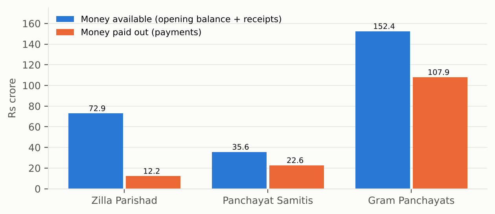
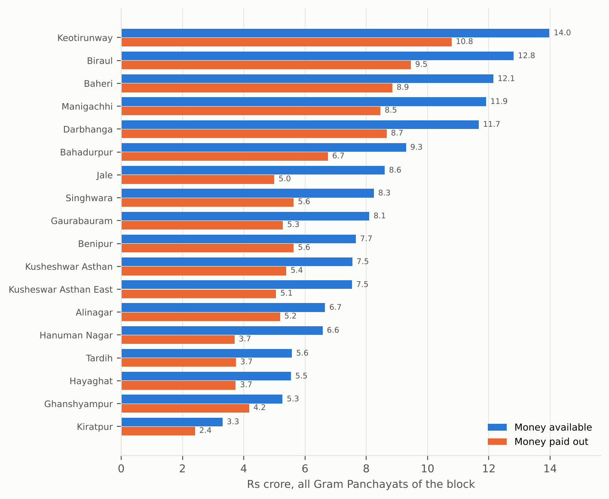
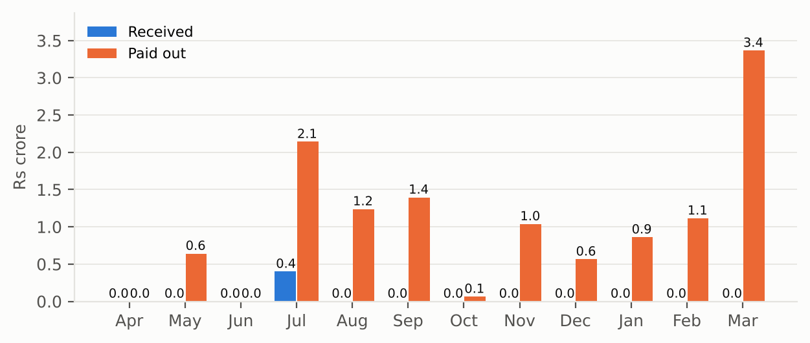

# Darbhanga District: Panchayat Finances and Accounts, 2024-25

A plain-language district profile from the Government of India's eGramSwaraj system · India By Numbers · data as published by the portal (district statement generated November 21, 2026 12:59 AM)

## 1. The main points

- **Darbhanga has 18 Panchayat Samitis (block councils) and 308 Gram Panchayats (village councils)** in the 2024-25 accounts, plus one Zilla Parishad (district council).
- **In 2024-25 its Panchayats together had Rs 260.91 crore available and paid out Rs 142.73 crore (55%).**
- **The Gram Panchayats had Rs 152.41 crore available and paid out Rs 107.90 crore (71%).** Rank among Bihar's districts: **8 of 38** for money available to Gram Panchayats, **7 of 38** for money paid out by them.
- **An average Gram Panchayat in Darbhanga had about Rs 49.5 lakh available and paid out about Rs 35.0 lakh** in the year (district totals divided by 308 Gram Panchayats).
- **Almost all the money is the 15th Finance Commission grant** (scheme-wise statement, all levels). Sources listed for Darbhanga: XV Finance Commission-XVFC 100.0%; own resources-OWN none.
- **Annual accounts are complete:** 308 of 308 Gram Panchayats, 18 of 18 Panchayat Samitis and the Zilla Parishad (closed) have closed their year book in the system.
- **Official figures for each of the 308 Gram Panchayats are in the Appendix.**

## 2. How to read the money words

| Term | Meaning |
|---|---|
| **Money available** (portal: *OB + Receipts*) | Money left from last year (opening balance) plus money received during the year |
| **Money paid out** (portal: *Payments*) | Payments made from the Panchayat's own accounts during the year |
| **Crore / lakh** | 1 crore = 100 lakh = Rs 1,00,00,000 |

Payments are only what passed through Panchayat accounts. They are **not** all government spending in the district (state departments pay for many works directly).

## 3. Money at each level of Panchayat

| Level | Bodies | Money available (Rs crore) | Paid out (Rs crore) | Paid out as share | Darbhanga's share of Bihar (available) |
|---|---|---|---|---|---|
| Zilla Parishad (district council) | 1 | 72.912 | 12.189 | 17% | 4% of Rs 1,885 crore |
| Panchayat Samitis (block councils) | 18 | 35.588 | 22.640 | 64% | 3% of Rs 1,029 crore |
| Gram Panchayats (village councils) | 308 | 152.414 | 107.902 | 71% | 4% of Rs 4,222 crore |
| **All levels** | | **260.914** | **142.731** | **55%** | |

Source: District wise Receipt and Payment Statement, 2024-25, Bihar (generated November 21, 2026 12:59 AM).

## 4. Block by block

Figures for the Panchayat Samiti (block council) itself and for all Gram Panchayats of the block together.

| Block | Gram Panchayats | Gram Panchayats: available (Rs crore) | Gram Panchayats: paid out | Share paid | Panchayat Samiti: available | Panchayat Samiti: paid out |
|---|---|---|---|---|---|---|
| Alinagar | 11 | 6.654 | 5.185 | 78% | 1.431 | 1.118 |
| Bahadurpur | 23 | 9.296 | 6.749 | 73% | 2.291 | 1.664 |
| Baheri | 25 | 12.150 | 8.851 | 73% | 2.532 | 1.205 |
| Benipur | 16 | 7.658 | 5.630 | 74% | 1.472 | 0.793 |
| Biraul | 25 | 12.811 | 9.457 | 74% | 4.991 | 2.328 |
| Darbhanga | 23 | 11.672 | 8.666 | 74% | 1.727 | 1.278 |
| Gaurabauram | 13 | 8.097 | 5.278 | 65% | 0.702 | 0.654 |
| Ghanshyampur | 10 | 5.265 | 4.178 | 79% | 0.556 | 0.504 |
| Hanuman Nagar | 14 | 6.574 | 3.698 | 56% | 1.020 | 1.019 |
| Hayaghat | 12 | 5.542 | 3.738 | 67% | 1.827 | 0.638 |
| Jale | 21 | 8.602 | 4.997 | 58% | 1.272 | 1.032 |
| Keotirunway | 26 | 13.978 | 10.783 | 77% | 4.071 | 2.798 |
| Kiratpur | 8 | 3.309 | 2.409 | 73% | 1.002 | 0.350 |
| Kusheshwar Asthan | 14 | 7.543 | 5.389 | 71% | 3.084 | 2.577 |
| Kusheswar Asthan East | 9 | 7.531 | 5.055 | 67% | 1.434 | 0.951 |
| Manigachhi | 22 | 11.912 | 8.462 | 71% | 3.058 | 1.867 |
| Singhwara | 22 | 8.250 | 5.628 | 68% | 1.025 | 1.022 |
| Tardih | 14 | 5.571 | 3.749 | 67% | 2.093 | 0.842 |

The blocks' Gram Panchayat figures add up to Rs 152.414 crore (district statement: Rs 152.414 crore). The largest is **Keotirunway** (Rs 13.98 crore across 26 GPs), the smallest **Kiratpur** (Rs 3.31 crore). The share of money paid out ranges from 56% to 79% across the 18 blocks with money (middle block: 72%). Blocks differ in the number and size of their Panchayats, so a larger amount does not by itself mean better or worse performance.

## 5. The Zilla Parishad month by month

The district council (Zilla Parishad) started the year with **Rs 72.51 crore** carried over, received **Rs 0.40 crore** during the year and paid out **Rs 12.43 crore** (Rs 0.24 crore of payments were later cancelled or rejected, leaving Rs 12.19 crore). This matches the annual statement.

| Month | Received (Rs lakh) | Paid out (Rs lakh) | Payment vouchers |
|---|---|---|---|
| April, 2024 | 0.00 | 0.00 | 0 |
| May, 2024 | 0.00 | 64.09 | 44 |
| June, 2024 | 0.00 | 0.00 | 0 |
| July, 2024 | 40.00 | 214.20 | 143 |
| August, 2024 | 0.00 | 123.86 | 115 |
| September, 2024 | 0.00 | 139.55 | 94 |
| October, 2024 | 0.00 | 6.39 | 11 |
| November, 2024 | 0.00 | 103.82 | 48 |
| December, 2024 | 0.00 | 56.51 | 42 |
| Januaury, 2025 | 0.00 | 86.13 | 29 |
| February, 2025 | 0.00 | 111.48 | 42 |
| March, 2025 | 0.00 | 336.61 | 185 |

Month names are shown exactly as the portal prints them.

The busiest month for payments was **March, 2025** (Rs 3.37 crore). Source: Month Wise Payment and Receipt Statement (generated November 5, 2026 7:59 PM) and Month wise Summary Report (generated November 21, 2026 8:14 PM).

## 6. Where the money comes from

| Source (as named by the portal) | Zilla Parishad | Panchayat Samitis | Gram Panchayats |
|---|---|---|---|
| XV Finance Commission-XVFC | 100% of receipts | 100% of receipts | 100% of receipts |
| own resources-OWN | 0 | 0 | 0 |

Only the 2 source(s) above are listed for the district. Shares are calculated from the scheme-wise statement (generated March 7, 2025 12:45 AM; October 8, 2025 3:34 AM). The same report counts 1,539 receipt vouchers and 18,109 payment vouchers for Darbhanga's Gram Panchayats under the XV FC grant.

## 7. How well the books are kept

| | Zilla Parishad | Panchayat Samitis | Gram Panchayats |
|---|---|---|---|
| Number | 1 | 18 | 308 |
| Masters and opening balance entered | yes / yes | 18 / 18 | 308 / 308 |
| Receipt vouchers recorded | 57 | 221 | 1,539 |
| Payment vouchers recorded | 753 | 2,843 | 18,109 |
| Day book closed | yes | 18 of 18 | 308 of 308 |
| Month book closed | yes | 18 of 18 | 308 of 308 |
| Year book (annual accounts) closed | yes | 18 of 18 | 308 of 308 |

On average each Gram Panchayat recorded about 59 payment vouchers in the year. Source: District Wise Summary Report (generated November 21, 2026 12:50 AM).

## 8. What this profile cannot tell you

| Not available | Why |
|---|---|
| Population or households of the district's Panchayats | Not in any open eGramSwaraj report, so no per-person figures |
| Who each payment went to (the payee or vendor of each voucher) | On the individual voucher page, behind a security check (CAPTCHA); not collected. The public voucher lists (number, date, type, amount) are collected so far only for Patna; for this district they can be collected from India with `scripts/run_vouchers.py` |
| Elected members of this district | Collected for Bihar as a whole only; district figures are a planned follow-up |
| Value of approved development plans | Only whether a plan was uploaded is public |
| Money left unspent at year end | Not printed as an official figure |

## 9. About these figures

- Every figure is copied from the government's own eGramSwaraj reports and was checked against the original pages in the data validation (Task 5). Totals in this profile add up to the portal's own totals.
- Each report is a snapshot taken on the date shown; later reports for the same year can differ slightly because accounts keep being updated.
- District code 186; block and Gram Panchayat codes are the portal's own. Data collected November 2026 from egramswaraj.gov.in. Machine-readable tables: `data/validated/egs/`.
- Reports for Darbhanga in other years: `docs/district_reports/darbhanga/index.md`; all districts: `docs/district_reports/README.md`.

## Appendix: every Gram Panchayat of Darbhanga, 2024-25

Amounts in Rs lakh. **Official receipts / payments** are from the Village wise Receipt and Payment Statement (generated November 21, 2026 4:34 AM); they are the figures to quote. 308 Gram Panchayats are shown; the district statement counts 308.

| Block | Gram Panchayat | Code | Official receipts | Official payments |
|---|---|---|---|---|
| Alinagar | Adhloam | 95111 | 56.66 | 43.93 |
| Alinagar | Alinagar | 95112 | 60.49 | 54.60 |
| Alinagar | Dhamura Dhamsain | 95113 | 66.96 | 37.72 |
| Alinagar | Garoul | 95114 | 71.23 | 69.23 |
| Alinagar | Hanuman Nagar | 95115 | 54.79 | 30.16 |
| Alinagar | Hariyath | 95116 | 53.31 | 43.27 |
| Alinagar | Harsing Pur | 95117 | 80.02 | 57.93 |
| Alinagar | Mohiudinpur Pakri | 95118 | 70.92 | 52.03 |
| Alinagar | Moti Pur | 95119 | 58.19 | 52.38 |
| Alinagar | Narma Navnagar | 95120 | 50.72 | 42.30 |
| Alinagar | Tumaul Suhath Lahta | 95121 | 42.14 | 34.91 |
| Bahadurpur | Bahadurpur Dekuli | 95122 | 26.82 | 15.46 |
| Bahadurpur | Bajid Pur | 95123 | 34.67 | 31.42 |
| Bahadurpur | Baruara | 95124 | 32.42 | 29.56 |
| Bahadurpur | Basat Pur | 95125 | 36.98 | 33.20 |
| Bahadurpur | Biuni Andama | 95126 | 38.19 | 37.20 |
| Bahadurpur | Darhar | 95127 | 47.41 | 27.93 |
| Bahadurpur | Dilabar Pur | 95128 | 38.90 | 38.40 |
| Bahadurpur | Hari Patti | 95129 | 63.16 | 39.28 |
| Bahadurpur | Jalwara | 95130 | 23.33 | 21.59 |
| Bahadurpur | Khaira | 95131 | 51.60 | 31.41 |
| Bahadurpur | Kharaj Pur | 95132 | 64.52 | 45.11 |
| Bahadurpur | Kusothar | 95133 | 17.12 | 11.65 |
| Bahadurpur | Maniyari | 95134 | 35.44 | 28.85 |
| Bahadurpur | Meknabeda | 95135 | 44.70 | 37.70 |
| Bahadurpur | Ojhoul | 95136 | 29.79 | 26.64 |
| Bahadurpur | Pirri | 95137 | 34.05 | 27.28 |
| Bahadurpur | Premjiwar | 95138 | 56.80 | 39.66 |
| Bahadurpur | Rambhadra Pur | 95139 | 18.63 | 12.74 |
| Bahadurpur | Simra Nehal Pur | 95140 | 24.46 | 23.80 |
| Bahadurpur | Taralahi | 95141 | 49.68 | 44.30 |
| Bahadurpur | Tikapatti | 95142 | 41.42 | 25.54 |
| Bahadurpur | Ughara | 95143 | 88.94 | 31.00 |
| Bahadurpur | Ughra Mahapara | 95144 | 30.61 | 15.16 |
| Baheri | Atahar North | 95145 | 29.89 | 28.46 |
| Baheri | Atahar South | 95146 | 67.96 | 58.92 |
| Baheri | Baghouni | 95147 | 41.07 | 33.80 |
| Baheri | Baligaon | 95150 | 52.50 | 47.38 |
| Baheri | Bhachhi | 95151 | 49.83 | 40.41 |
| Baheri | Bithouli | 95152 | 45.14 | 31.10 |
| Baheri | Chakwa Bharwari | 95153 | 92.65 | 41.27 |
| Baheri | Dhanouli | 95154 | 30.27 | 16.06 |
| Baheri | Dohat Narain | 95155 | 39.06 | 23.34 |
| Baheri | Enai | 95156 | 55.58 | 33.51 |
| Baheri | Gangdah Sheoram | 95157 | 38.22 | 33.94 |
| Baheri | Gujrouli Ramouli | 95158 | 31.01 | 29.71 |
| Baheri | Harhacha | 95159 | 36.93 | 31.65 |
| Baheri | Hathouri North | 95160 | 36.13 | 36.02 |
| Baheri | Hathouri South | 95161 | 38.37 | 23.87 |
| Baheri | Havidih North | 95162 | 32.16 | 30.00 |
| Baheri | Hawidih Middle | 95163 | 49.99 | 44.26 |
| Baheri | Hawidih South | 95164 | 45.93 | 41.54 |
| Baheri | Jorja | 95165 | 76.27 | 63.05 |
| Baheri | Mithunia | 95166 | 60.47 | 26.55 |
| Baheri | Nimaithi | 95167 | 32.55 | 26.40 |
| Baheri | Paghari | 95168 | 54.23 | 45.58 |
| Baheri | Samadhpura | 95169 | 62.68 | 45.37 |
| Baheri | Susari Turki | 95170 | 76.32 | 14.82 |
| Baheri | Thathopur | 95171 | 39.74 | 38.06 |
| Benipur | Batho Radhiyam | 95174 | 29.80 | 28.77 |
| Benipur | Devram Amethi | 95177 | 70.92 | 56.06 |
| Benipur | Ganesh Banaul Balni | 95179 | 74.63 | 39.27 |
| Benipur | Haripur | 95180 | 29.94 | 29.87 |
| Benipur | Havi Bhouar | 95181 | 53.44 | 46.31 |
| Benipur | Jarison | 95182 | 61.66 | 30.57 |
| Benipur | Madhopur Mahamdpur | 95183 | 59.53 | 33.28 |
| Benipur | Mahinam | 95184 | 113.71 | 58.01 |
| Benipur | Makram Pur | 95186 | 21.47 | 20.91 |
| Benipur | Nawada | 95187 | 34.77 | 24.21 |
| Benipur | Pohadi West | 95188 | 49.89 | 46.47 |
| Benipur | Ramouli | 95189 | 46.91 | 45.46 |
| Benipur | Sajaupura | 95190 | 26.66 | 21.26 |
| Benipur | Sajhuar | 95191 | 39.96 | 31.21 |
| Benipur | Shivram | 95192 | 29.19 | 28.98 |
| Benipur | Tarouni | 95193 | 23.28 | 22.33 |
| Biraul | Akbarpur Benk | 95195 | 16.07 | 15.15 |
| Biraul | Arga Usari | 95196 | 77.54 | 59.99 |
| Biraul | Bairampur | 95197 | 45.89 | 34.58 |
| Biraul | Bhawanipur | 95198 | 63.76 | 48.41 |
| Biraul | Biraul | 95199 | 40.52 | 29.92 |
| Biraul | Dekuli Jagnathpur | 95200 | 48.01 | 38.69 |
| Biraul | Dumari | 95201 | 22.43 | 15.65 |
| Biraul | Ganaura Tarwara | 95202 | 60.74 | 30.86 |
| Biraul | Itwa Shiv Nagar | 95203 | 29.04 | 24.27 |
| Biraul | Kahua | 95204 | 16.86 | 14.85 |
| Biraul | Kamarkala | 95205 | 60.49 | 50.55 |
| Biraul | Ladaho | 95206 | 30.26 | 25.50 |
| Biraul | Manor Bhauram | 95207 | 46.91 | 31.06 |
| Biraul | Neuri | 95208 | 87.63 | 60.14 |
| Biraul | Parri | 95209 | 38.84 | 34.37 |
| Biraul | Pataniya | 95210 | 58.48 | 24.08 |
| Biraul | Pokhram North | 95211 | 105.41 | 91.36 |
| Biraul | Pokhram South | 95212 | 92.44 | 53.08 |
| Biraul | Ramnagar | 95213 | 32.37 | 32.13 |
| Biraul | Rohar Mahmuda | 95214 | 41.74 | 38.19 |
| Biraul | Sahasram | 95215 | 39.00 | 33.48 |
| Biraul | Saho | 95216 | 89.54 | 72.26 |
| Biraul | Sonpur Paghari | 95217 | 26.52 | 15.37 |
| Biraul | Supaul | 95218 | 37.03 | 29.52 |
| Biraul | Uchati | 95219 | 73.52 | 42.20 |
| Darbhanga | Adalpur | 95220 | 54.47 | 41.91 |
| Darbhanga | Atihar | 95221 | 43.01 | 36.13 |
| Darbhanga | Balha | 95222 | 47.69 | 42.80 |
| Darbhanga | Basudevpur | 95223 | 44.02 | 43.22 |
| Darbhanga | Bhalpatti | 95224 | 85.35 | 35.65 |
| Darbhanga | Bijuli | 95225 | 55.61 | 50.25 |
| Darbhanga | Chhotaipatti | 95226 | 43.24 | 33.31 |
| Darbhanga | Dhoi | 95227 | 52.20 | 49.41 |
| Darbhanga | Dularpur | 95228 | 31.53 | 24.00 |
| Darbhanga | Ghorghatta | 95229 | 58.91 | 40.17 |
| Darbhanga | Kabirchak | 95230 | 30.27 | 27.15 |
| Darbhanga | Kansi | 95231 | 62.64 | 38.10 |
| Darbhanga | Kharua | 95232 | 59.04 | 20.68 |
| Darbhanga | Khutwara | 95233 | 29.13 | 24.66 |
| Darbhanga | Loam | 95234 | 42.46 | 42.36 |
| Darbhanga | Muria | 95235 | 79.81 | 56.76 |
| Darbhanga | Nainaghat | 95236 | 64.55 | 42.75 |
| Darbhanga | Ranipur | 95237 | 33.13 | 20.91 |
| Darbhanga | Saramahmad | 95239 | 73.91 | 50.16 |
| Darbhanga | Shahbajpur | 95238 | 53.06 | 33.74 |
| Darbhanga | Shisho East | 95240 | 39.61 | 36.49 |
| Darbhanga | Shisho West | 95241 | 32.91 | 28.87 |
| Darbhanga | Sonki | 95242 | 50.60 | 47.08 |
| Gaurabauram | Aadharpur | 95244 | 67.86 | 60.37 |
| Gaurabauram | Aasi | 95243 | 40.91 | 19.80 |
| Gaurabauram | Bagrasi | 95245 | 70.19 | 57.48 |
| Gaurabauram | Bauram | 95246 | 27.36 | 21.99 |
| Gaurabauram | Goramansingh | 95247 | 81.99 | 39.39 |
| Gaurabauram | Kanhai | 95248 | 66.82 | 51.39 |
| Gaurabauram | Kasraur Basauli | 95249 | 40.01 | 29.39 |
| Gaurabauram | Kasraur Belwara | 95250 | 74.03 | 35.11 |
| Gaurabauram | Kasraur Karkauli | 95255 | 44.83 | 43.52 |
| Gaurabauram | Kumai Bhadaun | 95251 | 53.45 | 32.99 |
| Gaurabauram | Mansara | 95252 | 143.05 | 63.43 |
| Gaurabauram | Nadai | 95253 | 47.26 | 33.94 |
| Gaurabauram | Nari | 95254 | 51.99 | 39.01 |
| Ghanshyampur | Borhiab Inyatpur | 95256 | 39.30 | 36.08 |
| Ghanshyampur | Brahmpur Maswasi | 95257 | 69.22 | 37.54 |
| Ghanshyampur | Ganoun | 95258 | 61.46 | 39.84 |
| Ghanshyampur | Jaideopatti | 95260 | 50.35 | 38.81 |
| Ghanshyampur | Kortho East | 95261 | 50.67 | 42.83 |
| Ghanshyampur | Kortho West | 95262 | 34.50 | 27.94 |
| Ghanshyampur | Pohadi Bela | 95264 | 68.91 | 57.86 |
| Ghanshyampur | Punhad | 95265 | 48.12 | 40.50 |
| Ghanshyampur | Salahpur Lagma | 95266 | 58.53 | 57.57 |
| Ghanshyampur | Tumoul | 95267 | 45.45 | 38.82 |
| Hanuman Nagar | Araila | 95268 | 45.57 | 37.72 |
| Hanuman Nagar | Dihlahi | 95269 | 32.08 | 20.31 |
| Hanuman Nagar | Godai Patti | 95270 | 80.02 | 46.69 |
| Hanuman Nagar | Gorhalla | 95271 | 30.90 | 25.37 |
| Hanuman Nagar | Gorhiyari | 95272 | 63.10 | 28.99 |
| Hanuman Nagar | Moro | 95273 | 33.91 | 18.76 |
| Hanuman Nagar | Narsara | 95274 | 24.49 | 23.58 |
| Hanuman Nagar | Neyam Chhatouna | 95275 | 49.47 | 18.39 |
| Hanuman Nagar | Panchobh | 95276 | 124.21 | 26.79 |
| Hanuman Nagar | Patori | 95277 | 31.06 | 27.38 |
| Hanuman Nagar | Rampur Dih | 95278 | 27.45 | 12.58 |
| Hanuman Nagar | Rupouli | 95279 | 51.64 | 33.36 |
| Hanuman Nagar | Sinuara | 95280 | 34.08 | 29.70 |
| Hanuman Nagar | Thalwara | 95281 | 29.41 | 20.16 |
| Hayaghat | Anand Pur Sahora | 95282 | 34.87 | 22.35 |
| Hayaghat | Chandan Patti | 95283 | 74.07 | 67.39 |
| Hayaghat | Ghosrama | 95284 | 23.94 | 20.46 |
| Hayaghat | Majhoulia | 95285 | 23.89 | 12.70 |
| Hayaghat | Malhi Patti North | 95286 | 51.39 | 27.55 |
| Hayaghat | Malhi Patti South | 95287 | 43.14 | 19.79 |
| Hayaghat | Mirja Pur | 95288 | 40.32 | 19.78 |
| Hayaghat | Pator | 95289 | 49.50 | 19.90 |
| Hayaghat | Pouram | 95290 | 72.12 | 33.19 |
| Hayaghat | Rasalpur | 95291 | 40.03 | 36.69 |
| Hayaghat | Shri Rampur | 95292 | 51.85 | 45.83 |
| Hayaghat | Sidhouli | 95293 | 49.06 | 48.18 |
| Jale | Ahiyari South | 95296 | 69.26 | 16.89 |
| Jale | Bandhouli | 95298 | 52.16 | 29.33 |
| Jale | Barampur (E) | 95299 | 35.70 | 21.13 |
| Jale | Brahmapur West | 95300 | 49.41 | 30.40 |
| Jale | Dhadhiya | 95301 | 28.78 | 15.98 |
| Jale | Doghra | 95302 | 36.22 | 21.04 |
| Jale | JALLEY EAST | 95305 | 27.27 | 21.77 |
| Jale | Kachhua | 95307 | 30.49 | 12.20 |
| Jale | Karwa Tariyani | 95309 | 24.71 | 10.84 |
| Jale | Katraul Basant | 95310 | 33.10 | 22.19 |
| Jale | Kazi Bahera | 95311 | 28.28 | 27.00 |
| Jale | Massa | 95312 | 38.28 | 28.09 |
| Jale | Muraitha | 95313 | 73.06 | 38.39 |
| Jale | Radai (N) | 95314 | 40.49 | 25.28 |
| Jale | Radhi East | 95315 | 32.07 | 31.21 |
| Jale | Radhi South | 95316 | 45.67 | 15.85 |
| Jale | Rarhi West | 95317 | 42.29 | 31.68 |
| Jale | Ratanpur | 95318 | 29.00 | 13.76 |
| Jale | Reorha | 95319 | 51.27 | 37.18 |
| Jale | Sahaspur | 95320 | 51.21 | 33.70 |
| Jale | Yogiara | 95321 | 41.46 | 15.84 |
| Keotirunway | Asraha | 95322 | 71.63 | 62.35 |
| Keotirunway | Bansara | 95323 | 32.08 | 30.18 |
| Keotirunway | Barahi | 95324 | 58.54 | 39.52 |
| Keotirunway | Bariaul | 95325 | 21.76 | 14.42 |
| Keotirunway | Chhachha Pachadhi | 95326 | 80.45 | 47.83 |
| Keotirunway | Chhatwan | 95327 | 47.11 | 42.81 |
| Keotirunway | Dighiyar | 95328 | 14.10 | 4.94 |
| Keotirunway | Jalwara | 95329 | 34.51 | 30.58 |
| Keotirunway | Karjapatti | 95330 | 74.66 | 61.38 |
| Keotirunway | Keoti | 95331 | 53.81 | 51.50 |
| Keotirunway | Khirma | 95332 | 53.81 | 33.05 |
| Keotirunway | Koila Asthan | 95333 | 70.44 | 62.21 |
| Keotirunway | Kothia | 95334 | 57.06 | 41.00 |
| Keotirunway | Ladari | 95335 | 87.65 | 54.27 |
| Keotirunway | Lahwar | 95336 | 54.28 | 47.69 |
| Keotirunway | Lalganj | 95337 | 68.22 | 35.91 |
| Keotirunway | Madho Patti | 95338 | 59.69 | 46.39 |
| Keotirunway | Majhigama | 95339 | 53.19 | 27.59 |
| Keotirunway | Nanaura | 95340 | 47.00 | 44.19 |
| Keotirunway | Naya Gaon East | 95341 | 56.80 | 48.14 |
| Keotirunway | Naya Gaon West | 95342 | 25.07 | 24.56 |
| Keotirunway | Paigambarpur | 95343 | 79.23 | 44.89 |
| Keotirunway | Pindaruch | 95344 | 48.69 | 47.83 |
| Keotirunway | Rajaura | 95345 | 41.86 | 40.95 |
| Keotirunway | Sarjapur | 95346 | 50.84 | 49.79 |
| Keotirunway | Shekhpur Dani | 95347 | 55.37 | 44.34 |
| Kiratpur | Jamalpur | 95348 | 24.01 | 22.83 |
| Kiratpur | Jhagarua Tarwara | 95349 | 38.75 | 14.92 |
| Kiratpur | Jhagrua | 95350 | 38.12 | 33.63 |
| Kiratpur | Khaisa Jamalpur | 95351 | 53.35 | 44.73 |
| Kiratpur | Kiratpur | 95352 | 36.60 | 33.67 |
| Kiratpur | Kuboul Dhagha | 95353 | 34.58 | 20.09 |
| Kiratpur | Narkatia Bhandara | 95354 | 34.80 | 25.69 |
| Kiratpur | Rasiari Pauni | 95355 | 70.64 | 45.34 |
| Kusheshwar Asthan | Aurahi | 95356 | 76.43 | 44.30 |
| Kusheshwar Asthan | Bargawn | 95357 | 86.90 | 45.81 |
| Kusheshwar Asthan | Barna | 95358 | 45.98 | 38.58 |
| Kusheshwar Asthan | Beri | 95359 | 68.05 | 26.41 |
| Kusheshwar Asthan | Bhadahar | 95360 | 49.26 | 35.19 |
| Kusheshwar Asthan | Bisaharia Mohim Bujurg | 95361 | 44.95 | 34.58 |
| Kusheshwar Asthan | Chigri Simraha | 95362 | 52.67 | 51.63 |
| Kusheshwar Asthan | Dinmo | 95363 | 44.23 | 34.65 |
| Kusheshwar Asthan | Gothani | 95364 | 72.20 | 66.61 |
| Kusheshwar Asthan | Harauli | 95365 | 42.76 | 26.18 |
| Kusheshwar Asthan | Harinagar | 95366 | 49.74 | 39.08 |
| Kusheshwar Asthan | Hirni | 95367 | 45.70 | 37.04 |
| Kusheshwar Asthan | Masankhon | 95368 | 31.04 | 27.05 |
| Kusheshwar Asthan | Pakahi Jhajhra | 95369 | 44.40 | 31.81 |
| Kusheswar Asthan East | Bhindua | 95370 | 73.02 | 71.16 |
| Kusheswar Asthan East | Itahar | 95371 | 96.30 | 66.49 |
| Kusheswar Asthan East | K. Sthan (S) | 95372 | 33.24 | 24.24 |
| Kusheswar Asthan East | Kewatgama | 95374 | 97.30 | 47.60 |
| Kusheswar Asthan East | Mahisauth | 95375 | 44.42 | 25.11 |
| Kusheswar Asthan East | Sughrain | 95376 | 104.89 | 61.30 |
| Kusheswar Asthan East | Tilkeshwar | 95377 | 105.26 | 79.14 |
| Kusheswar Asthan East | Ujua Simartoka | 95378 | 79.30 | 38.02 |
| Kusheswar Asthan East | Usari | 95379 | 119.35 | 92.46 |
| Manigachhi | Baghant | 95380 | 55.74 | 46.36 |
| Manigachhi | Balaur | 95381 | 45.22 | 40.70 |
| Manigachhi | Bazid Pur | 95382 | 86.38 | 61.04 |
| Manigachhi | Bhandarison | 95383 | 79.74 | 12.40 |
| Manigachhi | Bramhpur | 95384 | 31.09 | 23.03 |
| Manigachhi | Bramhpura Bhatpura | 95385 | 43.14 | 30.64 |
| Manigachhi | Chanaur | 95386 | 26.02 | 22.38 |
| Manigachhi | Gangauli Kanakpur | 95387 | 86.46 | 73.58 |
| Manigachhi | Jagdishpur | 95388 | 32.54 | 23.02 |
| Manigachhi | Katma Bahaurawa | 95389 | 96.29 | 92.28 |
| Manigachhi | Maubehat | 95390 | 47.67 | 41.58 |
| Manigachhi | Nehara West | 95391 | 34.88 | 13.20 |
| Manigachhi | Nehra East | 95392 | 43.93 | 35.86 |
| Manigachhi | Paiktol Jatuka | 95393 | 95.75 | 56.09 |
| Manigachhi | Paithan Kabai | 95394 | 54.39 | 49.41 |
| Manigachhi | Raghopur East | 95396 | 34.02 | 30.64 |
| Manigachhi | Raghopur North | 95395 | 88.29 | 65.09 |
| Manigachhi | Raghopur South | 95397 | 48.60 | 25.61 |
| Manigachhi | Raghopur West | 95398 | 56.22 | 13.26 |
| Manigachhi | Raje | 95399 | 41.40 | 31.07 |
| Manigachhi | Tatuar | 95400 | 36.83 | 33.26 |
| Manigachhi | Ujan | 95401 | 26.58 | 25.69 |
| Singhwara | Arai Birdipur | 95402 | 35.46 | 30.71 |
| Singhwara | Asthua | 95403 | 29.39 | 15.76 |
| Singhwara | Banauli | 95404 | 44.25 | 32.76 |
| Singhwara | Bharathi | 95405 | 31.73 | 26.58 |
| Singhwara | Bharhulli | 95406 | 36.39 | 24.40 |
| Singhwara | Bhawanipur | 95408 | 39.35 | 30.02 |
| Singhwara | Harihar Pur (E) | 95409 | 35.81 | 30.90 |
| Singhwara | Hariharpur (West) | 95410 | 37.38 | 22.70 |
| Singhwara | Harpur | 95411 | 21.36 | 14.09 |
| Singhwara | Kaligawn | 95412 | 25.55 | 20.53 |
| Singhwara | Katassa | 95413 | 47.86 | 33.97 |
| Singhwara | Katka | 95414 | 31.29 | 26.99 |
| Singhwara | Madhopur Bastwara | 95415 | 30.89 | 20.63 |
| Singhwara | Mankauli | 95416 | 36.04 | 28.91 |
| Singhwara | Nista | 95417 | 35.15 | 29.62 |
| Singhwara | Rajo | 95418 | 53.53 | 24.13 |
| Singhwara | Rampura | 95419 | 68.37 | 22.66 |
| Singhwara | Sadhwara | 95420 | 36.62 | 27.29 |
| Singhwara | Sanahpur | 95421 | 29.52 | 19.04 |
| Singhwara | Shankar Pur | 95422 | 30.03 | 22.13 |
| Singhwara | Simri | 95423 | 36.77 | 29.19 |
| Singhwara | Tektar | 95426 | 52.28 | 29.81 |
| Tardih | Baika | 95427 | 54.40 | 44.23 |
| Tardih | Bisahath Bathia | 95428 | 52.80 | 12.64 |
| Tardih | Ijarahta | 95429 | 44.25 | 35.29 |
| Tardih | Kaithwar | 95430 | 26.06 | 18.53 |
| Tardih | Kakodha | 95431 | 43.30 | 35.85 |
| Tardih | Kathara | 95432 | 22.24 | 20.78 |
| Tardih | Kursomachota | 95433 | 32.03 | 17.51 |
| Tardih | Lagma | 95434 | 26.65 | 24.06 |
| Tardih | Mahthaur | 95435 | 48.90 | 35.37 |
| Tardih | Nadiami Kurson | 95436 | 41.77 | 9.33 |
| Tardih | Pokhar Bhinda | 95437 | 50.47 | 47.63 |
| Tardih | Rajakhar War | 95438 | 42.21 | 15.42 |
| Tardih | Sherpur Narayanpur | 95439 | 37.08 | 27.31 |
| Tardih | Thengaha | 95440 | 34.97 | 30.97 |

Official Gram Panchayat figures above add up to Rs 152.41 crore received and Rs 107.90 crore paid out.

