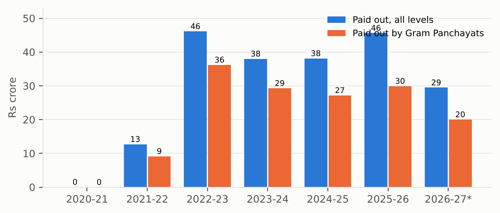

# Jehanabad District: Panchayat Finance Reports, Year by Year

India By Numbers · from the Government of India's eGramSwaraj system · one detailed report per financial year · [all districts](../README.md)

## The reports

| Financial year | Detailed report | What it contains |
|---|---|---|
| 2026-27 | [report.pdf](2026-2027/report.pdf) ([text](2026-2027/report.md)) | district, blocks, Zilla Parishad by month, sources, bookkeeping |
| 2025-26 | [report.pdf](2025-2026/report.pdf) ([text](2025-2026/report.md)) | district, blocks, Zilla Parishad by month, sources, bookkeeping |
| 2024-25 | [report.pdf](2024-2025/report.pdf) ([text](2024-2025/report.md)) | district, blocks, Zilla Parishad by month, sources, bookkeeping, official figures of every Gram Panchayat |
| 2023-24 | [report.pdf](2023-2024/report.pdf) ([text](2023-2024/report.md)) | district, blocks, Zilla Parishad by month, sources, bookkeeping |
| 2022-23 | [report.pdf](2022-2023/report.pdf) ([text](2022-2023/report.md)) | district, blocks, Zilla Parishad by month, sources, bookkeeping |
| 2021-22 | [report.pdf](2021-2022/report.pdf) ([text](2021-2022/report.md)) | district, blocks, Zilla Parishad by month, sources, bookkeeping |
| 2020-21 | [report.pdf](2020-2021/report.pdf) ([text](2020-2021/report.md)) | district, blocks, Zilla Parishad by month, sources, bookkeeping, official figures of every Gram Panchayat |
| 2019-20 | no report | all amounts on the portal are zero for every Bihar district, most likely because the accounts for this year were not entered in eGramSwaraj. This means **no data**, not proof that nothing was spent |
| 2018-19 | no report | all amounts on the portal are zero for every Bihar district, most likely because the accounts for this year were not entered in eGramSwaraj. This means **no data**, not proof that nothing was spent |
| 2017-18 | no report | all amounts on the portal are zero for every Bihar district, most likely because the accounts for this year were not entered in eGramSwaraj. This means **no data**, not proof that nothing was spent |
| 2016-17 | no report | all amounts on the portal are zero for every Bihar district, most likely because the accounts for this year were not entered in eGramSwaraj. This means **no data**, not proof that nothing was spent |

## Year by year at a glance

| Year | Received (Rs crore, old layout) | Available: OB + receipts (Rs crore) | Paid out, all levels (Rs crore) | Paid out by Gram Panchayats (Rs crore) | Gram Panchayats | Year book closed (GPs) |
|---|---|---|---|---|---|---|
| 2020-21 | 10.97 | — | 0.03 | 0.00 | 93 | 87 |
| 2021-22 | — | 59.40 | 12.71 | 9.13 | 93 | 92 |
| 2022-23 | — | 95.62 | 46.12 | 36.22 | 93 | 90 |
| 2023-24 | — | 90.08 | 38.01 | 29.28 | 93 | 88 |
| 2024-25 | — | 75.91 | 38.12 | 27.17 | 88 | 88 |
| 2025-26 | — | 88.10 | 45.63 | 29.92 | 88 | 88 |
| 2026-27 | — | 56.17 | 29.48 | 20.02 | 88 | 0 |

The 2020-21 statement printed *Receipts* in rupees; from 2021-22 the portal shows *OB + Receipts* (opening balance plus receipts) in crore. They are different measures, so they sit in different columns and should not be compared. *Payments* carry the same label in both layouts. The latest year is still running, so its figures are partial.

\* still running.

## How to use these reports

- Each report starts with **the main points** in plain words; the later sections give the detail.
- The **Appendix** of each report lists every Gram Panchayat where the portal's village statement was collected (2020-21, 2024-25).
- **No names of payees, vendors or residents** appear anywhere.
- Figures are copied from the portal and checked against the original pages (Task 5). Each report is a snapshot taken on the date shown in it.
