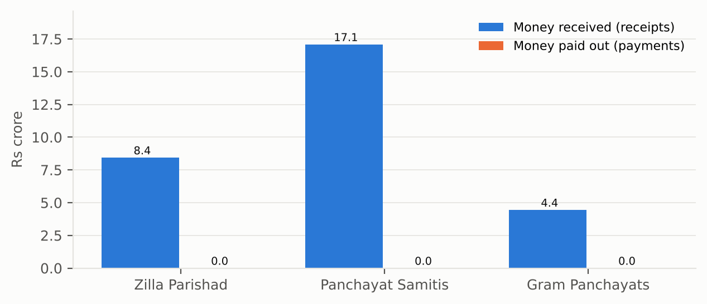
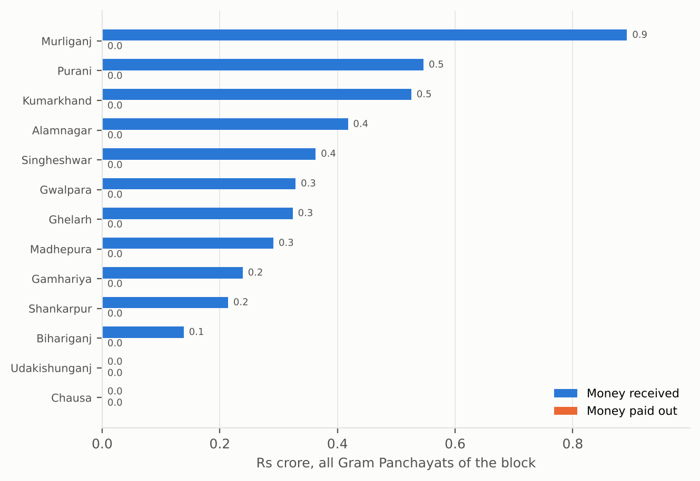
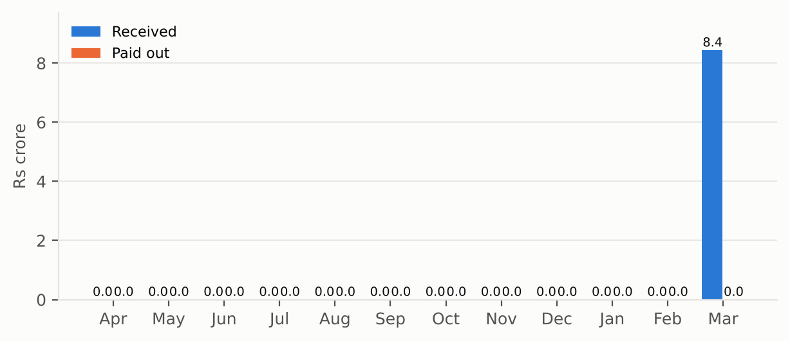

# Madhepura District: Panchayat Finances and Accounts, 2020-21

A plain-language district profile from the Government of India's eGramSwaraj system · India By Numbers · data as published by the portal (district statement generated July 18, 2022 2:27 AM)

## 1. The main points

- **Madhepura has 13 Panchayat Samitis (block councils) and 170 Gram Panchayats (village councils)** in the 2020-21 accounts, plus one Zilla Parishad (district council).
- **In 2020-21 its Panchayats together received Rs 29.96 crore and paid out Rs 0.00 crore.** (This year's statement uses a different measure from later years; see section 2.)
- **The Gram Panchayats had Rs 4.44 crore of receipts and paid out Rs 0.00 crore (0%).** Rank among Bihar's districts: **16 of 38** for money received by Gram Panchayats, **none (26 of 38 districts show none)** for money paid out by them.
- **An average Gram Panchayat in Madhepura had about Rs 2.6 lakh of receipts and paid out about Rs 0.0 lakh** in the year (district totals divided by 170 Gram Panchayats).
- **Almost all the money is the 15th Finance Commission grant** (scheme-wise statement, all levels). Sources listed for Madhepura: XV Finance Commission-XVFC 100.0%.
- **Annual accounts are not complete:** 157 of 170 Gram Panchayats, 13 of 13 Panchayat Samitis and the Zilla Parishad (closed) have closed their year book in the system.
- **Official figures for each of the 170 Gram Panchayats are in the Appendix.**

## 2. How to read the money words

| Term | Meaning |
|---|---|
| **Money received** (portal: *Receipts*) | Money received during the year, as printed in rupees in the 2020-21 statement. The report does not say whether last year's balance is included |
| **Money paid out** (portal: *Payments*) | Payments made from the Panchayat's own accounts during the year |
| **Crore / lakh** | 1 crore = 100 lakh = Rs 1,00,00,000 |

**Important:** from 2021-22 the portal changed this statement to *OB + Receipts* in crore. The 2020-21 *Receipts* figure is a different measure, so it should not be compared directly with the *money available* of later years.

Payments are only what passed through Panchayat accounts. They are **not** all government spending in the district (state departments pay for many works directly).

## 3. Money at each level of Panchayat

| Level | Bodies | Money received (Rs crore) | Paid out (Rs crore) | Paid out as share | Madhepura's share of Bihar (received) |
|---|---|---|---|---|---|
| Zilla Parishad (district council) | 1 | 8.437 | 0.000 | 0% | 3% of Rs 321 crore |
| Panchayat Samitis (block councils) | 13 | 17.083 | 0.000 | 0% | 5% of Rs 375 crore |
| Gram Panchayats (village councils) | 170 | 4.441 | 0.000 | 0% | 2% of Rs 235 crore |
| **All levels** | | **29.961** | **0.000** | **0%** | |

Source: District wise Receipt and Payment Statement, 2020-21, Bihar (generated July 18, 2022 2:27 AM); amounts printed in rupees, shown here in crore.

## 4. Block by block

Figures for the Panchayat Samiti (block council) itself and for all Gram Panchayats of the block together.

| Block | Gram Panchayats | Gram Panchayats: received (Rs crore) | Gram Panchayats: paid out | Share paid | Panchayat Samiti: received | Panchayat Samiti: paid out |
|---|---|---|---|---|---|---|
| Alamnagar | 14 | 0.418 | 0.000 | 0% | 1.536 | 0.000 |
| Bihariganj | 12 | 0.139 | 0.000 | 0% | 1.184 | 0.000 |
| Chausa | 13 | 0.000 | 0.000 | — | 1.306 | 0.000 |
| Gamhariya | 8 | 0.239 | 0.000 | 0% | 0.830 | 0.000 |
| Ghelarh | 9 | 0.324 | 0.000 | 0% | 1.386 | 0.000 |
| Gwalpara | 12 | 0.329 | 0.000 | 0% | 0.385 | 0.000 |
| Kumarkhand | 21 | 0.525 | 0.000 | 0% | 1.537 | 0.000 |
| Madhepura | 17 | 0.291 | 0.000 | 0% | 1.559 | 0.000 |
| Murliganj | 17 | 0.892 | 0.000 | 0% | 1.569 | 0.000 |
| Purani | 9 | 0.546 | 0.000 | 0% | 0.951 | 0.000 |
| Shankarpur | 9 | 0.214 | 0.000 | 0% | 0.660 | 0.000 |
| Singheshwar | 13 | 0.363 | 0.000 | 0% | 1.189 | 0.000 |
| Udakishunganj | 16 | 0.000 | 0.000 | — | 2.991 | 0.000 |

The blocks' Gram Panchayat figures add up to Rs 4.280 crore (district statement: Rs 4.441 crore). The largest is **Murliganj** (Rs 0.89 crore across 17 GPs), the smallest **Chausa** (Rs 0.00 crore). None of the 11 blocks with money shows any Gram Panchayat payment. In 2 of 13 blocks the Gram Panchayats show no money at all for this year. Blocks differ in the number and size of their Panchayats, so a larger amount does not by itself mean better or worse performance.

## 5. The Zilla Parishad month by month

The district council (Zilla Parishad) started the year with **Rs 0.00 crore** carried over, received **Rs 8.44 crore** during the year and paid out **Rs 0.00 crore**. This matches the annual statement.

| Month | Received (Rs lakh) | Paid out (Rs lakh) | Payment vouchers |
|---|---|---|---|
| April, 2020 | 0.00 | 0.00 | 0 |
| May, 2020 | 0.00 | 0.00 | 0 |
| June, 2020 | 0.00 | 0.00 | 0 |
| July, 2020 | 0.00 | 0.00 | 0 |
| August, 2020 | 0.00 | 0.00 | 0 |
| September, 2020 | 0.00 | 0.00 | 0 |
| October, 2020 | 0.00 | 0.00 | 0 |
| November, 2020 | 0.00 | 0.00 | 0 |
| December, 2020 | 0.00 | 0.00 | 0 |
| Januaury, 2021 | 0.00 | 0.00 | 0 |
| February, 2021 | 0.00 | 0.00 | 0 |
| March, 2021 | 843.66 | 0.00 | 0 |

Month names are shown exactly as the portal prints them.
 Source: Month Wise Payment and Receipt Statement (generated July 18, 2022 4:05 AM) and Month wise Summary Report (generated July 18, 2022 4:29 AM).

## 6. Where the money comes from

| Source (as named by the portal) | Zilla Parishad | Panchayat Samitis | Gram Panchayats |
|---|---|---|---|
| XV Finance Commission-XVFC | 100% of receipts | 100% of receipts | 100% of receipts |

Only the 1 source(s) above are listed for the district. Shares are calculated from the scheme-wise statement (generated August 20, 2021 6:50 AM). The same report counts 340 receipt vouchers and 5 payment vouchers for Madhepura's Gram Panchayats under the XV FC grant.

## 7. How well the books are kept

| | Zilla Parishad | Panchayat Samitis | Gram Panchayats |
|---|---|---|---|
| Number | 1 | 13 | 170 |
| Masters and opening balance entered | yes / yes | 13 / 13 | 157 / 157 |
| Receipt vouchers recorded | 9 | 103 | 340 |
| Payment vouchers recorded | 0 | 1 | 5 |
| Day book closed | yes | 13 of 13 | 157 of 170 |
| Month book closed | yes | 13 of 13 | 157 of 170 |
| Year book (annual accounts) closed | yes | 13 of 13 | 157 of 170 |

On average each Gram Panchayat recorded about 0 payment vouchers in the year. Source: District Wise Summary Report (generated July 18, 2022 2:31 AM).

## 8. What this profile cannot tell you

| Not available | Why |
|---|---|
| Population or households of the district's Panchayats | Not in any open eGramSwaraj report, so no per-person figures |
| Who each payment went to (the payee or vendor of each voucher) | On the individual voucher page, behind a security check (CAPTCHA); not collected. The public voucher lists (number, date, type, amount) are collected so far only for Patna; for this district they can be collected from India with `scripts/run_vouchers.py` |
| Elected members of this district | Collected for Bihar as a whole only; district figures are a planned follow-up |
| Value of approved development plans | Only whether a plan was uploaded is public |
| Money left unspent at year end | Not printed as an official figure |

## 9. About these figures

- Every figure is copied from the government's own eGramSwaraj reports and was checked against the original pages in the data validation (Task 5). Totals in this profile add up to the portal's own totals.
- Each report is a snapshot taken on the date shown; later reports for the same year can differ slightly because accounts keep being updated.
- District code 196; block and Gram Panchayat codes are the portal's own. Data collected November 2026 from egramswaraj.gov.in. Machine-readable tables: `data/validated/egs/`.
- Reports for Madhepura in other years: `docs/district_reports/madhepura/index.md`; all districts: `docs/district_reports/README.md`.

## Appendix: every Gram Panchayat of Madhepura, 2020-21

Amounts in Rs lakh. **Official receipts / payments** are from the Village wise Receipt and Payment Statement (generated July 18, 2022 3:58 AM); they are the figures to quote. 170 Gram Panchayats are shown; the district statement counts 170.

| Block | Gram Panchayat | Code | Official receipts | Official payments |
|---|---|---|---|---|
| Alamnagar | ALAM NAGAR ( N ) | 96976 | 3.62 | 0.00 |
| Alamnagar | ALAMNAGAR(E) | 96977 | 0.99 | 0.00 |
| Alamnagar | ALAMNAGAR(S) | 96978 | 0.11 | 0.00 |
| Alamnagar | Bargawn | 96979 | 7.10 | 0.00 |
| Alamnagar | Basanbara | 96980 | 0.00 | 0.00 |
| Alamnagar | Bispatti | 96981 | 0.35 | 0.00 |
| Alamnagar | Gangapur | 96982 | 7.16 | 0.00 |
| Alamnagar | Itahri | 96983 | 6.05 | 0.00 |
| Alamnagar | Khapur | 96984 | 5.46 | 0.00 |
| Alamnagar | Khurhan | 96985 | 5.89 | 0.00 |
| Alamnagar | Kishan Pur Ratwara | 96986 | 6.43 | 0.00 |
| Alamnagar | Kunjauri | 96987 | 0.00 | 0.00 |
| Alamnagar | Narthua Bhagipur | 96988 | 0.00 | 0.00 |
| Alamnagar | Singhar | 96989 | 3.34 | 0.00 |
| Bihariganj | Babhangama | 96990 | 0.25 | 0.00 |
| Bihariganj | BIHARIGANJ | 96991 | 0.02 | 0.00 |
| Bihariganj | Gamail | 96992 | 0.00 | 0.00 |
| Bihariganj | Hathioundha | 96993 | 0.37 | 0.00 |
| Bihariganj | KUSTHAN | 96994 | 0.05 | 0.00 |
| Bihariganj | Laxmipur Lalchand | 96995 | 3.50 | 0.00 |
| Bihariganj | Madhukarchak | 96996 | 0.03 | 0.00 |
| Bihariganj | Mohanpur | 96997 | 0.00 | 0.00 |
| Bihariganj | Parariya | 96998 | 0.67 | 0.00 |
| Bihariganj | Rajganj | 96999 | 2.27 | 0.00 |
| Bihariganj | Shekhpura | 97000 | 5.69 | 0.00 |
| Bihariganj | Tulsiya | 97001 | 1.09 | 0.00 |
| Chausa | Arajpur East | 97002 | 0.00 | 0.00 |
| Chausa | Arajpur West | 97003 | 0.00 | 0.00 |
| Chausa | Chirouri | 97004 | 0.00 | 0.00 |
| Chausa | Chousa East | 97005 | 0.00 | 0.00 |
| Chausa | Chousa West | 97006 | 0.00 | 0.00 |
| Chausa | Fulout East | 97007 | 0.00 | 0.00 |
| Chausa | Fulout West | 97008 | 0.00 | 0.00 |
| Chausa | Ghoshai | 97009 | 0.00 | 0.00 |
| Chausa | Laualagan East | 97010 | 0.00 | 0.00 |
| Chausa | Laualagan West | 97011 | 0.00 | 0.00 |
| Chausa | Morsanda | 97012 | 0.00 | 0.00 |
| Chausa | Paina | 97013 | 0.00 | 0.00 |
| Chausa | Rasalpur Dhuria | 97014 | 0.00 | 0.00 |
| Gamhariya | Aurahi - Ekparha | 97015 | 0.00 | 0.00 |
| Gamhariya | Babhni | 97016 | 5.75 | 0.00 |
| Gamhariya | Bhelwa | 97017 | 0.00 | 0.00 |
| Gamhariya | Chikni | 97018 | 9.36 | 0.00 |
| Gamhariya | Gamhariya | 97019 | 0.00 | 0.00 |
| Gamhariya | Itwa - Jiwachhpur | 97020 | 8.78 | 0.00 |
| Gamhariya | Jiwachhpur | 97021 | 0.00 | 0.00 |
| Gamhariya | Kaurihar - Tarawe | 97022 | 0.00 | 0.00 |
| Ghelarh | Araha Mahuwa Dighara | 97023 | 0.00 | 0.00 |
| Ghelarh | Bardaha | 97024 | 0.00 | 0.00 |
| Ghelarh | Bhantakthi | 97025 | 5.04 | 0.00 |
| Ghelarh | Bhatrandha Parmanpur | 97026 | 10.36 | 0.00 |
| Ghelarh | Chitti | 97027 | 0.00 | 0.00 |
| Ghelarh | Ghailar | 97028 | 9.33 | 0.00 |
| Ghelarh | Jhitkiya | 97029 | 0.00 | 0.00 |
| Ghelarh | Ratan Pura | 97030 | 0.00 | 0.00 |
| Ghelarh | Srinagar | 97031 | 7.65 | 0.00 |
| Gwalpara | Birgawn Chatara | 97032 | 1.50 | 0.00 |
| Gwalpara | Biswari | 97033 | 1.91 | 0.00 |
| Gwalpara | Gwalpara | 97034 | 1.56 | 0.00 |
| Gwalpara | Jhalari | 97035 | 2.91 | 0.00 |
| Gwalpara | Jhitakia Kaloutaha | 97036 | 4.25 | 0.00 |
| Gwalpara | Khokasi | 97037 | 0.00 | 0.00 |
| Gwalpara | Pirnagar | 97038 | 0.22 | 0.00 |
| Gwalpara | Reshana | 97039 | 7.69 | 0.00 |
| Gwalpara | Sarauni | 97040 | 7.86 | 0.00 |
| Gwalpara | Shahpur | 97041 | 0.78 | 0.00 |
| Gwalpara | Sukhasan | 97042 | 2.88 | 0.00 |
| Gwalpara | Tema Bhela | 97043 | 1.31 | 0.00 |
| Kumarkhand | Basiadh | 97044 | 0.90 | 0.00 |
| Kumarkhand | Belari | 97045 | 0.02 | 0.00 |
| Kumarkhand | Bishan Pur Sundar | 97046 | 4.39 | 0.00 |
| Kumarkhand | Bishanpur Bajar | 97047 | 0.00 | 0.00 |
| Kumarkhand | Bishunpur Korlahi | 97048 | 0.21 | 0.00 |
| Kumarkhand | Isarain Bela | 97049 | 0.01 | 0.00 |
| Kumarkhand | Isarain Kala | 97050 | 0.00 | 0.00 |
| Kumarkhand | Isarain Khurd | 97051 | 7.11 | 0.00 |
| Kumarkhand | Kumar Khand | 97052 | 0.72 | 0.00 |
| Kumarkhand | Laxmi Pur Chandi Asthan | 97053 | 6.96 | 0.00 |
| Kumarkhand | Laxmipur Bhagwati | 97054 | 0.01 | 0.00 |
| Kumarkhand | Maganwara | 97055 | 7.01 | 0.00 |
| Kumarkhand | Parmanand Pur | 97056 | 1.55 | 0.00 |
| Kumarkhand | Puraini | 97057 | 7.10 | 0.00 |
| Kumarkhand | Rahta | 97058 | 0.94 | 0.00 |
| Kumarkhand | Ramnagar Mahesh | 97059 | 0.08 | 0.00 |
| Kumarkhand | Rani Pati Sukhasan | 97060 | 5.89 | 0.00 |
| Kumarkhand | Raouta | 97061 | 7.14 | 0.00 |
| Kumarkhand | Sihpur Gadhiya | 97062 | 0.15 | 0.00 |
| Kumarkhand | Tegraha Sikiyaha | 97063 | 2.30 | 0.00 |
| Kumarkhand | Tengraha Parihari | 97064 | 0.07 | 0.00 |
| Madhepura | Balam Gadhiya | 97065 | 0.00 | 0.00 |
| Madhepura | Barahi | 97066 | 0.00 | 0.00 |
| Madhepura | Bhadaul Budhma | 97067 | 0.00 | 0.00 |
| Madhepura | Bhelwa | 97068 | 0.00 | 0.00 |
| Madhepura | Dhurgaon | 97069 | 0.00 | 0.00 |
| Madhepura | Khopaiti Tuniyahi | 97070 | 0.00 | 0.00 |
| Madhepura | Madanpur | 97071 | 6.58 | 0.00 |
| Madhepura | Madhuban | 97072 | 0.00 | 0.00 |
| Madhepura | Maheshua | 97073 | 9.62 | 0.00 |
| Madhepura | Manikpur | 97074 | 0.00 | 0.00 |
| Madhepura | Mathahi | 97075 | 0.00 | 0.00 |
| Madhepura | Murho | 97076 | 0.00 | 0.00 |
| Madhepura | Sahugarh -1 | 97077 | 6.50 | 0.00 |
| Madhepura | Sahugarh -2 | 97078 | 6.41 | 0.00 |
| Madhepura | Sakarpura Betauna | 97079 | 0.00 | 0.00 |
| Madhepura | Sukhasan | 97080 | 0.00 | 0.00 |
| Madhepura | Tulsibari Rajpur Maliya | 97081 | 0.00 | 0.00 |
| Murliganj | Belo | 97082 | 0.00 | 0.00 |
| Murliganj | Bhatkhora | 97083 | 4.63 | 0.00 |
| Murliganj | Dighi | 97085 | 5.05 | 0.00 |
| Murliganj | Dinapatti Sakhua | 97084 | 6.81 | 0.00 |
| Murliganj | Gangapur | 97086 | 6.71 | 0.00 |
| Murliganj | Haripur Kala | 97088 | 6.45 | 0.00 |
| Murliganj | Jitapur | 97087 | 0.00 | 0.00 |
| Murliganj | Jorgama | 97089 | 6.72 | 0.00 |
| Murliganj | Kolhaiptti Dumariya | 97090 | 5.42 | 0.00 |
| Murliganj | Nadhi | 97091 | 7.19 | 0.00 |
| Murliganj | Parwa Navtol | 97092 | 6.47 | 0.00 |
| Murliganj | Pokhram Parmanandpur | 97093 | 6.24 | 0.00 |
| Murliganj | Raghunathpur | 97094 | 5.26 | 0.00 |
| Murliganj | Rajni | 97095 | 9.51 | 0.00 |
| Murliganj | Rampur | 97096 | 0.00 | 0.00 |
| Murliganj | Singiyan | 97097 | 6.39 | 0.00 |
| Murliganj | Tamot Parsa | 97098 | 6.37 | 0.00 |
| Purani | Aurai | 97099 | 0.32 | 0.00 |
| Purani | Banshgopal | 97100 | 7.66 | 0.00 |
| Purani | Durgapur | 97101 | 4.53 | 0.00 |
| Purani | Ganeshpur | 97102 | 8.85 | 0.00 |
| Purani | Kursandi | 97103 | 8.06 | 0.00 |
| Purani | Makdampur | 97104 | 6.51 | 0.00 |
| Purani | Nardah | 97105 | 3.18 | 0.00 |
| Purani | Puraini | 97106 | 7.86 | 0.00 |
| Purani | Sapardah | 97107 | 7.66 | 0.00 |
| Shankarpur | Behrari | 97108 | 0.00 | 0.00 |
| Shankarpur | Giddha | 97109 | 2.32 | 0.00 |
| Shankarpur | Jirwa Madheli | 97110 | 6.73 | 0.00 |
| Shankarpur | Moura Jharkaha | 97111 | 6.65 | 0.00 |
| Shankarpur | Moura Kabiyahi | 97112 | 2.91 | 0.00 |
| Shankarpur | Parsa | 97113 | 0.00 | 0.00 |
| Shankarpur | Raibhir | 97114 | 0.00 | 0.00 |
| Shankarpur | Rampur Lahi | 97115 | 2.80 | 0.00 |
| Shankarpur | Sonbarsha | 97116 | 0.00 | 0.00 |
| Singheshwar | Baihari | 97117 | 0.00 | 0.00 |
| Singheshwar | Bhawanipur | 97118 | 1.21 | 0.00 |
| Singheshwar | Dular Piprahi | 97119 | 3.26 | 0.00 |
| Singheshwar | GOURI PUR | 97120 | 4.04 | 0.00 |
| Singheshwar | Ithari Gehumani | 97121 | 6.55 | 0.00 |
| Singheshwar | Jajhat Sabaila | 97122 | 8.83 | 0.00 |
| Singheshwar | Kamar Gama | 97123 | 2.45 | 0.00 |
| Singheshwar | Lalpur Saro Patti | 97124 | 8.11 | 0.00 |
| Singheshwar | Manpur | 97125 | 0.00 | 0.00 |
| Singheshwar | Patori | 97126 | 0.00 | 0.00 |
| Singheshwar | Rupoli | 97127 | 0.00 | 0.00 |
| Singheshwar | SINGHESHWAR | 97128 | 7.34 | 0.00 |
| Singheshwar | Sukhasan | 97129 | 5.88 | 0.00 |
| Udakishunganj | Barahi Anandpur A | 97130 | 0.00 | 0.00 |
| Udakishunganj | Biriranpal | 97131 | 0.00 | 0.00 |
| Udakishunganj | Budhma | 97132 | 0.00 | 0.00 |
| Udakishunganj | Gopalpur | 97133 | 0.00 | 0.00 |
| Udakishunganj | Jotaili | 97134 | 0.00 | 0.00 |
| Udakishunganj | Khara | 97135 | 0.00 | 0.00 |
| Udakishunganj | KISHUNGANJ | 97136 | 0.00 | 0.00 |
| Udakishunganj | Laskari | 97137 | 0.00 | 0.00 |
| Udakishunganj | LAXMIPUR | 97138 | 0.00 | 0.00 |
| Udakishunganj | Madhuban | 97139 | 0.00 | 0.00 |
| Udakishunganj | Manjaura | 97140 | 0.00 | 0.00 |
| Udakishunganj | Nayanagar | 97141 | 0.00 | 0.00 |
| Udakishunganj | Pipra Karauti | 97142 | 0.00 | 0.00 |
| Udakishunganj | RAHTA FANHAN | 97143 | 0.00 | 0.00 |
| Udakishunganj | RAMPUR KHORA | 97144 | 0.00 | 0.00 |
| Udakishunganj | Sahjadpur | 97145 | 0.00 | 0.00 |

Official Gram Panchayat figures above add up to Rs 4.44 crore received and Rs 0.00 crore paid out.

