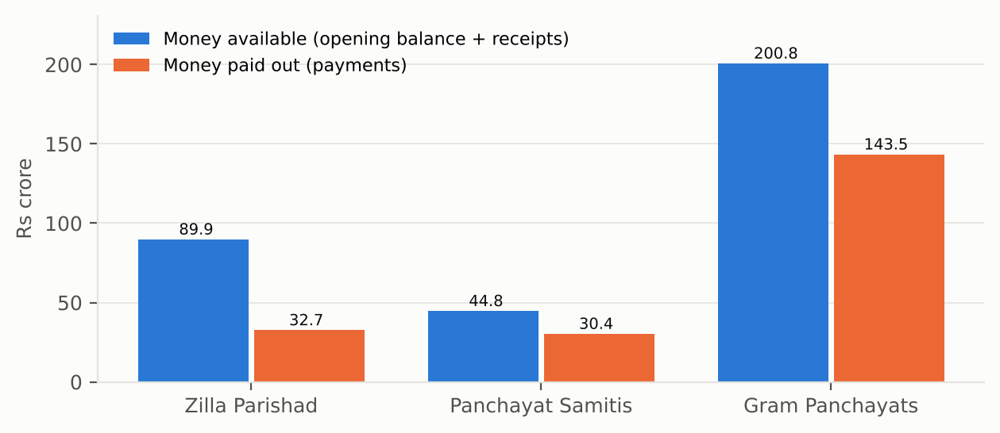
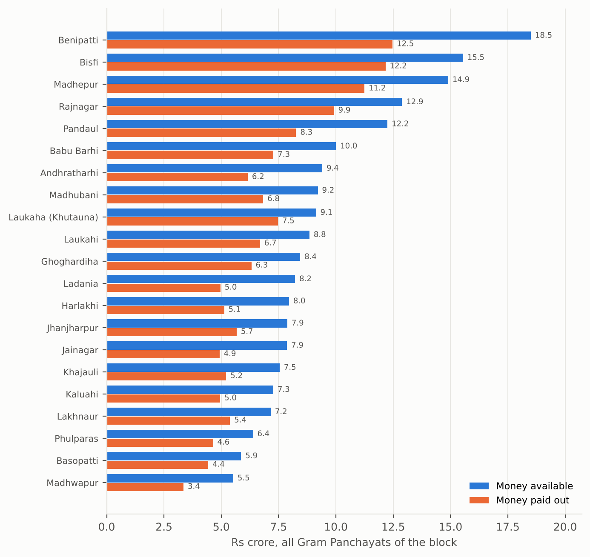
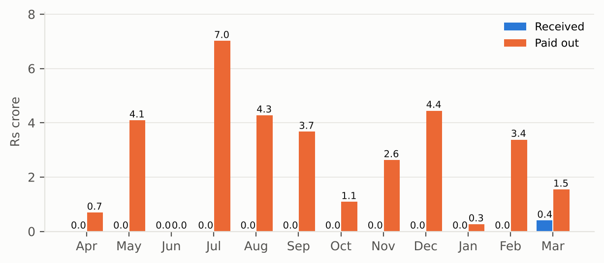

# Madhubani District: Panchayat Finances and Accounts, 2024-25

A plain-language district profile from the Government of India's eGramSwaraj system · India By Numbers · data as published by the portal (district statement generated November 21, 2026 12:59 AM)

## 1. The main points

- **Madhubani has 21 Panchayat Samitis (block councils) and 386 Gram Panchayats (village councils)** in the 2024-25 accounts, plus one Zilla Parishad (district council).
- **In 2024-25 its Panchayats together had Rs 335.47 crore available and paid out Rs 206.53 crore (62%).**
- **The Gram Panchayats had Rs 200.80 crore available and paid out Rs 143.47 crore (71%).** Rank among Bihar's districts: **3 of 38** for money available to Gram Panchayats, **1 of 38** for money paid out by them.
- **An average Gram Panchayat in Madhubani had about Rs 52.0 lakh available and paid out about Rs 37.2 lakh** in the year (district totals divided by 386 Gram Panchayats).
- **Almost all the money is the 15th Finance Commission grant** (scheme-wise statement, all levels). Sources listed for Madhubani: XV Finance Commission-XVFC 100.0%; own resources-OWN none.
- **Annual accounts are complete:** 386 of 386 Gram Panchayats, 21 of 21 Panchayat Samitis and the Zilla Parishad (closed) have closed their year book in the system.
- **Official figures for each of the 386 Gram Panchayats are in the Appendix.**

## 2. How to read the money words

| Term | Meaning |
|---|---|
| **Money available** (portal: *OB + Receipts*) | Money left from last year (opening balance) plus money received during the year |
| **Money paid out** (portal: *Payments*) | Payments made from the Panchayat's own accounts during the year |
| **Crore / lakh** | 1 crore = 100 lakh = Rs 1,00,00,000 |

Payments are only what passed through Panchayat accounts. They are **not** all government spending in the district (state departments pay for many works directly).

## 3. Money at each level of Panchayat

| Level | Bodies | Money available (Rs crore) | Paid out (Rs crore) | Paid out as share | Madhubani's share of Bihar (available) |
|---|---|---|---|---|---|
| Zilla Parishad (district council) | 1 | 89.912 | 32.693 | 36% | 5% of Rs 1,885 crore |
| Panchayat Samitis (block councils) | 21 | 44.753 | 30.375 | 68% | 4% of Rs 1,029 crore |
| Gram Panchayats (village councils) | 386 | 200.801 | 143.466 | 71% | 5% of Rs 4,222 crore |
| **All levels** | | **335.466** | **206.534** | **62%** | |

Source: District wise Receipt and Payment Statement, 2024-25, Bihar (generated November 21, 2026 12:59 AM).

## 4. Block by block

Figures for the Panchayat Samiti (block council) itself and for all Gram Panchayats of the block together.

| Block | Gram Panchayats | Gram Panchayats: available (Rs crore) | Gram Panchayats: paid out | Share paid | Panchayat Samiti: available | Panchayat Samiti: paid out |
|---|---|---|---|---|---|---|
| Andhratharhi | 18 | 9.406 | 6.155 | 65% | 2.019 | 1.316 |
| Babu Barhi | 20 | 10.003 | 7.277 | 73% | 4.007 | 3.162 |
| Basopatti | 15 | 5.866 | 4.434 | 76% | 0.948 | 0.561 |
| Benipatti | 31 | 18.501 | 12.470 | 67% | 5.187 | 4.032 |
| Bisfi | 28 | 15.548 | 12.164 | 78% | 2.828 | 2.137 |
| Ghoghardiha | 17 | 8.445 | 6.315 | 75% | 2.632 | 1.181 |
| Harlakhi | 17 | 7.954 | 5.128 | 64% | 1.219 | 1.197 |
| Jainagar | 15 | 7.867 | 4.926 | 63% | 0.804 | 0.533 |
| Jhanjharpur | 17 | 7.881 | 5.671 | 72% | 0.721 | 0.716 |
| Kaluahi | 11 | 7.271 | 4.953 | 68% | 1.278 | 0.862 |
| Khajauli | 14 | 7.546 | 5.214 | 69% | 1.154 | 0.997 |
| Ladania | 15 | 8.219 | 4.962 | 60% | 3.475 | 0.886 |
| Lakhnaur | 15 | 7.156 | 5.380 | 75% | 1.637 | 1.276 |
| Laukaha (Khutauna) | 18 | 9.137 | 7.474 | 82% | 2.814 | 1.054 |
| Laukahi | 18 | 8.845 | 6.692 | 76% | 1.524 | 1.200 |
| Madhepur | 26 | 14.900 | 11.247 | 75% | 2.561 | 2.014 |
| Madhubani | 18 | 9.210 | 6.828 | 74% | 1.200 | 1.198 |
| Madhwapur | 13 | 5.524 | 3.353 | 61% | 1.274 | 0.629 |
| Pandaul | 26 | 12.250 | 8.262 | 67% | 2.689 | 1.613 |
| Phulparas | 12 | 6.388 | 4.643 | 73% | 2.336 | 1.375 |
| Rajnagar | 22 | 12.883 | 9.918 | 77% | 2.444 | 2.435 |

The blocks' Gram Panchayat figures add up to Rs 200.801 crore (district statement: Rs 200.801 crore). The largest is **Benipatti** (Rs 18.50 crore across 31 GPs), the smallest **Madhwapur** (Rs 5.52 crore). The share of money paid out ranges from 60% to 82% across the 21 blocks with money (middle block: 73%). Blocks differ in the number and size of their Panchayats, so a larger amount does not by itself mean better or worse performance.

## 5. The Zilla Parishad month by month

The district council (Zilla Parishad) started the year with **Rs 89.51 crore** carried over, received **Rs 0.40 crore** during the year and paid out **Rs 33.10 crore** (Rs 0.41 crore of payments were later cancelled or rejected, leaving Rs 32.69 crore). This matches the annual statement.

| Month | Received (Rs lakh) | Paid out (Rs lakh) | Payment vouchers |
|---|---|---|---|
| April, 2024 | 0.00 | 69.51 | 22 |
| May, 2024 | 0.00 | 409.15 | 148 |
| June, 2024 | 0.00 | 0.00 | 0 |
| July, 2024 | 0.00 | 701.79 | 253 |
| August, 2024 | 0.00 | 427.39 | 159 |
| September, 2024 | 0.00 | 367.09 | 135 |
| October, 2024 | 0.00 | 108.76 | 47 |
| November, 2024 | 0.00 | 262.80 | 99 |
| December, 2024 | 0.00 | 444.53 | 180 |
| Januaury, 2025 | 0.00 | 26.43 | 8 |
| February, 2025 | 0.00 | 337.98 | 128 |
| March, 2025 | 40.00 | 154.42 | 64 |

Month names are shown exactly as the portal prints them.

The busiest month for payments was **July, 2024** (Rs 7.02 crore). Source: Month Wise Payment and Receipt Statement (generated November 21, 2026 11:17 AM) and Month wise Summary Report (generated November 21, 2026 8:14 PM).

## 6. Where the money comes from

| Source (as named by the portal) | Zilla Parishad | Panchayat Samitis | Gram Panchayats |
|---|---|---|---|
| XV Finance Commission-XVFC | 100% of receipts | 100% of receipts | 100% of receipts |
| own resources-OWN | 0 | 0 | 0 |

Only the 2 source(s) above are listed for the district. Shares are calculated from the scheme-wise statement (generated March 7, 2025 12:45 AM; October 8, 2025 3:34 AM). The same report counts 1,941 receipt vouchers and 13,170 payment vouchers for Madhubani's Gram Panchayats under the XV FC grant.

## 7. How well the books are kept

| | Zilla Parishad | Panchayat Samitis | Gram Panchayats |
|---|---|---|---|
| Number | 1 | 21 | 386 |
| Masters and opening balance entered | yes / yes | 21 / 21 | 386 / 386 |
| Receipt vouchers recorded | 16 | 242 | 1,941 |
| Payment vouchers recorded | 1,243 | 2,993 | 13,170 |
| Day book closed | yes | 21 of 21 | 386 of 386 |
| Month book closed | yes | 21 of 21 | 386 of 386 |
| Year book (annual accounts) closed | yes | 21 of 21 | 386 of 386 |

On average each Gram Panchayat recorded about 34 payment vouchers in the year. Source: District Wise Summary Report (generated November 21, 2026 12:50 AM).

## 8. What this profile cannot tell you

| Not available | Why |
|---|---|
| Population or households of the district's Panchayats | Not in any open eGramSwaraj report, so no per-person figures |
| Who each payment went to (the payee or vendor of each voucher) | On the individual voucher page, behind a security check (CAPTCHA); not collected. The public voucher lists (number, date, type, amount) are collected so far only for Patna; for this district they can be collected from India with `scripts/run_vouchers.py` |
| Elected members of this district | Collected for Bihar as a whole only; district figures are a planned follow-up |
| Value of approved development plans | Only whether a plan was uploaded is public |
| Money left unspent at year end | Not printed as an official figure |

## 9. About these figures

- Every figure is copied from the government's own eGramSwaraj reports and was checked against the original pages in the data validation (Task 5). Totals in this profile add up to the portal's own totals.
- Each report is a snapshot taken on the date shown; later reports for the same year can differ slightly because accounts keep being updated.
- District code 197; block and Gram Panchayat codes are the portal's own. Data collected November 2026 from egramswaraj.gov.in. Machine-readable tables: `data/validated/egs/`.
- Reports for Madhubani in other years: `docs/district_reports/madhubani/index.md`; all districts: `docs/district_reports/README.md`.

## Appendix: every Gram Panchayat of Madhubani, 2024-25

Amounts in Rs lakh. **Official receipts / payments** are from the Village wise Receipt and Payment Statement (generated November 21, 2026 4:34 AM); they are the figures to quote. 386 Gram Panchayats are shown; the district statement counts 386.

| Block | Gram Panchayat | Code | Official receipts | Official payments |
|---|---|---|---|---|
| Andhratharhi | Andhara Gaur | 97146 | 43.60 | 27.36 |
| Andhratharhi | Andhratharhi (N) | 97147 | 72.38 | 49.57 |
| Andhratharhi | Andhratharhi (S) | 97148 | 41.55 | 32.37 |
| Andhratharhi | Deohar | 97149 | 50.63 | 32.46 |
| Andhratharhi | Dumara | 97150 | 37.94 | 29.87 |
| Andhratharhi | Ganauli | 97151 | 54.04 | 30.41 |
| Andhratharhi | Gangdwar | 97152 | 74.72 | 60.76 |
| Andhratharhi | Harari | 97153 | 90.81 | 63.02 |
| Andhratharhi | Harna | 97154 | 39.66 | 23.28 |
| Andhratharhi | Jalsain | 97155 | 31.27 | 16.97 |
| Andhratharhi | Karn Pur | 97156 | 14.74 | 8.32 |
| Andhratharhi | Madana | 97157 | 77.02 | 49.30 |
| Andhratharhi | Maharail | 97158 | 43.84 | 27.84 |
| Andhratharhi | Mailam | 97159 | 65.36 | 34.61 |
| Andhratharhi | Marukiya | 97160 | 33.84 | 18.00 |
| Andhratharhi | Nanaur | 97161 | 68.04 | 44.38 |
| Andhratharhi | Rakhbari | 97162 | 44.56 | 34.27 |
| Andhratharhi | Shiva | 97163 | 56.57 | 32.71 |
| Babu Barhi | Babu Barhi | 97164 | 47.72 | 42.93 |
| Babu Barhi | Bardahi-Barhara | 97165 | 65.43 | 52.37 |
| Babu Barhi | Basaha | 97166 | 55.03 | 49.61 |
| Babu Barhi | Bela | 97167 | 31.93 | 21.93 |
| Babu Barhi | Bhatchaura | 97168 | 68.76 | 45.10 |
| Babu Barhi | Bhupati | 97169 | 28.34 | 26.38 |
| Babu Barhi | Chhaurahi | 97170 | 31.30 | 17.02 |
| Babu Barhi | Dhamaura | 97171 | 55.02 | 27.02 |
| Babu Barhi | Ghanghaur | 97172 | 61.82 | 42.56 |
| Babu Barhi | Kulharia | 97173 | 39.66 | 29.21 |
| Babu Barhi | Mahesh Wara | 97174 | 59.34 | 44.25 |
| Babu Barhi | Misraulia | 97175 | 45.16 | 29.30 |
| Babu Barhi | Murhadi | 97176 | 100.16 | 64.66 |
| Babu Barhi | Pachrukhi | 97177 | 35.02 | 33.23 |
| Babu Barhi | Pirhi | 97178 | 52.39 | 30.03 |
| Babu Barhi | Sarra-Sanpatahi | 97179 | 26.72 | 13.20 |
| Babu Barhi | Satghara | 97180 | 40.22 | 30.12 |
| Babu Barhi | Sonmati | 97181 | 38.90 | 38.15 |
| Babu Barhi | Teghra | 97182 | 51.50 | 37.44 |
| Babu Barhi | Tirhuta | 97183 | 65.84 | 53.13 |
| Basopatti | Arghawa | 97184 | 42.57 | 32.74 |
| Basopatti | Baso Patti ( East) | 97185 | 46.20 | 40.35 |
| Basopatti | Baso Patti (West) | 97186 | 54.89 | 49.08 |
| Basopatti | Birpur | 97187 | 28.78 | 24.89 |
| Basopatti | Chhatauni | 97188 | 22.99 | 18.70 |
| Basopatti | Damu | 97189 | 26.75 | 13.11 |
| Basopatti | Ghorbanki | 97190 | 31.75 | 21.95 |
| Basopatti | Hathhapur Parsa | 97191 | 25.20 | 22.06 |
| Basopatti | Kataia | 97192 | 20.03 | 17.25 |
| Basopatti | Khona | 97193 | 35.89 | 33.17 |
| Basopatti | Mahinath Pur | 97194 | 28.74 | 27.43 |
| Basopatti | Marhiya | 97195 | 74.39 | 34.68 |
| Basopatti | Phent | 97196 | 74.59 | 52.20 |
| Basopatti | Selibeli | 97197 | 52.80 | 39.34 |
| Basopatti | Siriyapur | 97198 | 21.06 | 16.50 |
| Benipatti | Akaur | 97199 | 55.77 | 44.66 |
| Benipatti | Arer (N) | 97200 | 88.67 | 53.76 |
| Benipatti | Arer (S) | 97201 | 118.48 | 72.93 |
| Benipatti | Bankata | 97202 | 78.94 | 41.39 |
| Benipatti | Barhampura | 97203 | 44.89 | 36.44 |
| Benipatti | Barri | 97204 | 52.72 | 41.72 |
| Benipatti | Basaitha | 97205 | 41.94 | 24.66 |
| Benipatti | Betauna | 97208 | 63.39 | 47.01 |
| Benipatti | Bishanpur | 97209 | 53.76 | 34.70 |
| Benipatti | Dhakjari | 97210 | 65.97 | 28.87 |
| Benipatti | Dhanga | 97211 | 80.99 | 66.98 |
| Benipatti | Ganguli | 97212 | 72.00 | 45.70 |
| Benipatti | Kapasia | 97213 | 21.22 | 12.38 |
| Benipatti | Karhara | 97214 | 58.13 | 48.67 |
| Benipatti | Kataia | 97215 | 143.62 | 101.53 |
| Benipatti | Manpaur | 97216 | 64.20 | 51.34 |
| Benipatti | Meghbon | 97217 | 113.92 | 67.37 |
| Benipatti | Mohamadpur | 97218 | 40.57 | 35.82 |
| Benipatti | Mureth | 97219 | 43.72 | 24.89 |
| Benipatti | Nagbas | 97220 | 40.09 | 28.06 |
| Benipatti | Nagdah Balain | 97221 | 35.92 | 25.45 |
| Benipatti | Nav Karhi | 97222 | 28.89 | 19.16 |
| Benipatti | Pali | 97223 | 74.98 | 64.16 |
| Benipatti | Paraul | 97224 | 49.09 | 36.64 |
| Benipatti | Parjuar | 97225 | 24.67 | 17.46 |
| Benipatti | Parkauli | 97226 | 75.01 | 48.51 |
| Benipatti | Parsauna | 97227 | 32.98 | 16.97 |
| Benipatti | Salha | 97228 | 46.59 | 21.71 |
| Benipatti | Samda | 97229 | 55.36 | 48.85 |
| Benipatti | Shahpur | 97230 | 61.39 | 19.97 |
| Benipatti | Tyoth | 97231 | 22.28 | 19.29 |
| Bisfi | Aunsi Babhangama North | 97232 | 67.92 | 55.27 |
| Bisfi | Aunsi Babhangama South | 97233 | 48.20 | 42.07 |
| Bisfi | Balha | 97234 | 52.29 | 28.18 |
| Bisfi | Bhairba | 97235 | 85.89 | 58.78 |
| Bisfi | Bhoj Pandaul | 97236 | 29.22 | 26.53 |
| Bisfi | Bisfi | 97237 | 56.25 | 37.92 |
| Bisfi | Chahuta | 97238 | 49.69 | 28.28 |
| Bisfi | Jafra | 97239 | 93.68 | 89.93 |
| Bisfi | Jagban East | 97240 | 86.95 | 72.76 |
| Bisfi | Jagban West | 97241 | 30.57 | 27.45 |
| Bisfi | Khairi Banka North | 97242 | 42.54 | 37.49 |
| Bisfi | Khairi Banka South | 97243 | 35.37 | 27.07 |
| Bisfi | Nahas Rupauli North | 97244 | 44.45 | 25.64 |
| Bisfi | Nahas Rupauli South | 97245 | 80.01 | 75.21 |
| Bisfi | Nurchak | 97246 | 64.21 | 60.66 |
| Bisfi | Parsauni North | 97247 | 64.32 | 51.38 |
| Bisfi | Parsauni South | 97248 | 95.20 | 82.60 |
| Bisfi | Raghauli | 97249 | 44.56 | 32.14 |
| Bisfi | Raghepura | 97250 | 34.58 | 17.25 |
| Bisfi | Rathaus | 97251 | 49.44 | 22.09 |
| Bisfi | Sadulahpur | 97252 | 48.46 | 26.06 |
| Bisfi | Simri | 97253 | 42.57 | 36.82 |
| Bisfi | Singaso | 97254 | 47.72 | 43.85 |
| Bisfi | Singia East | 97256 | 78.65 | 66.34 |
| Bisfi | Singia West | 97255 | 15.86 | 15.16 |
| Bisfi | Sohas | 97257 | 25.83 | 20.52 |
| Bisfi | Tisi Narsam North | 97258 | 92.73 | 65.05 |
| Bisfi | Tisi Narsam South | 97259 | 47.59 | 43.91 |
| Ghoghardiha | Amahi | 97260 | 73.66 | 30.79 |
| Ghoghardiha | Basuari | 97261 | 35.74 | 25.28 |
| Ghoghardiha | Bishanpur | 97262 | 57.59 | 45.91 |
| Ghoghardiha | Brahmpur (N) | 97263 | 60.43 | 45.73 |
| Ghoghardiha | Brahmpur (S) | 97264 | 39.80 | 29.62 |
| Ghoghardiha | Brahmpur Bathnaha | 97265 | 81.87 | 69.42 |
| Ghoghardiha | Chhajna | 97266 | 62.53 | 48.92 |
| Ghoghardiha | Chikna | 97267 | 49.98 | 44.14 |
| Ghoghardiha | Inarwa | 97268 | 51.12 | 35.97 |
| Ghoghardiha | Keotana | 97269 | 32.12 | 20.87 |
| Ghoghardiha | Naua Bakhar | 97270 | 31.74 | 28.75 |
| Ghoghardiha | Parsa (N) | 97271 | 42.30 | 26.13 |
| Ghoghardiha | Parsa (S) | 97272 | 45.14 | 31.24 |
| Ghoghardiha | Piroj Gadh | 97273 | 86.55 | 67.67 |
| Ghoghardiha | Sangi | 97274 | 35.49 | 29.30 |
| Ghoghardiha | Sarauti | 97275 | 33.39 | 30.23 |
| Ghoghardiha | Sudai Ra Toli | 97276 | 25.06 | 21.56 |
| Harlakhi | Beta Parsa | 97277 | 44.46 | 28.03 |
| Harlakhi | Bisaul | 97278 | 34.36 | 21.51 |
| Harlakhi | Borhar | 97279 | 61.74 | 27.95 |
| Harlakhi | Gangaur | 97280 | 56.90 | 30.67 |
| Harlakhi | Harlakhi | 97281 | 32.78 | 26.83 |
| Harlakhi | Hisar | 97282 | 30.93 | 25.17 |
| Harlakhi | Jhitki | 97283 | 41.37 | 36.34 |
| Harlakhi | Kalna | 97284 | 27.75 | 19.12 |
| Harlakhi | Karuna | 97285 | 52.77 | 27.09 |
| Harlakhi | Kauha Barhi | 97286 | 40.95 | 33.46 |
| Harlakhi | Khirhar | 97287 | 110.40 | 64.06 |
| Harlakhi | Naharnia | 97288 | 40.32 | 30.43 |
| Harlakhi | Phulhar | 97289 | 43.25 | 36.11 |
| Harlakhi | Pipraun | 97290 | 59.61 | 32.89 |
| Harlakhi | Sisauni | 97291 | 31.31 | 17.77 |
| Harlakhi | Sonei | 97292 | 51.25 | 27.00 |
| Harlakhi | Soth Gaon | 97293 | 35.24 | 28.39 |
| Jainagar | Barhi | 97294 | 45.07 | 22.85 |
| Jainagar | Belhi East | 97296 | 73.99 | 43.81 |
| Jainagar | Belhi South | 97297 | 57.04 | 45.53 |
| Jainagar | Belhi West | 97295 | 46.16 | 24.41 |
| Jainagar | Bera | 97298 | 32.41 | 23.32 |
| Jainagar | Deodha Middle | 97299 | 48.29 | 25.67 |
| Jainagar | Deodha North | 97300 | 38.40 | 22.43 |
| Jainagar | Deodha South | 97301 | 39.89 | 29.25 |
| Jainagar | Dorbar | 97302 | 84.93 | 74.96 |
| Jainagar | Dulipatti | 97303 | 88.02 | 44.50 |
| Jainagar | Jainagar Basti | 97304 | 39.86 | 28.78 |
| Jainagar | Korahia | 97305 | 43.96 | 22.67 |
| Jainagar | Parwa Belhi | 97306 | 62.90 | 41.24 |
| Jainagar | Rajauli | 97307 | 46.68 | 17.48 |
| Jainagar | Selra | 97308 | 39.17 | 25.68 |
| Jhanjharpur | Balni Mehat | 97309 | 34.51 | 19.80 |
| Jhanjharpur | Chanaura Ganj | 97310 | 50.98 | 43.43 |
| Jhanjharpur | Kako | 97311 | 44.40 | 22.67 |
| Jhanjharpur | Kothiya | 97312 | 26.35 | 21.90 |
| Jhanjharpur | Lohana North | 97313 | 50.86 | 40.89 |
| Jhanjharpur | Lohana South | 97314 | 37.46 | 27.35 |
| Jhanjharpur | Mahinath Pur | 97315 | 50.47 | 18.71 |
| Jhanjharpur | Nabani | 97316 | 46.26 | 36.63 |
| Jhanjharpur | Naruar | 97317 | 55.30 | 23.44 |
| Jhanjharpur | Parsa | 97318 | 18.35 | 16.62 |
| Jhanjharpur | Pipraulia | 97319 | 41.01 | 35.38 |
| Jhanjharpur | Raiyam East | 97320 | 46.85 | 27.65 |
| Jhanjharpur | Raiyam West | 97321 | 51.13 | 38.19 |
| Jhanjharpur | Sangram | 97322 | 69.95 | 65.47 |
| Jhanjharpur | Sant Nagar | 97323 | 33.19 | 19.53 |
| Jhanjharpur | Simrah | 97324 | 84.40 | 76.03 |
| Jhanjharpur | Sukhet | 97325 | 46.60 | 33.36 |
| Kaluahi | Haripur North | 97326 | 52.82 | 34.24 |
| Kaluahi | Haripur South | 97327 | 77.59 | 67.65 |
| Kaluahi | Kalikapur | 97328 | 91.65 | 63.71 |
| Kaluahi | Karmauli | 97329 | 79.85 | 61.86 |
| Kaluahi | Loha | 97330 | 67.38 | 46.19 |
| Kaluahi | Madhepur | 97331 | 41.59 | 29.65 |
| Kaluahi | Malmal North | 97332 | 36.87 | 24.02 |
| Kaluahi | Malmal South | 97333 | 64.52 | 56.77 |
| Kaluahi | Narar West | 97334 | 58.61 | 32.16 |
| Kaluahi | Palimohan | 97335 | 91.49 | 39.14 |
| Kaluahi | Pursolia | 97336 | 64.72 | 39.92 |
| Khajauli | Benta Kakarghati | 97337 | 61.73 | 49.93 |
| Khajauli | Bhakua | 97338 | 82.23 | 46.16 |
| Khajauli | Chandra Dih | 97339 | 49.76 | 18.05 |
| Khajauli | Chatra Goth North | 97340 | 43.21 | 30.91 |
| Khajauli | Chatra Goth South | 97341 | 38.83 | 29.53 |
| Khajauli | Datuar | 97342 | 54.06 | 38.36 |
| Khajauli | Inrwa | 97343 | 49.80 | 35.57 |
| Khajauli | Kanhauli | 97344 | 46.28 | 20.97 |
| Khajauli | Khajauli | 97345 | 59.64 | 48.48 |
| Khajauli | Mahua Ekdara | 97346 | 35.92 | 23.63 |
| Khajauli | Narar East | 97347 | 66.71 | 41.84 |
| Khajauli | Rashidpur | 97348 | 54.45 | 50.69 |
| Khajauli | Sarabe | 97349 | 49.89 | 43.32 |
| Khajauli | Sukki | 97350 | 62.13 | 43.93 |
| Ladania | Belahi | 97351 | 48.59 | 20.22 |
| Ladania | Dalokhar | 97352 | 47.80 | 28.19 |
| Ladania | Ekhari | 97353 | 63.39 | 40.20 |
| Ladania | Gajhara | 97354 | 43.71 | 24.76 |
| Ladania | Gidhwas | 97355 | 56.13 | 20.20 |
| Ladania | Khoja | 97356 | 86.74 | 57.15 |
| Ladania | Kumarkhat East | 97357 | 89.29 | 68.39 |
| Ladania | Kumarkhat West | 97358 | 73.94 | 42.31 |
| Ladania | Lachhminia | 97359 | 61.61 | 55.64 |
| Ladania | Mahtha | 97360 | 32.92 | 17.42 |
| Ladania | Padma | 97361 | 46.06 | 18.85 |
| Ladania | Pathrahi | 97362 | 45.25 | 26.03 |
| Ladania | Piprahi | 97363 | 41.86 | 20.53 |
| Ladania | Sidhap Kala | 97364 | 32.69 | 23.53 |
| Ladania | Sidhpa | 97365 | 51.96 | 32.79 |
| Lakhnaur | Balia | 97366 | 39.94 | 33.25 |
| Lakhnaur | Belauncha | 97369 | 71.93 | 45.25 |
| Lakhnaur | Berma | 97370 | 33.09 | 22.07 |
| Lakhnaur | Deep East | 97371 | 67.83 | 51.48 |
| Lakhnaur | Deep West | 97372 | 42.83 | 33.78 |
| Lakhnaur | Gangapur | 97373 | 39.44 | 29.61 |
| Lakhnaur | Kachhua | 97374 | 43.16 | 32.31 |
| Lakhnaur | Kachhuvi | 97375 | 46.26 | 40.40 |
| Lakhnaur | Kaithinia | 97376 | 37.18 | 30.76 |
| Lakhnaur | Lakhnaur East | 97377 | 47.14 | 35.97 |
| Lakhnaur | Lakhnaur West | 97378 | 69.27 | 43.28 |
| Lakhnaur | Laufa | 97379 | 39.15 | 29.56 |
| Lakhnaur | Madanpur | 97380 | 35.19 | 25.69 |
| Lakhnaur | Maibi | 97381 | 68.45 | 55.04 |
| Lakhnaur | Tamuria | 97382 | 34.74 | 29.50 |
| Laukaha (Khutauna) | Bagha Kusumar | 97383 | 29.85 | 23.79 |
| Laukaha (Khutauna) | Basudevpur | 97384 | 39.50 | 34.92 |
| Laukaha (Khutauna) | Birpur | 97385 | 56.94 | 51.12 |
| Laukaha (Khutauna) | Chaturbhuj Piprahi | 97399 | 46.19 | 31.14 |
| Laukaha (Khutauna) | Durgipatti | 97386 | 40.84 | 40.29 |
| Laukaha (Khutauna) | Ekhatha | 97387 | 40.65 | 34.93 |
| Laukaha (Khutauna) | Jhanjhpatti Asha | 97388 | 41.18 | 35.47 |
| Laukaha (Khutauna) | Karmegh Middle | 97389 | 71.99 | 58.20 |
| Laukaha (Khutauna) | Karmegh North | 97390 | 61.50 | 50.75 |
| Laukaha (Khutauna) | Karmegh West | 97391 | 109.91 | 67.60 |
| Laukaha (Khutauna) | Khutauna | 97392 | 56.80 | 53.70 |
| Laukaha (Khutauna) | Lalmaniya | 97393 | 39.72 | 31.03 |
| Laukaha (Khutauna) | Madhopur | 97394 | 56.06 | 47.35 |
| Laukaha (Khutauna) | Majhaura | 97395 | 69.50 | 63.17 |
| Laukaha (Khutauna) | Nahari | 97396 | 65.44 | 57.08 |
| Laukaha (Khutauna) | Parsahi East | 97397 | 26.10 | 23.24 |
| Laukaha (Khutauna) | Parsahi West | 97398 | 34.79 | 23.07 |
| Laukaha (Khutauna) | Siktiyahi | 97400 | 26.74 | 20.56 |
| Laukahi | Atari | 97401 | 46.02 | 31.40 |
| Laukahi | Bangama North | 97402 | 26.95 | 18.21 |
| Laukahi | Bangama South | 97403 | 55.61 | 34.77 |
| Laukahi | Baruwar | 97404 | 53.90 | 31.18 |
| Laukahi | Belahi Bhawanipur | 97405 | 47.99 | 36.52 |
| Laukahi | Dhanchhiha | 97406 | 45.38 | 30.66 |
| Laukahi | Dharhara | 97407 | 33.20 | 24.32 |
| Laukahi | Jhahuri | 97408 | 43.07 | 38.03 |
| Laukahi | Jiroga | 97409 | 58.74 | 35.30 |
| Laukahi | Kariot | 97410 | 53.69 | 45.10 |
| Laukahi | Kukurdaura | 97411 | 48.00 | 35.25 |
| Laukahi | Ladania | 97412 | 58.82 | 53.65 |
| Laukahi | Laukahi | 97413 | 62.48 | 57.36 |
| Laukahi | Mahadeo Math | 97414 | 62.17 | 51.91 |
| Laukahi | Mansapur | 97415 | 28.04 | 19.59 |
| Laukahi | Narendrapur | 97416 | 56.18 | 51.26 |
| Laukahi | Narhiya North | 97417 | 62.30 | 38.51 |
| Laukahi | Narhiya South | 97418 | 41.98 | 36.16 |
| Madhepur | Bakua | 97419 | 43.52 | 23.51 |
| Madhepur | Banki | 97420 | 42.51 | 30.74 |
| Madhepur | Barsam | 97421 | 61.45 | 32.70 |
| Madhepur | Basipatti | 97422 | 34.44 | 25.00 |
| Madhepur | Bath | 97423 | 26.02 | 18.04 |
| Madhepur | Bhakharain | 97424 | 23.70 | 13.31 |
| Madhepur | Bhargama | 97425 | 44.16 | 41.25 |
| Madhepur | Bheja | 97426 | 51.82 | 40.67 |
| Madhepur | Bhit Bhagwanpur | 97427 | 52.25 | 47.63 |
| Madhepur | Darah | 97428 | 108.59 | 81.65 |
| Madhepur | Dwalakh | 97429 | 46.84 | 30.86 |
| Madhepur | Gargaon | 97430 | 38.84 | 24.73 |
| Madhepur | Karhara | 97431 | 71.05 | 63.64 |
| Madhepur | Madhepur East | 97432 | 50.60 | 47.70 |
| Madhepur | Madhepur West | 97433 | 71.24 | 49.19 |
| Madhepur | Mahasingh Hasauli | 97434 | 77.82 | 68.08 |
| Madhepur | Mahisham | 97435 | 82.01 | 78.14 |
| Madhepur | Mahpatia | 97436 | 91.10 | 62.14 |
| Madhepur | Matras | 97437 | 127.83 | 72.12 |
| Madhepur | Nawada | 97438 | 39.49 | 29.08 |
| Madhepur | Pachahi | 97439 | 49.09 | 39.92 |
| Madhepur | Parwalpur | 97440 | 56.89 | 54.44 |
| Madhepur | Prasad | 97441 | 55.46 | 52.65 |
| Madhepur | Rahua Sangram | 97442 | 54.23 | 52.37 |
| Madhepur | Sundar Birajeet | 97443 | 56.20 | 28.92 |
| Madhepur | Tardiha | 97444 | 32.85 | 16.25 |
| Madhubani | Balia | 97445 | 76.11 | 51.02 |
| Madhubani | Basauli | 97446 | 65.12 | 49.40 |
| Madhubani | Hussin Pur | 97450 | 23.03 | 18.07 |
| Madhubani | Izra | 97451 | 84.00 | 79.95 |
| Madhubani | Jagat Pur | 97452 | 22.90 | 20.29 |
| Madhubani | Kakraul North | 97453 | 90.35 | 61.61 |
| Madhubani | Kakraul South | 97454 | 46.67 | 38.17 |
| Madhubani | Khajuri | 97455 | 30.57 | 17.61 |
| Madhubani | Laxmipur | 97456 | 38.45 | 20.54 |
| Madhubani | Maksuda | 97457 | 47.58 | 39.57 |
| Madhubani | Malangia | 97458 | 108.08 | 61.30 |
| Madhubani | Nazirpur | 97459 | 57.25 | 46.63 |
| Madhubani | Rahika | 97460 | 39.28 | 35.30 |
| Madhubani | Satlakha | 97462 | 25.70 | 19.92 |
| Madhubani | Saurath | 97463 | 46.17 | 40.77 |
| Madhubani | Shambhuar | 97464 | 26.43 | 22.41 |
| Madhubani | Sonaur | 97465 | 47.01 | 23.36 |
| Madhubani | Sundar Pur Bhitthi | 97466 | 46.35 | 36.91 |
| Madhwapur | Balba | 97467 | 34.51 | 22.34 |
| Madhwapur | Basuki Bihari North | 97468 | 47.27 | 30.64 |
| Madhwapur | Basuki Bihari South | 97469 | 30.90 | 21.37 |
| Madhwapur | Bisanpur | 97470 | 74.74 | 50.81 |
| Madhwapur | Madhwapur | 97471 | 59.84 | 21.87 |
| Madhwapur | Mukhiapatti | 97472 | 39.60 | 23.62 |
| Madhwapur | Pihwara | 97473 | 50.53 | 27.48 |
| Madhwapur | Pirokhar | 97474 | 40.49 | 21.21 |
| Madhwapur | Sahar North | 97475 | 34.94 | 18.80 |
| Madhwapur | Sahar South | 97476 | 51.92 | 37.43 |
| Madhwapur | Salempur | 97477 | 29.79 | 19.77 |
| Madhwapur | Taraia | 97478 | 28.18 | 25.80 |
| Madhwapur | Uttra | 97479 | 29.68 | 14.13 |
| Pandaul | Bathne | 97480 | 53.24 | 28.13 |
| Pandaul | Belahi | 97481 | 34.84 | 29.13 |
| Pandaul | Bhagwatipur | 97482 | 40.10 | 29.51 |
| Pandaul | Bhaur | 97483 | 32.71 | 21.65 |
| Pandaul | Bhawanipur | 97484 | 74.27 | 34.52 |
| Pandaul | Biraul | 97485 | 34.53 | 24.61 |
| Pandaul | Dahibat Madhopur (E) | 97486 | 38.20 | 25.26 |
| Pandaul | Dahibat Madhopur (W) | 97487 | 60.54 | 47.36 |
| Pandaul | Makrampur | 97488 | 32.72 | 26.22 |
| Pandaul | Meghaul | 97489 | 23.14 | 17.42 |
| Pandaul | Narpati Nagar | 97490 | 55.52 | 37.75 |
| Pandaul | Pachadhi | 97491 | 49.70 | 41.55 |
| Pandaul | Pandaul (East) | 97492 | 79.94 | 60.51 |
| Pandaul | Pandaul (Middle) | 97493 | 49.67 | 40.27 |
| Pandaul | Pandaul (West) | 97494 | 79.07 | 44.28 |
| Pandaul | Sagarpur | 97495 | 41.67 | 19.19 |
| Pandaul | Sakri East | 97496 | 65.12 | 36.98 |
| Pandaul | Sakri West | 97497 | 55.69 | 21.64 |
| Pandaul | Salempur | 97498 | 47.00 | 28.35 |
| Pandaul | Sankorth | 97499 | 49.29 | 39.28 |
| Pandaul | Sarisaw Pahi (E) | 97500 | 40.54 | 23.99 |
| Pandaul | Sarisaw Pahi (W) | 97501 | 34.11 | 22.13 |
| Pandaul | Sripurhati (M) | 97502 | 29.21 | 24.01 |
| Pandaul | Sripurhati (N) | 97503 | 15.16 | 12.61 |
| Pandaul | Sripurhati (S) | 97504 | 47.92 | 35.67 |
| Pandaul | Udaipur Bithuar | 97505 | 61.06 | 54.13 |
| Phulparas | Bathnaha | 97506 | 35.40 | 30.68 |
| Phulparas | Dhanauja | 97507 | 51.81 | 36.76 |
| Phulparas | Dharmdiha | 97508 | 71.17 | 15.60 |
| Phulparas | Gehuma Bairia | 97509 | 59.77 | 56.83 |
| Phulparas | Godhiari | 97510 | 31.36 | 29.66 |
| Phulparas | Kalapatti | 97511 | 44.13 | 31.91 |
| Phulparas | Mahathaur Khurd | 97512 | 65.52 | 58.51 |
| Phulparas | Mahind Bar | 97513 | 34.75 | 18.98 |
| Phulparas | Ram Nagar | 97515 | 116.12 | 85.97 |
| Phulparas | Saini | 97516 | 57.64 | 55.61 |
| Phulparas | Siswar | 97518 | 37.04 | 18.81 |
| Phulparas | Suga Patti | 97519 | 34.13 | 25.00 |
| Rajnagar | Bharia Bisanpur | 97520 | 41.53 | 36.88 |
| Rajnagar | Bhatsimar East | 97521 | 36.21 | 17.44 |
| Rajnagar | Bhatsimar West | 97522 | 54.53 | 33.13 |
| Rajnagar | Chichri Kanungo | 97523 | 76.95 | 57.59 |
| Rajnagar | Kaithahi | 97524 | 46.47 | 34.53 |
| Rajnagar | Karahia East | 97525 | 91.42 | 84.40 |
| Rajnagar | Karahia West | 97526 | 56.85 | 38.78 |
| Rajnagar | Koilakh | 97527 | 29.25 | 5.53 |
| Rajnagar | Mangrauni North | 97529 | 80.41 | 63.99 |
| Rajnagar | Pariharpur | 97531 | 96.61 | 51.81 |
| Rajnagar | Patwara North | 97532 | 43.41 | 43.36 |
| Rajnagar | Patwara South | 97533 | 63.37 | 49.21 |
| Rajnagar | Pilakhwar | 97534 | 47.72 | 40.05 |
| Rajnagar | Raghopur Balath | 97535 | 41.53 | 39.25 |
| Rajnagar | Raghuni Dehat | 97536 | 76.40 | 66.92 |
| Rajnagar | Ram Patti | 97537 | 38.67 | 15.72 |
| Rajnagar | Satghara | 97539 | 24.42 | 20.94 |
| Rajnagar | Sibipatti | 97540 | 43.78 | 31.68 |
| Rajnagar | Simri | 97541 | 65.01 | 58.36 |
| Rajnagar | Singion | 97542 | 66.80 | 56.37 |
| Rajnagar | Sugauna North | 97543 | 94.42 | 76.37 |
| Rajnagar | Sugauna South | 97544 | 72.52 | 69.44 |

Official Gram Panchayat figures above add up to Rs 200.80 crore received and Rs 143.47 crore paid out.

