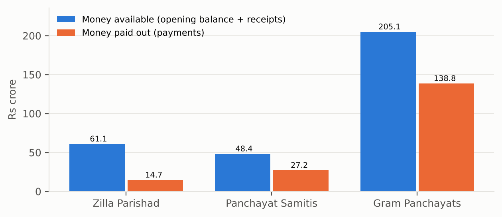
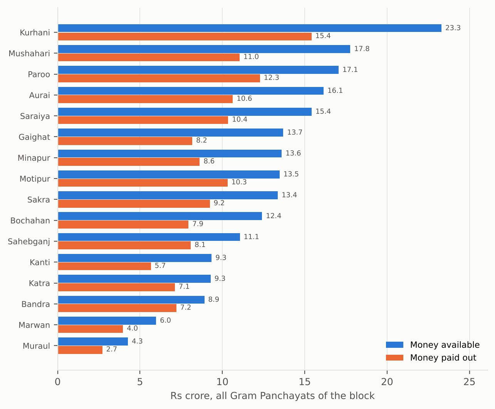
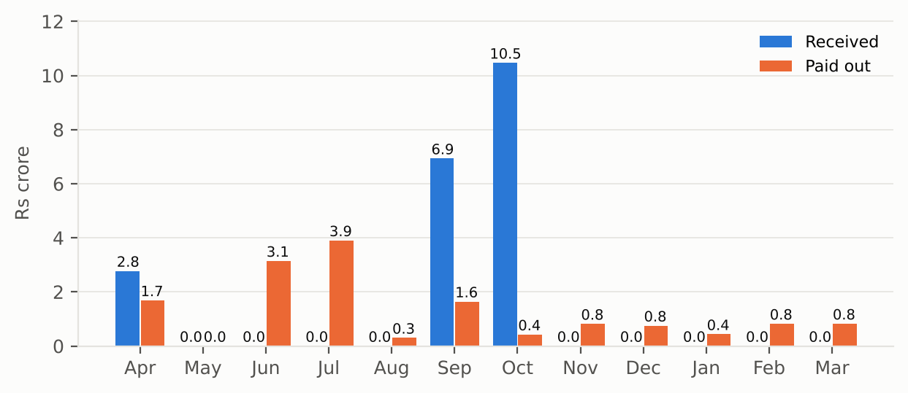

# Muzaffarpur District: Panchayat Finances and Accounts, 2024-25

A plain-language district profile from the Government of India's eGramSwaraj system · India By Numbers · data as published by the portal (district statement generated November 21, 2026 12:59 AM)

## 1. The main points

- **Muzaffarpur has 16 Panchayat Samitis (block councils) and 373 Gram Panchayats (village councils)** in the 2024-25 accounts, plus one Zilla Parishad (district council).
- **In 2024-25 its Panchayats together had Rs 314.56 crore available and paid out Rs 180.73 crore (57%).**
- **The Gram Panchayats had Rs 205.11 crore available and paid out Rs 138.77 crore (68%).** Rank among Bihar's districts: **2 of 38** for money available to Gram Panchayats, **2 of 38** for money paid out by them.
- **An average Gram Panchayat in Muzaffarpur had about Rs 55.0 lakh available and paid out about Rs 37.2 lakh** in the year (district totals divided by 373 Gram Panchayats).
- **Almost all the money is the 15th Finance Commission grant** (scheme-wise statement, all levels). Sources listed for Muzaffarpur: XV Finance Commission-XVFC 100.0%; own resources-OWN none.
- **Annual accounts are complete:** 373 of 373 Gram Panchayats, 16 of 16 Panchayat Samitis and the Zilla Parishad (closed) have closed their year book in the system.
- **Official figures for each of the 373 Gram Panchayats are in the Appendix.**

## 2. How to read the money words

| Term | Meaning |
|---|---|
| **Money available** (portal: *OB + Receipts*) | Money left from last year (opening balance) plus money received during the year |
| **Money paid out** (portal: *Payments*) | Payments made from the Panchayat's own accounts during the year |
| **Crore / lakh** | 1 crore = 100 lakh = Rs 1,00,00,000 |

Payments are only what passed through Panchayat accounts. They are **not** all government spending in the district (state departments pay for many works directly).

## 3. Money at each level of Panchayat

| Level | Bodies | Money available (Rs crore) | Paid out (Rs crore) | Paid out as share | Muzaffarpur's share of Bihar (available) |
|---|---|---|---|---|---|
| Zilla Parishad (district council) | 1 | 61.077 | 14.730 | 24% | 3% of Rs 1,885 crore |
| Panchayat Samitis (block councils) | 16 | 48.373 | 27.231 | 56% | 5% of Rs 1,029 crore |
| Gram Panchayats (village councils) | 373 | 205.108 | 138.770 | 68% | 5% of Rs 4,222 crore |
| **All levels** | | **314.558** | **180.731** | **57%** | |

Source: District wise Receipt and Payment Statement, 2024-25, Bihar (generated November 21, 2026 12:59 AM).

## 4. Block by block

Figures for the Panchayat Samiti (block council) itself and for all Gram Panchayats of the block together.

| Block | Gram Panchayats | Gram Panchayats: available (Rs crore) | Gram Panchayats: paid out | Share paid | Panchayat Samiti: available | Panchayat Samiti: paid out |
|---|---|---|---|---|---|---|
| Aurai | 26 | 16.147 | 10.634 | 66% | 6.105 | 3.395 |
| Bandra | 12 | 8.908 | 7.207 | 81% | 1.006 | 0.502 |
| Bochahan | 20 | 12.412 | 7.943 | 64% | 3.146 | 1.512 |
| Gaighat | 23 | 13.699 | 8.174 | 60% | 2.859 | 0.931 |
| Kanti | 20 | 9.347 | 5.659 | 61% | 3.081 | 2.149 |
| Katra | 22 | 9.290 | 7.114 | 77% | 1.794 | 1.096 |
| Kurhani | 37 | 23.302 | 15.411 | 66% | 4.296 | 1.673 |
| Marwan | 14 | 5.978 | 3.970 | 66% | 2.013 | 1.590 |
| Minapur | 26 | 13.603 | 8.626 | 63% | 2.225 | 1.151 |
| Motipur | 29 | 13.475 | 10.316 | 77% | 3.874 | 1.024 |
| Muraul | 9 | 4.268 | 2.712 | 64% | 1.004 | 0.279 |
| Mushahari | 26 | 17.770 | 11.047 | 62% | 4.747 | 4.102 |
| Paroo | 34 | 17.060 | 12.282 | 72% | 3.158 | 2.668 |
| Sahebganj | 19 | 11.061 | 8.083 | 73% | 2.281 | 1.400 |
| Sakra | 27 | 13.366 | 9.238 | 69% | 2.962 | 2.217 |
| Saraiya | 29 | 15.420 | 10.353 | 67% | 3.823 | 1.544 |

The blocks' Gram Panchayat figures add up to Rs 205.108 crore (district statement: Rs 205.108 crore). The largest is **Kurhani** (Rs 23.30 crore across 37 GPs), the smallest **Muraul** (Rs 4.27 crore). The share of money paid out ranges from 60% to 81% across the 16 blocks with money (middle block: 66%). Blocks differ in the number and size of their Panchayats, so a larger amount does not by itself mean better or worse performance.

## 5. The Zilla Parishad month by month

The district council (Zilla Parishad) started the year with **Rs 40.90 crore** carried over, received **Rs 20.17 crore** during the year and paid out **Rs 14.75 crore** (Rs 0.02 crore of payments were later cancelled or rejected, leaving Rs 14.73 crore). This matches the annual statement.

| Month | Received (Rs lakh) | Paid out (Rs lakh) | Payment vouchers |
|---|---|---|---|
| April, 2024 | 277.44 | 168.69 | 157 |
| May, 2024 | 0.00 | 0.00 | 0 |
| June, 2024 | 0.00 | 314.52 | 76 |
| July, 2024 | 0.00 | 390.30 | 104 |
| August, 2024 | 0.00 | 30.05 | 14 |
| September, 2024 | 693.30 | 164.40 | 39 |
| October, 2024 | 1,046.68 | 42.42 | 20 |
| November, 2024 | 0.00 | 81.74 | 24 |
| December, 2024 | 0.00 | 75.19 | 21 |
| Januaury, 2025 | 0.00 | 43.39 | 12 |
| February, 2025 | 0.00 | 82.19 | 32 |
| March, 2025 | 0.00 | 82.43 | 28 |

Month names are shown exactly as the portal prints them.

The busiest month for payments was **July, 2024** (Rs 3.90 crore). Source: Month Wise Payment and Receipt Statement (generated November 21, 2026 11:17 AM) and Month wise Summary Report (generated November 21, 2026 8:14 PM).

## 6. Where the money comes from

| Source (as named by the portal) | Zilla Parishad | Panchayat Samitis | Gram Panchayats |
|---|---|---|---|
| XV Finance Commission-XVFC | 100% of receipts | 100% of receipts | 100% of receipts |
| own resources-OWN | 0 | 0 | 0 |

Only the 2 source(s) above are listed for the district. Shares are calculated from the scheme-wise statement (generated March 7, 2025 12:45 AM; October 8, 2025 3:34 AM). The same report counts 1,538 receipt vouchers and 11,846 payment vouchers for Muzaffarpur's Gram Panchayats under the XV FC grant.

## 7. How well the books are kept

| | Zilla Parishad | Panchayat Samitis | Gram Panchayats |
|---|---|---|---|
| Number | 1 | 16 | 373 |
| Masters and opening balance entered | yes / yes | 16 / 16 | 373 / 373 |
| Receipt vouchers recorded | 6 | 161 | 1,538 |
| Payment vouchers recorded | 527 | 1,731 | 11,846 |
| Day book closed | yes | 16 of 16 | 373 of 373 |
| Month book closed | yes | 16 of 16 | 373 of 373 |
| Year book (annual accounts) closed | yes | 16 of 16 | 373 of 373 |

On average each Gram Panchayat recorded about 32 payment vouchers in the year. Source: District Wise Summary Report (generated November 21, 2026 12:50 AM).

## 8. What this profile cannot tell you

| Not available | Why |
|---|---|
| Population or households of the district's Panchayats | Not in any open eGramSwaraj report, so no per-person figures |
| Who each payment went to (the payee or vendor of each voucher) | On the individual voucher page, behind a security check (CAPTCHA); not collected. The public voucher lists (number, date, type, amount) are collected so far only for Patna; for this district they can be collected from India with `scripts/run_vouchers.py` |
| Elected members of this district | Collected for Bihar as a whole only; district figures are a planned follow-up |
| Value of approved development plans | Only whether a plan was uploaded is public |
| Money left unspent at year end | Not printed as an official figure |

## 9. About these figures

- Every figure is copied from the government's own eGramSwaraj reports and was checked against the original pages in the data validation (Task 5). Totals in this profile add up to the portal's own totals.
- Each report is a snapshot taken on the date shown; later reports for the same year can differ slightly because accounts keep being updated.
- District code 199; block and Gram Panchayat codes are the portal's own. Data collected November 2026 from egramswaraj.gov.in. Machine-readable tables: `data/validated/egs/`.
- Reports for Muzaffarpur in other years: `docs/district_reports/muzaffarpur/index.md`; all districts: `docs/district_reports/README.md`.

## Appendix: every Gram Panchayat of Muzaffarpur, 2024-25

Amounts in Rs lakh. **Official receipts / payments** are from the Village wise Receipt and Payment Statement (generated November 21, 2026 4:34 AM); they are the figures to quote. 373 Gram Panchayats are shown; the district statement counts 373.

| Block | Gram Panchayat | Code | Official receipts | Official payments |
|---|---|---|---|---|
| Aurai | Alampur Simri | 97646 | 65.59 | 51.54 |
| Aurai | Amnaur | 97647 | 27.47 | 23.12 |
| Aurai | Atrar | 97648 | 80.62 | 29.53 |
| Aurai | Aurai | 97649 | 44.69 | 26.56 |
| Aurai | Babhangama | 97650 | 80.85 | 57.21 |
| Aurai | Bhadai | 97651 | 74.24 | 59.30 |
| Aurai | Bhalura | 97652 | 46.10 | 38.67 |
| Aurai | Bharathua | 97653 | 82.81 | 36.04 |
| Aurai | Bishunpur Gokhul | 97654 | 21.58 | 17.67 |
| Aurai | Bishunpur Umapath Basant | 97655 | 49.68 | 39.79 |
| Aurai | Dharharwa | 97656 | 73.22 | 43.68 |
| Aurai | Dih Jiwar | 97657 | 61.72 | 26.51 |
| Aurai | Ghanshyampur | 97658 | 53.93 | 28.40 |
| Aurai | Janadh Jiwajor Beni | 97659 | 75.55 | 56.90 |
| Aurai | Khetalpur | 97660 | 73.48 | 61.68 |
| Aurai | Maheshwara | 97661 | 74.73 | 27.10 |
| Aurai | Mathurapur Bujurg | 97662 | 46.95 | 28.17 |
| Aurai | Nayagaon | 97663 | 34.44 | 27.44 |
| Aurai | Paramjivwar Tarajiwar | 97671 | 95.08 | 51.52 |
| Aurai | Rajkhand North | 97664 | 64.26 | 51.36 |
| Aurai | Rajkhand South | 97665 | 43.92 | 32.06 |
| Aurai | Rampur Shambhuta | 97666 | 61.87 | 37.01 |
| Aurai | Ratwara Bindwara Deoriya Pashchim | 97667 | 51.71 | 41.15 |
| Aurai | Ratwara Bindwara Deoriya Purvi | 97668 | 61.42 | 31.61 |
| Aurai | Sahila Balli | 97669 | 89.32 | 72.27 |
| Aurai | Sarhachiya | 97670 | 79.52 | 67.08 |
| Bandra | Badgaon | 97673 | 92.00 | 52.32 |
| Bandra | Bandra | 97672 | 83.29 | 66.83 |
| Bandra | Hattha | 97674 | 75.73 | 67.31 |
| Bandra | Munni Baingari | 97675 | 66.76 | 51.31 |
| Bandra | Mutlupur | 97676 | 74.81 | 62.57 |
| Bandra | Nunfara | 97677 | 63.47 | 53.83 |
| Bandra | Patsara | 97678 | 69.86 | 63.63 |
| Bandra | Pirapur | 97679 | 65.53 | 54.84 |
| Bandra | Rampur Dayal | 97680 | 63.11 | 53.99 |
| Bandra | Simra Chak Srinath | 97681 | 75.48 | 72.47 |
| Bandra | Sundarpur Ratwara | 97682 | 90.72 | 70.95 |
| Bandra | Tepri Urf Hasan Nagar | 97683 | 70.01 | 50.65 |
| Bochahan | Adigopalpur | 97684 | 54.10 | 41.30 |
| Bochahan | Balthi Rasulpur | 97685 | 61.05 | 44.58 |
| Bochahan | Bhutane | 97686 | 92.89 | 59.14 |
| Bochahan | Deogan | 97687 | 51.11 | 35.36 |
| Bochahan | Garhan | 97688 | 39.13 | 38.31 |
| Bochahan | Jhapha | 97689 | 89.10 | 43.66 |
| Bochahan | Kafain Choudhri | 97690 | 63.60 | 54.79 |
| Bochahan | Karanpur North | 97691 | 52.09 | 38.05 |
| Bochahan | Karanpur South | 97692 | 83.29 | 36.96 |
| Bochahan | Lohsari | 97693 | 79.84 | 35.18 |
| Bochahan | Maidapur | 97694 | 32.21 | 23.98 |
| Bochahan | Majhauli | 97695 | 53.56 | 46.21 |
| Bochahan | Narkatiya | 97696 | 25.35 | 23.75 |
| Bochahan | Narma | 97697 | 54.83 | 42.51 |
| Bochahan | Patiyasha | 97698 | 55.88 | 33.97 |
| Bochahan | Rampur Jaipal | 97699 | 55.58 | 27.44 |
| Bochahan | Sahila Rampur | 97700 | 95.59 | 77.60 |
| Bochahan | Sharfuddinpur | 97701 | 62.71 | 36.47 |
| Bochahan | Unsar | 97702 | 73.56 | 38.82 |
| Bochahan | Vishunpur Jagdish | 97703 | 65.71 | 16.25 |
| Gaighat | Baghakhal | 97704 | 39.08 | 18.20 |
| Gaighat | Bakhari | 97705 | 55.55 | 23.44 |
| Gaighat | Balaur Nidhi | 97706 | 39.06 | 26.79 |
| Gaighat | Baruari | 97707 | 46.77 | 38.92 |
| Gaighat | Berua | 97708 | 58.21 | 30.38 |
| Gaighat | Boaridih | 97709 | 39.72 | 38.98 |
| Gaighat | Dahila-Patsharma | 97710 | 45.78 | 34.84 |
| Gaighat | Jamalpur Kodai | 97711 | 46.26 | 16.67 |
| Gaighat | Janta | 97712 | 91.94 | 43.70 |
| Gaighat | Jarang East | 97713 | 57.54 | 51.80 |
| Gaighat | Jarang West | 97714 | 84.04 | 48.98 |
| Gaighat | Kamartho | 97715 | 89.76 | 43.54 |
| Gaighat | Kanta Pir Roucha (South) | 97716 | 58.89 | 33.12 |
| Gaighat | Kanta Pirauchha (North) | 97717 | 31.64 | 24.52 |
| Gaighat | Kewatsa | 97718 | 58.13 | 50.31 |
| Gaighat | Ladaur | 97719 | 67.25 | 54.69 |
| Gaighat | Laxman Nagar | 97720 | 80.39 | 39.56 |
| Gaighat | Loma | 97721 | 87.96 | 12.56 |
| Gaighat | Mahamadpur Sura | 97722 | 48.29 | 42.98 |
| Gaighat | Maithi | 97723 | 46.85 | 30.23 |
| Gaighat | Ramnagar | 97724 | 67.58 | 45.98 |
| Gaighat | Shiv Daha | 97725 | 60.30 | 37.14 |
| Gaighat | Susta | 97726 | 68.92 | 30.05 |
| Kanti | Bahuaara | 97727 | 35.40 | 15.30 |
| Kanti | Bakatpur | 97728 | 29.83 | 17.68 |
| Kanti | Birpur | 97729 | 24.44 | 22.52 |
| Kanti | Dadar Kolhuwa | 97730 | 51.78 | 27.16 |
| Kanti | Damodarpur | 97731 | 76.14 | 38.51 |
| Kanti | Dhamouli Ramnath East | 97732 | 61.08 | 33.11 |
| Kanti | Dhamouli Ramnath West | 97733 | 34.48 | 13.88 |
| Kanti | Fulkanhan Mani | 97734 | 49.27 | 32.66 |
| Kanti | Godai Fulkanhan | 97735 | 41.18 | 31.77 |
| Kanti | Harchanda | 97736 | 43.54 | 33.57 |
| Kanti | Jhitkahi Madhuban | 97737 | 44.88 | 36.83 |
| Kanti | Laskaripur | 97738 | 59.85 | 51.49 |
| Kanti | Manikpur Narotam | 97740 | 37.22 | 25.31 |
| Kanti | Mustafapur | 97741 | 65.78 | 26.75 |
| Kanti | Paigamber Pur Kolhua | 97742 | 74.41 | 42.68 |
| Kanti | Panapur Habeli | 97743 | 40.58 | 27.15 |
| Kanti | Sadatpur | 97744 | 46.68 | 16.41 |
| Kanti | Sain | 97745 | 29.08 | 16.22 |
| Kanti | Shahpur | 97746 | 54.99 | 32.68 |
| Kanti | Sherukahi | 97747 | 34.08 | 24.25 |
| Katra | Bandhpura | 97748 | 55.46 | 29.81 |
| Katra | Bansghatta | 97749 | 51.76 | 40.43 |
| Katra | Barari | 97750 | 58.26 | 50.32 |
| Katra | Bel Pakauna | 97751 | 18.33 | 15.92 |
| Katra | Berai North | 97752 | 32.36 | 31.11 |
| Katra | Berai South | 97753 | 34.05 | 33.55 |
| Katra | Changel | 97754 | 44.95 | 32.41 |
| Katra | Dhanaur | 97755 | 50.69 | 23.67 |
| Katra | Hathauri | 97756 | 38.49 | 36.39 |
| Katra | Jajuar East | 97757 | 43.77 | 33.66 |
| Katra | Jajuar Middle | 97758 | 30.09 | 28.18 |
| Katra | Jajuara West | 97759 | 23.97 | 21.73 |
| Katra | Katai | 97760 | 39.54 | 22.86 |
| Katra | Katra | 97761 | 28.63 | 27.80 |
| Katra | Khangura Dih | 97762 | 34.19 | 22.44 |
| Katra | Lakhan Pur | 97763 | 36.71 | 27.40 |
| Katra | Madhepura | 97764 | 53.44 | 42.85 |
| Katra | Nagwara | 97765 | 57.37 | 37.58 |
| Katra | Pahsaul | 97766 | 35.40 | 22.30 |
| Katra | Shivdas Pur | 97767 | 67.89 | 63.39 |
| Katra | Sonpur | 97768 | 46.17 | 27.38 |
| Katra | Tehwara | 97769 | 47.47 | 40.24 |
| Kurhani | Akhtiyarpur Paraiya | 97770 | 69.11 | 56.63 |
| Kurhani | Amarakh | 97771 | 45.18 | 23.74 |
| Kurhani | Balaurdih | 97772 | 44.58 | 29.02 |
| Kurhani | Bangra Bansidhar | 97773 | 87.29 | 65.55 |
| Kurhani | Basouli | 97774 | 50.16 | 28.49 |
| Kurhani | Chadhua | 97775 | 62.15 | 61.59 |
| Kurhani | Chainpur Wazid | 97776 | 90.07 | 45.55 |
| Kurhani | Chakiya | 97777 | 13.15 | 11.99 |
| Kurhani | Chandra Hati | 97778 | 58.99 | 41.65 |
| Kurhani | Chhajan Harishankar West | 97779 | 26.52 | 17.77 |
| Kurhani | Chhajan Harishanker East | 97780 | 63.45 | 45.34 |
| Kurhani | Chhitrauli | 97781 | 129.41 | 89.60 |
| Kurhani | Dariyapur Kafen | 97782 | 56.47 | 54.58 |
| Kurhani | Dubiahi | 97783 | 45.75 | 33.75 |
| Kurhani | Fakuli | 97784 | 76.06 | 53.21 |
| Kurhani | Harishankar Maniyari | 97785 | 75.97 | 43.05 |
| Kurhani | Harpur Balra | 97786 | 41.34 | 27.84 |
| Kurhani | Jagarnathpur | 97787 | 50.05 | 36.78 |
| Kurhani | Jamaharua | 97788 | 76.92 | 76.62 |
| Kurhani | Kermadih | 97789 | 88.38 | 55.87 |
| Kurhani | Kharauna Dih | 97790 | 57.41 | 48.55 |
| Kurhani | Kinaroo | 97791 | 63.69 | 47.19 |
| Kurhani | Kishunpur Balaur | 97792 | 67.29 | 36.36 |
| Kurhani | Kishunpur Madhuban | 97793 | 94.34 | 46.53 |
| Kurhani | Kishunpur Mohni | 97794 | 52.52 | 26.21 |
| Kurhani | Kurahni | 97795 | 69.28 | 45.28 |
| Kurhani | Ladaura | 97796 | 53.97 | 26.32 |
| Kurhani | Mahant Maniyari | 97798 | 56.97 | 40.91 |
| Kurhani | Mohammadpur Mobarak | 97799 | 52.21 | 27.81 |
| Kurhani | Pakhahin | 97800 | 101.44 | 68.66 |
| Kurhani | Raghunathpur Madhuban | 97801 | 72.41 | 12.92 |
| Kurhani | Rajla | 97802 | 36.44 | 27.05 |
| Kurhani | Ratnauli | 97803 | 32.01 | 20.12 |
| Kurhani | Shahpur Mircha | 97804 | 55.97 | 44.15 |
| Kurhani | Shakri Saraiya | 97805 | 48.85 | 38.27 |
| Kurhani | Sonwarsa | 97806 | 63.81 | 48.45 |
| Kurhani | Sumera | 97807 | 100.63 | 37.71 |
| Marwan | Barkagaon North | 97809 | 44.99 | 17.95 |
| Marwan | Barkagaon South | 97810 | 44.16 | 24.31 |
| Marwan | Bhatauna | 97811 | 60.49 | 54.46 |
| Marwan | Gavasara | 97812 | 56.08 | 36.30 |
| Marwan | Jhakhada Shekh | 97813 | 46.58 | 37.64 |
| Marwan | Jiyan Khurd | 97814 | 24.04 | 19.21 |
| Marwan | Karja Dih | 97815 | 29.79 | 22.28 |
| Marwan | Makdumpur Kodaria North | 97816 | 56.77 | 35.57 |
| Marwan | Mohammad Pur Khaje | 97817 | 30.15 | 23.87 |
| Marwan | Mohammadpur Subey | 97818 | 59.48 | 41.68 |
| Marwan | Pakari Pakohi | 97819 | 40.05 | 17.95 |
| Marwan | Raksa | 97820 | 44.20 | 29.86 |
| Marwan | Rupwara | 97821 | 23.74 | 22.82 |
| Marwan | Shubhankar Pur | 97822 | 37.33 | 13.09 |
| Minapur | Ali Neora | 97823 | 42.49 | 27.82 |
| Minapur | Bara Bharti | 97824 | 48.11 | 31.79 |
| Minapur | Belahi Lachhi | 97825 | 53.66 | 51.02 |
| Minapur | Chand Parna | 97826 | 36.22 | 30.55 |
| Minapur | Chatursi | 97827 | 48.84 | 22.99 |
| Minapur | Dharampur | 97828 | 61.61 | 34.29 |
| Minapur | Ghosaut | 97829 | 48.61 | 26.11 |
| Minapur | Gorigama | 97830 | 61.24 | 28.86 |
| Minapur | Harka Man Shahi | 97831 | 29.52 | 16.46 |
| Minapur | Harser | 97832 | 74.40 | 50.36 |
| Minapur | Jamin Mathiya | 97833 | 69.37 | 67.69 |
| Minapur | Koili | 97834 | 51.85 | 18.21 |
| Minapur | Madaripur Karn | 97835 | 53.82 | 42.37 |
| Minapur | Mahdeiya | 97836 | 62.15 | 33.14 |
| Minapur | Majhouliya | 97837 | 77.85 | 46.17 |
| Minapur | Muksudpur | 97840 | 53.58 | 38.26 |
| Minapur | Nandna | 97841 | 41.26 | 18.41 |
| Minapur | Paigambarpur | 97842 | 29.76 | 12.83 |
| Minapur | Panapur | 97843 | 43.25 | 36.68 |
| Minapur | Piprahan Asli | 97844 | 60.29 | 38.46 |
| Minapur | Raghai | 97845 | 34.31 | 22.67 |
| Minapur | Raghopur | 97846 | 67.29 | 54.04 |
| Minapur | Rani Khaira Urf Banua | 97847 | 25.12 | 23.34 |
| Minapur | Tengrari | 97848 | 61.85 | 34.51 |
| Minapur | Turki East | 97849 | 40.03 | 18.68 |
| Minapur | Turki West | 97850 | 83.82 | 36.90 |
| Motipur | Bansghat | 97851 | 46.37 | 40.40 |
| Motipur | Bariyarpur [North] | 97852 | 26.73 | 13.56 |
| Motipur | Bariyarpur [South] | 97853 | 32.05 | 25.69 |
| Motipur | Bariyarpur [West] | 97854 | 47.15 | 34.23 |
| Motipur | Bariyarpur[East] | 97855 | 65.69 | 52.20 |
| Motipur | Barji | 97856 | 46.00 | 44.10 |
| Motipur | Brahmpur Karman | 97859 | 26.35 | 25.13 |
| Motipur | Ebrahimpur | 97860 | 54.09 | 52.14 |
| Motipur | Fateha | 97861 | 70.95 | 43.33 |
| Motipur | Hardi | 97862 | 66.06 | 35.99 |
| Motipur | Harnahi | 97863 | 34.08 | 31.60 |
| Motipur | Harpur | 97864 | 54.97 | 43.94 |
| Motipur | Jahangirpur | 97865 | 51.50 | 39.79 |
| Motipur | Jasauli | 97866 | 65.15 | 39.86 |
| Motipur | Jatouliya | 97867 | 39.81 | 37.06 |
| Motipur | Kamalpur Bithroul | 97869 | 59.59 | 47.31 |
| Motipur | Korigama | 97870 | 37.89 | 32.82 |
| Motipur | Mahamadpur Balmi | 97871 | 10.68 | 10.59 |
| Motipur | Mahima Gopinathpur | 97872 | 55.96 | 27.26 |
| Motipur | Mahmadpur Mahmada | 97873 | 55.56 | 36.56 |
| Motipur | Mangurahatajpur | 97874 | 31.11 | 29.97 |
| Motipur | Morsandi | 97875 | 58.67 | 38.22 |
| Motipur | Nariar | 97876 | 41.17 | 35.54 |
| Motipur | Pagahia | 97877 | 39.42 | 36.42 |
| Motipur | Pakari | 97878 | 49.03 | 43.44 |
| Motipur | Parsouninath | 97879 | 32.69 | 15.85 |
| Motipur | Patti Aswari | 97880 | 48.86 | 39.28 |
| Motipur | Rampur Bheriyahi | 97881 | 30.23 | 17.83 |
| Motipur | Thikaha | 97882 | 69.67 | 61.50 |
| Muraul | Bidya Jhap | 97883 | 22.40 | 14.54 |
| Muraul | Bishunpur Bakhri | 97884 | 24.53 | 15.86 |
| Muraul | Bishunpur Sriram | 97885 | 52.93 | 44.29 |
| Muraul | Harsinghpur Loutan | 97886 | 26.17 | 23.97 |
| Muraul | Itha Rasulpur | 97887 | 69.82 | 49.66 |
| Muraul | Mira Pur | 97888 | 45.29 | 22.21 |
| Muraul | Mohammadpur Badal | 97889 | 75.03 | 40.20 |
| Muraul | Pilkhi Gay Patti | 97890 | 73.50 | 38.86 |
| Muraul | Sadikpur Mural | 97891 | 37.18 | 21.64 |
| Mushahari | Abdul Nagar Urf Madhopur | 97892 | 59.59 | 36.41 |
| Mushahari | Baikatpur | 97893 | 37.35 | 35.30 |
| Mushahari | Bara Jagarnath | 97894 | 91.28 | 48.24 |
| Mushahari | Bhagwanpur | 97895 | 45.63 | 40.36 |
| Mushahari | Bhikhanpura | 97896 | 86.25 | 65.57 |
| Mushahari | Chhapra Megh | 97897 | 58.44 | 31.23 |
| Mushahari | Dumri | 97898 | 54.39 | 48.74 |
| Mushahari | Jamala Bad | 97899 | 51.45 | 26.24 |
| Mushahari | Jhapaha | 97900 | 78.68 | 61.65 |
| Mushahari | Kanauli Bishundat | 97901 | 40.19 | 18.85 |
| Mushahari | Khabra | 97902 | 101.46 | 17.60 |
| Mushahari | Madhubani | 97903 | 75.04 | 65.44 |
| Mushahari | Maijhauli Khetal | 97904 | 74.87 | 63.58 |
| Mushahari | Manika Harikesh | 97906 | 48.09 | 27.22 |
| Mushahari | Manika Vishnudut Chand | 97905 | 72.16 | 53.38 |
| Mushahari | Mushahari Radha Nagar | 97907 | 42.20 | 28.40 |
| Mushahari | Narauli | 97908 | 39.60 | 28.93 |
| Mushahari | Patahin | 97909 | 115.50 | 66.69 |
| Mushahari | Prahladpur | 97910 | 37.99 | 22.50 |
| Mushahari | Rajwara Bhagwan | 97911 | 31.82 | 25.82 |
| Mushahari | Rohua | 97912 | 50.73 | 12.93 |
| Mushahari | Shahbazpur | 97913 | 236.17 | 150.73 |
| Mushahari | Shekhpur | 97914 | 83.50 | 65.00 |
| Mushahari | Sherpur | 97915 | 22.77 | 22.28 |
| Mushahari | Susta | 97916 | 59.51 | 21.45 |
| Mushahari | Taraura | 97917 | 82.32 | 20.17 |
| Paroo | Anandpur Kharauni | 97918 | 40.43 | 36.50 |
| Paroo | Bahdinpur | 97919 | 43.41 | 40.40 |
| Paroo | Baijalpur | 97920 | 36.48 | 29.15 |
| Paroo | Bajitpur | 97921 | 45.38 | 33.18 |
| Paroo | Bhagwanpur Simra | 97922 | 34.48 | 25.28 |
| Paroo | Bishanpur Saraiya | 97923 | 34.25 | 28.16 |
| Paroo | Chaki Sohagpur | 97924 | 16.42 | 16.29 |
| Paroo | Chand Kewari | 97925 | 40.78 | 37.76 |
| Paroo | Chintamanpur | 97926 | 73.19 | 43.24 |
| Paroo | Chochahi Chapra | 97927 | 54.20 | 11.27 |
| Paroo | Deoria East | 97928 | 98.13 | 58.58 |
| Paroo | Deoria West | 97929 | 31.62 | 24.41 |
| Paroo | Dharphari | 97930 | 98.45 | 84.55 |
| Paroo | Fatehabad | 97931 | 54.10 | 52.95 |
| Paroo | Ghayaspur | 97932 | 38.72 | 29.75 |
| Paroo | Jafarpur | 97933 | 29.59 | 27.32 |
| Paroo | Jagdishpur Baya | 97934 | 56.27 | 46.14 |
| Paroo | Jaimal Dumri | 97935 | 28.95 | 14.64 |
| Paroo | Kamalpura | 97936 | 49.18 | 42.89 |
| Paroo | Kataru | 97937 | 54.21 | 45.37 |
| Paroo | Khutahin | 97938 | 26.98 | 17.58 |
| Paroo | Koria Nizamat | 97939 | 53.61 | 39.33 |
| Paroo | Laloo Chapra | 97940 | 36.48 | 12.74 |
| Paroo | Mangurahiyan | 97941 | 34.74 | 22.03 |
| Paroo | Mohabbatpur | 97942 | 56.96 | 51.04 |
| Paroo | Mohjamma | 97943 | 48.88 | 26.56 |
| Paroo | Neknamepur | 97944 | 112.57 | 97.84 |
| Paroo | Pandeh | 97945 | 37.23 | 18.13 |
| Paroo | Paroo [N] | 97946 | 45.32 | 32.59 |
| Paroo | Paroo [S] | 97947 | 33.10 | 27.77 |
| Paroo | Raghunathpur | 97948 | 76.36 | 49.09 |
| Paroo | Rampur Keso Urf Malahi | 97949 | 38.31 | 31.33 |
| Paroo | Sariya | 97950 | 106.78 | 59.72 |
| Paroo | Usti | 97951 | 40.44 | 14.62 |
| Sahebganj | Ahiyapur | 97952 | 64.06 | 37.96 |
| Sahebganj | Bangra Nizamat | 97954 | 57.16 | 44.88 |
| Sahebganj | Basatpur Chanpur | 97955 | 74.23 | 44.83 |
| Sahebganj | Basudeopur Sarai | 97956 | 52.71 | 32.18 |
| Sahebganj | Bishanpur Patti | 97957 | 65.60 | 51.51 |
| Sahebganj | Bishunpur Kalyan | 97958 | 41.67 | 38.18 |
| Sahebganj | Gaura | 97959 | 88.12 | 58.04 |
| Sahebganj | Gulab Patti | 97960 | 24.50 | 18.17 |
| Sahebganj | Halimpur | 97961 | 36.78 | 32.80 |
| Sahebganj | Husepur | 97962 | 29.83 | 25.07 |
| Sahebganj | Husepur Rati | 97963 | 58.01 | 38.79 |
| Sahebganj | Jagdishpur | 97964 | 63.18 | 48.70 |
| Sahebganj | Madhopur Hajari | 97965 | 84.80 | 48.52 |
| Sahebganj | Paharpur Manorath | 97967 | 41.98 | 30.39 |
| Sahebganj | Pakri Basarat | 97968 | 102.20 | 78.44 |
| Sahebganj | Prasauni Raisi | 97969 | 38.67 | 33.65 |
| Sahebganj | Rajepur | 97971 | 72.00 | 52.95 |
| Sahebganj | Roop Chapra | 97973 | 33.43 | 21.21 |
| Sahebganj | Saraiya | 97974 | 77.23 | 72.03 |
| Sakra | Baji Bujurg | 97975 | 50.13 | 44.26 |
| Sakra | Bariyarpur | 97976 | 57.98 | 46.40 |
| Sakra | Beruadih | 97977 | 49.40 | 33.05 |
| Sakra | Bharthipur | 97978 | 46.71 | 29.03 |
| Sakra | Bishanpur Baghnagari | 97979 | 66.14 | 59.86 |
| Sakra | Chandanpatti | 97980 | 28.46 | 22.70 |
| Sakra | Dihuli Ishaque | 97981 | 39.99 | 29.30 |
| Sakra | Dubahan Bujurg | 97982 | 35.44 | 27.95 |
| Sakra | Gannipur Bejha | 97984 | 33.24 | 21.61 |
| Sakra | Gaurihan Khalik Nagar | 97985 | 31.98 | 29.72 |
| Sakra | Harlochanpur | 97986 | 67.05 | 31.91 |
| Sakra | Jagdishpur Baghnagri | 97987 | 46.55 | 36.89 |
| Sakra | Kateshar | 97988 | 101.72 | 45.06 |
| Sakra | Keshopur | 97989 | 50.84 | 40.35 |
| Sakra | Machhahi | 97990 | 33.52 | 28.22 |
| Sakra | Majhaulia | 97991 | 28.49 | 9.51 |
| Sakra | Marwan Urf Ajijragar | 97992 | 68.23 | 30.97 |
| Sakra | Mishraulia | 97993 | 68.17 | 55.13 |
| Sakra | Paigamberpur | 97994 | 68.90 | 41.35 |
| Sakra | Raghunathpur Donma | 97995 | 28.08 | 22.36 |
| Sakra | Rajapakar | 97996 | 60.38 | 56.96 |
| Sakra | Rampur Krishna | 97997 | 25.26 | 19.03 |
| Sakra | Rampur Mani | 97998 | 59.19 | 29.50 |
| Sakra | Rupanpatti Mathura | 97999 | 57.41 | 46.24 |
| Sakra | Sakra Wajid | 98000 | 50.23 | 30.66 |
| Sakra | Sarmastpur | 98001 | 43.47 | 26.92 |
| Sakra | Sirajabad | 98002 | 39.69 | 28.89 |
| Saraiya | Amaitha | 98003 | 46.35 | 35.34 |
| Saraiya | Ambaratej Singh | 98004 | 56.26 | 28.74 |
| Saraiya | Bahilwar Gobind | 98005 | 65.35 | 46.72 |
| Saraiya | Bahilwara Rupnath South | 98006 | 69.59 | 65.91 |
| Saraiya | Bahilwararupnath North | 98007 | 47.14 | 30.70 |
| Saraiya | Bakhra | 98008 | 80.00 | 45.90 |
| Saraiya | Basaitha | 98009 | 68.77 | 62.23 |
| Saraiya | Berua | 98010 | 47.63 | 34.82 |
| Saraiya | Chakibrahim | 98011 | 43.04 | 20.13 |
| Saraiya | Chakna | 98012 | 18.03 | 8.75 |
| Saraiya | Datapur Punch Bhinda | 98013 | 85.99 | 61.53 |
| Saraiya | Ginjas | 98014 | 48.90 | 37.34 |
| Saraiya | Gopi Dhanwat | 98015 | 39.01 | 23.24 |
| Saraiya | Gopinathpur Dokra | 98016 | 33.06 | 25.17 |
| Saraiya | Gorgamandih | 98017 | 68.20 | 35.59 |
| Saraiya | Khaira | 98018 | 44.39 | 19.63 |
| Saraiya | Kolhua | 98019 | 101.71 | 43.42 |
| Saraiya | Madhaul | 98020 | 70.18 | 49.81 |
| Saraiya | Marwapakar | 98022 | 30.28 | 28.92 |
| Saraiya | Narngi Jiwnath | 98023 | 27.54 | 24.12 |
| Saraiya | Pokhraira | 98024 | 83.91 | 42.91 |
| Saraiya | Raja Rampur | 98025 | 33.58 | 26.23 |
| Saraiya | Ramkrishandu Biyahi | 98026 | 29.77 | 23.73 |
| Saraiya | Repora Rampur Bali | 98027 | 37.23 | 32.94 |
| Saraiya | Repura Rampur Bisnath | 98028 | 50.21 | 29.31 |
| Saraiya | Rewa Basantpur North | 98029 | 67.24 | 56.64 |
| Saraiya | Rewa Basantpur South | 98030 | 39.63 | 36.42 |
| Saraiya | Rupauli | 98031 | 25.24 | 18.68 |
| Saraiya | Saraiya | 98032 | 83.79 | 40.40 |

Official Gram Panchayat figures above add up to Rs 205.11 crore received and Rs 138.77 crore paid out.

