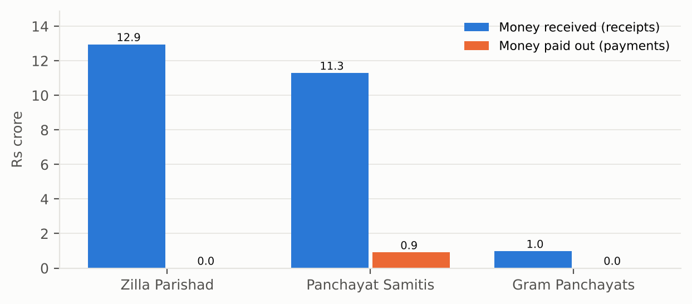
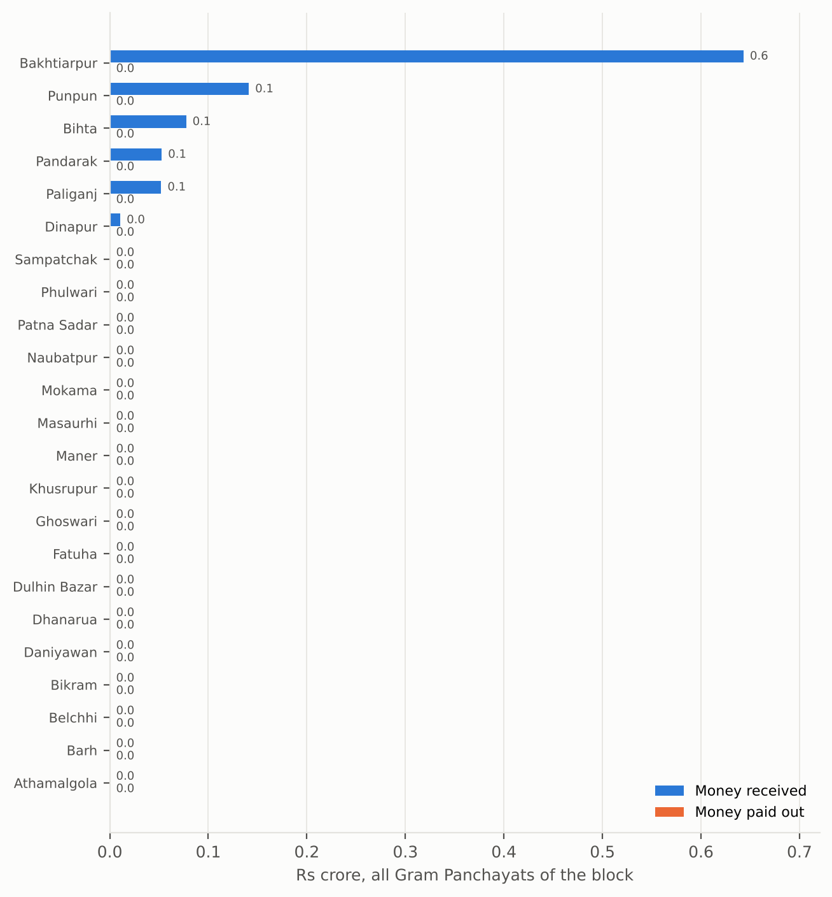
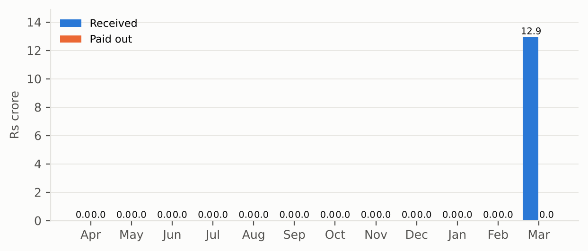

# Patna District: Panchayat Finances and Accounts, 2020-21

A plain-language district profile from the Government of India's eGramSwaraj system · India By Numbers · data as published by the portal (district statement generated July 18, 2022 2:27 AM)

## 1. The main points

- **Patna has 23 Panchayat Samitis (block councils) and 322 Gram Panchayats (village councils)** in the 2020-21 accounts, plus one Zilla Parishad (district council).
- **In 2020-21 its Panchayats together received Rs 25.21 crore and paid out Rs 0.90 crore.** (This year's statement uses a different measure from later years; see section 2.)
- **The Gram Panchayats had Rs 0.98 crore of receipts and paid out Rs 0.00 crore (0%).** Rank among Bihar's districts: **28 of 38** for money received by Gram Panchayats, **none (26 of 38 districts show none)** for money paid out by them.
- **An average Gram Panchayat in Patna had about Rs 0.3 lakh of receipts and paid out about Rs 0.0 lakh** in the year (district totals divided by 322 Gram Panchayats).
- **Almost all the money is the 15th Finance Commission grant** (scheme-wise statement, all levels). Sources listed for Patna: XV Finance Commission-XVFC 100.0%.
- **Annual accounts are not complete:** 293 of 322 Gram Panchayats, 23 of 23 Panchayat Samitis and the Zilla Parishad (closed) have closed their year book in the system.
- **Official figures for each of the 322 Gram Panchayats are in the Appendix.**

## 2. How to read the money words

| Term | Meaning |
|---|---|
| **Money received** (portal: *Receipts*) | Money received during the year, as printed in rupees in the 2020-21 statement. The report does not say whether last year's balance is included |
| **Money paid out** (portal: *Payments*) | Payments made from the Panchayat's own accounts during the year |
| **Crore / lakh** | 1 crore = 100 lakh = Rs 1,00,00,000 |

**Important:** from 2021-22 the portal changed this statement to *OB + Receipts* in crore. The 2020-21 *Receipts* figure is a different measure, so it should not be compared directly with the *money available* of later years.

Payments are only what passed through Panchayat accounts. They are **not** all government spending in the district (state departments pay for many works directly).

## 3. Money at each level of Panchayat

| Level | Bodies | Money received (Rs crore) | Paid out (Rs crore) | Paid out as share | Patna's share of Bihar (received) |
|---|---|---|---|---|---|
| Zilla Parishad (district council) | 1 | 12.945 | 0.000 | 0% | 4% of Rs 321 crore |
| Panchayat Samitis (block councils) | 23 | 11.290 | 0.905 | 8% | 3% of Rs 375 crore |
| Gram Panchayats (village councils) | 322 | 0.978 | 0.000 | 0% | 0% of Rs 235 crore |
| **All levels** | | **25.213** | **0.905** | **4%** | |

Source: District wise Receipt and Payment Statement, 2020-21, Bihar (generated July 18, 2022 2:27 AM); amounts printed in rupees, shown here in crore.

## 4. Block by block

Figures for the Panchayat Samiti (block council) itself and for all Gram Panchayats of the block together.

| Block | Gram Panchayats | Gram Panchayats: received (Rs crore) | Gram Panchayats: paid out | Share paid | Panchayat Samiti: received | Panchayat Samiti: paid out |
|---|---|---|---|---|---|---|
| Athamalgola | 8 | 0.000 | 0.000 | — | 0.521 | 0.000 |
| Bakhtiarpur | 16 | 0.643 | 0.000 | 0% | 0.451 | 0.000 |
| Barh | 13 | 0.000 | 0.000 | — | 0.397 | 0.000 |
| Belchhi | 7 | 0.000 | 0.000 | — | 0.438 | 0.210 |
| Bihta | 26 | 0.078 | 0.000 | 0% | 1.950 | 0.694 |
| Bikram | 16 | 0.000 | 0.000 | — | 0.381 | 0.000 |
| Daniyawan | 6 | 0.000 | 0.000 | — | 0.648 | 0.000 |
| Dhanarua | 20 | 0.000 | 0.000 | — | 1.196 | 0.000 |
| Dinapur | 13 | 0.011 | 0.000 | 0% | 0.353 | 0.000 |
| Dulhin Bazar | 14 | 0.000 | 0.000 | — | 0.342 | 0.000 |
| Fatuha | 15 | 0.000 | 0.000 | — | 0.000 | 0.000 |
| Ghoswari | 8 | 0.000 | 0.000 | — | 0.000 | 0.000 |
| Khusrupur | 7 | 0.000 | 0.000 | — | 0.282 | 0.000 |
| Maner | 19 | 0.000 | 0.000 | — | 0.339 | 0.000 |
| Masaurhi | 18 | 0.000 | 0.000 | — | 0.000 | 0.000 |
| Mokama | 15 | 0.000 | 0.000 | — | 0.891 | 0.000 |
| Naubatpur | 19 | 0.000 | 0.000 | — | 0.000 | 0.000 |
| Paliganj | 25 | 0.052 | 0.000 | 0% | 0.671 | 0.000 |
| Pandarak | 15 | 0.053 | 0.000 | 0% | 0.708 | 0.000 |
| Patna Sadar | 7 | 0.000 | 0.000 | — | 0.618 | 0.000 |
| Phulwari | 14 | 0.000 | 0.000 | — | 0.474 | 0.000 |
| Punpun | 14 | 0.141 | 0.000 | 0% | 0.068 | 0.000 |
| Sampatchak | 7 | 0.000 | 0.000 | — | 0.564 | 0.000 |

The blocks' Gram Panchayat figures add up to Rs 0.978 crore (district statement: Rs 0.978 crore). The largest is **Bakhtiarpur** (Rs 0.64 crore across 16 GPs), the smallest **Athamalgola** (Rs 0.00 crore). None of the 6 blocks with money shows any Gram Panchayat payment. In 17 of 23 blocks the Gram Panchayats show no money at all for this year. Blocks differ in the number and size of their Panchayats, so a larger amount does not by itself mean better or worse performance.

## 5. The Zilla Parishad month by month

The district council (Zilla Parishad) started the year with **Rs 0.00 crore** carried over, received **Rs 12.95 crore** during the year and paid out **Rs 0.00 crore**. This matches the annual statement.

| Month | Received (Rs lakh) | Paid out (Rs lakh) | Payment vouchers |
|---|---|---|---|
| April, 2020 | 0.00 | 0.00 | 0 |
| May, 2020 | 0.00 | 0.00 | 0 |
| June, 2020 | 0.00 | 0.00 | 0 |
| July, 2020 | 0.00 | 0.00 | 0 |
| August, 2020 | 0.00 | 0.00 | 0 |
| September, 2020 | 0.00 | 0.00 | 0 |
| October, 2020 | 0.00 | 0.00 | 0 |
| November, 2020 | 0.00 | 0.00 | 0 |
| December, 2020 | 0.00 | 0.00 | 0 |
| Januaury, 2021 | 0.00 | 0.00 | 0 |
| February, 2021 | 0.00 | 0.00 | 0 |
| March, 2021 | 1,294.55 | 0.00 | 0 |

Month names are shown exactly as the portal prints them.
 Source: Month Wise Payment and Receipt Statement (generated July 18, 2022 4:05 AM) and Month wise Summary Report (generated July 18, 2022 4:29 AM).

## 6. Where the money comes from

| Source (as named by the portal) | Zilla Parishad | Panchayat Samitis | Gram Panchayats |
|---|---|---|---|
| XV Finance Commission-XVFC | 100% of receipts | 100% of receipts | 100% of receipts |

Only the 1 source(s) above are listed for the district. Shares are calculated from the scheme-wise statement (generated August 20, 2021 6:50 AM). The same report counts 34 receipt vouchers and 0 payment vouchers for Patna's Gram Panchayats under the XV FC grant.

## 7. How well the books are kept

| | Zilla Parishad | Panchayat Samitis | Gram Panchayats |
|---|---|---|---|
| Number | 1 | 23 | 322 |
| Masters and opening balance entered | yes / yes | 23 / 23 | 294 / 294 |
| Receipt vouchers recorded | 5 | 61 | 34 |
| Payment vouchers recorded | 0 | 96 | 0 |
| Day book closed | yes | 23 of 23 | 293 of 322 |
| Month book closed | yes | 23 of 23 | 293 of 322 |
| Year book (annual accounts) closed | yes | 23 of 23 | 293 of 322 |

On average each Gram Panchayat recorded about 0 payment vouchers in the year. Source: District Wise Summary Report (generated July 18, 2022 2:31 AM).

## 8. Every receipt and payment (voucher level)

eGramSwaraj records each transaction as a **voucher**. For Patna in 2020-21 we opened the month-wise statement of the Zilla Parishad, all 23 Panchayat Samitis and 30 Gram Panchayats, and collected every voucher-wise list they link to — 196 voucher lines in all. Vouchers appear for **19 Panchayat Samitis and 30 Gram Panchayats**; the others list no vouchers for this year. (The 2020-21 block pages link the month-wise statements of only 30 of the 322 Gram Panchayats, so vouchers of the rest could not be reached. Every Gram Panchayat that shows any money in the official village statement was among those reached. The official figure for every Gram Panchayat is in the Appendix.) **No payee or vendor names are included** — only the voucher number, date, type and amount, exactly as the portal lists them.

| | Zilla Parishad | Panchayat Samitis | Gram Panchayats | Total collected |
|---|---|---|---|---|
| Receipt vouchers | 5 | 61 | 34 | 100 |
| Payment vouchers | 0 | 96 | 0 | 96 |
| Amount received (Rs crore) | 12.95 | 11.70 | 0.98 | 25.63 |
| Amount paid (Rs crore) | 0.00 | 1.32 | 0.00 | 1.32 |

Payments listed in vouchers (Rs 1.32 crore) are +46% compared with the annual statement (Rs 0.90 crore). The statement is the official total; the vouchers list somewhat more, probably because the statement is net of payments later cancelled, rejected or returned (the portal does not define this). Use the vouchers for detail and pattern, the statement for totals. A multi-year voucher report for the district is in `docs/district_reports/patna_vouchers/`.

**Types of voucher** (what the transaction was recorded as):

| Voucher type | Number | What it means |
|---|---|---|
| Direct Receipts | 96 | Money received directly |
| Expenditures | 95 | A payment / expenditure |
| Refund of Excess Payment | 4 | Money returned after an overpayment |
| Receipt Cancellation | 1 | as labelled by the portal |

**The ten largest single payments collected:**

| Voucher date | Voucher number | Level | Block | Amount (Rs) | Type |
|---|---|---|---|---|---|
| 31/03/2021 | XVFC/2020-21/P/1 | Panchayat Samiti | Patna Sadar | 4,116,720 | Receipt Cancellation |
| 25/03/2021 | XVFC/2020-21/P/13 | Panchayat Samiti | Bihta | 732,100 | Expenditures |
| 24/03/2021 | XVFC/2020-21/P/12 | Panchayat Samiti | Bihta | 729,546 | Expenditures |
| 20/03/2021 | XVFC/2020-21/P/3 | Panchayat Samiti | Bihta | 706,400 | Expenditures |
| 24/03/2021 | XVFC/2020-21/P/55 | Panchayat Samiti | Belchhi | 656,579 | Expenditures |
| 28/03/2021 | XVFC/2020-21/P/22 | Panchayat Samiti | Bihta | 647,488 | Expenditures |
| 12/03/2021 | XVFC/2020-21/P/1 | Panchayat Samiti | Bihta | 618,643 | Expenditures |
| 28/03/2021 | XVFC/2020-21/P/20 | Panchayat Samiti | Bihta | 423,074 | Expenditures |
| 24/03/2021 | XVFC/2020-21/P/41 | Panchayat Samiti | Belchhi | 420,178 | Expenditures |
| 18/03/2021 | XVFC/2020-21/P/1 | Panchayat Samiti | Belchhi | 415,674 | Expenditures |

All 196 voucher numbers begin with **XVFC**, confirming the money is the 15th Finance Commission grant. Every voucher is in the machine-readable file `data/validated/egs/vouchers/203_2020-2021.csv`, with its source page. Source: Voucher Wise Summary Report pages, collected 2026-11-22.

## 9. What this profile cannot tell you

| Not available | Why |
|---|---|
| Population or households of the district's Panchayats | Not in any open eGramSwaraj report, so no per-person figures |
| Who each payment went to (the payee or vendor of each voucher) | On the individual voucher page, behind a security check (CAPTCHA); not collected. The voucher number, date, type and amount ARE collected (section 8) |
| Elected members of this district | Collected for Bihar as a whole only; district figures are a planned follow-up |
| Value of approved development plans | Only whether a plan was uploaded is public |
| Money left unspent at year end | Not printed as an official figure |

## 10. About these figures

- Every figure is copied from the government's own eGramSwaraj reports and was checked against the original pages in the data validation (Task 5). Totals in this profile add up to the portal's own totals.
- Each report is a snapshot taken on the date shown; later reports for the same year can differ slightly because accounts keep being updated.
- District code 203; block and Gram Panchayat codes are the portal's own. Data collected November 2026 from egramswaraj.gov.in. Machine-readable tables: `data/validated/egs/`.
- Reports for Patna in other years: `docs/district_reports/patna/index.md`; all districts: `docs/district_reports/README.md`.

## Appendix: every Gram Panchayat of Patna, 2020-21

Amounts in Rs lakh. **Official receipts / payments** are from the Village wise Receipt and Payment Statement (generated July 18, 2022 3:58 AM); they are the figures to quote. **Voucher** columns add up the Gram Panchayat's own receipt and payment vouchers (section 8). Voucher totals are gross and run somewhat higher than official figures; use them for detail and comparison between villages, not as official totals. A dash means no vouchers were listed or reached. A dash in *Code* means the portal printed that row without a code link, so it is shown by name only. 322 Gram Panchayats are shown; the district statement counts 322.

| Block | Gram Panchayat | Code | Official receipts | Official payments | Receipt vouchers | Received (vouchers) | Payment vouchers | Paid (vouchers) |
|---|---|---|---|---|---|---|---|---|
| Athamalgola | Bahadurpur | 98783 | 0.00 | 0.00 | — | — | — | — |
| Athamalgola | Kalyanpur | 98784 | 0.00 | 0.00 | — | — | — | — |
| Athamalgola | Karjan | 98785 | 0.00 | 0.00 | — | — | — | — |
| Athamalgola | Phulelpur Meaura | 98786 | 0.00 | 0.00 | — | — | — | — |
| Athamalgola | Ramnagar Diyara | 98787 | 0.00 | 0.00 | — | — | — | — |
| Athamalgola | Ramnagar Korari Kochhar | 98788 | 0.00 | 0.00 | — | — | — | — |
| Athamalgola | Sabnima | 98789 | 0.00 | 0.00 | — | — | — | — |
| Athamalgola | Usmanpur | 98790 | 0.00 | 0.00 | — | — | — | — |
| Bakhtiarpur | Alipur Bihta | 98791 | 5.37 | 0.00 | 1 | 5.37 | 0 | 0.00 |
| Bakhtiarpur | Bidhipur Narauli | 98792 | 5.26 | 0.00 | 1 | 5.26 | 0 | 0.00 |
| Bakhtiarpur | Champa Pur | 98793 | 5.90 | 0.00 | 1 | 5.90 | 0 | 0.00 |
| Bakhtiarpur | Chiraiya Rupas | 98794 | 2.80 | 0.00 | 1 | 2.80 | 0 | 0.00 |
| Bakhtiarpur | Doma | 98795 | 5.33 | 0.00 | 1 | 5.33 | 0 | 0.00 |
| Bakhtiarpur | Ghangah | 98796 | 1.89 | 0.00 | 1 | 1.89 | 0 | 0.00 |
| Bakhtiarpur | Ghoswari | 98797 | 2.56 | 0.00 | 1 | 2.56 | 0 | 0.00 |
| Bakhtiarpur | Hardaspur Diara | 98798 | 2.83 | 0.00 | 1 | 2.83 | 0 | 0.00 |
| Bakhtiarpur | Hidayatpur Saidpur | 98799 | 4.53 | 0.00 | 1 | 4.53 | 0 | 0.00 |
| Bakhtiarpur | Kala Diara | 98800 | 4.08 | 0.00 | 1 | 4.08 | 0 | 0.00 |
| Bakhtiarpur | Karnauti | 98801 | 2.70 | 0.00 | 1 | 2.70 | 0 | 0.00 |
| Bakhtiarpur | Manjhauli | 98802 | 4.78 | 0.00 | 1 | 4.78 | 0 | 0.00 |
| Bakhtiarpur | Missi | 98803 | 4.90 | 0.00 | 1 | 4.90 | 0 | 0.00 |
| Bakhtiarpur | Mogal Pura | 98804 | 5.43 | 0.00 | 1 | 5.43 | 0 | 0.00 |
| Bakhtiarpur | Rupas Mahaji | 98805 | 5.28 | 0.00 | 1 | 5.28 | 0 | 0.00 |
| Bakhtiarpur | Satbhaiya Ram Nagar | 98806 | 0.68 | 0.00 | 1 | 0.68 | 0 | 0.00 |
| Barh | Agwanpur | 98807 | 0.00 | 0.00 | — | — | — | — |
| Barh | Berhana East | 98808 | 0.00 | 0.00 | — | — | — | — |
| Barh | Berhana West | 98809 | 0.00 | 0.00 | — | — | — | — |
| Barh | Bhatgawn | 98810 | 0.00 | 0.00 | — | — | — | — |
| Barh | Dhanwan Mobarakpur | 98811 | 0.00 | 0.00 | — | — | — | — |
| Barh | Ekdanga | 98812 | 0.00 | 0.00 | — | — | — | — |
| Barh | Ibrahimpur | 98813 | 0.00 | 0.00 | — | — | — | — |
| Barh | Nadawan | 98814 | 0.00 | 0.00 | — | — | — | — |
| Barh | Navada | 98815 | 0.00 | 0.00 | — | — | — | — |
| Barh | Rahimpur Rupas | 98816 | 0.00 | 0.00 | — | — | — | — |
| Barh | Rangbigha | 98817 | 0.00 | 0.00 | — | — | — | — |
| Barh | Sarkatti Saidpur | 98818 | 0.00 | 0.00 | — | — | — | — |
| Barh | Shohari | 98819 | 0.00 | 0.00 | — | — | — | — |
| Belchhi | Aundouli Darweshpura | 98820 | 0.00 | 0.00 | — | — | — | — |
| Belchhi | Barah | 98821 | 0.00 | 0.00 | — | — | — | — |
| Belchhi | Belchhi | 98822 | 0.00 | 0.00 | — | — | — | — |
| Belchhi | Fatehpur | 98823 | 0.00 | 0.00 | — | — | — | — |
| Belchhi | Korari | 98824 | 0.00 | 0.00 | — | — | — | — |
| Belchhi | Saksohara West | 98825 | 0.00 | 0.00 | — | — | — | — |
| Belchhi | Saksohra East | 98826 | 0.00 | 0.00 | — | — | — | — |
| Bihta | AMHARA | 98827 | 0.00 | 0.00 | — | — | — | — |
| Bihta | Anandpur | 98828 | 0.00 | 0.00 | — | — | — | — |
| Bihta | Bela | 98829 | 0.00 | 0.00 | — | — | — | — |
| Bihta | BIHTA | 98830 | 0.00 | 0.00 | — | — | — | — |
| Bihta | Bindaul | 98831 | 5.80 | 0.00 | 2 | 5.80 | 0 | 0.00 |
| Bihta | Bishunpura | 98832 | 0.00 | 0.00 | — | — | — | — |
| Bihta | Dayalpur Daulatpur | 98833 | 0.00 | 0.00 | — | — | — | — |
| Bihta | Doulatpur Simri | 98834 | 0.00 | 0.00 | — | — | — | — |
| Bihta | Kanchanpur Kharagpur | 98835 | 0.00 | 0.00 | — | — | — | — |
| Bihta | Kateshar | 98836 | 0.00 | 0.00 | — | — | — | — |
| Bihta | Kouriya | 98837 | 0.00 | 0.00 | — | — | — | — |
| Bihta | Kunwa | 98838 | 0.00 | 0.00 | — | — | — | — |
| Bihta | Machhalpur Lai | 98839 | 0.00 | 0.00 | — | — | — | — |
| Bihta | Makhdumpur | 98840 | 0.86 | 0.00 | 1 | 0.86 | 0 | 0.00 |
| Bihta | Mushepur | 98841 | 0.00 | 0.00 | — | — | — | — |
| Bihta | Neora | 98842 | 0.00 | 0.00 | — | — | — | — |
| Bihta | Painal | 98843 | 0.00 | 0.00 | — | — | — | — |
| Bihta | Parev | 98844 | 1.10 | 0.00 | 2 | 1.10 | 0 | 0.00 |
| Bihta | Purusottampur Painathi | 98845 | 0.00 | 0.00 | — | — | — | — |
| Bihta | RAGHOPUR | 98846 | 0.00 | 0.00 | — | — | — | — |
| Bihta | Sadisopur | 98847 | 0.00 | 0.00 | — | — | — | — |
| Bihta | Sikandarpur | 98848 | 0.00 | 0.00 | — | — | — | — |
| Bihta | Sri Chandpur | 98849 | 0.00 | 0.00 | — | — | — | — |
| Bihta | SRI RAMPUR | 98850 | 0.00 | 0.00 | — | — | — | — |
| Bihta | Tara Nagar | 98851 | 0.00 | 0.00 | — | — | — | — |
| Bihta | Yamunapur | 98852 | 0.00 | 0.00 | — | — | — | — |
| Bikram | Akhtyarpur Manjhauli | 98853 | 0.00 | 0.00 | — | — | — | — |
| Bikram | Arap | 98854 | 0.00 | 0.00 | — | — | — | — |
| Bikram | Beni Bigha | 98856 | 0.00 | 0.00 | — | — | — | — |
| Bikram | Birdhaur Berar Katari | 98858 | 0.00 | 0.00 | — | — | — | — |
| Bikram | Brah | 98855 | 0.00 | 0.00 | — | — | — | — |
| Bikram | Danara Katari | 98859 | 0.00 | 0.00 | — | — | — | — |
| Bikram | Datiyana | 98860 | 0.00 | 0.00 | — | — | — | — |
| Bikram | Gorkhari | 98862 | 0.00 | 0.00 | — | — | — | — |
| Bikram | Haibaspur Gona | 98863 | 0.00 | 0.00 | — | — | — | — |
| Bikram | Mahajpura | 98864 | 0.00 | 0.00 | — | — | — | — |
| Bikram | Moriyawa Shivgadh | 98866 | 0.00 | 0.00 | — | — | — | — |
| Bikram | Naghar | 98867 | 0.00 | 0.00 | — | — | — | — |
| Bikram | Patut | 98868 | 0.00 | 0.00 | — | — | — | — |
| Bikram | Saidabad Kanpa | 98869 | 0.00 | 0.00 | — | — | — | — |
| Bikram | Sunderpur Chauthiyan | 98865 | 0.00 | 0.00 | — | — | — | — |
| Bikram | Wazirpur | 98870 | 0.00 | 0.00 | — | — | — | — |
| Daniyawan | Bankipur Machhariyawan | 98871 | 0.00 | 0.00 | — | — | — | — |
| Daniyawan | Daniyawan | 98872 | 0.00 | 0.00 | — | — | — | — |
| Daniyawan | Kharbhaiya | 98873 | 0.00 | 0.00 | — | — | — | — |
| Daniyawan | Salarpur | 98875 | 0.00 | 0.00 | — | — | — | — |
| Daniyawan | Shahjahanpur | 98874 | 0.00 | 0.00 | — | — | — | — |
| Daniyawan | Singariyawan | 98876 | 0.00 | 0.00 | — | — | — | — |
| Dhanarua | Bahrampur | 98877 | 0.00 | 0.00 | — | — | — | — |
| Dhanarua | Baribigha | 98878 | 0.00 | 0.00 | — | — | — | — |
| Dhanarua | BARNI | 98879 | 0.00 | 0.00 | — | — | — | — |
| Dhanarua | Bijaypura | 98880 | 0.00 | 0.00 | — | — | — | — |
| Dhanarua | Chhati | 98881 | 0.00 | 0.00 | — | — | — | — |
| Dhanarua | Deodaha | 98882 | 0.00 | 0.00 | — | — | — | — |
| Dhanarua | Dewan | 98883 | 0.00 | 0.00 | — | — | — | — |
| Dhanarua | Dhanarua | 98884 | 0.00 | 0.00 | — | — | — | — |
| Dhanarua | Gobindpur Baurhi | 98885 | 0.00 | 0.00 | — | — | — | — |
| Dhanarua | Hulaschakbir | 98886 | 0.00 | 0.00 | — | — | — | — |
| Dhanarua | Kosut | 98887 | 0.00 | 0.00 | — | — | — | — |
| Dhanarua | Mai Netaul | 98888 | 0.00 | 0.00 | — | — | — | — |
| Dhanarua | Moriyawan | 98889 | 0.00 | 0.00 | — | — | — | — |
| Dhanarua | Nadwa | 98890 | 0.00 | 0.00 | — | — | — | — |
| Dhanarua | Nimra | 98891 | 0.00 | 0.00 | — | — | — | — |
| Dhanarua | Pabhera | 98892 | 0.00 | 0.00 | — | — | — | — |
| Dhanarua | Patharhat | 98893 | 0.00 | 0.00 | — | — | — | — |
| Dhanarua | Sanda | 98894 | 0.00 | 0.00 | — | — | — | — |
| Dhanarua | Satparsa | 98895 | 0.00 | 0.00 | — | — | — | — |
| Dhanarua | Sonmai | 98896 | 0.00 | 0.00 | — | — | — | — |
| Dinapur | Ganghara | 98897 | 0.00 | 0.00 | — | — | — | — |
| Dinapur | Hathia Kandh | 98898 | 0.00 | 0.00 | — | — | — | — |
| Dinapur | Hetanpur | 98899 | 0.00 | 0.00 | — | — | — | — |
| Dinapur | Jamaluddin | 98900 | 0.00 | 0.00 | — | — | — | — |
| Dinapur | Jamsaut | 98901 | 0.00 | 0.00 | — | — | — | — |
| Dinapur | Kasim Chak | 98902 | 0.00 | 0.00 | — | — | — | — |
| Dinapur | Kothawan | 98903 | 0.00 | 0.00 | — | — | — | — |
| Dinapur | Lakhani Bigha | 98904 | 0.00 | 0.00 | — | — | — | — |
| Dinapur | Manas | 98905 | 0.00 | 0.00 | — | — | — | — |
| Dinapur | Mobarakpur-Raghurampur | 98906 | 1.07 | 0.00 | 1 | 1.07 | 0 | 0.00 |
| Dinapur | Patla Pur | 98907 | 0.00 | 0.00 | — | — | — | — |
| Dinapur | Purani Panapur | 98908 | 0.00 | 0.00 | — | — | — | — |
| Dinapur | Sarari | 98909 | 0.00 | 0.00 | — | — | — | — |
| Dulhin Bazar | Achhua Rakasiya | 98911 | 0.00 | 0.00 | — | — | — | — |
| Dulhin Bazar | Ainkhan Bhimnichak | 98910 | 0.00 | 0.00 | — | — | — | — |
| Dulhin Bazar | Bharatpura | 98912 | 0.00 | 0.00 | — | — | — | — |
| Dulhin Bazar | Dhana Nisarpura | 98913 | 0.00 | 0.00 | — | — | — | — |
| Dulhin Bazar | Kab | 98914 | 0.00 | 0.00 | — | — | — | — |
| Dulhin Bazar | Lala Bhadsara | 98915 | 0.00 | 0.00 | — | — | — | — |
| Dulhin Bazar | Narhi Pirhi | 98916 | 0.00 | 0.00 | — | — | — | — |
| Dulhin Bazar | Rajipur | 98917 | 0.00 | 0.00 | — | — | — | — |
| Dulhin Bazar | Sadaweh Dorawan | 98918 | 0.00 | 0.00 | — | — | — | — |
| Dulhin Bazar | Selhauri Belhauri | 98919 | 0.00 | 0.00 | — | — | — | — |
| Dulhin Bazar | Sihi | 98920 | 0.00 | 0.00 | — | — | — | — |
| Dulhin Bazar | Singhara Kopa | 98921 | 0.00 | 0.00 | — | — | — | — |
| Dulhin Bazar | Soniyawan | 98922 | 0.00 | 0.00 | — | — | — | — |
| Dulhin Bazar | Ular Sorampur | 98923 | 0.00 | 0.00 | — | — | — | — |
| Fatuha | Alawal Pur | 98924 | 0.00 | 0.00 | — | — | — | — |
| Fatuha | Bali | 98925 | 0.00 | 0.00 | — | — | — | — |
| Fatuha | Dumari | 98926 | 0.00 | 0.00 | — | — | — | — |
| Fatuha | Gauri Punda | 98927 | 0.00 | 0.00 | — | — | — | — |
| Fatuha | Jaita | 98928 | 0.00 | 0.00 | — | — | — | — |
| Fatuha | Jethuli | 98929 | 0.00 | 0.00 | — | — | — | — |
| Fatuha | Kolhar | 98930 | 0.00 | 0.00 | — | — | — | — |
| Fatuha | Mansing Pur | 98931 | 0.00 | 0.00 | — | — | — | — |
| Fatuha | Masadhi | 98932 | 0.00 | 0.00 | — | — | — | — |
| Fatuha | Mauji Pur | 98933 | 0.00 | 0.00 | — | — | — | — |
| Fatuha | Mohiuddin Pur | 98934 | 0.00 | 0.00 | — | — | — | — |
| Fatuha | Momin Pur | 98935 | 0.00 | 0.00 | — | — | — | — |
| Fatuha | Pitamberpur | 98936 | 0.00 | 0.00 | — | — | — | — |
| Fatuha | Rukun Pur | 98937 | 0.00 | 0.00 | — | — | — | — |
| Fatuha | Usfa | 98938 | 0.00 | 0.00 | — | — | — | — |
| Ghoswari | Ghoswari | 98939 | 0.00 | 0.00 | — | — | — | — |
| Ghoswari | Gosai Gaon | 98940 | 0.00 | 0.00 | — | — | — | — |
| Ghoswari | Kumhra | 98941 | 0.00 | 0.00 | — | — | — | — |
| Ghoswari | Kurmichak | 98942 | 0.00 | 0.00 | — | — | — | — |
| Ghoswari | Paijna | 98943 | 0.00 | 0.00 | — | — | — | — |
| Ghoswari | Samya Garh | 98944 | 0.00 | 0.00 | — | — | — | — |
| Ghoswari | Tartar | 98945 | 0.00 | 0.00 | — | — | — | — |
| Ghoswari | Trimuhan | 98946 | 0.00 | 0.00 | — | — | — | — |
| Khusrupur | Alawalpur | 98947 | 0.00 | 0.00 | — | — | — | — |
| Khusrupur | Baikatpur | 98948 | 0.00 | 0.00 | — | — | — | — |
| Khusrupur | Chaura | 98949 | 0.00 | 0.00 | — | — | — | — |
| Khusrupur | Haibatpur | 98950 | 0.00 | 0.00 | — | — | — | — |
| Khusrupur | Hardas Bigha | 98951 | 0.00 | 0.00 | — | — | — | — |
| Khusrupur | Mosim Pur | 98952 | 0.00 | 0.00 | — | — | — | — |
| Khusrupur | Sukarbeg Chak | 98953 | 0.00 | 0.00 | — | — | — | — |
| Maner | Baluwa | 98954 | 0.00 | 0.00 | — | — | — | — |
| Maner | Bank | 98955 | 0.00 | 0.00 | — | — | — | — |
| Maner | Biyapur | 98956 | 0.00 | 0.00 | — | — | — | — |
| Maner | Darwesh Pur North | 98957 | 0.00 | 0.00 | — | — | — | — |
| Maner | Darwesh Pur South | 98958 | 0.00 | 0.00 | — | — | — | — |
| Maner | Gyas Pur | 98959 | 0.00 | 0.00 | — | — | — | — |
| Maner | Khas Pur | 98960 | 0.00 | 0.00 | — | — | — | — |
| Maner | Kita Chauhattar East | 98961 | 0.00 | 0.00 | — | — | — | — |
| Maner | Kita Chauhattar Middle | 98962 | 0.00 | 0.00 | — | — | — | — |
| Maner | Kita Chauhattar West | 98963 | 0.00 | 0.00 | — | — | — | — |
| Maner | Madhopur | 98964 | 0.00 | 0.00 | — | — | — | — |
| Maner | Magar Pal | 98965 | 0.00 | 0.00 | — | — | — | — |
| Maner | Rampur Diyara Tauffir | 98966 | 0.00 | 0.00 | — | — | — | — |
| Maner | Sadikpur | 98967 | 0.00 | 0.00 | — | — | — | — |
| Maner | Sarai | 98968 | 0.00 | 0.00 | — | — | — | — |
| Maner | Sherpur East | 98969 | 0.00 | 0.00 | — | — | — | — |
| Maner | Sherpur West | 98970 | 0.00 | 0.00 | — | — | — | — |
| Maner | Singhara | 98971 | 0.00 | 0.00 | — | — | — | — |
| Maner | Suwarmarwah | 98972 | 0.00 | 0.00 | — | — | — | — |
| Masaurhi | Bara | 98973 | 0.00 | 0.00 | — | — | — | — |
| Masaurhi | Berra | 98974 | 0.00 | 0.00 | — | — | — | — |
| Masaurhi | BHADAURA | 98975 | 0.00 | 0.00 | — | — | — | — |
| Masaurhi | Bhagwanganj | 98976 | 0.00 | 0.00 | — | — | — | — |
| Masaurhi | Bhaiswan | 98977 | 0.00 | 0.00 | — | — | — | — |
| Masaurhi | Chapaur | 98978 | 0.00 | 0.00 | — | — | — | — |
| Masaurhi | Charma | 98979 | 0.00 | 0.00 | — | — | — | — |
| Masaurhi | Daulatpur | 98980 | 0.00 | 0.00 | — | — | — | — |
| Masaurhi | Deoria | 98981 | 0.00 | 0.00 | — | — | — | — |
| Masaurhi | Karay | 98982 | 0.00 | 0.00 | — | — | — | — |
| Masaurhi | Kharant | 98983 | 0.00 | 0.00 | — | — | — | — |
| Masaurhi | Lakhnaur-Bedauli | 98984 | 0.00 | 0.00 | — | — | — | — |
| Masaurhi | Nadaul | 98985 | 0.00 | 0.00 | — | — | — | — |
| Masaurhi | Nishiyawan | 98986 | 0.00 | 0.00 | — | — | — | — |
| Masaurhi | Nura | 98987 | 0.00 | 0.00 | — | — | — | — |
| Masaurhi | Rewan | 98988 | 0.00 | 0.00 | — | — | — | — |
| Masaurhi | Shahabad | 98989 | 0.00 | 0.00 | — | — | — | — |
| Masaurhi | Tineri | 98990 | 0.00 | 0.00 | — | — | — | — |
| Mokama | Aunta | 98991 | 0.00 | 0.00 | — | — | — | — |
| Mokama | Barahpur | 98992 | 0.00 | 0.00 | — | — | — | — |
| Mokama | Dariapur | 98993 | 0.00 | 0.00 | — | — | — | — |
| Mokama | Hathidah Buzurg | 98994 | 0.00 | 0.00 | — | — | — | — |
| Mokama | Kanhaipur | 98995 | 0.00 | 0.00 | — | — | — | — |
| Mokama | Kasaha Diyara | 98996 | 0.00 | 0.00 | — | — | — | — |
| Mokama | Malpur | 98997 | 0.00 | 0.00 | — | — | — | — |
| Mokama | Maranchi (North) | 98998 | 0.00 | 0.00 | — | — | — | — |
| Mokama | Maranchi (South) | 98999 | 0.00 | 0.00 | — | — | — | — |
| Mokama | Mekra | 99000 | 0.00 | 0.00 | — | — | — | — |
| Mokama | Mor (East) | 99001 | 0.00 | 0.00 | — | — | — | — |
| Mokama | Mor (West) | 99002 | 0.00 | 0.00 | — | — | — | — |
| Mokama | Nauranga Jalalpur | 99003 | 0.00 | 0.00 | — | — | — | — |
| Mokama | Rampur Dumra | 99004 | 0.00 | 0.00 | — | — | — | — |
| Mokama | Shivnar | 99005 | 0.00 | 0.00 | — | — | — | — |
| Naubatpur | Adla | 99006 | 0.00 | 0.00 | — | — | — | — |
| Naubatpur | Ajwan | 99007 | 0.00 | 0.00 | — | — | — | — |
| Naubatpur | Badi Tengraila | 99008 | 0.00 | 0.00 | — | — | — | — |
| Naubatpur | Bara | 99009 | 0.00 | 0.00 | — | — | — | — |
| Naubatpur | Chak-Chechoul | 99010 | 0.00 | 0.00 | — | — | — | — |
| Naubatpur | Chesi | 99011 | 0.00 | 0.00 | — | — | — | — |
| Naubatpur | Chiraura | 99012 | 0.00 | 0.00 | — | — | — | — |
| Naubatpur | Dariyapur | 99013 | 0.00 | 0.00 | — | — | — | — |
| Naubatpur | Dewra | 99014 | 0.00 | 0.00 | — | — | — | — |
| Naubatpur | Faridpur | 99015 | 0.00 | 0.00 | — | — | — | — |
| Naubatpur | Gonwan | 99016 | 0.00 | 0.00 | — | — | — | — |
| Naubatpur | Ibrahimpur | 99017 | 0.00 | 0.00 | — | — | — | — |
| Naubatpur | Jaitipur | 99018 | 0.00 | 0.00 | — | — | — | — |
| Naubatpur | Jamalpura | 99019 | 0.00 | 0.00 | — | — | — | — |
| Naubatpur | Karanja Gowai | 99020 | 0.00 | 0.00 | — | — | — | — |
| Naubatpur | Khajuri | 99021 | 0.00 | 0.00 | — | — | — | — |
| Naubatpur | Nawdiha | 99023 | 0.00 | 0.00 | — | — | — | — |
| Naubatpur | Nawhi | 99024 | 0.00 | 0.00 | — | — | — | — |
| Naubatpur | Savar Chak | 99026 | 0.00 | 0.00 | — | — | — | — |
| Paliganj | Ajda Sikariya | 99028 | 0.85 | 0.00 | 1 | 0.85 | 0 | 0.00 |
| Paliganj | Akbarpur Ranipur | 99027 | 0.00 | 0.00 | — | — | — | — |
| Paliganj | Bherhariya Siyarampur | 99029 | 0.00 | 0.00 | — | — | — | — |
| Paliganj | Chandhos | 99030 | 0.00 | 0.00 | — | — | — | — |
| Paliganj | Chiksi | 99031 | 0.00 | 0.00 | — | — | — | — |
| Paliganj | Dahiya | 99032 | 0.00 | 0.00 | — | — | — | — |
| Paliganj | Dharhara | 99033 | 0.00 | 0.00 | — | — | — | — |
| Paliganj | Jamharu Imamganj | 99034 | 0.00 | 0.00 | — | — | — | — |
| Paliganj | Jarkha | 99035 | 4.12 | 0.00 | 1 | 4.12 | 0 | 0.00 |
| Paliganj | Kalyanpur Paipura | 99036 | 0.00 | 0.00 | — | — | — | — |
| Paliganj | Katka Paigambarpur | 99037 | 0.25 | 0.00 | 1 | 0.25 | 0 | 0.00 |
| Paliganj | Khanpura Taranpur | 99038 | 0.00 | 0.00 | — | — | — | — |
| Paliganj | Lalganj Sehra | 99039 | 0.00 | 0.00 | — | — | — | — |
| Paliganj | Madhwan Makhmilpur | 99040 | 0.00 | 0.00 | — | — | — | — |
| Paliganj | Mahabalipur | 99041 | 0.00 | 0.00 | — | — | — | — |
| Paliganj | Masaudha Jalpura | 99042 | 0.00 | 0.00 | — | — | — | — |
| Paliganj | Mera Patouna | 99044 | 0.00 | 0.00 | — | — | — | — |
| Paliganj | Mouri Piyarpura | 99043 | 0.00 | 0.00 | — | — | — | — |
| Paliganj | Mudika | 99045 | 0.00 | 0.00 | — | — | — | — |
| Paliganj | Nadahari Kodahari | 99046 | 0.00 | 0.00 | — | — | — | — |
| Paliganj | NIRAKHPUR PALI | 99047 | 0.00 | 0.00 | — | — | — | — |
| Paliganj | RAMPUR NAGWAN | 99048 | 0.00 | 0.00 | — | — | — | — |
| Paliganj | Ranipur Kurkuri | 99049 | 0.00 | 0.00 | — | — | — | — |
| Paliganj | Sarsi Pipardahan | 99050 | 0.00 | 0.00 | — | — | — | — |
| Paliganj | Sigodi | 99051 | 0.00 | 0.00 | — | — | — | — |
| Pandarak | Ajgara Bakawan | 99052 | 0.00 | 0.00 | — | — | — | — |
| Pandarak | Baraune Bathoi | 99053 | 0.00 | 0.00 | — | — | — | — |
| Pandarak | Bihari Bigha | 99054 | 0.00 | 0.00 | — | — | — | — |
| Pandarak | Chakjalal | 99055 | 0.00 | 0.00 | — | — | — | — |
| Pandarak | Dabhawan | 99058 | 0.00 | 0.00 | — | — | — | — |
| Pandarak | DARWEBHADAUR | — | 0.00 | 0.00 | — | — | — | — |
| Pandarak | Dhivar | 99057 | 0.01 | 0.00 | 1 | 0.01 | 0 | 0.00 |
| Pandarak | Gowasa Shekhpura | 99059 | 0.00 | 0.00 | — | — | — | — |
| Pandarak | Khushhal Chak | 99060 | 0.00 | 0.00 | — | — | — | — |
| Pandarak | Kondi | 99061 | 0.00 | 0.00 | — | — | — | — |
| Pandarak | Lemuabad | 99062 | 0.54 | 0.00 | 1 | 0.54 | 0 | 0.00 |
| Pandarak | Pandarak East | 99063 | 0.00 | 0.00 | — | — | — | — |
| Pandarak | Pandarak West | 99064 | 0.00 | 0.00 | — | — | — | — |
| Pandarak | Parsawan | 99065 | 0.00 | 0.00 | — | — | — | — |
| Pandarak | Raili | 99066 | 4.72 | 0.00 | 3 | 4.72 | 0 | 0.00 |
| Patna Sadar | Fatehpur | 99070 | 0.00 | 0.00 | — | — | — | — |
| Patna Sadar | Mahuli | 99071 | 0.00 | 0.00 | — | — | — | — |
| Patna Sadar | Marchi | 99072 | 0.00 | 0.00 | — | — | — | — |
| Patna Sadar | Nakta Diyara | 99073 | 0.00 | 0.00 | — | — | — | — |
| Patna Sadar | Punadih | 99075 | 0.00 | 0.00 | — | — | — | — |
| Patna Sadar | Sabalpur | 99076 | 0.00 | 0.00 | — | — | — | — |
| Patna Sadar | Sonawa Pur | 99077 | 0.00 | 0.00 | — | — | — | — |
| Phulwari | Bhusaula Danapur | 99079 | 0.00 | 0.00 | — | — | — | — |
| Phulwari | Chilbilli | 99080 | 0.00 | 0.00 | — | — | — | — |
| Phulwari | Dhiwara | 99081 | 0.00 | 0.00 | — | — | — | — |
| Phulwari | Gonpura | 99082 | 0.00 | 0.00 | — | — | — | — |
| Phulwari | Koriayawan | 99083 | 0.00 | 0.00 | — | — | — | — |
| Phulwari | Kurkuri | 99084 | 0.00 | 0.00 | — | — | — | — |
| Phulwari | Kurthoul | 99085 | 0.00 | 0.00 | — | — | — | — |
| Phulwari | Menpura Anda | 99086 | 0.00 | 0.00 | — | — | — | — |
| Phulwari | Nohsa | 99087 | 0.00 | 0.00 | — | — | — | — |
| Phulwari | Persa | 99088 | 0.00 | 0.00 | — | — | — | — |
| Phulwari | Rampur Faridpur | 99089 | 0.00 | 0.00 | — | — | — | — |
| Phulwari | Sakraicha | 99090 | 0.00 | 0.00 | — | — | — | — |
| Phulwari | Shorampur | 99091 | 0.00 | 0.00 | — | — | — | — |
| Phulwari | Suitha | 99092 | 0.00 | 0.00 | — | — | — | — |
| Punpun | Akauna | 99098 | 0.00 | 0.00 | — | — | — | — |
| Punpun | Barah | 99093 | 0.00 | 0.00 | — | — | — | — |
| Punpun | Baranwa | 99094 | 2.71 | 0.00 | 1 | 2.71 | 0 | 0.00 |
| Punpun | Behranwa | 99095 | 0.00 | 0.00 | — | — | — | — |
| Punpun | Dumri | 99096 | 2.45 | 0.00 | 1 | 2.45 | 0 | 0.00 |
| Punpun | East Lakhna | 99097 | 0.00 | 0.00 | — | — | — | — |
| Punpun | Kalyanpur | 99099 | 0.00 | 0.00 | — | — | — | — |
| Punpun | Kewra | 99100 | 0.00 | 0.00 | — | — | — | — |
| Punpun | Lakhanpar | 99101 | 0.00 | 0.00 | — | — | — | — |
| Punpun | Lakhna North | 99102 | 8.25 | 0.00 | 1 | 8.25 | 0 | 0.00 |
| Punpun | Paimar | 99103 | 0.71 | 0.00 | 1 | 0.71 | 0 | 0.00 |
| Punpun | Parthu | 99104 | 0.00 | 0.00 | — | — | — | — |
| Punpun | Potthhi | 99105 | 0.00 | 0.00 | — | — | — | — |
| Punpun | PUNPUN | 99106 | 0.00 | 0.00 | — | — | — | — |
| Sampatchak | BAIRIYA KARNPUR | 99107 | 0.00 | 0.00 | — | — | — | — |
| Sampatchak | BHELWARA DARIYAPUR | 99108 | 0.00 | 0.00 | — | — | — | — |
| Sampatchak | Chipura | 99109 | 0.00 | 0.00 | — | — | — | — |
| Sampatchak | KANAUJI KACHUARA | 99110 | 0.00 | 0.00 | — | — | — | — |
| Sampatchak | Kandap Taranpur | 99111 | 0.00 | 0.00 | — | — | — | — |
| Sampatchak | Lanka Kachuara | 99112 | 0.00 | 0.00 | — | — | — | — |
| Sampatchak | SONA GOPALPUR | 99113 | 0.00 | 0.00 | — | — | — | — |

Official Gram Panchayat figures above add up to Rs 0.98 crore received and Rs 0.00 crore paid out.

Voucher totals above add up to Rs 0.98 crore received and Rs 0.00 crore paid out across 30 Gram Panchayats.

