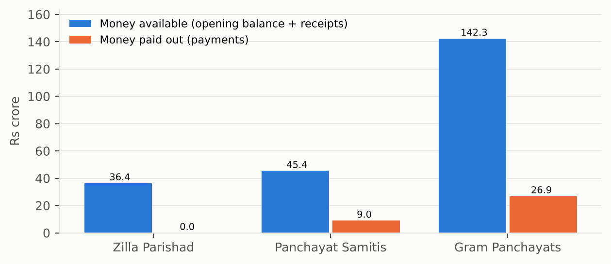
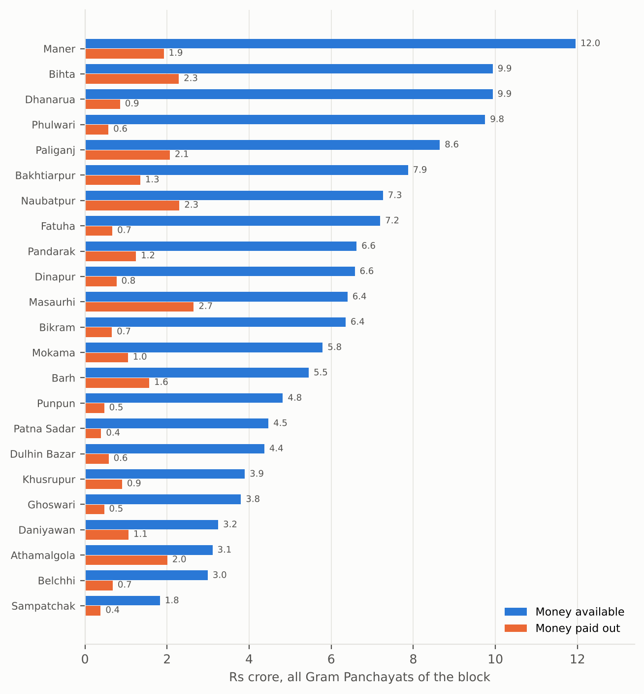
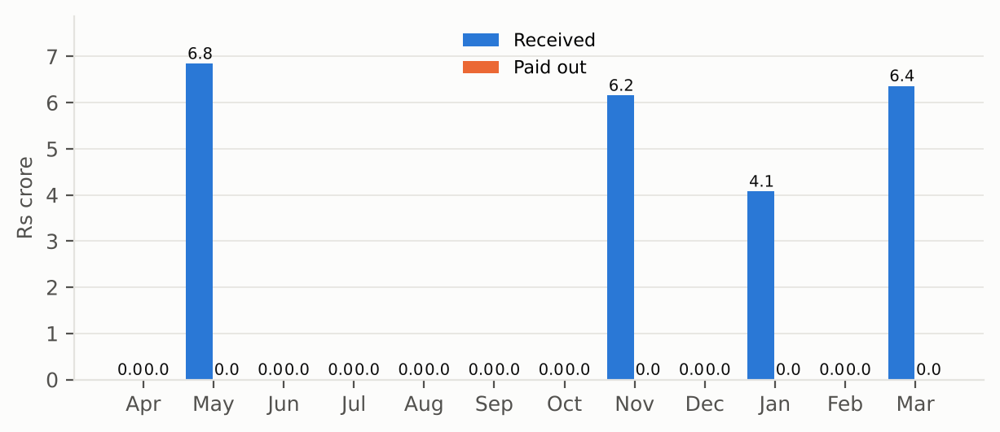

# Patna District: Panchayat Finances and Accounts, 2021-22

A plain-language district profile from the Government of India's eGramSwaraj system · India By Numbers · data as published by the portal (district statement generated October 23, 2024 12:58 AM)

## 1. The main points

- **Patna has 23 Panchayat Samitis (block councils) and 313 Gram Panchayats (village councils)** in the 2021-22 accounts, plus one Zilla Parishad (district council).
- **In 2021-22 its Panchayats together had Rs 224.06 crore available and paid out Rs 35.90 crore (16%).**
- **The Gram Panchayats had Rs 142.27 crore available and paid out Rs 26.89 crore (19%).** Patna ranks **5 of 38** districts in Bihar for money available to Gram Panchayats and **9 of 38** for money paid out by them.
- **An average Gram Panchayat in Patna had about Rs 45.5 lakh available and paid out about Rs 8.6 lakh** in the year (district totals divided by 313 Gram Panchayats).
- **Almost all the money is the 15th Finance Commission grant.** The scheme-wise statement for Patna lists: Fourteen Finance Commission-FFC, XV Finance Commission-XVFC, own resources-OWN. Own resources received nothing in 2021-22. Fourteen Finance Commission-FFC received nothing. 
- **Annual accounts are not complete:** 311 of 313 Gram Panchayats, 23 of 23 Panchayat Samitis and the Zilla Parishad (closed) have closed their year book in the system.
- **Official village-by-village figures for this year are on the portal but not yet collected;** the Appendix shows each Gram Panchayat's own voucher totals instead.

## 2. How to read the money words

| Term | Meaning |
|---|---|
| **Money available** (portal: *OB + Receipts*) | Money left from last year (opening balance) plus money received during the year |
| **Money paid out** (portal: *Payments*) | Payments made from the Panchayat's own accounts during the year |
| **Crore / lakh** | 1 crore = 100 lakh = Rs 1,00,00,000 |

Payments are only what passed through Panchayat accounts. They are **not** all government spending in the district (state departments pay for many works directly).

## 3. Money at each level of Panchayat

| Level | Bodies | Money available (Rs crore) | Paid out (Rs crore) | Paid out as share | Patna's share of Bihar (available) |
|---|---|---|---|---|---|
| Zilla Parishad (district council) | 1 | 36.380 | 0.000 | 0% | 4% of Rs 989 crore |
| Panchayat Samitis (block councils) | 23 | 45.410 | 9.010 | 20% | 4% of Rs 1,274 crore |
| Gram Panchayats (village councils) | 313 | 142.270 | 26.890 | 19% | 4% of Rs 3,403 crore |
| **All levels** | | **224.060** | **35.900** | **16%** | |

Source: District wise Receipt and Payment Statement, 2021-22, Bihar (generated October 23, 2024 12:58 AM).

## 4. Block by block

Figures for the Panchayat Samiti (block council) itself and for all Gram Panchayats of the block together.

| Block | Gram Panchayats | Gram Panchayats: available (Rs crore) | Gram Panchayats: paid out | Share paid | Panchayat Samiti: available | Panchayat Samiti: paid out |
|---|---|---|---|---|---|---|
| Athamalgola | 8 | 3.108 | 2.007 | 65% | 1.413 | 0.563 |
| Bakhtiarpur | 16 | 7.871 | 1.348 | 17% | 2.150 | 0.000 |
| Barh | 13 | 5.453 | 1.566 | 29% | 2.732 | 0.687 |
| Belchhi | 7 | 2.992 | 0.676 | 23% | 0.912 | 0.515 |
| Bihta | 22 | 9.936 | 2.287 | 23% | 1.764 | 1.521 |
| Bikram | 16 | 6.352 | 0.656 | 10% | 1.740 | 0.219 |
| Daniyawan | 6 | 3.247 | 1.061 | 33% | 1.401 | 0.206 |
| Dhanarua | 19 | 9.933 | 0.855 | 9% | 3.122 | 0.000 |
| Dinapur | 13 | 6.574 | 0.768 | 12% | 1.739 | 0.125 |
| Dulhin Bazar | 14 | 4.371 | 0.578 | 13% | 1.940 | 0.462 |
| Fatuha | 15 | 7.194 | 0.667 | 9% | 1.956 | 0.000 |
| Ghoswari | 8 | 3.801 | 0.467 | 12% | 1.226 | 0.103 |
| Khusrupur | 7 | 3.896 | 0.905 | 23% | 1.197 | 0.138 |
| Maner | 19 | 11.954 | 1.921 | 16% | 1.999 | 1.572 |
| Masaurhi | 17 | 6.398 | 2.650 | 41% | 2.162 | 0.065 |
| Mokama | 15 | 5.792 | 1.047 | 18% | 2.206 | 0.157 |
| Naubatpur | 19 | 7.260 | 2.301 | 32% | 2.744 | 0.852 |
| Paliganj | 23 | 8.646 | 2.068 | 24% | 3.755 | 1.420 |
| Pandarak | 15 | 6.618 | 1.243 | 19% | 2.170 | 0.290 |
| Patna Sadar | 7 | 4.471 | 0.394 | 9% | 1.383 | 0.000 |
| Phulwari | 14 | 9.751 | 0.571 | 6% | 3.148 | — |
| Punpun | 13 | 4.822 | 0.469 | 10% | 1.333 | 0.115 |
| Sampatchak | 3 | 1.828 | 0.382 | 21% | 1.214 | — |

The blocks' Gram Panchayat figures add up to Rs 142.267 crore (district statement: Rs 142.270 crore). The largest is **Maner** (Rs 11.95 crore across 19 GPs), the smallest **Sampatchak** (Rs 1.83 crore). The share of money paid out ranges from 6% to 65% across the 23 blocks with money (middle block: 18%). Blocks differ in the number and size of their Panchayats, so a larger amount does not by itself mean better or worse performance.

## 5. The Zilla Parishad month by month

The district council (Zilla Parishad) started the year with **Rs 12.95 crore** carried over, received **Rs 23.44 crore** during the year and paid out **Rs 0.00 crore**. This matches the annual statement.

| Month | Received (Rs lakh) | Paid out (Rs lakh) | Payment vouchers |
|---|---|---|---|
| April, 2021 | 0.00 | 0.00 | 0 |
| May, 2021 | 684.54 | 0.00 | 0 |
| June, 2021 | 0.00 | 0.00 | 0 |
| July, 2021 | 0.00 | 0.00 | 0 |
| August, 2021 | 0.00 | 0.00 | 0 |
| September, 2021 | 0.00 | 0.00 | 0 |
| October, 2021 | 0.00 | 0.00 | 0 |
| November, 2021 | 615.44 | 0.00 | 0 |
| December, 2021 | 0.00 | 0.00 | 0 |
| Januaury, 2022 | 407.64 | 0.00 | 0 |
| February, 2022 | 0.00 | 0.00 | 0 |
| March, 2022 | 636.30 | 0.00 | 0 |

Month names are shown exactly as the portal prints them.
 Source: Month Wise Payment and Receipt Statement (generated October 23, 2024 9:53 AM) and Month wise Summary Report (generated October 23, 2024 12:57 PM).

## 6. Where the money comes from

| Source (as named by the portal) | Zilla Parishad | Panchayat Samitis | Gram Panchayats |
|---|---|---|---|
| XV Finance Commission-XVFC | 100% of receipts | 100% of receipts | 100% of receipts |
| own resources-OWN | 0 | 0 | 0 |
| Fourteen Finance Commission-FFC | 0 | 0 | 0 |

Only the 3 source(s) above are listed for the district. Shares are calculated from the scheme-wise statement (generated October 30, 2021 6:55 AM; September 30, 2023 9:08 AM; June 12, 2022 7:15 AM). The same report counts 3,618 receipt vouchers and 3,753 payment vouchers for Patna's Gram Panchayats under the XV FC grant.

## 7. How well the books are kept

| | Zilla Parishad | Panchayat Samitis | Gram Panchayats |
|---|---|---|---|
| Number | 1 | 23 | 313 |
| Masters and opening balance entered | yes / yes | 23 / 23 | 312 / 313 |
| Receipt vouchers recorded | 6 | 257 | 3,566 |
| Payment vouchers recorded | 0 | 785 | 3,732 |
| Day book closed | yes | 23 of 23 | 313 of 313 |
| Month book closed | yes | 23 of 23 | 313 of 313 |
| Year book (annual accounts) closed | yes | 23 of 23 | 311 of 313 |

On average each Gram Panchayat recorded about 12 payment vouchers in the year. Source: District Wise Summary Report (generated October 23, 2024 1:03 AM).

## 8. Every receipt and payment (voucher level)

eGramSwaraj records each transaction as a **voucher**. For Patna in 2021-22 we opened the month-wise statement of the Zilla Parishad, all 23 Panchayat Samitis and 309 Gram Panchayats, and collected every voucher-wise list they link to — 8,350 voucher lines in all. Vouchers appear for **23 Panchayat Samitis and 309 Gram Panchayats**; the others list no vouchers for this year. (The 2021-22 block pages link the month-wise statements of only 309 of the 313 Gram Panchayats, so vouchers of the rest could not be reached. The official figure for every Gram Panchayat is in the Appendix.) **No payee or vendor names are included** — only the voucher number, date, type and amount, exactly as the portal lists them.

| | Zilla Parishad | Panchayat Samitis | Gram Panchayats | Total collected |
|---|---|---|---|---|
| Receipt vouchers | 6 | 257 | 3,566 | 3,829 |
| Payment vouchers | 0 | 785 | 3,732 | 4,517 |
| Amount received (Rs crore) | 23.44 | 36.96 | 149.29 | 209.69 |
| Amount paid (Rs crore) | 0.00 | 10.97 | 34.91 | 45.88 |

Payments listed in vouchers (Rs 45.88 crore) are +28% compared with the annual statement (Rs 35.90 crore). The statement is the official total; the vouchers list somewhat more, probably because the statement is net of payments later cancelled, rejected or returned (the portal does not define this). Use the vouchers for detail and pattern, the statement for totals. A multi-year voucher report for the district is in `docs/district_reports/patna_vouchers/`.

**Types of voucher** (what the transaction was recorded as):

| Voucher type | Number | What it means |
|---|---|---|
| Expenditures | 4,415 | A payment / expenditure |
| Direct Receipts | 3,077 | Money received directly |
| Reverse Receipt -PFMS | 447 | A receipt reversed in the PFMS payment system |
| Refund of Excess Payment | 305 | Money returned after an overpayment |
| Receipt Cancellation | 78 | as labelled by the portal |
| OB Cancellation | 24 | Cancellation of an opening-balance entry |
| (blank) | 4 | as labelled by the portal |

**The ten largest single payments collected:**

| Voucher date | Voucher number | Level | Block | Amount (Rs) | Type |
|---|---|---|---|---|---|
| 19/05/2021 | XVFC/2021-22/P/12 | Panchayat Samiti | Bihta | 6,427,487 | OB Cancellation |
| 19/05/2021 | XVFC/2021-22/P/13 | Panchayat Samiti | Bihta | 3,014,663.5 | OB Cancellation |
| 31/03/2022 | XVFC/2021-22/P/17 | Panchayat Samiti | Dulhin Bazar | 2,917,261 | Expenditures |
| 23/08/2021 | XVFC/2021-22/P/37 | Panchayat Samiti | Barh | 2,239,103 | Receipt Cancellation |
| 26/05/2021 | XVFC/2021-22/P/1 | Gram Panchayat | Maner | 1,863,200.99 | Receipt Cancellation |
| 28/05/2021 | XVFC/2021-22/P/1 | Gram Panchayat | Phulwari | 1,734,935.99 | Receipt Cancellation |
| 27/05/2021 | XVFC/2021-22/P/1 | Gram Panchayat | Barh | 1,698,747 | Receipt Cancellation |
| 26/05/2021 | XVFC/2021-22/P/1 | Gram Panchayat | Maner | 1,529,133.99 | Receipt Cancellation |
| 28/05/2021 | XVFC/2021-22/P/1 | Gram Panchayat | Phulwari | 1,466,603.74 | Receipt Cancellation |
| 22/12/2021 | XVFC/2021-22/P/4 | Panchayat Samiti | Bikram | 1,383,413 | Expenditures |

All 8,350 voucher numbers begin with **XVFC**, confirming the money is the 15th Finance Commission grant. Every voucher is in the machine-readable file `data/validated/egs/vouchers/203_2021-2022.csv`, with its source page. Source: Voucher Wise Summary Report pages, collected 2026-11-22.

## 9. What this profile cannot tell you

| Not available | Why |
|---|---|
| Official figures for each Gram Panchayat in 2021-22 | Published on the portal; not yet collected (planned follow-up collection). The Appendix shows voucher totals per Gram Panchayat instead |
| Population or households of the district's Panchayats | Not in any open eGramSwaraj report, so no per-person figures |
| Who each payment went to (the payee or vendor of each voucher) | On the individual voucher page, behind a security check (CAPTCHA); not collected. The voucher number, date, type and amount ARE collected (section 8) |
| Elected members of this district | Collected for Bihar as a whole only; district figures are a planned follow-up |
| Value of approved development plans | Only whether a plan was uploaded is public |
| Money left unspent at year end | Not printed as an official figure |

## 10. About these figures

- Every figure is copied from the government's own eGramSwaraj reports and was checked against the original pages in the data validation (Task 5). Totals in this profile add up to the portal's own totals.
- Each report is a snapshot taken on the date shown; later reports for the same year can differ slightly because accounts keep being updated.
- District code 203; block and Gram Panchayat codes are the portal's own. Data collected November 2026 from egramswaraj.gov.in. Machine-readable tables: `data/validated/egs/`.
- Reports for Patna in other years: `docs/district_reports/patna_index.md`.

## Appendix: every Gram Panchayat of Patna, 2021-22

Amounts in Rs lakh. **Voucher** columns add up the Gram Panchayat's own receipt and payment vouchers (section 8). Voucher totals are gross and run somewhat higher than official figures; use them for detail and comparison between villages, not as official totals. A dash means no vouchers were listed or reached. 309 Gram Panchayats are shown; the district statement counts 313.

| Block | Gram Panchayat | Code | Receipt vouchers | Received (vouchers) | Payment vouchers | Paid (vouchers) |
|---|---|---|---|---|---|---|
| Athamalgola | Bahadurpur | 98783 | 12 | 39.62 | 18 | 26.14 |
| Athamalgola | Kalyanpur | 98784 | 10 | 31.25 | 18 | 19.06 |
| Athamalgola | Karjan | 98785 | 15 | 36.64 | 20 | 19.32 |
| Athamalgola | Phulelpur Meaura | 98786 | 14 | 27.48 | 15 | 16.33 |
| Athamalgola | Ramnagar Diyara | 98787 | 16 | 47.46 | 26 | 35.22 |
| Athamalgola | Ramnagar Korari Kochhar | 98788 | 10 | 32.79 | 22 | 21.94 |
| Athamalgola | Sabnima | 98789 | 21 | 67.93 | 30 | 51.27 |
| Athamalgola | Usmanpur | 98790 | 19 | 45.14 | 25 | 29.23 |
| Bakhtiarpur | Alipur Bihta | 98791 | 11 | 35.99 | 6 | 7.37 |
| Bakhtiarpur | Bidhipur Narauli | 98792 | 14 | 49.40 | 196 | 26.68 |
| Bakhtiarpur | Champa Pur | 98793 | 17 | 120.04 | 179 | 51.80 |
| Bakhtiarpur | Chiraiya Rupas | 98794 | 10 | 35.95 | 7 | 4.08 |
| Bakhtiarpur | Doma | 98795 | 11 | 52.29 | 8 | 8.01 |
| Bakhtiarpur | Ghangah | 98796 | 10 | 37.73 | 7 | 4.82 |
| Bakhtiarpur | Ghoswari | 98797 | 12 | 47.30 | 105 | 16.07 |
| Bakhtiarpur | Hardaspur Diara | 98798 | 12 | 29.57 | 2 | 4.33 |
| Bakhtiarpur | Hidayatpur Saidpur | 98799 | 11 | 64.26 | 8 | 7.66 |
| Bakhtiarpur | Kala Diara | 98800 | 13 | 69.30 | 191 | 32.94 |
| Bakhtiarpur | Karnauti | 98801 | 10 | 56.37 | 7 | 6.21 |
| Bakhtiarpur | Manjhauli | 98802 | 11 | 54.74 | 27 | 20.10 |
| Bakhtiarpur | Missi | 98803 | 10 | 45.14 | 7 | 7.04 |
| Bakhtiarpur | Mogal Pura | 98804 | 11 | 46.10 | 15 | 11.96 |
| Bakhtiarpur | Rupas Mahaji | 98805 | 10 | 54.18 | 8 | 7.02 |
| Bakhtiarpur | Satbhaiya Ram Nagar | 98806 | 9 | 7.94 | 6 | 2.16 |
| Barh | Agwanpur | 98807 | 7 | 39.64 | 3 | 5.44 |
| Barh | Berhana East | 98808 | 9 | 42.07 | 1 | 1.71 |
| Barh | Berhana West | 98809 | 12 | 34.02 | 12 | 11.94 |
| Barh | Bhatgawn | 98810 | 12 | 55.64 | 36 | 26.63 |
| Barh | Dhanwan Mobarakpur | 98811 | 9 | 41.32 | 12 | 18.41 |
| Barh | Ekdanga | 98812 | 10 | 47.17 | 18 | 9.71 |
| Barh | Ibrahimpur | 98813 | 12 | 108.63 | 18 | 58.27 |
| Barh | Nadawan | 98814 | 8 | 36.76 | 12 | 23.46 |
| Barh | Navada | 98815 | 9 | 56.09 | 37 | 22.46 |
| Barh | Rahimpur Rupas | 98816 | 7 | 50.98 | 1 | 2.25 |
| Barh | Rangbigha | 98817 | 6 | 16.90 | 13 | 11.28 |
| Barh | Sarkatti Saidpur | 98818 | 8 | 43.74 | 22 | 12.51 |
| Barh | Shohari | 98819 | 7 | 28.54 | 4 | 8.75 |
| Belchhi | Aundouli Darweshpura | 98820 | 14 | 49.30 | 19 | 11.94 |
| Belchhi | Barah | 98821 | 12 | 60.45 | 12 | 8.40 |
| Belchhi | Belchhi | 98822 | 7 | 25.82 | 8 | 9.76 |
| Belchhi | Fatehpur | 98823 | 8 | 29.84 | 10 | 12.65 |
| Belchhi | Korari | 98824 | 7 | 48.10 | 9 | 5.61 |
| Belchhi | Saksohara West | 98825 | 7 | 52.56 | 38 | 18.53 |
| Belchhi | Saksohra East | 98826 | 7 | 33.07 | 4 | 0.72 |
| Bihta | Anandpur | 98828 | 9 | 43.47 | 19 | 23.35 |
| Bihta | Bela | 98829 | 16 | 51.99 | 19 | 22.89 |
| Bihta | Bindaul | 98831 | 9 | 45.63 | 10 | 10.65 |
| Bihta | Bishunpura | 98832 | 14 | 24.48 | 6 | 4.56 |
| Bihta | Dayalpur Daulatpur | 98833 | 9 | 32.79 | 8 | 10.61 |
| Bihta | Doulatpur Simri | 98834 | 15 | 45.09 | 9 | 4.16 |
| Bihta | Kanchanpur Kharagpur | 98835 | 15 | 35.91 | 5 | 14.36 |
| Bihta | Kateshar | 98836 | 11 | 36.31 | 15 | 12.29 |
| Bihta | Kouriya | 98837 | 15 | 49.13 | 11 | 6.74 |
| Bihta | Kunwa | 98838 | 10 | 43.40 | 2 | 2.67 |
| Bihta | Machhalpur Lai | 98839 | 13 | 59.74 | 4 | 2.67 |
| Bihta | Makhdumpur | 98840 | 10 | 36.05 | 4 | 1.78 |
| Bihta | Mushepur | 98841 | 16 | 54.15 | 45 | 30.72 |
| Bihta | Neora | 98842 | 11 | 51.79 | 12 | 6.88 |
| Bihta | Painal | 98843 | 16 | 61.90 | 8 | 5.49 |
| Bihta | Parev | 98844 | 10 | 58.21 | 39 | 27.07 |
| Bihta | Purusottampur Painathi | 98845 | 14 | 44.08 | 15 | 10.27 |
| Bihta | Sadisopur | 98847 | 16 | 55.29 | 16 | 9.71 |
| Bihta | Sikandarpur | 98848 | 11 | 50.67 | 12 | 16.45 |
| Bihta | Sri Chandpur | 98849 | 17 | 32.33 | 6 | 4.40 |
| Bihta | Tara Nagar | 98851 | 12 | 49.23 | 8 | 6.60 |
| Bihta | Yamunapur | 98852 | 12 | 34.68 | 8 | 4.85 |
| Bikram | Akhtyarpur Manjhauli | 98853 | 11 | 47.51 | 2 | 0.62 |
| Bikram | Arap | 98854 | 12 | 42.28 | 0 | 0.00 |
| Bikram | Beni Bigha | 98856 | 9 | 27.39 | 17 | 7.37 |
| Bikram | Birdhaur Berar Katari | 98858 | 12 | 49.67 | 4 | 1.70 |
| Bikram | Brah | 98855 | 11 | 34.05 | 6 | 6.34 |
| Bikram | Danara Katari | 98859 | 11 | 38.76 | 1 | 0.01 |
| Bikram | Datiyana | 98860 | 11 | 39.58 | 7 | 5.55 |
| Bikram | Gorkhari | 98862 | 9 | 19.50 | 10 | 5.69 |
| Bikram | Haibaspur Gona | 98863 | 14 | 43.77 | 9 | 11.41 |
| Bikram | Mahajpura | 98864 | 11 | 39.85 | 2 | 1.87 |
| Bikram | Moriyawa Shivgadh | 98866 | 11 | 29.80 | 10 | 3.62 |
| Bikram | Naghar | 98867 | 14 | 34.34 | 8 | 8.17 |
| Bikram | Patut | 98868 | 12 | 43.30 | 2 | 0.48 |
| Bikram | Saidabad Kanpa | 98869 | 10 | 45.78 | 5 | 7.13 |
| Bikram | Sunderpur Chauthiyan | 98865 | 15 | 48.33 | 9 | 2.78 |
| Bikram | Wazirpur | 98870 | 13 | 55.25 | 13 | 6.95 |
| Daniyawan | Bankipur Machhariyawan | 98871 | 11 | 75.75 | 34 | 20.60 |
| Daniyawan | Daniyawan | 98872 | 10 | 43.11 | 31 | 19.92 |
| Daniyawan | Kharbhaiya | 98873 | 11 | 79.38 | 14 | 9.82 |
| Daniyawan | Salarpur | 98875 | 12 | 43.00 | 38 | 24.85 |
| Daniyawan | Shahjahanpur | 98874 | 11 | 46.36 | 8 | 23.24 |
| Daniyawan | Singariyawan | 98876 | 12 | 51.45 | 51 | 22.03 |
| Dhanarua | Bahrampur | 98877 | 15 | 55.74 | 25 | 23.12 |
| Dhanarua | Baribigha | 98878 | 15 | 44.92 | 2 | 0.97 |
| Dhanarua | Bijaypura | 98880 | 15 | 46.15 | 11 | 17.83 |
| Dhanarua | Chhati | 98881 | 10 | 50.89 | 4 | 6.08 |
| Dhanarua | Deodaha | 98882 | 14 | 75.66 | 6 | 3.54 |
| Dhanarua | Dewan | 98883 | 27 | 60.53 | 23 | 13.66 |
| Dhanarua | Dhanarua | 98884 | 11 | 55.05 | 13 | 10.31 |
| Dhanarua | Gobindpur Baurhi | 98885 | 9 | 42.31 | 1 | 0.31 |
| Dhanarua | Hulaschakbir | 98886 | 10 | 66.32 | 1 | 2.37 |
| Dhanarua | Kosut | 98887 | 15 | 64.61 | 1 | 1.80 |
| Dhanarua | Mai Netaul | 98888 | 20 | 57.32 | 19 | 14.74 |
| Dhanarua | Moriyawan | 98889 | 9 | 38.69 | 2 | 3.65 |
| Dhanarua | Nadwa | 98890 | 17 | 59.76 | 2 | 0.90 |
| Dhanarua | Nimra | 98891 | 16 | 50.33 | 1 | 0.70 |
| Dhanarua | Pabhera | 98892 | 8 | 34.24 | 2 | 3.35 |
| Dhanarua | Patharhat | 98893 | 15 | 61.16 | 1 | 0.95 |
| Dhanarua | Sanda | 98894 | 10 | 69.75 | 1 | 1.70 |
| Dhanarua | Satparsa | 98895 | 13 | 40.38 | 2 | 0.60 |
| Dhanarua | Sonmai | 98896 | 12 | 42.33 | 1 | 1.80 |
| Dinapur | Ganghara | 98897 | 10 | 34.56 | 3 | 5.07 |
| Dinapur | Hathia Kandh | 98898 | 13 | 54.92 | 10 | 14.82 |
| Dinapur | Hetanpur | 98899 | 13 | 70.16 | 12 | 26.73 |
| Dinapur | Jamaluddin | 98900 | 12 | 79.70 | 9 | 4.70 |
| Dinapur | Jamsaut | 98901 | 15 | 59.17 | 5 | 3.64 |
| Dinapur | Kasim Chak | 98902 | 13 | 40.14 | 8 | 7.63 |
| Dinapur | Kothawan | 98903 | 14 | 33.46 | 6 | 7.74 |
| Dinapur | Lakhani Bigha | 98904 | 16 | 57.91 | 7 | 5.86 |
| Dinapur | Manas | 98905 | 11 | 63.95 | 7 | 21.92 |
| Dinapur | Mobarakpur-Raghurampur | 98906 | 5 | 32.08 | 8 | 7.29 |
| Dinapur | Patla Pur | 98907 | 14 | 66.26 | 4 | 2.82 |
| Dinapur | Purani Panapur | 98908 | 11 | 53.76 | 3 | 4.43 |
| Dinapur | Sarari | 98909 | 17 | 53.51 | 4 | 7.75 |
| Dulhin Bazar | Achhua Rakasiya | 98911 | 11 | 32.11 | 9 | 8.31 |
| Dulhin Bazar | Ainkhan Bhimnichak | 98910 | 6 | 20.34 | 7 | 7.07 |
| Dulhin Bazar | Bharatpura | 98912 | 6 | 25.58 | 14 | 15.20 |
| Dulhin Bazar | Dhana Nisarpura | 98913 | 11 | 32.66 | 6 | 9.72 |
| Dulhin Bazar | Kab | 98914 | 11 | 33.35 | 3 | 1.56 |
| Dulhin Bazar | Lala Bhadsara | 98915 | 7 | 24.37 | 2 | 0.74 |
| Dulhin Bazar | Narhi Pirhi | 98916 | 11 | 62.35 | 6 | 20.92 |
| Dulhin Bazar | Rajipur | 98917 | 6 | 20.20 | 5 | 8.08 |
| Dulhin Bazar | Sadaweh Dorawan | 98918 | 6 | 40.03 | 12 | 7.38 |
| Dulhin Bazar | Selhauri Belhauri | 98919 | 8 | 32.80 | 4 | 4.09 |
| Dulhin Bazar | Sihi | 98920 | 7 | 44.43 | 2 | 0.63 |
| Dulhin Bazar | Singhara Kopa | 98921 | 7 | 37.67 | 5 | 5.64 |
| Dulhin Bazar | Soniyawan | 98922 | 6 | 43.13 | 2 | 0.59 |
| Dulhin Bazar | Ular Sorampur | 98923 | 8 | 21.75 | 4 | 1.48 |
| Fatuha | Alawal Pur | 98924 | 11 | 53.89 | 1 | 2.25 |
| Fatuha | Bali | 98925 | 10 | 40.77 | 5 | 4.83 |
| Fatuha | Dumari | 98926 | 13 | 60.91 | 2 | 4.67 |
| Fatuha | Gauri Punda | 98927 | 11 | 34.48 | 2 | 3.11 |
| Fatuha | Jaita | 98928 | 11 | 51.01 | 5 | 3.89 |
| Fatuha | Jethuli | 98929 | 15 | 110.83 | 7 | 18.16 |
| Fatuha | Kolhar | 98930 | 15 | 48.48 | 5 | 5.53 |
| Fatuha | Mansing Pur | 98931 | 12 | 24.55 | 5 | 5.10 |
| Fatuha | Masadhi | 98932 | 11 | 37.03 | 1 | 0.56 |
| Fatuha | Mauji Pur | 98933 | 19 | 45.90 | 3 | 0.93 |
| Fatuha | Mohiuddin Pur | 98934 | 14 | 39.79 | 5 | 8.88 |
| Fatuha | Momin Pur | 98935 | 13 | 48.12 | 4 | 9.23 |
| Fatuha | Pitamberpur | 98936 | 12 | 56.07 | 7 | 10.42 |
| Fatuha | Rukun Pur | 98937 | 11 | 43.87 | 10 | 7.59 |
| Fatuha | Usfa | 98938 | 11 | 44.43 | 2 | 2.33 |
| Ghoswari | Ghoswari | 98939 | 5 | 24.45 | 11 | 12.72 |
| Ghoswari | Gosai Gaon | 98940 | 8 | 42.27 | 0 | 0.00 |
| Ghoswari | Kumhra | 98941 | 8 | 54.95 | 2 | 2.12 |
| Ghoswari | Kurmichak | 98942 | 5 | 30.34 | 7 | 4.49 |
| Ghoswari | Paijna | 98943 | 6 | 37.82 | 7 | 3.44 |
| Ghoswari | Samya Garh | 98944 | 9 | 58.07 | 14 | 10.30 |
| Ghoswari | Tartar | 98945 | 7 | 52.69 | 5 | 3.31 |
| Ghoswari | Trimuhan | 98946 | 7 | 80.41 | 6 | 11.25 |
| Khusrupur | Alawalpur | 98947 | 12 | 54.62 | 25 | 17.29 |
| Khusrupur | Baikatpur | 98948 | 12 | 87.27 | 5 | 9.85 |
| Khusrupur | Chaura | 98949 | 12 | 31.83 | 12 | 5.29 |
| Khusrupur | Haibatpur | 98950 | 12 | 60.60 | 14 | 16.39 |
| Khusrupur | Hardas Bigha | 98951 | 9 | 56.09 | 19 | 20.75 |
| Khusrupur | Mosim Pur | 98952 | 11 | 30.84 | 17 | 13.70 |
| Khusrupur | Sukarbeg Chak | 98953 | 11 | 70.24 | 31 | 9.15 |
| Maner | Baluwa | 98954 | 15 | 67.95 | 2 | 7.97 |
| Maner | Bank | 98955 | 15 | 75.81 | 38 | 32.97 |
| Maner | Biyapur | 98956 | 15 | 104.33 | 5 | 15.47 |
| Maner | Darwesh Pur North | 98957 | 10 | 41.48 | 1 | 1.80 |
| Maner | Darwesh Pur South | 98958 | 9 | 103.25 | 17 | 23.18 |
| Maner | Gyas Pur | 98959 | 9 | 41.98 | 1 | 1.80 |
| Maner | Khas Pur | 98960 | 14 | 138.67 | 19 | 38.66 |
| Maner | Kita Chauhattar East | 98961 | 9 | 44.38 | 7 | 11.14 |
| Maner | Kita Chauhattar Middle | 98962 | 11 | 55.11 | 12 | 14.76 |
| Maner | Kita Chauhattar West | 98963 | 9 | 40.92 | 12 | 17.12 |
| Maner | Madhopur | 98964 | 10 | 36.40 | 7 | 6.36 |
| Maner | Magar Pal | 98965 | 9 | 23.71 | 2 | 3.45 |
| Maner | Rampur Diyara Tauffir | 98966 | 15 | 86.25 | 3 | 11.00 |
| Maner | Sadikpur | 98967 | 9 | 70.67 | 0 | 0.00 |
| Maner | Sarai | 98968 | 9 | 40.79 | 15 | 13.62 |
| Maner | Sherpur East | 98969 | 14 | 92.11 | 4 | 19.80 |
| Maner | Sherpur West | 98970 | 16 | 119.76 | 26 | 52.29 |
| Maner | Singhara | 98971 | 14 | 62.18 | 4 | 21.29 |
| Maner | Suwarmarwah | 98972 | 13 | 64.13 | 4 | 13.86 |
| Masaurhi | Bara | 98973 | 16 | 31.46 | 18 | 26.79 |
| Masaurhi | Berra | 98974 | 10 | 31.12 | 20 | 16.38 |
| Masaurhi | Bhagwanganj | 98976 | 26 | 36.43 | 13 | 17.98 |
| Masaurhi | Bhaiswan | 98977 | 18 | 58.57 | 18 | 29.57 |
| Masaurhi | Chapaur | 98978 | 20 | 45.17 | 23 | 32.29 |
| Masaurhi | Charma | 98979 | 13 | 27.05 | 9 | 15.95 |
| Masaurhi | Daulatpur | 98980 | 14 | 52.01 | 9 | 21.47 |
| Masaurhi | Deoria | 98981 | 17 | 35.22 | 11 | 22.70 |
| Masaurhi | Karay | 98982 | 41 | 43.31 | 23 | 18.28 |
| Masaurhi | Kharant | 98983 | 20 | 43.81 | 21 | 25.25 |
| Masaurhi | Lakhnaur-Bedauli | 98984 | 14 | 37.11 | 6 | 6.15 |
| Masaurhi | Nadaul | 98985 | 9 | 40.80 | 9 | 7.82 |
| Masaurhi | Nishiyawan | 98986 | 14 | 59.82 | 14 | 24.28 |
| Masaurhi | Nura | 98987 | 10 | 27.28 | 13 | 17.45 |
| Masaurhi | Rewan | 98988 | 7 | 27.44 | 7 | 8.47 |
| Masaurhi | Shahabad | 98989 | 10 | 41.93 | 15 | 18.84 |
| Masaurhi | Tineri | 98990 | 18 | 63.92 | 16 | 18.02 |
| Mokama | Aunta | 98991 | 9 | 44.34 | 7 | 6.50 |
| Mokama | Barahpur | 98992 | 10 | 45.81 | 6 | 8.77 |
| Mokama | Dariapur | 98993 | 11 | 47.07 | 9 | 8.40 |
| Mokama | Hathidah Buzurg | 98994 | 8 | 37.10 | 11 | 6.76 |
| Mokama | Kanhaipur | 98995 | 9 | 46.73 | 5 | 6.54 |
| Mokama | Kasaha Diyara | 98996 | 10 | 21.67 | 0 | 0.00 |
| Mokama | Malpur | 98997 | 8 | 32.37 | 6 | 2.28 |
| Mokama | Maranchi (North) | 98998 | 8 | 27.99 | 7 | 4.19 |
| Mokama | Maranchi (South) | 98999 | 9 | 40.89 | 10 | 7.00 |
| Mokama | Mekra | 99000 | 8 | 52.21 | 10 | 10.15 |
| Mokama | Mor (East) | 99001 | 15 | 35.61 | 15 | 8.27 |
| Mokama | Mor (West) | 99002 | 9 | 47.18 | 20 | 11.25 |
| Mokama | Nauranga Jalalpur | 99003 | 7 | 18.80 | 6 | 9.09 |
| Mokama | Rampur Dumra | 99004 | 8 | 35.36 | 7 | 5.29 |
| Mokama | Shivnar | 99005 | 10 | 53.62 | 14 | 17.78 |
| Naubatpur | Adla | 99006 | 11 | 38.11 | 2 | 4.08 |
| Naubatpur | Ajwan | 99007 | 12 | 70.89 | 1 | 10.14 |
| Naubatpur | Badi Tengraila | 99008 | 11 | 49.77 | 11 | 27.64 |
| Naubatpur | Bara | 99009 | 11 | 41.59 | 12 | 24.01 |
| Naubatpur | Chak-Chechoul | 99010 | 11 | 45.79 | 8 | 17.33 |
| Naubatpur | Chesi | 99011 | 7 | 25.76 | 9 | 12.39 |
| Naubatpur | Chiraura | 99012 | 14 | 57.03 | 10 | 20.14 |
| Naubatpur | Dariyapur | 99013 | 7 | 35.22 | 9 | 19.53 |
| Naubatpur | Dewra | 99014 | 9 | 29.94 | 9 | 17.49 |
| Naubatpur | Faridpur | 99015 | 12 | 46.68 | 9 | 23.12 |
| Naubatpur | Gonwan | 99016 | 12 | 45.34 | 6 | 12.69 |
| Naubatpur | Ibrahimpur | 99017 | 22 | 53.35 | 23 | 44.16 |
| Naubatpur | Jaitipur | 99018 | 7 | 38.74 | 2 | 3.52 |
| Naubatpur | Jamalpura | 99019 | 19 | 52.25 | 12 | 31.63 |
| Naubatpur | Karanja Gowai | 99020 | 7 | 45.09 | 4 | 4.39 |
| Naubatpur | Khajuri | 99021 | 13 | 40.02 | 7 | 15.18 |
| Naubatpur | Nawdiha | 99023 | 13 | 61.15 | 10 | 23.16 |
| Naubatpur | Nawhi | 99024 | 8 | 45.22 | 18 | 32.81 |
| Naubatpur | Savar Chak | 99026 | 10 | 35.96 | 15 | 18.61 |
| Paliganj | Ajda Sikariya | 99028 | 9 | 26.05 | 7 | 7.52 |
| Paliganj | Akbarpur Ranipur | 99027 | 14 | 41.72 | 15 | 14.36 |
| Paliganj | Bherhariya Siyarampur | 99029 | 8 | 42.15 | 7 | 5.93 |
| Paliganj | Chandhos | 99030 | 8 | 31.99 | 12 | 5.50 |
| Paliganj | Chiksi | 99031 | 9 | 29.78 | 6 | 3.20 |
| Paliganj | Dahiya | 99032 | 9 | 27.59 | 18 | 9.24 |
| Paliganj | Dharhara | 99033 | 7 | 28.85 | 7 | 9.28 |
| Paliganj | Jamharu Imamganj | 99034 | 8 | 35.22 | 32 | 17.17 |
| Paliganj | Jarkha | 99035 | 8 | 44.39 | 20 | 14.20 |
| Paliganj | Kalyanpur Paipura | 99036 | 9 | 39.45 | 7 | 10.14 |
| Paliganj | Katka Paigambarpur | 99037 | 8 | 34.27 | 11 | 5.31 |
| Paliganj | Khanpura Taranpur | 99038 | 10 | 50.48 | 5 | 9.39 |
| Paliganj | Lalganj Sehra | 99039 | 16 | 48.14 | 28 | 15.64 |
| Paliganj | Madhwan Makhmilpur | 99040 | 8 | 44.09 | 7 | 7.37 |
| Paliganj | Mahabalipur | 99041 | 10 | 44.71 | 11 | 5.86 |
| Paliganj | Masaudha Jalpura | 99042 | 11 | 35.89 | 16 | 15.55 |
| Paliganj | Mera Patouna | 99044 | 10 | 42.74 | 7 | 9.35 |
| Paliganj | Mouri Piyarpura | 99043 | 6 | 20.41 | 9 | 5.76 |
| Paliganj | Mudika | 99045 | 6 | 25.12 | 13 | 7.91 |
| Paliganj | Nadahari Kodahari | 99046 | 10 | 49.66 | 16 | 8.18 |
| Paliganj | Ranipur Kurkuri | 99049 | 8 | 44.30 | 12 | 8.74 |
| Paliganj | Sarsi Pipardahan | 99050 | 12 | 48.02 | 34 | 12.46 |
| Paliganj | Sigodi | 99051 | 13 | 37.82 | 25 | 13.25 |
| Pandarak | Ajgara Bakawan | 99052 | 9 | 56.24 | 1 | 0.90 |
| Pandarak | Baraune Bathoi | 99053 | 8 | 44.80 | 9 | 9.67 |
| Pandarak | Bihari Bigha | 99054 | 9 | 42.50 | 18 | 15.92 |
| Pandarak | Chakjalal | 99055 | 9 | 38.39 | 2 | 2.55 |
| Pandarak | Dabhawan | 99058 | 15 | 65.72 | 11 | 23.48 |
| Pandarak | Darwe Bhadaur | 99056 | 10 | 22.70 | 2 | 4.50 |
| Pandarak | Dhivar | 99057 | 8 | 30.49 | 14 | 13.20 |
| Pandarak | Gowasa Shekhpura | 99059 | 4 | 32.10 | 13 | 9.80 |
| Pandarak | Khushhal Chak | 99060 | 7 | 35.69 | 11 | 14.38 |
| Pandarak | Kondi | 99061 | 11 | 42.99 | 12 | 14.98 |
| Pandarak | Lemuabad | 99062 | 18 | 59.02 | 10 | 14.00 |
| Pandarak | Pandarak East | 99063 | 6 | 40.93 | 5 | 5.40 |
| Pandarak | Pandarak West | 99064 | 6 | 40.72 | 1 | 0.30 |
| Pandarak | Parsawan | 99065 | 8 | 82.10 | 1 | 1.98 |
| Pandarak | Raili | 99066 | 9 | 31.44 | 1 | 2.56 |
| Patna Sadar | Fatehpur | 99070 | 11 | 69.34 | 6 | 11.61 |
| Patna Sadar | Mahuli | 99071 | 10 | 58.49 | 7 | 3.04 |
| Patna Sadar | Marchi | 99072 | 9 | 71.41 | 9 | 4.44 |
| Patna Sadar | Nakta Diyara | 99073 | 11 | 49.11 | 5 | 3.21 |
| Patna Sadar | Punadih | 99075 | 10 | 33.24 | 8 | 4.30 |
| Patna Sadar | Sabalpur | 99076 | 9 | 118.49 | 7 | 7.53 |
| Patna Sadar | Sonawa Pur | 99077 | 10 | 46.98 | 13 | 5.26 |
| Phulwari | Bhusaula Danapur | 99079 | 16 | 74.61 | 3 | 13.65 |
| Phulwari | Chilbilli | 99080 | 16 | 110.77 | 2 | 18.42 |
| Phulwari | Dhiwara | 99081 | 16 | 51.30 | 3 | 9.97 |
| Phulwari | Gonpura | 99082 | 16 | 84.07 | 2 | 11.61 |
| Phulwari | Koriayawan | 99083 | 16 | 62.43 | 15 | 18.28 |
| Phulwari | Kurkuri | 99084 | 13 | 39.10 | 7 | 10.11 |
| Phulwari | Kurthoul | 99085 | 13 | 117.30 | 2 | 13.90 |
| Phulwari | Menpura Anda | 99086 | 16 | 72.04 | 3 | 12.81 |
| Phulwari | Nohsa | 99087 | 16 | 147.45 | 3 | 22.09 |
| Phulwari | Persa | 99088 | 16 | 86.54 | 2 | 12.27 |
| Phulwari | Rampur Faridpur | 99089 | 15 | 57.96 | 2 | 10.15 |
| Phulwari | Sakraicha | 99090 | 16 | 58.13 | 2 | 8.49 |
| Phulwari | Shorampur | 99091 | 16 | 64.64 | 2 | 14.16 |
| Phulwari | Suitha | 99092 | 16 | 79.99 | 2 | 12.52 |
| Punpun | Akauna | 99098 | 15 | 51.55 | 3 | 2.12 |
| Punpun | Barah | 99093 | 9 | 21.41 | 3 | 1.01 |
| Punpun | Baranwa | 99094 | 9 | 54.32 | 10 | 9.94 |
| Punpun | Behranwa | 99095 | 13 | 41.90 | 2 | 2.17 |
| Punpun | Dumri | 99096 | 12 | 31.64 | 4 | 6.55 |
| Punpun | East Lakhna | 99097 | 14 | 52.58 | 1 | 0.28 |
| Punpun | Kalyanpur | 99099 | 22 | 30.92 | 29 | 13.14 |
| Punpun | Kewra | 99100 | 7 | 32.31 | 10 | 2.96 |
| Punpun | Lakhanpar | 99101 | 9 | 27.93 | 8 | 3.63 |
| Punpun | Lakhna North | 99102 | 14 | 46.55 | 3 | 10.42 |
| Punpun | Paimar | 99103 | 9 | 24.25 | 7 | 2.08 |
| Punpun | Parthu | 99104 | 10 | 44.16 | 11 | 8.56 |
| Punpun | Potthhi | 99105 | 8 | 28.70 | 11 | 4.37 |
| Sampatchak | Chipura | 99109 | 14 | 58.77 | 9 | 24.46 |
| Sampatchak | Kandap Taranpur | 99111 | 18 | 65.45 | 5 | 3.13 |
| Sampatchak | Lanka Kachuara | 99112 | 15 | 58.55 | 13 | 10.59 |

Voucher totals above add up to Rs 149.29 crore received and Rs 34.91 crore paid out across 309 Gram Panchayats.

