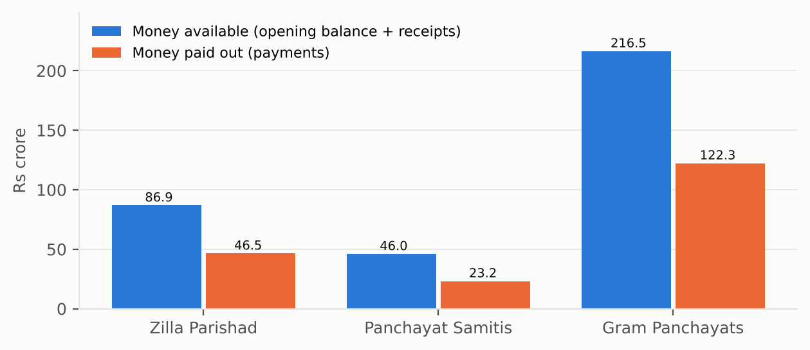
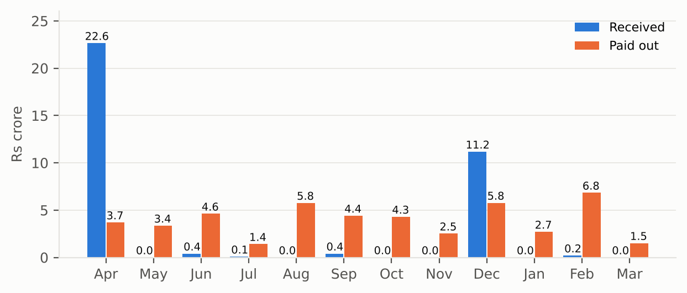

# Patna District: Panchayat Finances and Accounts, 2025-26

A plain-language district profile from the Government of India's eGramSwaraj system · India By Numbers · data as published by the portal (district statement generated November 21, 2026 12:51 AM)

## 1. The main points

- **Patna has 23 Panchayat Samitis (block councils) and 309 Gram Panchayats (village councils)**, plus one Zilla Parishad (district council).
- **In 2025-26 its Panchayats together had Rs 349.37 crore available and paid out Rs 191.94 crore (55%).**
- **The Gram Panchayats had Rs 216.45 crore and paid out Rs 122.27 crore (56%).** Patna ranks **3 of 38** districts in Bihar for money available to Gram Panchayats and **4 of 38** for money paid out by them.
- **An average Gram Panchayat in Patna had about Rs 70 lakh available and paid out about Rs 40 lakh** in the year (district totals divided by 309 Gram Panchayats).
- **Almost all the money is the 15th Finance Commission grant.** The scheme-wise statement lists only the 15th Finance Commission (XV FC) and the Panchayats' own resources for Patna; own resources received nothing in 2025-26.
- **Bookkeeping is complete:** 309 of 309 Gram Panchayats, 23 of 23 Panchayat Samitis and the Zilla Parishad have closed their annual accounts for the year in the system.
- **Village-by-village figures for 2025-26 are on the portal but not yet collected.**

## 2. How to read the money words

| Term | Meaning |
|---|---|
| **Money available** (portal: *OB + Receipts*) | Money left from last year (opening balance) plus money received during the year |
| **Money paid out** (portal: *Payments*) | Payments made from the Panchayat's own accounts during the year |
| **Crore / lakh** | 1 crore = 100 lakh = Rs 1,00,00,000 |

Payments are only what passed through Panchayat accounts. They are **not** all government spending in the district (state departments pay for many works directly).

## 3. Money at each level of Panchayat

| Level | Bodies | Money available (Rs crore) | Paid out (Rs crore) | Paid out as share | Patna's share of Bihar (available) |
|---|---|---|---|---|---|
| Zilla Parishad (district council) | 1 | 86.883 | 46.485 | 54% | 4% of Rs 2,037 crore |
| Panchayat Samitis (block councils) | 23 | 46.028 | 23.179 | 50% | 4% of Rs 1,027 crore |
| Gram Panchayats (village councils) | 309 | 216.454 | 122.273 | 56% | 5% of Rs 4,767 crore |
| **All levels** | | **349.365** | **191.937** | **55%** | |

Source: District wise Receipt and Payment Statement, 2025-26, Bihar (generated November 21, 2026 12:51 AM).

## 4. Block by block

Figures for the Panchayat Samiti (block council) itself and for all Gram Panchayats of the block together.

| Block | Gram Panchayats | Gram Panchayats: available (Rs crore) | Gram Panchayats: paid out | Share paid | Panchayat Samiti: available | Panchayat Samiti: paid out |
|---|---|---|---|---|---|---|
| Athamalgola | 8 | 4.588 | 3.075 | 67% | 0.800 | 0.637 |
| Bakhtiarpur | 16 | 10.845 | 6.883 | 63% | 2.017 | 1.118 |
| Barh | 13 | 10.223 | 5.521 | 54% | 1.772 | 0.720 |
| Belchhi | 7 | 3.626 | 2.488 | 69% | 0.583 | 0.333 |
| Bihta | 22 | 13.663 | 8.034 | 59% | 1.891 | 1.549 |
| Bikram | 16 | 9.351 | 4.951 | 53% | 2.029 | 1.596 |
| Daniyawan | 6 | 3.877 | 2.426 | 63% | 0.644 | 0.371 |
| Dhanarua | 19 | 13.440 | 8.647 | 64% | 4.481 | 1.688 |
| Dinapur | 13 | 9.731 | 4.396 | 45% | 2.719 | 0.617 |
| Dulhin Bazar | 14 | 8.905 | 4.299 | 48% | 1.911 | 1.100 |
| Fatuha | 15 | 9.179 | 5.115 | 56% | 2.471 | 1.217 |
| Ghoswari | 8 | 6.311 | 2.556 | 41% | 0.812 | 0.366 |
| Khusrupur | 7 | 5.546 | 3.098 | 56% | 0.690 | 0.147 |
| Maner | 19 | 17.659 | 9.496 | 54% | 4.094 | 1.436 |
| Masaurhi | 17 | 9.656 | 5.592 | 58% | 1.106 | 0.866 |
| Mokama | 15 | 9.649 | 7.088 | 73% | 1.618 | 1.561 |
| Naubatpur | 19 | 10.060 | 5.650 | 56% | 2.011 | 1.698 |
| Paliganj | 23 | 15.050 | 8.415 | 56% | 3.300 | 1.603 |
| Pandarak | 15 | 10.264 | 6.901 | 67% | 2.162 | 1.827 |
| Patna Sadar | 7 | 9.068 | 4.795 | 53% | 2.252 | 0.360 |
| Phulwari | 14 | 11.813 | 6.975 | 59% | 3.920 | 1.010 |
| Punpun | 13 | 10.487 | 4.834 | 46% | 1.726 | 1.197 |
| Sampatchak | 3 | 3.462 | 1.038 | 30% | 1.020 | 0.160 |

The blocks' Gram Panchayat figures add up to Rs 216.454 crore (district statement: Rs 216.454 crore). The largest is **Maner** (Rs 17.66 crore across 19 GPs), the smallest **Sampatchak** (Rs 3.46 crore). The share of money paid out ranges from 30% to 73% across blocks (middle block: 56%). Blocks differ in the number and size of their Panchayats, so a larger amount does not by itself mean better or worse performance.

## 5. The Zilla Parishad month by month

The district council (Zilla Parishad) started the year with **Rs 51.98 crore** carried over, received **Rs 34.91 crore** during the year and paid out **Rs 46.85 crore** (Rs 0.37 crore of payments were later cancelled or rejected, leaving Rs 46.48 crore, the figure in the annual statement).

| Month | Received (Rs lakh) | Paid out (Rs lakh) | Payment vouchers |
|---|---|---|---|
| April, 2025 | 2,264.78 | 369.52 | 293 |
| May, 2025 | 0.00 | 335.02 | 264 |
| June, 2025 | 40.00 | 461.50 | 294 |
| July, 2025 | 7.83 | 140.93 | 195 |
| August, 2025 | 0.00 | 575.97 | 320 |
| September, 2025 | 40.00 | 440.08 | 378 |
| October, 2025 | 0.98 | 429.47 | 245 |
| November, 2025 | 0.00 | 251.71 | 224 |
| December, 2025 | 1,117.09 | 576.76 | 229 |
| Januaury, 2026 | 0.00 | 270.38 | 313 |
| February, 2026 | 20.00 | 682.99 | 299 |
| March, 2026 | 0.00 | 151.12 | 242 |

Month names are shown exactly as the portal prints them.

The busiest month for payments was **February, 2026** (Rs 6.83 crore). Source: Month Wise Payment and Receipt Statement (generated November 21, 2026 11:20 AM) and Month wise Summary Report (generated November 21, 2026 8:15 PM).

## 6. Where the money comes from

| Source | Zilla Parishad | Panchayat Samitis | Gram Panchayats |
|---|---|---|---|
| 15th Finance Commission grant (XV FC) | 100% of receipts | 100% of receipts | 100% of receipts |
| Own resources (local taxes, fees) | 0 | 0 | 0 |

Only these two sources are listed for the district. **Caution:** in the 2025-26 scheme-wise report the rupee amounts are exactly twice the district statement in every district (a fault found in the data check, Task 5), so only the shares are shown here, not the amounts. The same report counts 3,658 receipt vouchers and 13,541 payment vouchers for Patna's Gram Panchayats under the XV FC grant (voucher counts are not affected).

## 7. How well the books are kept

| | Zilla Parishad | Panchayat Samitis | Gram Panchayats |
|---|---|---|---|
| Number | 1 | 23 | 309 |
| Masters and opening balance entered | yes / yes | 23 / 23 | 309 / 309 |
| Receipt vouchers recorded | 287 | 420 | 3,659 |
| Payment vouchers recorded | 3,296 | 1,794 | 13,541 |
| Day book closed | yes | 23 of 23 | 309 of 309 |
| Month book closed | yes | 23 of 23 | 309 of 309 |
| Year book (annual accounts) closed | yes | 23 of 23 | 309 of 309 |

On average each Gram Panchayat recorded about 44 payment vouchers in the year. Source: District Wise Summary Report (generated November 21, 2026 12:49 AM).

## 8. What this profile cannot tell you

| Not available | Why |
|---|---|
| Figures for each Gram Panchayat in 2025-26 | Published on the portal; not yet collected (planned follow-up collection). Available now for 2020-21 and 2024-25 |
| Population or households of the district's Panchayats | Not in any open eGramSwaraj report, so no per-person figures |
| What the money was spent on, item by item | Cash book, ledger and vendor reports are behind a security check (CAPTCHA) |
| Elected members of this district | Collected for Bihar as a whole only; district figures are a planned follow-up |
| Value of approved development plans | Only whether a plan was uploaded is public |
| Money left unspent at year end | Not printed as an official figure |

## 9. About these figures

- Every figure is copied from the government's own eGramSwaraj reports and was checked against the original pages in the data validation (Task 5). Totals in this profile add up to the portal's own totals.
- Each report is a snapshot taken on the date shown; later reports for the same year can differ slightly because accounts keep being updated.
- District code 203; block codes are the portal's own. Data collected 20–22 Nov 2026 from egramswaraj.gov.in. Machine-readable tables: `data/validated/egs/`.
