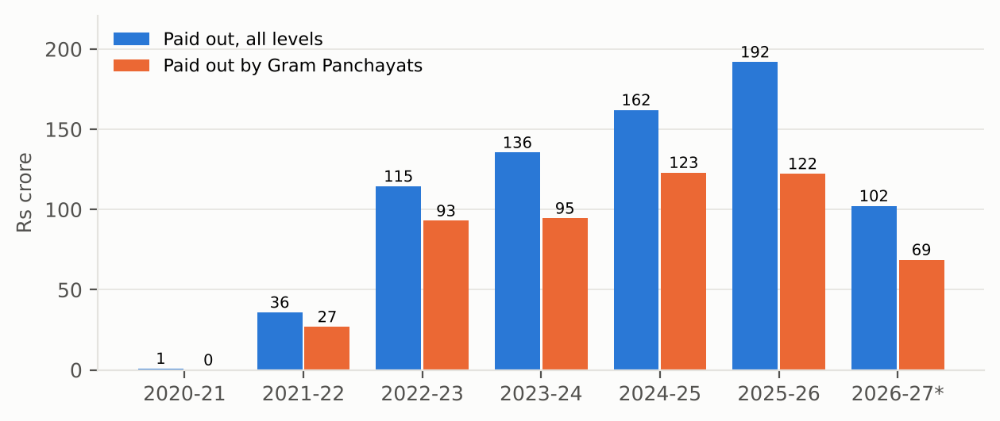

# Patna District: Panchayat Finance Reports, Year by Year

India By Numbers · from the Government of India's eGramSwaraj system · one detailed report per financial year

## The reports

| Financial year | Detailed report | What it contains |
|---|---|---|
| 2026-27 | [patna_2026-2027/report.pdf](patna_2026-2027/report.pdf) ([text](patna_2026-2027/report.md)) | district, blocks, Zilla Parishad by month, sources, bookkeeping, 10,825 vouchers, voucher totals of every Gram Panchayat |
| 2025-26 | [patna_2025-2026/report.pdf](patna_2025-2026/report.pdf) ([text](patna_2025-2026/report.md)) | district, blocks, Zilla Parishad by month, sources, bookkeeping, 22,997 vouchers, voucher totals of every Gram Panchayat |
| 2024-25 | [patna_2024-2025/report.pdf](patna_2024-2025/report.pdf) ([text](patna_2024-2025/report.md)) | district, blocks, Zilla Parishad by month, sources, bookkeeping, 18,181 vouchers, official figures of every Gram Panchayat |
| 2023-24 | [patna_2023-2024/report.pdf](patna_2023-2024/report.pdf) ([text](patna_2023-2024/report.md)) | district, blocks, Zilla Parishad by month, sources, bookkeeping, 15,821 vouchers, voucher totals of every Gram Panchayat |
| 2022-23 | [patna_2022-2023/report.pdf](patna_2022-2023/report.pdf) ([text](patna_2022-2023/report.md)) | district, blocks, Zilla Parishad by month, sources, bookkeeping, 14,032 vouchers, voucher totals of every Gram Panchayat |
| 2021-22 | [patna_2021-2022/report.pdf](patna_2021-2022/report.pdf) ([text](patna_2021-2022/report.md)) | district, blocks, Zilla Parishad by month, sources, bookkeeping, 8,350 vouchers, voucher totals of every Gram Panchayat |
| 2020-21 | [patna_2020-2021/report.pdf](patna_2020-2021/report.pdf) ([text](patna_2020-2021/report.md)) | district, blocks, Zilla Parishad by month, sources, bookkeeping, 196 vouchers, official figures of every Gram Panchayat |
| 2019-20 | no report | all amounts on the portal are zero for every Bihar district, most likely because the accounts for this year were not entered in eGramSwaraj. This means **no data**, not proof that nothing was spent |
| 2018-19 | no report | all amounts on the portal are zero for every Bihar district, most likely because the accounts for this year were not entered in eGramSwaraj. This means **no data**, not proof that nothing was spent |
| 2017-18 | no report | all amounts on the portal are zero for every Bihar district, most likely because the accounts for this year were not entered in eGramSwaraj. This means **no data**, not proof that nothing was spent |
| 2016-17 | no report | all amounts on the portal are zero for every Bihar district, most likely because the accounts for this year were not entered in eGramSwaraj. This means **no data**, not proof that nothing was spent |

A multi-year report on the vouchers alone is in [patna_vouchers/](patna_vouchers/).

## Year by year at a glance

| Year | Received (Rs crore, old layout) | Available: OB + receipts (Rs crore) | Paid out, all levels (Rs crore) | Paid out by Gram Panchayats (Rs crore) | Gram Panchayats | Year book closed (GPs) |
|---|---|---|---|---|---|---|
| 2020-21 | 25.21 | — | 0.90 | 0.00 | 322 | 293 |
| 2021-22 | — | 224.06 | 35.90 | 26.89 | 313 | 311 |
| 2022-23 | — | 353.41 | 114.51 | 92.96 | 313 | 309 |
| 2023-24 | — | 387.40 | 135.51 | 94.55 | 313 | 309 |
| 2024-25 | — | 318.29 | 162.06 | 123.04 | 309 | 309 |
| 2025-26 | — | 349.37 | 191.94 | 122.27 | 309 | 309 |
| 2026-27 | — | 204.73 | 102.24 | 68.66 | 309 | 0 |

The 2020-21 statement printed *Receipts* in rupees; from 2021-22 the portal shows *OB + Receipts* (opening balance plus receipts) in crore. They are different measures, so they sit in different columns and should not be compared. *Payments* carry the same label in both layouts. The latest year is still running, so its figures are partial.

\* still running.

## How to use these reports

- Each report starts with **the main points** in plain words; the later sections give the detail.
- The **Appendix** of each report lists every Gram Panchayat: official figures where the portal's village statement was collected (2020-21 and 2024-25), and totals of each Gram Panchayat's own vouchers for every year with vouchers.
- **No names of payees, vendors or residents** appear anywhere; only voucher numbers, dates, types and amounts.
- Figures are copied from the portal and checked against the original pages (Task 5). Each report is a snapshot taken on the date shown in it.
