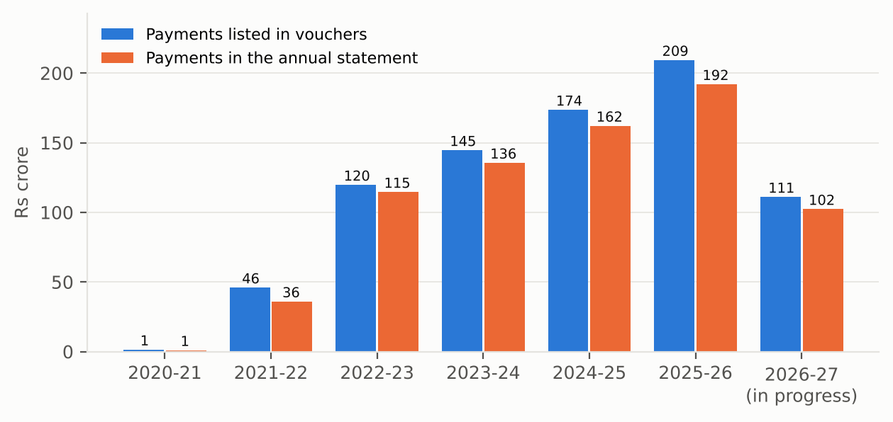
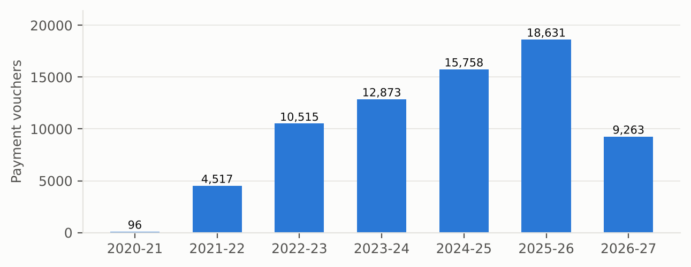
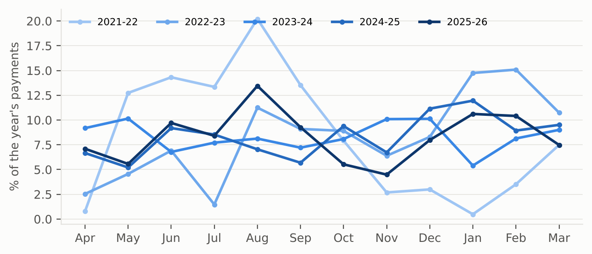

# Patna District: Every Panchayat Receipt and Payment, 2020-21 to 2026-27

A plain-language report on the transaction-level accounts (vouchers) of all Panchayats in the district, from the Government of India's eGramSwaraj system · India By Numbers · collected 22 Nov 2026

## 1. The main points

- **90,402 voucher entries** were collected for Patna's Zilla Parishad, Panchayat Samitis and Gram Panchayats over 7 financial years (2020-21 to 2026-27). Every page the portal offered was collected; no page needed a security check (CAPTCHA).
- **Payments recorded through vouchers grew from Rs 46 crore in 2021-22 to Rs 209 crore in 2025-26**, and the number of payment vouchers from 4,517 to 18,631.
- **2020-21 was the first year**: only 196 entries, from 30 Gram Panchayats. From 2021-22 every Gram Panchayat in the district records its accounts this way.
- **Almost every payment is an 'Expenditure' voucher under the 15th Finance Commission grant** (voucher numbers begin with XVFC).
- **Payments are spread through the year; there is no fixed busiest month.** The busiest month was Aug in 2021-22, Feb in 2022-23, May in 2023-24, Jan in 2024-25, Aug in 2025-26. The last quarter (January–March) carried between 11% and 41% of a year's payments (section 6).
- **Vouchers list somewhat more in payments than the official annual statement** (+4% to +9% from 2022-23; +28% in 2021-22). The statement is the official total; the vouchers give the detail and the pattern (section 10).
- **No names of people or firms are included.** The voucher lists show only the date, voucher number, type and amount.

## 2. What a voucher is

Every time a Panchayat receives or pays money, it records a **voucher** in eGramSwaraj — like a numbered receipt or bill. The portal lists them month by month:

| Kind | What it records |
|---|---|
| Receipt voucher | Money coming in (grants, refunds, money sent back by the payment system) |
| Payment voucher | Money going out |
| Contra voucher | Money moved between the Panchayat's own accounts |
| Journal voucher | An adjustment entry, no money moves |

A voucher number (e.g. *XVFC/2025-26/P/35*) can appear on more than one line when several entries are recorded under it; every line is counted as the portal lists it.

## 3. Year by year

| Year | Gram Panchayats covered | Receipt entries | Payment entries | Other entries | Received (Rs crore) | Paid (Rs crore) | Annual statement: paid (Rs crore) |
|---|---|---|---|---|---|---|---|
| 2020-21 | 30 | 100 | 96 | 0 | 25.63 | 1.32 | 0.90 |
| 2021-22 | 309 | 3,829 | 4,517 | 4 | 209.69 | 45.88 | 35.90 |
| 2022-23 | 309 | 3,505 | 10,515 | 12 | 169.25 | 119.65 | 114.51 |
| 2023-24 | 309 | 2,818 | 12,873 | 130 | 151.36 | 144.53 | 135.51 |
| 2024-25 | 309 | 2,391 | 15,758 | 32 | 68.86 | 173.52 | 162.06 |
| 2025-26 | 309 | 4,366 | 18,631 | 0 | 199.66 | 209.29 | 191.94 |
| 2026-27 (in progress) | 308 | 1,562 | 9,263 | 0 | 50.06 | 110.97 | 102.24 |
| **All years** | | **18,571** | **71,653** | | **874.52** | **805.16** | |

'Received' here is money received during the year only. The annual statement's 'money available' also includes the opening balance carried over, so it is much larger.

## 4. Who paid: each level of Panchayat

Payments listed in vouchers (Rs crore):

| Year | Zilla Parishad | Panchayat Samitis | Gram Panchayats | Payment entries at Gram Panchayats | Average entries per Gram Panchayat |
|---|---|---|---|---|---|
| 2020-21 | 0.00 | 1.32 | 0.00 | 0 | 0 |
| 2021-22 | 0.00 | 10.97 | 34.91 | 3,732 | 12 |
| 2022-23 | 0.00 | 23.00 | 96.64 | 8,719 | 28 |
| 2023-24 | 19.57 | 25.04 | 99.92 | 10,525 | 34 |
| 2024-25 | 16.06 | 26.44 | 131.03 | 12,686 | 41 |
| 2025-26 | 50.41 | 25.74 | 133.15 | 13,541 | 44 |
| 2026-27 | 15.40 | 21.44 | 74.12 | 7,065 | 23 |

From 2021-22, Gram Panchayats made between 64% and 81% of all payments listed. The Zilla Parishad recorded no payment vouchers in 2020-21, 2021-22. In 2022-23 it recorded 1 payment totalling only Rs 1.

## 5. Types of entry

| Type | 2020-21 | 2021-22 | 2022-23 | 2023-24 | 2024-25 | 2025-26 | 2026-27 | Meaning |
|---|---|---|---|---|---|---|---|---|
| Expenditures | 95 | 4,415 | 10,515 | 12,873 | 15,758 | 18,629 | 9,263 | a payment made |
| Direct Receipts | 96 | 3,077 | 813 | 1,309 | 569 | 1,015 | 141 | money received directly |
| Refund of Excess Payment | 4 | 305 | 1,158 | 849 | 1,156 | 2,350 | 1,107 | money returned after an overpayment |
| Reverse Receipt -PFMS | 0 | 447 | 1,534 | 660 | 666 | 1,001 | 314 | a payment sent back by the PFMS payment system and re-credited |
| Receipt Cancellation | 1 | 78 | 0 | 0 | 0 | 0 | 0 | a receipt entry cancelled |
| OB Cancellation | 0 | 24 | 0 | 0 | 0 | 2 | 0 | an opening-balance entry cancelled |
| Contra / journal (no type shown) | 0 | 4 | 12 | 130 | 32 | 0 | 0 | money moved between own accounts, or adjustments |

## 6. When the money is paid: month by month

Payments listed in vouchers, Rs crore:

| Month | 2020-21 | 2021-22 | 2022-23 | 2023-24 | 2024-25 | 2025-26 | 2026-27 |
|---|---|---|---|---|---|---|---|
| Apr | 0.00 | 0.36 | 3.03 | 13.27 | 11.57 | 14.86 | 6.87 |
| May | 0.00 | 5.84 | 5.45 | 14.67 | 9.04 | 11.65 | 7.04 |
| Jun | 0.00 | 6.57 | 8.27 | 9.80 | 15.94 | 20.32 | 32.77 |
| Jul | 0.00 | 6.12 | 1.76 | 11.15 | 14.81 | 17.59 | 21.48 |
| Aug | 0.00 | 9.27 | 13.46 | 11.75 | 12.22 | 28.15 | 13.84 |
| Sep | 0.00 | 6.20 | 10.89 | 10.42 | 9.87 | 19.41 | 15.00 |
| Oct | 0.00 | 3.63 | 10.65 | 11.68 | 16.29 | 11.57 | 10.12 |
| Nov | 0.00 | 1.23 | 7.65 | 14.59 | 11.68 | 9.39 | 3.86 |
| Dec | 0.00 | 1.37 | 9.92 | 14.63 | 19.34 | 16.70 | 0.00 |
| Jan | 0.00 | 0.22 | 17.65 | 7.80 | 20.75 | 22.21 | 0.00 |
| Feb | 0.00 | 1.61 | 18.05 | 11.76 | 15.51 | 21.79 | 0.00 |
| Mar | 1.32 | 3.43 | 12.86 | 13.02 | 16.50 | 15.66 | 0.00 |

The busiest month changes from year to year (2021-22: Aug, 20%, 2022-23: Feb, 15%, 2023-24: May, 10%, 2024-25: Jan, 12%, 2025-26: Aug, 13%). The chart shows each full year; 2026-27 is still in progress, so its later months are empty.

## 7. Size of payments

Number of payment entries:

| Size | 2020-21 | 2021-22 | 2022-23 | 2023-24 | 2024-25 | 2025-26 | 2026-27 |
|---|---|---|---|---|---|---|---|
| Up to Rs 10,000 | 38 | 1,221 | 2,067 | 4,599 | 4,185 | 2,694 | 1,148 |
| Rs 10,000 – 1 lakh | 34 | 1,851 | 5,058 | 4,061 | 5,955 | 9,868 | 4,848 |
| Rs 1 – 5 lakh | 17 | 1,334 | 2,931 | 3,594 | 5,017 | 5,246 | 2,857 |
| Rs 5 – 10 lakh | 6 | 90 | 421 | 576 | 553 | 746 | 387 |
| Over Rs 10 lakh | 1 | 21 | 38 | 43 | 48 | 77 | 23 |

The typical (middle) payment was Rs 10,045 in 2020-21, Rs 46,008 in 2021-22, Rs 48,000 in 2022-23, Rs 29,481 in 2023-24, Rs 39,003 in 2024-25, Rs 35,000 in 2025-26, Rs 46,003 in 2026-27. Most payments are small; a few large ones carry much of the money.

## 8. The largest payments of each year

| Year | Date | Voucher number | Level | Block | Amount (Rs) | Type |
|---|---|---|---|---|---|---|
| 2020-21 | 31/03/2021 | XVFC/2020-21/P/1 | Panchayat Samiti | Patna Sadar | 4,116,720 | Receipt Cancellation |
| 2020-21 | 25/03/2021 | XVFC/2020-21/P/13 | Panchayat Samiti | Bihta | 732,100 | Expenditures |
| 2020-21 | 24/03/2021 | XVFC/2020-21/P/12 | Panchayat Samiti | Bihta | 729,546 | Expenditures |
| 2021-22 | 19/05/2021 | XVFC/2021-22/P/12 | Panchayat Samiti | Bihta | 6,427,487 | OB Cancellation |
| 2021-22 | 19/05/2021 | XVFC/2021-22/P/13 | Panchayat Samiti | Bihta | 3,014,663.5 | OB Cancellation |
| 2021-22 | 31/03/2022 | XVFC/2021-22/P/17 | Panchayat Samiti | Dulhin Bazar | 2,917,261 | Expenditures |
| 2022-23 | 01/12/2022 | XVFC/2022-23/P/100 | Panchayat Samiti | Bakhtiarpur | 1,885,104 | Expenditures |
| 2022-23 | 15/03/2023 | XVFC/2022-23/P/20 | Gram Panchayat | Naubatpur | 1,816,533 | Expenditures |
| 2022-23 | 10/01/2023 | XVFC/2022-23/P/26 | Gram Panchayat | Phulwari | 1,678,959 | Expenditures |
| 2023-24 | 09/06/2023 | XVFC/2023-24/P/6 | Panchayat Samiti | Bakhtiarpur | 1,796,018 | Expenditures |
| 2023-24 | 20/04/2023 | XVFC/2023-24/P/1 | Gram Panchayat | Bakhtiarpur | 1,485,037 | Expenditures |
| 2023-24 | 18/05/2023 | XVFC/2023-24/P/1 | Gram Panchayat | Bakhtiarpur | 1,430,878 | Expenditures |
| 2024-25 | 01/08/2024 | XVFC/2024-25/P/6 | Gram Panchayat | Bakhtiarpur | 1,496,901 | Expenditures |
| 2024-25 | 28/02/2025 | XVFC/2024-25/P/24 | Gram Panchayat | Bakhtiarpur | 1,488,842 | Expenditures |
| 2024-25 | 21/01/2025 | XVFC/2024-25/P/42 | Panchayat Samiti | Bakhtiarpur | 1,405,316 | Expenditures |
| 2025-26 | 23/08/2025 | XVFC/2025-26/P/35 | Panchayat Samiti | Barh | 3,973,289 | OB Cancellation |
| 2025-26 | 19/08/2025 | XVFC/2025-26/P/8 | Gram Panchayat | Barh | 1,909,746.99 | OB Cancellation |
| 2025-26 | 17/05/2025 | XVFC/2025-26/P/1 | Panchayat Samiti | Punpun | 1,495,782 | Expenditures |
| 2026-27 | 10/07/2026 | XVFC/2026-27/P/505 | Zilla Parishad | — | 1,216,395 | Expenditures |
| 2026-27 | 02/07/2026 | XVFC/2026-27/P/2 | Gram Panchayat | Bihta | 1,213,731 | Expenditures |
| 2026-27 | 03/07/2026 | XVFC/2026-27/P/7 | Gram Panchayat | Bihta | 1,213,731 | Expenditures |

## 9. Block by block: Gram Panchayat payments

Payments listed in Gram Panchayat vouchers, by block (Rs crore):

| Block | 2020-21 | 2021-22 | 2022-23 | 2023-24 | 2024-25 | 2025-26 | 2026-27 |
|---|---|---|---|---|---|---|---|
| Athamalgola | 0.00 | 2.19 | 3.63 | 2.37 | 2.77 | 3.10 | 1.61 |
| Bakhtiarpur | 0.00 | 2.18 | 4.14 | 5.57 | 8.22 | 7.52 | 4.45 |
| Barh | 0.00 | 2.13 | 4.78 | 4.17 | 6.12 | 6.42 | 2.88 |
| Belchhi | 0.00 | 0.68 | 2.24 | 2.28 | 2.84 | 2.67 | 0.81 |
| Bihta | 0.00 | 2.39 | 5.86 | 8.39 | 8.48 | 8.61 | 4.75 |
| Bikram | 0.00 | 0.70 | 2.28 | 4.99 | 6.82 | 5.34 | 3.12 |
| Daniyawan | 0.00 | 1.20 | 2.82 | 2.82 | 2.85 | 2.64 | 1.65 |
| Dhanarua | 0.00 | 1.08 | 8.43 | 6.90 | 7.83 | 8.82 | 4.96 |
| Dinapur | 0.00 | 1.20 | 3.38 | 5.24 | 5.74 | 5.13 | 3.71 |
| Dulhin Bazar | 0.00 | 0.91 | 3.42 | 3.60 | 4.37 | 4.65 | 3.70 |
| Fatuha | 0.00 | 0.87 | 4.54 | 4.80 | 6.14 | 5.53 | 3.44 |
| Ghoswari | 0.00 | 0.48 | 2.93 | 2.13 | 2.25 | 2.81 | 1.49 |
| Khusrupur | 0.00 | 0.92 | 3.14 | 3.47 | 3.23 | 3.60 | 2.93 |
| Maner | 0.00 | 3.07 | 7.66 | 6.95 | 7.98 | 9.93 | 5.32 |
| Masaurhi | 0.00 | 3.28 | 6.74 | 4.41 | 5.89 | 6.17 | 3.56 |
| Mokama | 0.00 | 1.12 | 3.22 | 3.51 | 6.14 | 7.50 | 2.80 |
| Naubatpur | 0.00 | 3.62 | 8.46 | 6.03 | 5.64 | 6.41 | 3.02 |
| Paliganj | 0.00 | 2.21 | 7.74 | 6.68 | 7.84 | 9.55 | 5.72 |
| Pandarak | 0.00 | 1.34 | 2.99 | 3.45 | 7.87 | 7.40 | 3.27 |
| Patna Sadar | 0.00 | 0.39 | 1.72 | 1.26 | 2.79 | 5.27 | 3.24 |
| Phulwari | 0.00 | 1.88 | 4.62 | 7.58 | 10.03 | 7.70 | 3.65 |
| Punpun | 0.00 | 0.67 | 1.53 | 2.29 | 7.54 | 5.26 | 2.86 |
| Sampatchak | 0.00 | 0.38 | 0.37 | 1.04 | 1.65 | 1.11 | 1.18 |

## 10. How these figures relate to the official annual statement

| Year | Paid in vouchers (Rs crore) | Paid in the annual statement (Rs crore) | Vouchers above statement |
|---|---|---|---|
| 2020-21 | 1.32 | 0.90 | +46% |
| 2021-22 | 45.88 | 35.90 | +28% |
| 2022-23 | 119.65 | 114.51 | +4% |
| 2023-24 | 144.53 | 135.51 | +7% |
| 2024-25 | 173.52 | 162.06 | +7% |
| 2025-26 | 209.29 | 191.94 | +9% |
| 2026-27 | 110.97 | 102.24 | +9% |

The annual statement (District wise Receipt and Payment Statement) is the **official total** and should be quoted for totals. The vouchers list somewhat more in payments, probably because the statement is net of payments later cancelled, rejected or returned; the portal does not define the netting, and simple formulas (minus refunds, minus PFMS reversals) do not reproduce it exactly. Use the vouchers for detail, timing and pattern, not as a replacement for the official total.

## 11. About this data

- Source: eGramSwaraj 'Voucher Wise Summary Report' pages for Patna (district code 203), one per body and month, collected 22 Nov 2026 from an Indian connection. Each page is stored unchanged with its URL, time and sha256; every voucher number was re-found in its page.
- Coverage: the Zilla Parishad, all 23 Panchayat Samitis and every Gram Panchayat that the portal lists (30 in 2020-21, 309 in 2021-22, 309 in 2022-23, 309 in 2023-24, 309 in 2024-25, 309 in 2025-26, 308 in 2026-27).
- Who received each payment is shown only on the individual voucher page, which is behind a security check (CAPTCHA); it was not collected.
- Machine-readable: `data/validated/egs/vouchers/203_<year>.csv` — one row per voucher line.
