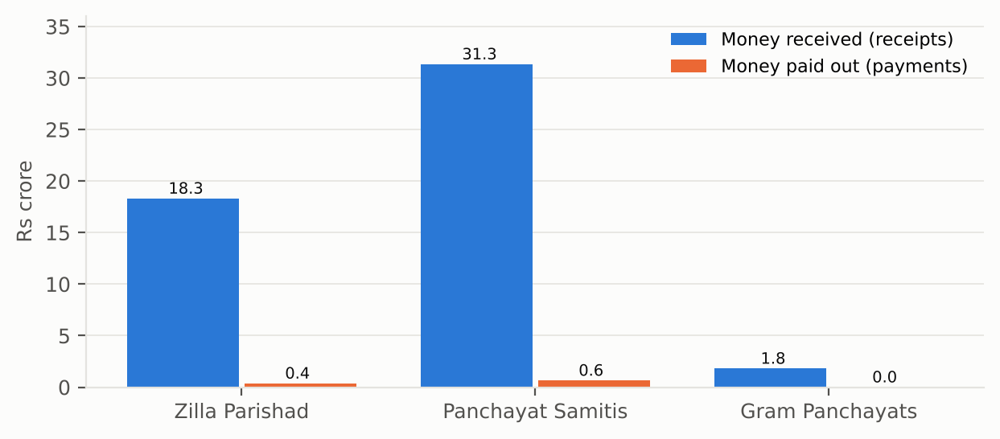
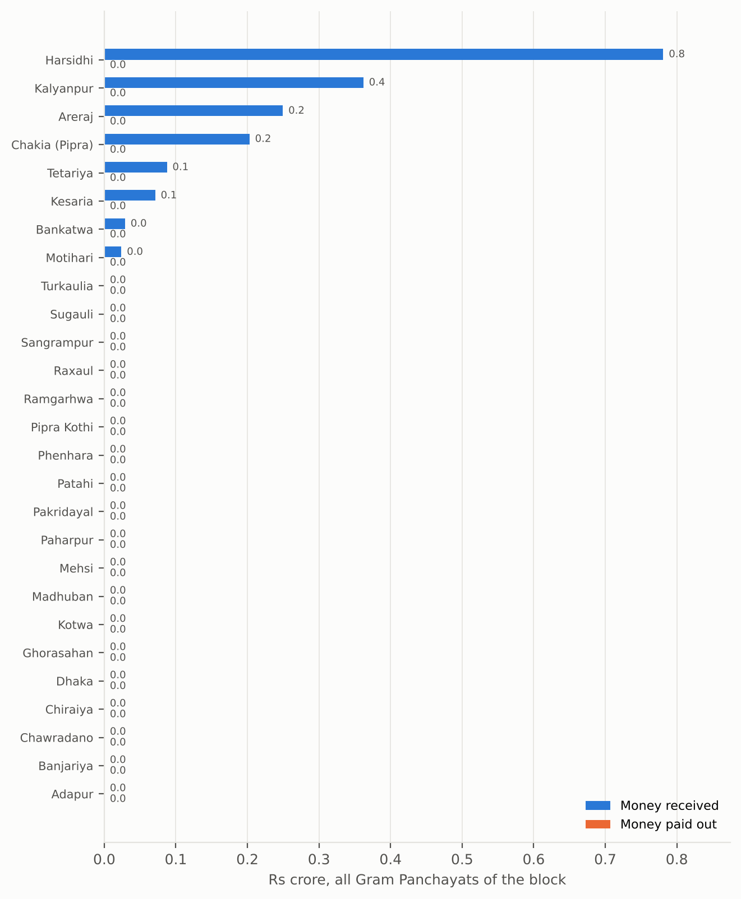
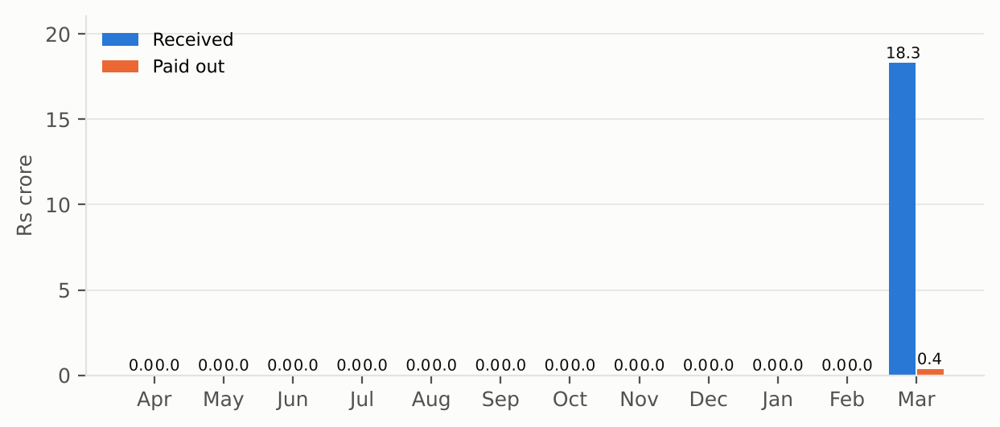

# Purbi Champaran District: Panchayat Finances and Accounts, 2020-21

A plain-language district profile from the Government of India's eGramSwaraj system · India By Numbers · data as published by the portal (district statement generated July 18, 2022 2:27 AM)

## 1. The main points

- **Purbi Champaran has 27 Panchayat Samitis (block councils) and 405 Gram Panchayats (village councils)** in the 2020-21 accounts, plus one Zilla Parishad (district council).
- **In 2020-21 its Panchayats together received Rs 51.46 crore and paid out Rs 1.02 crore.** (This year's statement uses a different measure from later years; see section 2.)
- **The Gram Panchayats had Rs 1.81 crore of receipts and paid out Rs 0.00 crore (0%).** Rank among Bihar's districts: **23 of 38** for money received by Gram Panchayats, **none (26 of 38 districts show none)** for money paid out by them.
- **An average Gram Panchayat in Purbi Champaran had about Rs 0.4 lakh of receipts and paid out about Rs 0.0 lakh** in the year (district totals divided by 405 Gram Panchayats).
- **Almost all the money is the 15th Finance Commission grant** (scheme-wise statement, all levels). Sources listed for Purbi Champaran: XV Finance Commission-XVFC 100.0%.
- **Annual accounts are not complete:** 386 of 405 Gram Panchayats, 27 of 27 Panchayat Samitis and the Zilla Parishad (closed) have closed their year book in the system.
- **Official figures for each of the 405 Gram Panchayats are in the Appendix.**

## 2. How to read the money words

| Term | Meaning |
|---|---|
| **Money received** (portal: *Receipts*) | Money received during the year, as printed in rupees in the 2020-21 statement. The report does not say whether last year's balance is included |
| **Money paid out** (portal: *Payments*) | Payments made from the Panchayat's own accounts during the year |
| **Crore / lakh** | 1 crore = 100 lakh = Rs 1,00,00,000 |

**Important:** from 2021-22 the portal changed this statement to *OB + Receipts* in crore. The 2020-21 *Receipts* figure is a different measure, so it should not be compared directly with the *money available* of later years.

Payments are only what passed through Panchayat accounts. They are **not** all government spending in the district (state departments pay for many works directly).

## 3. Money at each level of Panchayat

| Level | Bodies | Money received (Rs crore) | Paid out (Rs crore) | Paid out as share | Purbi Champaran's share of Bihar (received) |
|---|---|---|---|---|---|
| Zilla Parishad (district council) | 1 | 18.311 | 0.369 | 2% | 6% of Rs 321 crore |
| Panchayat Samitis (block councils) | 27 | 31.342 | 0.648 | 2% | 8% of Rs 375 crore |
| Gram Panchayats (village councils) | 405 | 1.807 | 0.000 | 0% | 1% of Rs 235 crore |
| **All levels** | | **51.459** | **1.017** | **2%** | |

Source: District wise Receipt and Payment Statement, 2020-21, Bihar (generated July 18, 2022 2:27 AM); amounts printed in rupees, shown here in crore.

## 4. Block by block

Figures for the Panchayat Samiti (block council) itself and for all Gram Panchayats of the block together.

| Block | Gram Panchayats | Gram Panchayats: received (Rs crore) | Gram Panchayats: paid out | Share paid | Panchayat Samiti: received | Panchayat Samiti: paid out |
|---|---|---|---|---|---|---|
| Adapur | 17 | 0.000 | 0.000 | — | 1.716 | 0.094 |
| Areraj | 14 | 0.249 | 0.000 | 0% | 1.114 | 0.119 |
| Banjariya | 13 | 0.000 | 0.000 | — | 1.389 | 0.000 |
| Bankatwa | 10 | 0.029 | 0.000 | 0% | 0.682 | 0.000 |
| Chakia (Pipra) | 18 | 0.203 | 0.000 | 0% | 1.582 | 0.079 |
| Chawradano | 15 | 0.000 | 0.000 | — | 1.463 | 0.000 |
| Chiraiya | 23 | 0.000 | 0.000 | — | 0.781 | 0.000 |
| Dhaka | 23 | 0.000 | 0.000 | — | 2.201 | 0.175 |
| Ghorasahan | 14 | 0.000 | 0.000 | — | 0.985 | 0.000 |
| Harsidhi | 19 | 0.781 | 0.000 | 0% | 1.229 | 0.000 |
| Kalyanpur | 24 | 0.362 | 0.000 | 0% | 2.155 | 0.000 |
| Kesaria | 17 | 0.071 | 0.000 | 0% | 0.000 | 0.000 |
| Kotwa | 16 | 0.000 | 0.000 | — | 1.435 | 0.000 |
| Madhuban | 13 | 0.000 | 0.000 | — | 1.382 | 0.000 |
| Mehsi | 13 | 0.000 | 0.000 | — | 0.844 | 0.000 |
| Motihari | 20 | 0.024 | 0.000 | 0% | 0.848 | 0.000 |
| Paharpur | 16 | 0.000 | 0.000 | — | 0.926 | 0.000 |
| Pakridayal | 9 | 0.000 | 0.000 | — | 1.058 | 0.000 |
| Patahi | 15 | 0.000 | 0.000 | — | 1.416 | 0.131 |
| Phenhara | 6 | 0.000 | 0.000 | — | 0.000 | 0.000 |
| Pipra Kothi | 6 | 0.000 | 0.000 | — | 1.100 | 0.000 |
| Ramgarhwa | 16 | 0.000 | 0.000 | — | 1.686 | 0.000 |
| Raxaul | 13 | 0.000 | 0.000 | — | 0.951 | 0.050 |
| Sangrampur | 14 | 0.000 | 0.000 | — | 0.803 | 0.000 |
| Sugauli | 16 | 0.000 | 0.000 | — | 1.604 | 0.000 |
| Tetariya | 9 | 0.087 | 0.000 | 0% | 0.984 | 0.000 |
| Turkaulia | 16 | 0.000 | 0.000 | — | 1.005 | 0.000 |

The blocks' Gram Panchayat figures add up to Rs 1.807 crore (district statement: Rs 1.807 crore). The largest is **Harsidhi** (Rs 0.78 crore across 19 GPs), the smallest **Adapur** (Rs 0.00 crore). None of the 8 blocks with money shows any Gram Panchayat payment. In 19 of 27 blocks the Gram Panchayats show no money at all for this year. Blocks differ in the number and size of their Panchayats, so a larger amount does not by itself mean better or worse performance.

## 5. The Zilla Parishad month by month

The district council (Zilla Parishad) started the year with **Rs 0.00 crore** carried over, received **Rs 18.31 crore** during the year and paid out **Rs 0.37 crore**. This matches the annual statement.

| Month | Received (Rs lakh) | Paid out (Rs lakh) | Payment vouchers |
|---|---|---|---|
| April, 2020 | 0.00 | 0.00 | 0 |
| May, 2020 | 0.00 | 0.00 | 0 |
| June, 2020 | 0.00 | 0.00 | 0 |
| July, 2020 | 0.00 | 0.00 | 0 |
| August, 2020 | 0.00 | 0.00 | 0 |
| September, 2020 | 0.00 | 0.00 | 0 |
| October, 2020 | 0.00 | 0.00 | 0 |
| November, 2020 | 0.00 | 0.00 | 0 |
| December, 2020 | 0.00 | 0.00 | 0 |
| Januaury, 2021 | 0.00 | 0.00 | 0 |
| February, 2021 | 0.00 | 0.00 | 0 |
| March, 2021 | 1,831.09 | 36.88 | 18 |

Month names are shown exactly as the portal prints them.

The busiest month for payments was **March, 2021** (Rs 0.37 crore). Source: Month Wise Payment and Receipt Statement (generated July 18, 2022 4:05 AM) and Month wise Summary Report (generated July 18, 2022 4:29 AM).

## 6. Where the money comes from

| Source (as named by the portal) | Zilla Parishad | Panchayat Samitis | Gram Panchayats |
|---|---|---|---|
| XV Finance Commission-XVFC | 100% of receipts | 100% of receipts | 100% of receipts |

Only the 1 source(s) above are listed for the district. Shares are calculated from the scheme-wise statement (generated August 20, 2021 6:50 AM). The same report counts 93 receipt vouchers and 10 payment vouchers for Purbi Champaran's Gram Panchayats under the XV FC grant.

## 7. How well the books are kept

| | Zilla Parishad | Panchayat Samitis | Gram Panchayats |
|---|---|---|---|
| Number | 1 | 27 | 405 |
| Masters and opening balance entered | yes / yes | 27 / 27 | 389 / 386 |
| Receipt vouchers recorded | 9 | 172 | 93 |
| Payment vouchers recorded | 18 | 23 | 10 |
| Day book closed | yes | 27 of 27 | 386 of 405 |
| Month book closed | yes | 27 of 27 | 386 of 405 |
| Year book (annual accounts) closed | yes | 27 of 27 | 386 of 405 |

On average each Gram Panchayat recorded about 0 payment vouchers in the year. Source: District Wise Summary Report (generated July 18, 2022 2:31 AM).

## 8. What this profile cannot tell you

| Not available | Why |
|---|---|
| Population or households of the district's Panchayats | Not in any open eGramSwaraj report, so no per-person figures |
| Who each payment went to (the payee or vendor of each voucher) | On the individual voucher page, behind a security check (CAPTCHA); not collected. The public voucher lists (number, date, type, amount) are collected so far only for Patna; for this district they can be collected from India with `scripts/run_vouchers.py` |
| Elected members of this district | Collected for Bihar as a whole only; district figures are a planned follow-up |
| Value of approved development plans | Only whether a plan was uploaded is public |
| Money left unspent at year end | Not printed as an official figure |

## 9. About these figures

- Every figure is copied from the government's own eGramSwaraj reports and was checked against the original pages in the data validation (Task 5). Totals in this profile add up to the portal's own totals.
- Each report is a snapshot taken on the date shown; later reports for the same year can differ slightly because accounts keep being updated.
- District code 204; block and Gram Panchayat codes are the portal's own. Data collected November 2026 from egramswaraj.gov.in. Machine-readable tables: `data/validated/egs/`.
- Reports for Purbi Champaran in other years: `docs/district_reports/purbi_champaran/index.md`; all districts: `docs/district_reports/README.md`.

## Appendix: every Gram Panchayat of Purbi Champaran, 2020-21

Amounts in Rs lakh. **Official receipts / payments** are from the Village wise Receipt and Payment Statement (generated July 18, 2022 3:58 AM); they are the figures to quote. 405 Gram Panchayats are shown; the district statement counts 405.

| Block | Gram Panchayat | Code | Official receipts | Official payments |
|---|---|---|---|---|
| Adapur | Andhara | 99114 | 0.00 | 0.00 |
| Adapur | Auraiya | 99115 | 0.00 | 0.00 |
| Adapur | Bakhari | 99116 | 0.00 | 0.00 |
| Adapur | Barwa | 99117 | 0.00 | 0.00 |
| Adapur | Belwa | 99118 | 0.00 | 0.00 |
| Adapur | Bhawanipur | 99119 | 0.00 | 0.00 |
| Adapur | Bherihari | 99120 | 0.00 | 0.00 |
| Adapur | Dubahan | 99121 | 0.00 | 0.00 |
| Adapur | Gamharia | 99122 | 0.00 | 0.00 |
| Adapur | Harpur | 99123 | 0.00 | 0.00 |
| Adapur | Koraiya | 99124 | 0.00 | 0.00 |
| Adapur | Lakshmipur Pokhariya | 99125 | 0.00 | 0.00 |
| Adapur | Majhariya | 99126 | 0.00 | 0.00 |
| Adapur | Murtiya | 99127 | 0.00 | 0.00 |
| Adapur | Nakardei | 99128 | 0.00 | 0.00 |
| Adapur | Shyampur | 99129 | 0.00 | 0.00 |
| Adapur | Sirsiya Kala | 99130 | 0.00 | 0.00 |
| Areraj | Babhnauli | 99131 | 1.77 | 0.00 |
| Areraj | Bahadurpur | 99132 | 5.22 | 0.00 |
| Areraj | Chaita Chintamanpur | 244378 | 1.80 | 0.00 |
| Areraj | Chatia Barharwa | 99133 | 0.00 | 0.00 |
| Areraj | Mamarkha | 99134 | 6.77 | 0.00 |
| Areraj | Mamarkha Tola Bhaiya | 99135 | 0.00 | 0.00 |
| Areraj | Manguraha | 99136 | 1.72 | 0.00 |
| Areraj | Misraulia | 99137 | 0.00 | 0.00 |
| Areraj | Mura | 99138 | 0.00 | 0.00 |
| Areraj | Nagdaha | 99139 | 1.85 | 0.00 |
| Areraj | Nawada | 99140 | 0.00 | 0.00 |
| Areraj | Pipra | 99141 | 5.82 | 0.00 |
| Areraj | Radhiya | 99142 | 0.00 | 0.00 |
| Areraj | Sareya | 99143 | 0.00 | 0.00 |
| Banjariya | Ajgari | 99144 | 0.00 | 0.00 |
| Banjariya | BANJARIA | 99145 | 0.00 | 0.00 |
| Banjariya | Chailanha | 99146 | 0.00 | 0.00 |
| Banjariya | Fulwar North | 99147 | 0.00 | 0.00 |
| Banjariya | Fulwar South | 99148 | 0.00 | 0.00 |
| Banjariya | Janarwa | 99149 | 0.00 | 0.00 |
| Banjariya | Pachrukha East | 99151 | 0.00 | 0.00 |
| Banjariya | Pachrukha Middle | 99150 | 0.00 | 0.00 |
| Banjariya | Pachrukha West | 244379 | 0.00 | 0.00 |
| Banjariya | Rohiniya | 99152 | 0.00 | 0.00 |
| Banjariya | Semra Tola Bhola | 99153 | 0.00 | 0.00 |
| Banjariya | Siswa East | 99154 | 0.00 | 0.00 |
| Banjariya | Siswa West | 244380 | 0.00 | 0.00 |
| Bankatwa | Bankatwa | 99155 | 0.00 | 0.00 |
| Bankatwa | Bijbani East | 99156 | 2.73 | 0.00 |
| Bankatwa | Bijbani North | 99157 | 0.00 | 0.00 |
| Bankatwa | Bijbani South | 99158 | 0.00 | 0.00 |
| Bankatwa | Golapakaria | 99159 | 0.00 | 0.00 |
| Bankatwa | Inarwa Phulwar | 99160 | 0.17 | 0.00 |
| Bankatwa | Jhanjhara | 99161 | 0.00 | 0.00 |
| Bankatwa | Jitpur | 99162 | 0.00 | 0.00 |
| Bankatwa | Nimoia East | 99163 | 0.00 | 0.00 |
| Bankatwa | Nimoia West | 99164 | 0.00 | 0.00 |
| Chakia (Pipra) | Baisaha | 99165 | 6.67 | 0.00 |
| Chakia (Pipra) | Barmadiya | 99166 | 0.00 | 0.00 |
| Chakia (Pipra) | Bherkhia | 99168 | 0.00 | 0.00 |
| Chakia (Pipra) | Chak Bara | 99170 | 0.00 | 0.00 |
| Chakia (Pipra) | CHAKIA | 99171 | 0.00 | 0.00 |
| Chakia (Pipra) | Chintamanpur | 99172 | 0.00 | 0.00 |
| Chakia (Pipra) | Hardia Bad | 99173 | 5.72 | 0.00 |
| Chakia (Pipra) | Harpur | 99174 | 0.00 | 0.00 |
| Chakia (Pipra) | Jamunia | 99175 | 0.00 | 0.00 |
| Chakia (Pipra) | KUNAWA | 99176 | 0.00 | 0.00 |
| Chakia (Pipra) | Kuria | 99177 | 0.00 | 0.00 |
| Chakia (Pipra) | Kuwar Pur | 99178 | 0.00 | 0.00 |
| Chakia (Pipra) | Madhuban Vediban | 99167 | 0.00 | 0.00 |
| Chakia (Pipra) | Madhurapur | 99179 | 0.00 | 0.00 |
| Chakia (Pipra) | Mahuawa | 99180 | 2.38 | 0.00 |
| Chakia (Pipra) | Ramgarh Mahuawa | 99181 | 0.00 | 0.00 |
| Chakia (Pipra) | Sagar | 99182 | 0.00 | 0.00 |
| Chakia (Pipra) | Vishunpura | 99169 | 5.51 | 0.00 |
| Chawradano | Bhatanahiya | 99183 | 0.00 | 0.00 |
| Chawradano | Bhelwa | 99184 | 0.00 | 0.00 |
| Chawradano | Darpa | 99185 | 0.00 | 0.00 |
| Chawradano | Ekdari | 99186 | 0.00 | 0.00 |
| Chawradano | Hiramani | 99187 | 0.00 | 0.00 |
| Chawradano | Jitpur | 99188 | 0.00 | 0.00 |
| Chawradano | Juafar | 99189 | 0.00 | 0.00 |
| Chawradano | Khairwa | 99190 | 0.00 | 0.00 |
| Chawradano | Kudarkat | 99191 | 0.00 | 0.00 |
| Chawradano | Mahuawa | 99192 | 0.00 | 0.00 |
| Chawradano | Narkatia | 99193 | 0.00 | 0.00 |
| Chawradano | Pakaria | 99194 | 0.00 | 0.00 |
| Chawradano | Purainiya | 99195 | 0.00 | 0.00 |
| Chawradano | Rampur | 99196 | 0.00 | 0.00 |
| Chawradano | Tinkoni | 99197 | 0.00 | 0.00 |
| Chiraiya | Bara Jairam | 99198 | 0.00 | 0.00 |
| Chiraiya | Dipahi Dharharwa | 99199 | 0.00 | 0.00 |
| Chiraiya | Haraj Noorullah Pur | 99200 | 0.00 | 0.00 |
| Chiraiya | Harnaraina | 99201 | 0.00 | 0.00 |
| Chiraiya | Khartari East | 99202 | 0.00 | 0.00 |
| Chiraiya | Khartari Middle | 99203 | 0.00 | 0.00 |
| Chiraiya | Khartari West | 244383 | 0.00 | 0.00 |
| Chiraiya | Khora | 99204 | 0.00 | 0.00 |
| Chiraiya | Madhopur | 99205 | 0.00 | 0.00 |
| Chiraiya | Madhubani | 99206 | 0.00 | 0.00 |
| Chiraiya | Mahuawa East | 99207 | 0.00 | 0.00 |
| Chiraiya | Mahuawa West | 244381 | 0.00 | 0.00 |
| Chiraiya | Meerpur | 99208 | 0.00 | 0.00 |
| Chiraiya | Mishrauliya | 99209 | 0.00 | 0.00 |
| Chiraiya | Pakri Kapoor | 99210 | 0.00 | 0.00 |
| Chiraiya | Parewa | 99211 | 0.00 | 0.00 |
| Chiraiya | Raghopur | 99212 | 0.00 | 0.00 |
| Chiraiya | Rampur North | 99213 | 0.00 | 0.00 |
| Chiraiya | Rampur South | 244382 | 0.00 | 0.00 |
| Chiraiya | Roophara | 99214 | 0.00 | 0.00 |
| Chiraiya | Saraigadh | 99216 | 0.00 | 0.00 |
| Chiraiya | Semra | 99215 | 0.00 | 0.00 |
| Chiraiya | Sirauna | 99217 | 0.00 | 0.00 |
| Dhaka | Balua Gowabari | 99224 | 0.00 | 0.00 |
| Dhaka | Barharwa Fateh Mohammed | 99226 | 0.00 | 0.00 |
| Dhaka | Barharwa Lakhansen | 99231 | 0.00 | 0.00 |
| Dhaka | Barharwa Siwan | 99230 | 0.00 | 0.00 |
| Dhaka | Bhagwanpur | 99222 | 0.00 | 0.00 |
| Dhaka | Bhandar | 99235 | 0.00 | 0.00 |
| Dhaka | Chandanbara | 99227 | 0.00 | 0.00 |
| Dhaka | Dalpat Bishunpur | 99232 | 0.00 | 0.00 |
| Dhaka | Fulwariya | 99225 | 0.00 | 0.00 |
| Dhaka | Gawandari | 99220 | 0.00 | 0.00 |
| Dhaka | Ghai | 244506 | 0.00 | 0.00 |
| Dhaka | Gurhanwa | 99223 | 0.00 | 0.00 |
| Dhaka | Jamua | 244509 | 0.00 | 0.00 |
| Dhaka | Jatwaliya | 244507 | 0.00 | 0.00 |
| Dhaka | Jhauaram | 99219 | 0.00 | 0.00 |
| Dhaka | Jhitkahi | 99234 | 0.00 | 0.00 |
| Dhaka | Karamwa | 244508 | 0.00 | 0.00 |
| Dhaka | Karsahiya | 99218 | 0.00 | 0.00 |
| Dhaka | Khadua Chainpur | 99221 | 0.00 | 0.00 |
| Dhaka | Malkaunia | 99229 | 0.00 | 0.00 |
| Dhaka | Pach Pakari | 99233 | 0.00 | 0.00 |
| Dhaka | Parari | 99228 | 0.00 | 0.00 |
| Dhaka | Telhara Kala | 99236 | 0.00 | 0.00 |
| Ghorasahan | Baghahi Bhelwa | 99237 | 0.00 | 0.00 |
| Ghorasahan | Barwa Kala | 99239 | 0.00 | 0.00 |
| Ghorasahan | Bishunpur | 99240 | 0.00 | 0.00 |
| Ghorasahan | Ghorasahan North | 99241 | 0.00 | 0.00 |
| Ghorasahan | Ghorasahan South | 99242 | 0.00 | 0.00 |
| Ghorasahan | Gurmiya | 99243 | 0.00 | 0.00 |
| Ghorasahan | Jharokhar | 99244 | 0.00 | 0.00 |
| Ghorasahan | Kadamawa | 99245 | 0.00 | 0.00 |
| Ghorasahan | Kawaiya | 99246 | 0.00 | 0.00 |
| Ghorasahan | Laukhan | 99247 | 0.00 | 0.00 |
| Ghorasahan | Purnahiya | 99248 | 0.00 | 0.00 |
| Ghorasahan | Samanpur | 99249 | 0.00 | 0.00 |
| Ghorasahan | Shripur | 99250 | 0.00 | 0.00 |
| Ghorasahan | Vijayee | 99238 | 0.00 | 0.00 |
| Harsidhi | Bariyadih | 99251 | 58.05 | 0.00 |
| Harsidhi | Bhada | 99252 | 0.00 | 0.00 |
| Harsidhi | Charrahiya | 99253 | 0.00 | 0.00 |
| Harsidhi | Gai Ghat | 99254 | 0.00 | 0.00 |
| Harsidhi | Ghiwadharh | 99255 | 0.00 | 0.00 |
| Harsidhi | Harpur Rai | 99256 | 0.00 | 0.00 |
| Harsidhi | Harsidhi Pakariya | 99257 | 8.23 | 0.00 |
| Harsidhi | Jaga Pakar | 99258 | 0.00 | 0.00 |
| Harsidhi | Kanchedwa | 99259 | 0.00 | 0.00 |
| Harsidhi | Kritpur | 99260 | 0.00 | 0.00 |
| Harsidhi | Manikpur | 99261 | 7.02 | 0.00 |
| Harsidhi | Math Lohiyar | 99262 | 0.00 | 0.00 |
| Harsidhi | Matiyariya | 99263 | 0.00 | 0.00 |
| Harsidhi | Murar Pur | 99264 | 0.00 | 0.00 |
| Harsidhi | Olanha Mehta Tola | 99265 | 0.00 | 0.00 |
| Harsidhi | Panapur Ranjita | 99266 | 0.00 | 0.00 |
| Harsidhi | Sonbarsha | 99267 | 0.00 | 0.00 |
| Harsidhi | Ujjain Lohiyar | 99268 | 4.80 | 0.00 |
| Harsidhi | Yodo Pur | 99269 | 0.00 | 0.00 |
| Kalyanpur | Bakhari | 99271 | 0.00 | 0.00 |
| Kalyanpur | Bans Ghat | 99287 | 6.83 | 0.00 |
| Kalyanpur | Barharwa Mahanand | 99281 | 0.00 | 0.00 |
| Kalyanpur | Bhuwan Chhapra | 99277 | 7.17 | 0.00 |
| Kalyanpur | Brindavan | 99275 | 0.00 | 0.00 |
| Kalyanpur | Darmaha | 99279 | 0.00 | 0.00 |
| Kalyanpur | Dilawarpur | 99284 | 0.00 | 0.00 |
| Kalyanpur | Gariba | 244505 | 0.00 | 0.00 |
| Kalyanpur | Kalyanpur | 99280 | 0.00 | 0.00 |
| Kalyanpur | Koyla Belwa | 99285 | 0.00 | 0.00 |
| Kalyanpur | Mani Chapra | 99291 | 0.00 | 0.00 |
| Kalyanpur | Medan Sirsiya | 99288 | 0.00 | 0.00 |
| Kalyanpur | North Gawandhara | 99274 | 6.36 | 0.00 |
| Kalyanpur | Pakri Dixit | 99283 | 0.00 | 0.00 |
| Kalyanpur | Parsauni Wazid | 99270 | 0.00 | 0.00 |
| Kalyanpur | Patna | 99273 | 0.00 | 0.00 |
| Kalyanpur | Pipra Khem | 99282 | 0.00 | 0.00 |
| Kalyanpur | Raghunathpur | 99292 | 0.00 | 0.00 |
| Kalyanpur | Rajpur | 99276 | 7.03 | 0.00 |
| Kalyanpur | Sambhu Chak | 99290 | 0.00 | 0.00 |
| Kalyanpur | Shitalpur | 99286 | 6.73 | 0.00 |
| Kalyanpur | Siswa Kharar | 99272 | 0.00 | 0.00 |
| Kalyanpur | Siswa Sob | 99278 | 2.08 | 0.00 |
| Kalyanpur | South Gawandara | 99289 | 0.00 | 0.00 |
| Kesaria | Bairia | 99300 | 0.00 | 0.00 |
| Kesaria | Bathna | 99309 | 0.00 | 0.00 |
| Kesaria | Dhekahan | 99302 | 0.67 | 0.00 |
| Kesaria | Gonchhi Kushar | 99304 | 0.00 | 0.00 |
| Kesaria | Husani North | 244404 | 0.00 | 0.00 |
| Kesaria | Husani South | 99297 | 0.00 | 0.00 |
| Kesaria | Kadhan | 99301 | 0.00 | 0.00 |
| Kesaria | Kesaria West | 99299 | 0.00 | 0.00 |
| Kesaria | Khijaripur Benipur | 99298 | 0.00 | 0.00 |
| Kesaria | Mathya | 99306 | 0.00 | 0.00 |
| Kesaria | Rampur Khajuria | 99296 | 0.00 | 0.00 |
| Kesaria | Sarotar East | 99293 | 0.00 | 0.00 |
| Kesaria | Sarotar West | 99294 | 0.00 | 0.00 |
| Kesaria | Sebhuapur | 99295 | 0.00 | 0.00 |
| Kesaria | Sundarpur East | 99308 | 6.44 | 0.00 |
| Kesaria | Sundarpur West | 99307 | 0.00 | 0.00 |
| Kesaria | Tajpur Pathkauliya | 99303 | 0.00 | 0.00 |
| Kotwa | Ahiraulia | 99310 | 0.00 | 0.00 |
| Kotwa | Barharwa Kala East | 99311 | 0.00 | 0.00 |
| Kotwa | Barharwa Kala West | 244401 | 0.00 | 0.00 |
| Kotwa | Bathna | 99312 | 0.00 | 0.00 |
| Kotwa | Bhopatpur North | 99322 | 0.00 | 0.00 |
| Kotwa | Bhopatpur South | 99313 | 0.00 | 0.00 |
| Kotwa | Dumra | 99314 | 0.00 | 0.00 |
| Kotwa | Gopi Chapara | 99315 | 0.00 | 0.00 |
| Kotwa | Jagiranha | 99316 | 0.00 | 0.00 |
| Kotwa | Jasauli | 99317 | 0.00 | 0.00 |
| Kotwa | Jasauli Patti | 99318 | 0.00 | 0.00 |
| Kotwa | Kararia | 244402 | 0.00 | 0.00 |
| Kotwa | Kotwa | 99319 | 0.00 | 0.00 |
| Kotwa | Machargawa | 99320 | 0.00 | 0.00 |
| Kotwa | Maharani Bhopat | 99321 | 0.00 | 0.00 |
| Kotwa | Pokhara | 99323 | 0.00 | 0.00 |
| Madhuban | Bajit Par | 99324 | 0.00 | 0.00 |
| Madhuban | Bhalwa | 99325 | 0.00 | 0.00 |
| Madhuban | Dulma | 99326 | 0.00 | 0.00 |
| Madhuban | Garahia | 99327 | 0.00 | 0.00 |
| Madhuban | Karisna Nagra | 99328 | 0.00 | 0.00 |
| Madhuban | Koilahara | 99329 | 0.00 | 0.00 |
| Madhuban | Koria Kajraha | 99330 | 0.00 | 0.00 |
| Madhuban | Madhuban North | 99331 | 0.00 | 0.00 |
| Madhuban | Madhuban South | 99332 | 0.00 | 0.00 |
| Madhuban | Nawrangia Madhopur | 99333 | 0.00 | 0.00 |
| Madhuban | Rupni | 99334 | 0.00 | 0.00 |
| Madhuban | Sawagia | 99335 | 0.00 | 0.00 |
| Madhuban | Talimpur | 99336 | 0.00 | 0.00 |
| Mehsi | Bakhari | 99337 | 0.00 | 0.00 |
| Mehsi | Bhimal Pur | 99338 | 0.00 | 0.00 |
| Mehsi | Bhurkurwa | 99339 | 0.00 | 0.00 |
| Mehsi | Harpur Nag | 99341 | 0.00 | 0.00 |
| Mehsi | Jhitkahiya | 99342 | 0.00 | 0.00 |
| Mehsi | Katahan | 99344 | 0.00 | 0.00 |
| Mehsi | Kathia Hariram | 99345 | 0.00 | 0.00 |
| Mehsi | Muhamadpur | 99347 | 0.00 | 0.00 |
| Mehsi | Nonimal | 99348 | 0.00 | 0.00 |
| Mehsi | Ojhlpur | 99346 | 0.00 | 0.00 |
| Mehsi | Parsauni Dewajit | 99349 | 0.00 | 0.00 |
| Mehsi | Partapur | 99350 | 0.00 | 0.00 |
| Mehsi | Rajepur | 99351 | 0.00 | 0.00 |
| Motihari | AMAR CHATAUNI | 99357 | 0.00 | 0.00 |
| Motihari | Bardaha | 99353 | 0.00 | 0.00 |
| Motihari | BARIYARPUR | 99354 | 0.00 | 0.00 |
| Motihari | Barwa | 99352 | 0.00 | 0.00 |
| Motihari | Basman Pur | 99355 | 0.00 | 0.00 |
| Motihari | CHANDRAHIYA | 99356 | 0.00 | 0.00 |
| Motihari | Dhekhahan North | 99358 | 0.00 | 0.00 |
| Motihari | Dhekhahan West | 244442 | 0.00 | 0.00 |
| Motihari | Dhurwa Lakhaura | 99362 | 0.00 | 0.00 |
| Motihari | Gorhwa | 99359 | 0.00 | 0.00 |
| Motihari | Jhitkahia | 99360 | 0.00 | 0.00 |
| Motihari | Kataha | 99361 | 0.00 | 0.00 |
| Motihari | Madhubani Ghat | 99363 | 0.00 | 0.00 |
| Motihari | Nawrangia | 99364 | 0.00 | 0.00 |
| Motihari | PATAURA | 99365 | 0.00 | 0.00 |
| Motihari | Ram Singh Chhatauni | 99366 | 0.00 | 0.00 |
| Motihari | Ramgarhwa | 99367 | 0.00 | 0.00 |
| Motihari | Rulahi | 99368 | 0.00 | 0.00 |
| Motihari | Sirsa Mal | 99369 | 0.00 | 0.00 |
| Motihari | Tikuliya | 99370 | 2.38 | 0.00 |
| Paharpur | Balua | 244455 | 0.00 | 0.00 |
| Paharpur | Kamal Pipra | 244460 | 0.00 | 0.00 |
| Paharpur | Kotwa | 244450 | 0.00 | 0.00 |
| Paharpur | Majhariya | 244447 | 0.00 | 0.00 |
| Paharpur | Mankararya | 244456 | 0.00 | 0.00 |
| Paharpur | Narawbhar | 244452 | 0.00 | 0.00 |
| Paharpur | Nawadih | 244451 | 0.00 | 0.00 |
| Paharpur | Noneya North | 244454 | 0.00 | 0.00 |
| Paharpur | Noneya South | 244453 | 0.00 | 0.00 |
| Paharpur | Parsauni | 244459 | 0.00 | 0.00 |
| Paharpur | Sareya East | 244446 | 0.00 | 0.00 |
| Paharpur | Sareya West | 244445 | 0.00 | 0.00 |
| Paharpur | Siswa East | 244458 | 0.00 | 0.00 |
| Paharpur | Siswa West | 244457 | 0.00 | 0.00 |
| Paharpur | Sonwal | 244449 | 0.00 | 0.00 |
| Paharpur | Tejpurwa | 244448 | 0.00 | 0.00 |
| Pakridayal | Ajgarwa Sisahani | 99371 | 0.00 | 0.00 |
| Pakridayal | Barka Gaon | 99372 | 0.00 | 0.00 |
| Pakridayal | Chaita | 99373 | 0.00 | 0.00 |
| Pakridayal | Chorma | 99374 | 0.00 | 0.00 |
| Pakridayal | Dhanaujee | 99375 | 0.00 | 0.00 |
| Pakridayal | Rajepur Nawada | 99378 | 0.00 | 0.00 |
| Pakridayal | Siraha | 99379 | 0.00 | 0.00 |
| Pakridayal | Sundarpatti | 244443 | 0.00 | 0.00 |
| Pakridayal | Tharwitia | 99380 | 0.00 | 0.00 |
| Patahi | Bakane Kala | 99381 | 0.00 | 0.00 |
| Patahi | Bakhri | 99382 | 0.00 | 0.00 |
| Patahi | Balua Zulfakarabad | 99383 | 0.00 | 0.00 |
| Patahi | Bara Shankar | 99384 | 0.00 | 0.00 |
| Patahi | Belahi Ram | 99385 | 0.00 | 0.00 |
| Patahi | Betauna | 99386 | 0.00 | 0.00 |
| Patahi | Devapur | 99387 | 0.00 | 0.00 |
| Patahi | Gonahi | 99388 | 0.00 | 0.00 |
| Patahi | Jihuli North | 99389 | 0.00 | 0.00 |
| Patahi | Nanfarwa | 99390 | 0.00 | 0.00 |
| Patahi | Padumker | 99391 | 0.00 | 0.00 |
| Patahi | Parsauni Kapoor | 99392 | 0.00 | 0.00 |
| Patahi | Patahi East | 99393 | 0.00 | 0.00 |
| Patahi | Patahi West | 99394 | 0.00 | 0.00 |
| Patahi | Saria Gopal | 99395 | 0.00 | 0.00 |
| Phenhara | Bara Parsoni | 99396 | 0.00 | 0.00 |
| Phenhara | Khan Pipra | 244444 | 0.00 | 0.00 |
| Phenhara | Madhubani | 99397 | 0.00 | 0.00 |
| Phenhara | Mankarwa | 99398 | 0.00 | 0.00 |
| Phenhara | Phanhara | 99399 | 0.00 | 0.00 |
| Phenhara | Rupauliya | 99400 | 0.00 | 0.00 |
| Pipra Kothi | Dhekhan South | 99403 | 0.00 | 0.00 |
| Pipra Kothi | Panditpur | 99401 | 0.00 | 0.00 |
| Pipra Kothi | Salempur | 99402 | 0.00 | 0.00 |
| Pipra Kothi | Suraypur | 99404 | 0.00 | 0.00 |
| Pipra Kothi | Tikaita Gobindpur | 99405 | 0.00 | 0.00 |
| Pipra Kothi | Veer Chapra | 99406 | 0.00 | 0.00 |
| Ramgarhwa | Adh Kaparia | 99407 | 0.00 | 0.00 |
| Ramgarhwa | Ahiraulia | 99408 | 0.00 | 0.00 |
| Ramgarhwa | Amodei | 99409 | 0.00 | 0.00 |
| Ramgarhwa | Bela | 99410 | 0.00 | 0.00 |
| Ramgarhwa | Champapur | 99411 | 0.00 | 0.00 |
| Ramgarhwa | Dhanhar Dihuli | 99412 | 0.00 | 0.00 |
| Ramgarhwa | Jaitapur | 99413 | 0.00 | 0.00 |
| Ramgarhwa | Murla | 99414 | 0.00 | 0.00 |
| Ramgarhwa | Pakhnahia | 99415 | 0.00 | 0.00 |
| Ramgarhwa | Patani | 99416 | 0.00 | 0.00 |
| Ramgarhwa | Raghunathpur | 99417 | 0.00 | 0.00 |
| Ramgarhwa | Ramgarhwa | 99418 | 0.00 | 0.00 |
| Ramgarhwa | Sakrar | 99419 | 0.00 | 0.00 |
| Ramgarhwa | Shiv Nagar | 99420 | 0.00 | 0.00 |
| Ramgarhwa | Singasani | 99421 | 0.00 | 0.00 |
| Ramgarhwa | Tola Brita Baria | 99422 | 0.00 | 0.00 |
| Raxaul | Bhelahi | 99423 | 0.00 | 0.00 |
| Raxaul | Dhangarhwa Kaurihar | 99424 | 0.00 | 0.00 |
| Raxaul | Hardiya | 99425 | 0.00 | 0.00 |
| Raxaul | Harnahi | 99426 | 0.00 | 0.00 |
| Raxaul | Jokiyari | 99427 | 0.00 | 0.00 |
| Raxaul | Lawkaria | 99428 | 0.00 | 0.00 |
| Raxaul | Laxmipur Laxmanwa | 99429 | 0.00 | 0.00 |
| Raxaul | Noneya Dih | 99430 | 0.00 | 0.00 |
| Raxaul | Palanwa Jagdhar | 99431 | 0.00 | 0.00 |
| Raxaul | Pantoka | 99432 | 0.00 | 0.00 |
| Raxaul | Parsauna Tapsi | 99433 | 0.00 | 0.00 |
| Raxaul | Purandra | 99434 | 0.00 | 0.00 |
| Raxaul | Siswa | 99435 | 0.00 | 0.00 |
| Sangrampur | Bariaria North | 244463 | 0.00 | 0.00 |
| Sangrampur | Bariaria South | 244464 | 0.00 | 0.00 |
| Sangrampur | Bariaria Tola Rajpur | 244470 | 0.00 | 0.00 |
| Sangrampur | Barwa | 99436 | 0.00 | 0.00 |
| Sangrampur | Bhatwaliya | 244469 | 0.00 | 0.00 |
| Sangrampur | Bhawanipur North | 244471 | 0.00 | 0.00 |
| Sangrampur | Bhawanipur South | 244472 | 0.00 | 0.00 |
| Sangrampur | Dumariya | 99437 | 0.00 | 0.00 |
| Sangrampur | Madhubani East | 244465 | 0.00 | 0.00 |
| Sangrampur | Madhubani North | 244467 | 0.00 | 0.00 |
| Sangrampur | Madhubani South | 244468 | 0.00 | 0.00 |
| Sangrampur | Madhubani West | 244466 | 0.00 | 0.00 |
| Sangrampur | Sangrampur East | 244461 | 0.00 | 0.00 |
| Sangrampur | Sangrampur West | 244462 | 0.00 | 0.00 |
| Sugauli | Baghi | 99438 | 0.00 | 0.00 |
| Sugauli | Bhargawan | 99439 | 0.00 | 0.00 |
| Sugauli | Bhataha | 99440 | 0.00 | 0.00 |
| Sugauli | Chhapara Basas North | 99447 | 0.00 | 0.00 |
| Sugauli | Chhapara Basas South | 99446 | 0.00 | 0.00 |
| Sugauli | Fulwaria | 99441 | 0.00 | 0.00 |
| Sugauli | Karamwa Raghunathpur | 99442 | 0.00 | 0.00 |
| Sugauli | Mali | 99443 | 0.00 | 0.00 |
| Sugauli | Mansingha North | 99445 | 0.00 | 0.00 |
| Sugauli | Mansingha South | 99444 | 0.00 | 0.00 |
| Sugauli | Pajiyarwa | 99450 | 0.00 | 0.00 |
| Sugauli | Shirpur North | 99448 | 0.00 | 0.00 |
| Sugauli | Sirpur South | 99451 | 0.00 | 0.00 |
| Sugauli | Suganw North | 99449 | 0.00 | 0.00 |
| Sugauli | Suganw South | 99452 | 0.00 | 0.00 |
| Sugauli | Sukul Pakar | 99453 | 0.00 | 0.00 |
| Tetariya | Bahuara Gopi Singh | 99454 | 0.00 | 0.00 |
| Tetariya | Gheghawa | 244481 | 0.00 | 0.00 |
| Tetariya | Khothiya | 99455 | 0.00 | 0.00 |
| Tetariya | Madhuban Vrit | 99456 | 8.75 | 0.00 |
| Tetariya | Meghua | 99457 | 0.00 | 0.00 |
| Tetariya | Narhan Panapur | 244482 | 0.00 | 0.00 |
| Tetariya | Punas Lahladpur | 244480 | 0.00 | 0.00 |
| Tetariya | Semrahan | 99458 | 0.00 | 0.00 |
| Tetariya | Tetaria | 99459 | 0.00 | 0.00 |
| Turkaulia | Belwa Narirawa | 244493 | 0.00 | 0.00 |
| Turkaulia | Bijulpur | 244494 | 0.00 | 0.00 |
| Turkaulia | Charganha | 99460 | 0.00 | 0.00 |
| Turkaulia | HARDIYA | 99461 | 0.00 | 0.00 |
| Turkaulia | Jaisinghpur East | 99462 | 0.00 | 0.00 |
| Turkaulia | Jaisinghpur North | 244495 | 0.00 | 0.00 |
| Turkaulia | Jaisinghpur South | 244496 | 0.00 | 0.00 |
| Turkaulia | Madhopur Madhumalti | 244501 | 0.00 | 0.00 |
| Turkaulia | Madhrupur | 99463 | 0.00 | 0.00 |
| Turkaulia | RAGHUNATH PUR | 244499 | 0.00 | 0.00 |
| Turkaulia | Sankar Saraiya South | 244500 | 0.00 | 0.00 |
| Turkaulia | Sapahi | 99464 | 0.00 | 0.00 |
| Turkaulia | Shankar Saraiya North | 99465 | 0.00 | 0.00 |
| Turkaulia | Turkaulia East | 244498 | 0.00 | 0.00 |
| Turkaulia | Turkaulia Middle | 244497 | 0.00 | 0.00 |
| Turkaulia | Turkaulia West | 99466 | 0.00 | 0.00 |

Official Gram Panchayat figures above add up to Rs 1.81 crore received and Rs 0.00 crore paid out.

