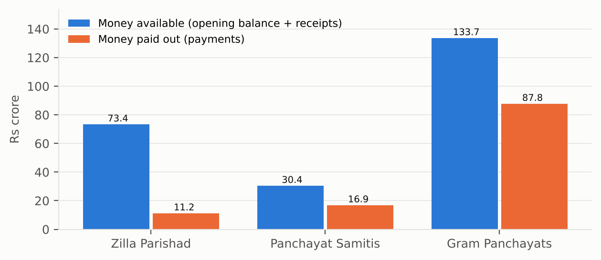
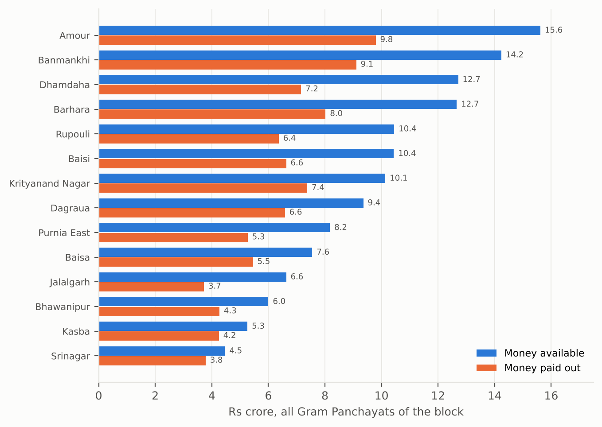
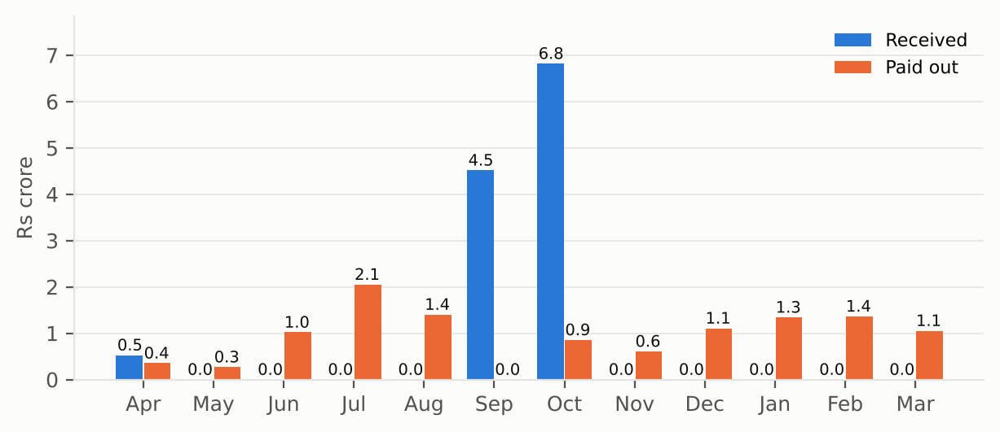

# Purnia District: Panchayat Finances and Accounts, 2024-25

A plain-language district profile from the Government of India's eGramSwaraj system · India By Numbers · data as published by the portal (district statement generated November 21, 2026 12:59 AM)

## 1. The main points

- **Purnia has 14 Panchayat Samitis (block councils) and 230 Gram Panchayats (village councils)** in the 2024-25 accounts, plus one Zilla Parishad (district council).
- **In 2024-25 its Panchayats together had Rs 237.50 crore available and paid out Rs 115.89 crore (49%).**
- **The Gram Panchayats had Rs 133.68 crore available and paid out Rs 87.78 crore (66%).** Rank among Bihar's districts: **12 of 38** for money available to Gram Panchayats, **14 of 38** for money paid out by them.
- **An average Gram Panchayat in Purnia had about Rs 58.1 lakh available and paid out about Rs 38.2 lakh** in the year (district totals divided by 230 Gram Panchayats).
- **Almost all the money is the 15th Finance Commission grant** (scheme-wise statement, all levels). Sources listed for Purnia: XV Finance Commission-XVFC 100.0%; own resources-OWN none.
- **Annual accounts are complete:** 230 of 230 Gram Panchayats, 14 of 14 Panchayat Samitis and the Zilla Parishad (closed) have closed their year book in the system.
- **Official figures for each of the 230 Gram Panchayats are in the Appendix.**

## 2. How to read the money words

| Term | Meaning |
|---|---|
| **Money available** (portal: *OB + Receipts*) | Money left from last year (opening balance) plus money received during the year |
| **Money paid out** (portal: *Payments*) | Payments made from the Panchayat's own accounts during the year |
| **Crore / lakh** | 1 crore = 100 lakh = Rs 1,00,00,000 |

Payments are only what passed through Panchayat accounts. They are **not** all government spending in the district (state departments pay for many works directly).

## 3. Money at each level of Panchayat

| Level | Bodies | Money available (Rs crore) | Paid out (Rs crore) | Paid out as share | Purnia's share of Bihar (available) |
|---|---|---|---|---|---|
| Zilla Parishad (district council) | 1 | 73.365 | 11.240 | 15% | 4% of Rs 1,885 crore |
| Panchayat Samitis (block councils) | 14 | 30.450 | 16.873 | 55% | 3% of Rs 1,029 crore |
| Gram Panchayats (village councils) | 230 | 133.684 | 87.777 | 66% | 3% of Rs 4,222 crore |
| **All levels** | | **237.499** | **115.890** | **49%** | |

Source: District wise Receipt and Payment Statement, 2024-25, Bihar (generated November 21, 2026 12:59 AM).

## 4. Block by block

Figures for the Panchayat Samiti (block council) itself and for all Gram Panchayats of the block together.

| Block | Gram Panchayats | Gram Panchayats: available (Rs crore) | Gram Panchayats: paid out | Share paid | Panchayat Samiti: available | Panchayat Samiti: paid out |
|---|---|---|---|---|---|---|
| Amour | 24 | 15.618 | 9.796 | 63% | 3.019 | 2.339 |
| Baisa | 16 | 7.551 | 5.454 | 72% | 1.077 | 0.457 |
| Baisi | 17 | 10.435 | 6.628 | 64% | 2.835 | 1.320 |
| Banmankhi | 24 | 14.236 | 9.106 | 64% | 4.830 | 0.765 |
| Barhara | 19 | 12.659 | 8.022 | 63% | 2.779 | 1.536 |
| Bhawanipur | 12 | 6.001 | 4.268 | 71% | 1.335 | 0.983 |
| Dagraua | 18 | 9.356 | 6.584 | 70% | 1.564 | 1.217 |
| Dhamdaha | 20 | 12.711 | 7.157 | 56% | 1.836 | 1.239 |
| Jalalgarh | 10 | 6.630 | 3.721 | 56% | 1.156 | 0.908 |
| Kasba | 12 | 5.260 | 4.250 | 81% | 1.150 | 0.733 |
| Krityanand Nagar | 17 | 10.136 | 7.375 | 73% | 3.412 | 1.416 |
| Purnia East | 14 | 8.176 | 5.268 | 64% | 1.231 | 0.629 |
| Rupouli | 18 | 10.450 | 6.367 | 61% | 2.785 | 2.572 |
| Srinagar | 9 | 4.465 | 3.781 | 85% | 1.439 | 0.758 |

The blocks' Gram Panchayat figures add up to Rs 133.684 crore (district statement: Rs 133.684 crore). The largest is **Amour** (Rs 15.62 crore across 24 GPs), the smallest **Srinagar** (Rs 4.46 crore). The share of money paid out ranges from 56% to 85% across the 14 blocks with money (middle block: 64%). Blocks differ in the number and size of their Panchayats, so a larger amount does not by itself mean better or worse performance.

## 5. The Zilla Parishad month by month

The district council (Zilla Parishad) started the year with **Rs 61.50 crore** carried over, received **Rs 11.86 crore** during the year and paid out **Rs 11.43 crore** (Rs 0.19 crore of payments were later cancelled or rejected, leaving Rs 11.24 crore). This matches the annual statement.

| Month | Received (Rs lakh) | Paid out (Rs lakh) | Payment vouchers |
|---|---|---|---|
| April, 2024 | 52.77 | 35.35 | 10 |
| May, 2024 | 0.00 | 26.94 | 11 |
| June, 2024 | 0.00 | 101.98 | 25 |
| July, 2024 | 0.00 | 205.11 | 37 |
| August, 2024 | 0.00 | 140.30 | 68 |
| September, 2024 | 451.74 | 0.00 | 0 |
| October, 2024 | 681.98 | 85.50 | 29 |
| November, 2024 | 0.00 | 60.78 | 21 |
| December, 2024 | 0.00 | 110.67 | 33 |
| Januaury, 2025 | 0.00 | 134.20 | 35 |
| February, 2025 | 0.00 | 136.44 | 33 |
| March, 2025 | 0.00 | 105.37 | 24 |

Month names are shown exactly as the portal prints them.

The busiest month for payments was **July, 2024** (Rs 2.05 crore). Source: Month Wise Payment and Receipt Statement (generated November 21, 2026 11:17 AM) and Month wise Summary Report (generated November 21, 2026 8:14 PM).

## 6. Where the money comes from

| Source (as named by the portal) | Zilla Parishad | Panchayat Samitis | Gram Panchayats |
|---|---|---|---|
| XV Finance Commission-XVFC | 100% of receipts | 100% of receipts | 100% of receipts |
| own resources-OWN | 0 | 0 | 0 |

Only the 2 source(s) above are listed for the district. Shares are calculated from the scheme-wise statement (generated March 7, 2025 12:45 AM; October 8, 2025 3:34 AM). The same report counts 1,038 receipt vouchers and 6,618 payment vouchers for Purnia's Gram Panchayats under the XV FC grant.

## 7. How well the books are kept

| | Zilla Parishad | Panchayat Samitis | Gram Panchayats |
|---|---|---|---|
| Number | 1 | 14 | 230 |
| Masters and opening balance entered | yes / yes | 14 / 14 | 230 / 230 |
| Receipt vouchers recorded | 36 | 106 | 1,038 |
| Payment vouchers recorded | 326 | 675 | 6,618 |
| Day book closed | yes | 14 of 14 | 230 of 230 |
| Month book closed | yes | 14 of 14 | 230 of 230 |
| Year book (annual accounts) closed | yes | 14 of 14 | 230 of 230 |

On average each Gram Panchayat recorded about 29 payment vouchers in the year. Source: District Wise Summary Report (generated November 21, 2026 12:50 AM).

## 8. What this profile cannot tell you

| Not available | Why |
|---|---|
| Population or households of the district's Panchayats | Not in any open eGramSwaraj report, so no per-person figures |
| Who each payment went to (the payee or vendor of each voucher) | On the individual voucher page, behind a security check (CAPTCHA); not collected. The public voucher lists (number, date, type, amount) are collected so far only for Patna; for this district they can be collected from India with `scripts/run_vouchers.py` |
| Elected members of this district | Collected for Bihar as a whole only; district figures are a planned follow-up |
| Value of approved development plans | Only whether a plan was uploaded is public |
| Money left unspent at year end | Not printed as an official figure |

## 9. About these figures

- Every figure is copied from the government's own eGramSwaraj reports and was checked against the original pages in the data validation (Task 5). Totals in this profile add up to the portal's own totals.
- Each report is a snapshot taken on the date shown; later reports for the same year can differ slightly because accounts keep being updated.
- District code 205; block and Gram Panchayat codes are the portal's own. Data collected November 2026 from egramswaraj.gov.in. Machine-readable tables: `data/validated/egs/`.
- Reports for Purnia in other years: `docs/district_reports/purnia/index.md`; all districts: `docs/district_reports/README.md`.

## Appendix: every Gram Panchayat of Purnia, 2024-25

Amounts in Rs lakh. **Official receipts / payments** are from the Village wise Receipt and Payment Statement (generated November 21, 2026 4:34 AM); they are the figures to quote. 230 Gram Panchayats are shown; the district statement counts 230.

| Block | Gram Panchayat | Code | Official receipts | Official payments |
|---|---|---|---|---|
| Amour | Aam Gachchi | 99467 | 48.40 | 39.82 |
| Amour | Adhang | 99468 | 45.55 | 29.66 |
| Amour | Bakania Baraili | 99470 | 59.72 | 27.06 |
| Amour | Bangra Mehandipur | 99471 | 77.12 | 64.58 |
| Amour | Bara Idgah | 99472 | 63.13 | 49.26 |
| Amour | Barbatta | 99473 | 64.31 | 22.63 |
| Amour | Bhawanipur | 99474 | 95.96 | 37.10 |
| Amour | Bishunpur | 99475 | 57.00 | 38.41 |
| Amour | Dahuabari | 99476 | 58.20 | 45.79 |
| Amour | Dalmalpur | 99477 | 98.07 | 72.28 |
| Amour | Dhurpaili | 99478 | 118.03 | 72.34 |
| Amour | Gyandov | 99479 | 97.78 | 29.59 |
| Amour | Hafania | 99480 | 60.54 | 32.00 |
| Amour | Haripur | 99481 | 43.07 | 25.55 |
| Amour | Jhauari | 99482 | 44.70 | 23.01 |
| Amour | Khareya | 99483 | 53.77 | 37.74 |
| Amour | Khari Mahin Gawn | 99484 | 75.20 | 65.02 |
| Amour | Machchhatta | 99485 | 78.17 | 50.37 |
| Amour | Majhuwa Hat | 99486 | 70.32 | 41.66 |
| Amour | Nitendar | 99487 | 32.78 | 26.64 |
| Amour | Pothia Gangeli | 99488 | 40.75 | 31.66 |
| Amour | Rangraya Laltoli | 99489 | 74.99 | 40.58 |
| Amour | Talbari | 99490 | 55.87 | 48.28 |
| Amour | Teerpara | 99491 | 48.34 | 28.54 |
| Baisa | Asiyani | 99492 | 72.72 | 24.89 |
| Baisa | Baluwa Gostara | 99493 | 35.11 | 22.86 |
| Baisa | Chandel | 99494 | 40.73 | 37.30 |
| Baisa | Chandwar | 99495 | 30.33 | 28.35 |
| Baisa | Dhusamal | 99496 | 33.48 | 21.64 |
| Baisa | Kanfalia | 99497 | 52.88 | 26.21 |
| Baisa | Kanjia | 99498 | 26.85 | 16.65 |
| Baisa | Khapra | 99499 | 62.41 | 55.98 |
| Baisa | Malopara | 99501 | 70.53 | 59.55 |
| Baisa | Manjhok | 99500 | 55.08 | 46.00 |
| Baisa | Mungra Piyaji | 99502 | 42.40 | 29.90 |
| Baisa | Nandania | 99503 | 44.65 | 26.63 |
| Baisa | Raiber | 99504 | 51.39 | 39.73 |
| Baisa | Rauta | 99505 | 49.54 | 42.33 |
| Baisa | Shishabari | 99506 | 47.48 | 30.84 |
| Baisa | Sirsi | 99507 | 39.53 | 36.57 |
| Baisi | Asja Mobaiya | 99508 | 48.36 | 41.46 |
| Baisi | Baisi | 99509 | 71.22 | 46.46 |
| Baisi | Bangama | 99510 | 40.83 | 22.04 |
| Baisi | Chandragama | 99511 | 45.91 | 34.00 |
| Baisi | Charaiya | 99512 | 40.69 | 31.28 |
| Baisi | Chopara | 99513 | 30.72 | 26.13 |
| Baisi | Gangar Ghosh | 99514 | 31.87 | 20.02 |
| Baisi | Harintor | 99515 | 44.31 | 38.73 |
| Baisi | Khapara | 99516 | 78.04 | 31.07 |
| Baisi | Khutiya | 99517 | 60.72 | 45.02 |
| Baisi | Malahariya | 99518 | 89.53 | 63.75 |
| Baisi | Meenapur | 99519 | 183.07 | 100.41 |
| Baisi | Puranaganj | 99520 | 73.61 | 43.05 |
| Baisi | Shadipur Bhutaha | 99521 | 40.21 | 30.71 |
| Baisi | Sripur Malahtoli | 99522 | 42.23 | 40.76 |
| Baisi | Sugaba Mahanadpur | 99523 | 65.62 | 26.32 |
| Baisi | Tarabari | 99524 | 56.59 | 21.65 |
| Banmankhi | Bahora | 99525 | 43.26 | 39.59 |
| Banmankhi | Chandpur Bangaha | 99527 | 121.30 | 69.02 |
| Banmankhi | Dharhara | 99528 | 91.20 | 27.95 |
| Banmankhi | Dharhara Chakla Bhunai | 99529 | 33.09 | 20.89 |
| Banmankhi | Ganga Pur | 99530 | 50.95 | 37.80 |
| Banmankhi | Giyan Ganj | 99531 | 57.24 | 32.24 |
| Banmankhi | Hari Murhi | 99532 | 69.41 | 68.11 |
| Banmankhi | Kachahari Balua | 99533 | 42.75 | 32.06 |
| Banmankhi | Kajhi Hirdya Nagar | 99534 | 47.84 | 28.04 |
| Banmankhi | Koshi Sh. Devottar | 99535 | 22.49 | 10.41 |
| Banmankhi | Ladu Garh | 99536 | 82.22 | 49.16 |
| Banmankhi | Mahadeo Pur | 99538 | 53.33 | 35.68 |
| Banmankhi | Maharaj Ganj | 99539 | 72.33 | 36.81 |
| Banmankhi | Mahraj Ganj-Ii | 99540 | 66.15 | 30.81 |
| Banmankhi | Majhuwa Prem Raj | 99541 | 56.07 | 50.53 |
| Banmankhi | Mohania Chakala | 99542 | 70.96 | 43.72 |
| Banmankhi | Naulakhi | 99543 | 22.75 | 19.40 |
| Banmankhi | Pipra | 99544 | 48.44 | 25.77 |
| Banmankhi | Ramnagar Farsahimilik | 99546 | 42.11 | 21.07 |
| Banmankhi | Rampur Tilak | 99547 | 64.21 | 57.61 |
| Banmankhi | Rupauli North | 99548 | 20.46 | 13.24 |
| Banmankhi | Rupauli South | 99549 | 60.09 | 48.05 |
| Banmankhi | Sahoriya Subhay Milik | 99550 | 121.51 | 92.07 |
| Banmankhi | Ubhayram Chakla | 99551 | 63.48 | 20.59 |
| Barhara | Arbanna Chakala | 99552 | 39.65 | 36.95 |
| Barhara | Aurahi | 99553 | 50.03 | 41.29 |
| Barhara | Aurlaha | 99554 | 138.57 | 56.52 |
| Barhara | Barahara | 99555 | 73.91 | 48.55 |
| Barhara | Basudeopur | 99556 | 121.19 | 35.69 |
| Barhara | Bhat Sara | 99557 | 44.21 | 37.43 |
| Barhara | Dibra | 99559 | 24.33 | 14.26 |
| Barhara | Gauri Pur | 99560 | 73.18 | 28.80 |
| Barhara | Lataraha | 99561 | 37.33 | 21.49 |
| Barhara | Laxmi Pur | 99562 | 43.74 | 30.40 |
| Barhara | Matihani | 99563 | 85.52 | 48.90 |
| Barhara | Mulkiya | 99564 | 106.39 | 91.98 |
| Barhara | Nathpur | 99565 | 99.76 | 67.42 |
| Barhara | Nipania | 99566 | 59.84 | 50.78 |
| Barhara | Patraha | 99567 | 52.62 | 32.92 |
| Barhara | Rustampur | 99568 | 77.38 | 65.99 |
| Barhara | Sukeshna West | 245364 | 44.68 | 29.90 |
| Barhara | Sukhsena | 99569 | 51.80 | 34.86 |
| Barhara | Tarhi | 99570 | 41.71 | 28.05 |
| Bhawanipur | Barhari | 99571 | 40.89 | 10.75 |
| Bhawanipur | Basantpur Chintamani | 99572 | 38.62 | 35.73 |
| Bhawanipur | Gondwara Patkaili | 99575 | 29.66 | 28.28 |
| Bhawanipur | Jabe | 99576 | 48.26 | 20.53 |
| Bhawanipur | Lathi | 99577 | 40.03 | 26.88 |
| Bhawanipur | Raghunathpur | 99578 | 51.62 | 26.30 |
| Bhawanipur | Shahidganj | 99579 | 56.12 | 52.97 |
| Bhawanipur | Shripur Milik | 99582 | 57.99 | 48.53 |
| Bhawanipur | Sondeep Milik | 99580 | 102.73 | 70.40 |
| Bhawanipur | Sonma | 99581 | 52.05 | 30.14 |
| Bhawanipur | Supouli | 99583 | 35.11 | 33.16 |
| Bhawanipur | Suraiti | 99584 | 47.01 | 43.14 |
| Dagraua | Adhkeli | 99585 | 52.85 | 30.86 |
| Dagraua | Babhani | 99586 | 37.19 | 32.33 |
| Dagraua | Belgacchi | 99587 | 53.91 | 30.41 |
| Dagraua | Buwari | 99588 | 29.77 | 23.92 |
| Dagraua | Chanpi | 99589 | 72.15 | 50.54 |
| Dagraua | Dagarua | 99590 | 56.23 | 30.13 |
| Dagraua | Dariyapur | 99591 | 106.33 | 83.90 |
| Dagraua | Dubaili | 99592 | 55.21 | 33.14 |
| Dagraua | Echalo | 99593 | 35.10 | 32.47 |
| Dagraua | Harkheli | 99594 | 61.13 | 35.05 |
| Dagraua | Kohila | 99595 | 53.55 | 40.81 |
| Dagraua | Majgama | 99596 | 62.00 | 44.38 |
| Dagraua | Makeli | 99597 | 31.79 | 22.84 |
| Dagraua | Mathour | 99598 | 43.16 | 36.21 |
| Dagraua | Rampur | 99599 | 67.55 | 46.60 |
| Dagraua | Tauli | 99600 | 33.69 | 26.60 |
| Dagraua | Teghra | 99601 | 32.68 | 29.03 |
| Dagraua | Thathol | 99602 | 51.30 | 29.24 |
| Dhamdaha | Bardela | 99603 | 72.44 | 16.97 |
| Dhamdaha | Bishanpur | 99604 | 68.18 | 59.69 |
| Dhamdaha | Champabati | 99605 | 86.92 | 18.76 |
| Dhamdaha | Chikani Dumariya | 99606 | 42.23 | 22.35 |
| Dhamdaha | Damaili | 99607 | 93.61 | 21.98 |
| Dhamdaha | Damgaraha | 99609 | 56.47 | 40.67 |
| Dhamdaha | Itahari | 99613 | 36.26 | 32.70 |
| Dhamdaha | Kishan Pur Baluwa | 99614 | 141.19 | 94.31 |
| Dhamdaha | Kukaraun East | 99615 | 41.49 | 19.72 |
| Dhamdaha | Kukaraun West | 99616 | 27.97 | 19.48 |
| Dhamdaha | Kuwari | 99617 | 107.31 | 69.37 |
| Dhamdaha | Mali | 99618 | 37.65 | 19.52 |
| Dhamdaha | Mogalia Puran Daha (East) | 99619 | 61.38 | 26.07 |
| Dhamdaha | Mogalia Purndaha West | 99620 | 97.37 | 41.82 |
| Dhamdaha | Nirpur | 99621 | 51.22 | 42.05 |
| Dhamdaha | Parasmani | 99622 | 52.73 | 37.14 |
| Dhamdaha | Rajghat Garail | 99623 | 36.61 | 23.66 |
| Dhamdaha | Rangpura South | 99625 | 76.44 | 65.75 |
| Dhamdaha | Sarsi | 99627 | 31.77 | 18.24 |
| Dhamdaha | Thari Rajo | 99628 | 51.89 | 25.46 |
| Jalalgarh | Chak | 99629 | 84.57 | 42.46 |
| Jalalgarh | Dansar | 99630 | 75.11 | 40.31 |
| Jalalgarh | Dimia | 99631 | 83.73 | 64.08 |
| Jalalgarh | Ekamba | 99632 | 48.66 | 30.33 |
| Jalalgarh | Hasi Begam Pur | 99633 | 91.76 | 59.59 |
| Jalalgarh | Jalal Garh | 99634 | 69.92 | 28.75 |
| Jalalgarh | Nizgehuma | 99635 | 76.85 | 36.36 |
| Jalalgarh | Ram Deli | 99636 | 43.24 | 33.73 |
| Jalalgarh | Sarsauni | 99637 | 53.04 | 16.45 |
| Jalalgarh | Sautha | 99638 | 36.09 | 20.07 |
| Kasba | Banaili | 99639 | 42.96 | 38.08 |
| Kasba | Bhawara Lagan | 99641 | 40.97 | 38.22 |
| Kasba | Bochganw | 99642 | 43.42 | 37.46 |
| Kasba | Ghordaur | 99643 | 39.80 | 35.16 |
| Kasba | Gurhi | 99644 | 48.00 | 35.97 |
| Kasba | Kulla Khash | 99645 | 35.39 | 25.56 |
| Kasba | Lakhana | 99646 | 31.45 | 27.15 |
| Kasba | Malharia | 99647 | 39.63 | 14.19 |
| Kasba | Mohani Tikapur | 99648 | 46.91 | 44.79 |
| Kasba | Sabdalpur | 99649 | 43.52 | 34.58 |
| Kasba | Sadhubeli | 99650 | 26.15 | 23.69 |
| Kasba | Sanjheli | 99651 | 87.82 | 70.13 |
| Krityanand Nagar | Bela Rikabganj | 99652 | 75.02 | 44.52 |
| Krityanand Nagar | Bithnauli East | 99653 | 37.92 | 33.78 |
| Krityanand Nagar | Bithnauli West | 99654 | 54.90 | 19.48 |
| Krityanand Nagar | Chunapur | 99655 | 51.32 | 46.94 |
| Krityanand Nagar | Ganeshpur | 99656 | 93.23 | 73.56 |
| Krityanand Nagar | Gangaily | 99657 | 41.98 | 32.47 |
| Krityanand Nagar | Gokulpur | 99658 | 77.09 | 58.31 |
| Krityanand Nagar | Guwasi | 99659 | 37.70 | 27.38 |
| Krityanand Nagar | Jagni | 99660 | 45.62 | 34.98 |
| Krityanand Nagar | Jhunni Istambarar | 99661 | 72.65 | 67.90 |
| Krityanand Nagar | Kajha | 99662 | 76.39 | 40.28 |
| Krityanand Nagar | Majra | 99664 | 29.98 | 26.43 |
| Krityanand Nagar | Parora | 99665 | 91.95 | 70.71 |
| Krityanand Nagar | Pothiya Rampur | 99666 | 51.63 | 47.19 |
| Krityanand Nagar | Rahuwa | 99667 | 66.42 | 34.69 |
| Krityanand Nagar | Sahara | 99668 | 63.24 | 59.27 |
| Krityanand Nagar | Satkodaria | 99669 | 46.60 | 19.57 |
| Purnia East | Bhoga Kariyat | 99672 | 62.53 | 47.48 |
| Purnia East | Bikram Pur | 99673 | 39.56 | 36.02 |
| Purnia East | Birpur | 99674 | 66.53 | 53.97 |
| Purnia East | Biyarpur | 99675 | 41.61 | 15.75 |
| Purnia East | Chandi | 99676 | 54.77 | 43.25 |
| Purnia East | Dimia Chhatarjan | 99677 | 46.89 | 19.60 |
| Purnia East | Gaura | 99678 | 57.48 | 23.15 |
| Purnia East | Harada | 99558 | 78.33 | 36.16 |
| Purnia East | Kabaiya | 99681 | 51.32 | 38.80 |
| Purnia East | Lal Ganj | 99682 | 48.54 | 42.23 |
| Purnia East | Maharaj Pur | 99683 | 50.88 | 40.94 |
| Purnia East | Rajiganj | 99686 | 102.65 | 71.79 |
| Purnia East | Rampur | 99687 | 55.38 | 24.48 |
| Purnia East | Sikandarpur | 99688 | 61.14 | 33.17 |
| Rupouli | Basant Pur | 99689 | 55.68 | 45.08 |
| Rupouli | Bhauwa Parbal | 99690 | 39.52 | 21.54 |
| Rupouli | Bhikhana | 99691 | 73.76 | 53.99 |
| Rupouli | Bijay Lal Ganj | 99692 | 79.95 | 30.28 |
| Rupouli | Dhusar-Tikapatti | 99694 | 63.16 | 30.54 |
| Rupouli | Dobha Milik | 99695 | 70.99 | 47.31 |
| Rupouli | Goriar (East) | 99696 | 46.80 | 35.60 |
| Rupouli | Goriar (West) | 99697 | 38.52 | 29.99 |
| Rupouli | Goriarpatti Srimatta | 99698 | 59.22 | 31.66 |
| Rupouli | Kanp | 99699 | 50.14 | 28.31 |
| Rupouli | Koili Simra (West) | 99700 | 72.54 | 45.90 |
| Rupouli | Koilisimra (East) | 99701 | 57.56 | 40.05 |
| Rupouli | Lachhmipur Girdhar | 99702 | 75.93 | 33.25 |
| Rupouli | Laxmipur Charapatti | 99703 | 57.19 | 37.22 |
| Rupouli | Mataili Khemchandra | 99704 | 53.27 | 22.90 |
| Rupouli | Nath Pur | 99705 | 61.22 | 41.82 |
| Rupouli | Singhpur Deera | 99707 | 41.89 | 32.91 |
| Rupouli | Vijay Mohanpur | 99708 | 47.64 | 28.38 |
| Srinagar | Chanka | 99709 | 49.49 | 37.80 |
| Srinagar | Garhia Baluwa | 99710 | 44.28 | 41.66 |
| Srinagar | Jageli | 99711 | 50.91 | 44.36 |
| Srinagar | Jhunni Kala | 99712 | 48.27 | 31.51 |
| Srinagar | Khokha North | 99713 | 52.62 | 43.50 |
| Srinagar | Khokha South | 99714 | 54.16 | 46.47 |
| Srinagar | Khuti Dhunaili | 99716 | 46.42 | 41.97 |
| Srinagar | Khuti Haseli | 99715 | 35.62 | 32.67 |
| Srinagar | Sighia | 99717 | 64.73 | 58.14 |

Official Gram Panchayat figures above add up to Rs 133.68 crore received and Rs 87.78 crore paid out.

