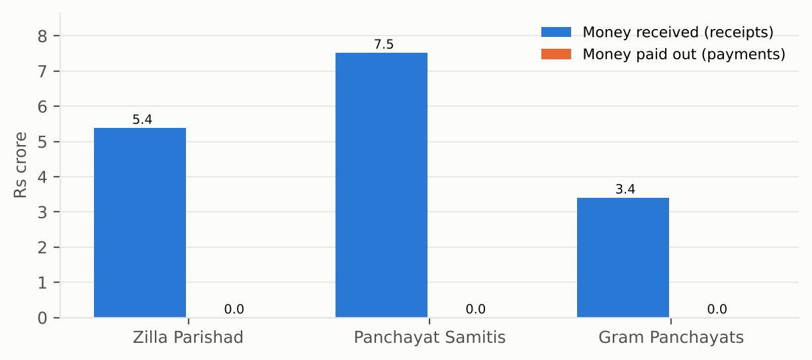
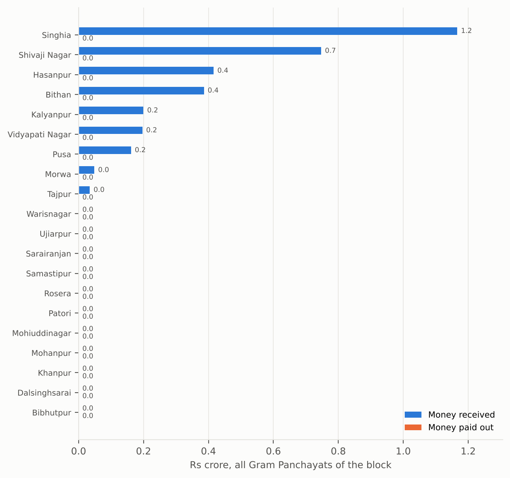
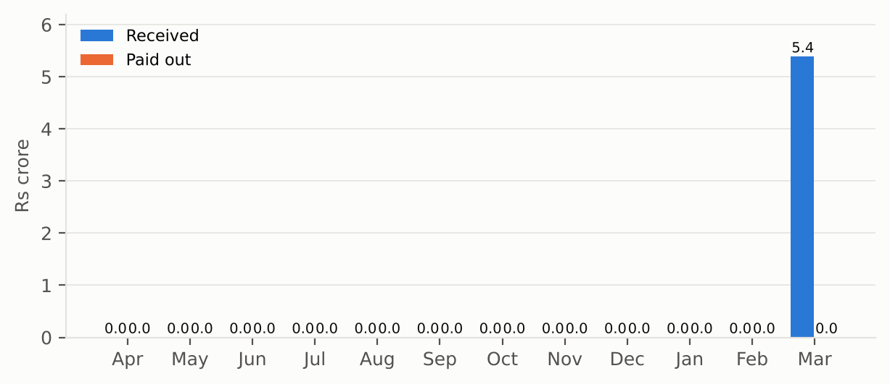

# Samastipur District: Panchayat Finances and Accounts, 2020-21

A plain-language district profile from the Government of India's eGramSwaraj system · India By Numbers · data as published by the portal (district statement generated July 18, 2022 2:27 AM)

## 1. The main points

- **Samastipur has 20 Panchayat Samitis (block councils) and 381 Gram Panchayats (village councils)** in the 2020-21 accounts, plus one Zilla Parishad (district council).
- **In 2020-21 its Panchayats together received Rs 16.32 crore and paid out Rs 0.00 crore.** (This year's statement uses a different measure from later years; see section 2.)
- **The Gram Panchayats had Rs 3.41 crore of receipts and paid out Rs 0.00 crore (0%).** Rank among Bihar's districts: **20 of 38** for money received by Gram Panchayats, **none (26 of 38 districts show none)** for money paid out by them.
- **An average Gram Panchayat in Samastipur had about Rs 0.9 lakh of receipts and paid out about Rs 0.0 lakh** in the year (district totals divided by 381 Gram Panchayats).
- **Almost all the money is the 15th Finance Commission grant** (scheme-wise statement, all levels). Sources listed for Samastipur: XV Finance Commission-XVFC 100.0%.
- **Annual accounts are not complete:** 362 of 381 Gram Panchayats, 20 of 20 Panchayat Samitis and the Zilla Parishad (closed) have closed their year book in the system.
- **Official figures for each of the 381 Gram Panchayats are in the Appendix.**

## 2. How to read the money words

| Term | Meaning |
|---|---|
| **Money received** (portal: *Receipts*) | Money received during the year, as printed in rupees in the 2020-21 statement. The report does not say whether last year's balance is included |
| **Money paid out** (portal: *Payments*) | Payments made from the Panchayat's own accounts during the year |
| **Crore / lakh** | 1 crore = 100 lakh = Rs 1,00,00,000 |

**Important:** from 2021-22 the portal changed this statement to *OB + Receipts* in crore. The 2020-21 *Receipts* figure is a different measure, so it should not be compared directly with the *money available* of later years.

Payments are only what passed through Panchayat accounts. They are **not** all government spending in the district (state departments pay for many works directly).

## 3. Money at each level of Panchayat

| Level | Bodies | Money received (Rs crore) | Paid out (Rs crore) | Paid out as share | Samastipur's share of Bihar (received) |
|---|---|---|---|---|---|
| Zilla Parishad (district council) | 1 | 5.387 | 0.000 | 0% | 2% of Rs 321 crore |
| Panchayat Samitis (block councils) | 20 | 7.523 | 0.002 | 0% | 2% of Rs 375 crore |
| Gram Panchayats (village councils) | 381 | 3.409 | 0.000 | 0% | 1% of Rs 235 crore |
| **All levels** | | **16.320** | **0.002** | **0%** | |

Source: District wise Receipt and Payment Statement, 2020-21, Bihar (generated July 18, 2022 2:27 AM); amounts printed in rupees, shown here in crore.

## 4. Block by block

Figures for the Panchayat Samiti (block council) itself and for all Gram Panchayats of the block together.

| Block | Gram Panchayats | Gram Panchayats: received (Rs crore) | Gram Panchayats: paid out | Share paid | Panchayat Samiti: received | Panchayat Samiti: paid out |
|---|---|---|---|---|---|---|
| Bibhutpur | 29 | 0.000 | 0.000 | — | 0.000 | 0.000 |
| Bithan | 13 | 0.386 | 0.000 | 0% | 0.442 | 0.000 |
| Dalsinghsarai | 16 | 0.000 | 0.000 | — | 0.976 | 0.000 |
| Hasanpur | 20 | 0.416 | 0.000 | 0% | 0.611 | 0.000 |
| Kalyanpur | 31 | 0.200 | 0.000 | 0% | 0.000 | 0.000 |
| Khanpur | 19 | 0.000 | 0.000 | — | 0.539 | 0.000 |
| Mohanpur | 11 | 0.000 | 0.000 | — | 0.334 | 0.000 |
| Mohiuddinagar | 17 | 0.000 | 0.000 | — | 0.000 | 0.000 |
| Morwa | 18 | 0.049 | 0.000 | 0% | 0.000 | 0.000 |
| Patori | 17 | 0.000 | 0.000 | — | 0.483 | 0.000 |
| Pusa | 13 | 0.162 | 0.000 | 0% | 1.374 | 0.002 |
| Rosera | 16 | 0.000 | 0.000 | — | 0.455 | 0.000 |
| Samastipur | 26 | 0.000 | 0.000 | — | 0.000 | 0.000 |
| Sarairanjan | 23 | 0.000 | 0.000 | — | 0.000 | 0.000 |
| Shivaji Nagar | 17 | 0.747 | 0.000 | 0% | 0.000 | 0.000 |
| Singhia | 17 | 1.166 | 0.000 | 0% | 1.164 | 0.000 |
| Tajpur | 16 | 0.035 | 0.000 | 0% | 0.000 | 0.000 |
| Ujiarpur | 28 | 0.000 | 0.000 | — | 0.000 | 0.000 |
| Vidyapati Nagar | 14 | 0.196 | 0.000 | 0% | 0.000 | 0.000 |
| Warisnagar | 20 | 0.000 | 0.000 | — | 1.145 | 0.000 |

The blocks' Gram Panchayat figures add up to Rs 3.356 crore (district statement: Rs 3.409 crore). The largest is **Singhia** (Rs 1.17 crore across 17 GPs), the smallest **Bibhutpur** (Rs 0.00 crore). None of the 9 blocks with money shows any Gram Panchayat payment. In 11 of 20 blocks the Gram Panchayats show no money at all for this year. Blocks differ in the number and size of their Panchayats, so a larger amount does not by itself mean better or worse performance.

## 5. The Zilla Parishad month by month

The district council (Zilla Parishad) started the year with **Rs 0.00 crore** carried over, received **Rs 5.39 crore** during the year and paid out **Rs 0.00 crore**. This matches the annual statement.

| Month | Received (Rs lakh) | Paid out (Rs lakh) | Payment vouchers |
|---|---|---|---|
| April, 2020 | 0.00 | 0.00 | 0 |
| May, 2020 | 0.00 | 0.00 | 0 |
| June, 2020 | 0.00 | 0.00 | 0 |
| July, 2020 | 0.00 | 0.00 | 0 |
| August, 2020 | 0.00 | 0.00 | 0 |
| September, 2020 | 0.00 | 0.00 | 0 |
| October, 2020 | 0.00 | 0.00 | 0 |
| November, 2020 | 0.00 | 0.00 | 0 |
| December, 2020 | 0.00 | 0.00 | 0 |
| Januaury, 2021 | 0.00 | 0.00 | 0 |
| February, 2021 | 0.00 | 0.00 | 0 |
| March, 2021 | 538.74 | 0.00 | 0 |

Month names are shown exactly as the portal prints them.
 Source: Month Wise Payment and Receipt Statement (generated July 18, 2022 4:05 AM) and Month wise Summary Report (generated July 18, 2022 4:29 AM).

## 6. Where the money comes from

| Source (as named by the portal) | Zilla Parishad | Panchayat Samitis | Gram Panchayats |
|---|---|---|---|
| XV Finance Commission-XVFC | 100% of receipts | 100% of receipts | 100% of receipts |

Only the 1 source(s) above are listed for the district. Shares are calculated from the scheme-wise statement (generated August 20, 2021 6:50 AM). The same report counts 118 receipt vouchers and 0 payment vouchers for Samastipur's Gram Panchayats under the XV FC grant.

## 7. How well the books are kept

| | Zilla Parishad | Panchayat Samitis | Gram Panchayats |
|---|---|---|---|
| Number | 1 | 20 | 381 |
| Masters and opening balance entered | yes / yes | 20 / 20 | 362 / 362 |
| Receipt vouchers recorded | 1 | 23 | 118 |
| Payment vouchers recorded | 0 | 1 | 0 |
| Day book closed | yes | 20 of 20 | 362 of 381 |
| Month book closed | yes | 20 of 20 | 362 of 381 |
| Year book (annual accounts) closed | yes | 20 of 20 | 362 of 381 |

On average each Gram Panchayat recorded about 0 payment vouchers in the year. Source: District Wise Summary Report (generated July 18, 2022 2:31 AM).

## 8. What this profile cannot tell you

| Not available | Why |
|---|---|
| Population or households of the district's Panchayats | Not in any open eGramSwaraj report, so no per-person figures |
| Who each payment went to (the payee or vendor of each voucher) | On the individual voucher page, behind a security check (CAPTCHA); not collected. The public voucher lists (number, date, type, amount) are collected so far only for Patna; for this district they can be collected from India with `scripts/run_vouchers.py` |
| Elected members of this district | Collected for Bihar as a whole only; district figures are a planned follow-up |
| Value of approved development plans | Only whether a plan was uploaded is public |
| Money left unspent at year end | Not printed as an official figure |

## 9. About these figures

- Every figure is copied from the government's own eGramSwaraj reports and was checked against the original pages in the data validation (Task 5). Totals in this profile add up to the portal's own totals.
- Each report is a snapshot taken on the date shown; later reports for the same year can differ slightly because accounts keep being updated.
- District code 208; block and Gram Panchayat codes are the portal's own. Data collected November 2026 from egramswaraj.gov.in. Machine-readable tables: `data/validated/egs/`.
- Reports for Samastipur in other years: `docs/district_reports/samastipur/index.md`; all districts: `docs/district_reports/README.md`.

## Appendix: every Gram Panchayat of Samastipur, 2020-21

Amounts in Rs lakh. **Official receipts / payments** are from the Village wise Receipt and Payment Statement (generated July 18, 2022 3:58 AM); they are the figures to quote. 381 Gram Panchayats are shown; the district statement counts 381.

| Block | Gram Panchayat | Code | Official receipts | Official payments |
|---|---|---|---|---|
| Bibhutpur | Alampur Kodaria | 100117 | 0.00 | 0.00 |
| Bibhutpur | Belsandi Tara | 100118 | 0.00 | 0.00 |
| Bibhutpur | Bharpura Patpara | 100119 | 0.00 | 0.00 |
| Bibhutpur | Bhuswar | 100120 | 0.00 | 0.00 |
| Bibhutpur | Bibhutipur East | 100122 | 0.00 | 0.00 |
| Bibhutpur | Bibhutipur North | 100121 | 0.00 | 0.00 |
| Bibhutpur | Bijidpur Bambaiya | 100123 | 0.00 | 0.00 |
| Bibhutpur | Boriya | 100124 | 0.00 | 0.00 |
| Bibhutpur | Chak Habib | 100125 | 0.00 | 0.00 |
| Bibhutpur | Chora Tabhaka | 100126 | 0.00 | 0.00 |
| Bibhutpur | Desari Karrakh | 100127 | 0.00 | 0.00 |
| Bibhutpur | Gangouli Manda | 100128 | 0.00 | 0.00 |
| Bibhutpur | Kaliyanpur North | 100129 | 0.00 | 0.00 |
| Bibhutpur | Kalyanpur South | 100130 | 0.00 | 0.00 |
| Bibhutpur | Kerai | 100131 | 0.00 | 0.00 |
| Bibhutpur | Khas Tabhaka North | 100133 | 0.00 | 0.00 |
| Bibhutpur | Khas Tabhaka South | 100132 | 0.00 | 0.00 |
| Bibhutpur | Mahathi South | 100134 | 0.00 | 0.00 |
| Bibhutpur | Maheshi | 100135 | 0.00 | 0.00 |
| Bibhutpur | Mahmadpur Sakra | 100136 | 0.00 | 0.00 |
| Bibhutpur | Mahthi North | 100137 | 0.00 | 0.00 |
| Bibhutpur | Mushtafapur | 100138 | 0.00 | 0.00 |
| Bibhutpur | Narhan | 100139 | 0.00 | 0.00 |
| Bibhutpur | Patelia | 100140 | 0.00 | 0.00 |
| Bibhutpur | Sakhmohan | 100141 | 0.00 | 0.00 |
| Bibhutpur | Singhia Bujurg North | 100143 | 0.00 | 0.00 |
| Bibhutpur | Singhia Bujurg South | 100142 | 0.00 | 0.00 |
| Bibhutpur | Surouli | 100144 | 0.00 | 0.00 |
| Bibhutpur | Tabhaka | 100145 | 0.00 | 0.00 |
| Bithan | Belsandi | 100146 | 7.44 | 0.00 |
| Bithan | Bithan | 100147 | 0.00 | 0.00 |
| Bithan | Jagmohra | 100148 | 8.61 | 0.00 |
| Bithan | Karanchi | 100149 | 0.00 | 0.00 |
| Bithan | Marthua | 100150 | 0.00 | 0.00 |
| Bithan | Narpa | 100151 | 0.00 | 0.00 |
| Bithan | Pusaho | 100152 | 0.00 | 0.00 |
| Bithan | Sakhwa | 100153 | 8.06 | 0.00 |
| Bithan | Salaha Bujurg | 100154 | 6.21 | 0.00 |
| Bithan | Salaha Chandan | 100155 | 0.00 | 0.00 |
| Bithan | Sihma | 100156 | 0.00 | 0.00 |
| Bithan | Sohma | 100157 | 0.00 | 0.00 |
| Bithan | Ujan | 100158 | 8.28 | 0.00 |
| Dalsinghsarai | Ajnaul | 100159 | 0.00 | 0.00 |
| Dalsinghsarai | Bambaiya Harlal | 100160 | 0.00 | 0.00 |
| Dalsinghsarai | Basaria | 100161 | 0.00 | 0.00 |
| Dalsinghsarai | Bulaki Pur | 100162 | 0.00 | 0.00 |
| Dalsinghsarai | Chak Bahauddin | 100163 | 0.00 | 0.00 |
| Dalsinghsarai | Hari Shankar Pur | 100164 | 0.00 | 0.00 |
| Dalsinghsarai | Kamrawan | 100165 | 0.00 | 0.00 |
| Dalsinghsarai | Kewata | 100166 | 0.00 | 0.00 |
| Dalsinghsarai | Malpur Purwari Patti | 100167 | 0.00 | 0.00 |
| Dalsinghsarai | Mokhtiyarpur Salkhani | 100168 | 0.00 | 0.00 |
| Dalsinghsarai | Nagargama | 100169 | 0.00 | 0.00 |
| Dalsinghsarai | NAWADA | 100170 | 0.00 | 0.00 |
| Dalsinghsarai | Pagra | 100171 | 0.00 | 0.00 |
| Dalsinghsarai | Panr | 100172 | 0.00 | 0.00 |
| Dalsinghsarai | RAMPUR JALALPUR | 100173 | 0.00 | 0.00 |
| Dalsinghsarai | Sultanpur Ghataho | 100174 | 0.00 | 0.00 |
| Hasanpur | Ahilwar | 100175 | 7.06 | 0.00 |
| Hasanpur | Aura | 100176 | 0.00 | 0.00 |
| Hasanpur | Bargawan | 100177 | 0.00 | 0.00 |
| Hasanpur | Bhatwan | 100178 | 0.00 | 0.00 |
| Hasanpur | Deodha | 100179 | 0.00 | 0.00 |
| Hasanpur | Deora | 100180 | 0.00 | 0.00 |
| Hasanpur | Dudhpura | 100181 | 0.00 | 0.00 |
| Hasanpur | Fulhara | 100182 | 0.00 | 0.00 |
| Hasanpur | Hasanpur | 100183 | 0.00 | 0.00 |
| Hasanpur | Mangalgarh | 100184 | 0.00 | 0.00 |
| Hasanpur | Maranchi Ujagar | 100185 | 18.76 | 0.00 |
| Hasanpur | Mouji | 100186 | 0.00 | 0.00 |
| Hasanpur | Nakuni | 100187 | 0.00 | 0.00 |
| Hasanpur | Naya Nagar | 100188 | 0.00 | 0.00 |
| Hasanpur | Paridah | 100189 | 0.00 | 0.00 |
| Hasanpur | Paroriya | 100190 | 0.00 | 0.00 |
| Hasanpur | Rampur | 100191 | 15.77 | 0.00 |
| Hasanpur | Sakarpura | 100192 | 0.00 | 0.00 |
| Hasanpur | Shasan | 100193 | 0.00 | 0.00 |
| Hasanpur | Suraha Basantpur | 100194 | 0.00 | 0.00 |
| Kalyanpur | Ajna | 100195 | 0.00 | 0.00 |
| Kalyanpur | Barheta | 100196 | 0.00 | 0.00 |
| Kalyanpur | Basudeo Pur | 100197 | 0.00 | 0.00 |
| Kalyanpur | Belsandih | 100198 | 0.00 | 0.00 |
| Kalyanpur | BHAGIRATHPUR | 100199 | 5.29 | 0.00 |
| Kalyanpur | Birsingpur | 100200 | 5.54 | 0.00 |
| Kalyanpur | Chakmaheshi | 100201 | 0.00 | 0.00 |
| Kalyanpur | Dhrubgama | 100202 | 0.00 | 0.00 |
| Kalyanpur | Gopalpur | 100203 | 0.00 | 0.00 |
| Kalyanpur | Gorai | 100204 | 0.00 | 0.00 |
| Kalyanpur | Govindpur Khajuri | 100205 | 0.00 | 0.00 |
| Kalyanpur | Hajpurva | 100206 | 0.00 | 0.00 |
| Kalyanpur | Jitwaria | 100207 | 0.00 | 0.00 |
| Kalyanpur | Kalaunzer | 100208 | 0.00 | 0.00 |
| Kalyanpur | Kalyanpur | 100209 | 0.00 | 0.00 |
| Kalyanpur | Kharsand East | 100210 | 4.22 | 0.00 |
| Kalyanpur | Kharsand West | 100211 | 0.00 | 0.00 |
| Kalyanpur | Kudhwa | 100212 | 0.00 | 0.00 |
| Kalyanpur | Ladaura | 100213 | 0.00 | 0.00 |
| Kalyanpur | Madhurapur | 100214 | 0.00 | 0.00 |
| Kalyanpur | Malinagar | 100215 | 0.00 | 0.00 |
| Kalyanpur | MUKTAPUR | 100216 | 0.00 | 0.00 |
| Kalyanpur | Namapur | 100217 | 0.00 | 0.00 |
| Kalyanpur | Purusottampur | 100218 | 6.23 | 0.00 |
| Kalyanpur | Rambhadrapur | 100219 | 0.00 | 0.00 |
| Kalyanpur | Ratwara | 100220 | 3.96 | 0.00 |
| Kalyanpur | Saidpur | 100221 | 0.00 | 0.00 |
| Kalyanpur | Simaria Bhindi | 100222 | 0.00 | 0.00 |
| Kalyanpur | Somnaha | 100223 | 0.00 | 0.00 |
| Kalyanpur | Sormar | 100224 | 0.00 | 0.00 |
| Kalyanpur | Tira | 100225 | 0.00 | 0.00 |
| Khanpur | Bachhauli | 100226 | 0.00 | 0.00 |
| Khanpur | Bhorejayram | 100227 | 0.00 | 0.00 |
| Khanpur | Bishanpur Abhi | 100228 | 0.00 | 0.00 |
| Khanpur | Dinmanpur North | 100229 | 0.00 | 0.00 |
| Khanpur | Dinmanpur South | 100230 | 0.00 | 0.00 |
| Khanpur | Hasanpur | 100231 | 0.00 | 0.00 |
| Khanpur | Jahangirpur | 100232 | 0.00 | 0.00 |
| Khanpur | Kanuvishanpur | 100233 | 0.00 | 0.00 |
| Khanpur | Khairi | 100234 | 0.00 | 0.00 |
| Khanpur | Khanpur North | 100235 | 0.00 | 0.00 |
| Khanpur | Khanpur South | 100236 | 0.00 | 0.00 |
| Khanpur | Natthudwar | 100237 | 0.00 | 0.00 |
| Khanpur | Purushotampur Annu | 100238 | 0.00 | 0.00 |
| Khanpur | Rebra | 100239 | 0.00 | 0.00 |
| Khanpur | Sadipur | 100240 | 0.00 | 0.00 |
| Khanpur | Shobhan | 100243 | 0.00 | 0.00 |
| Khanpur | Siwaisingpur | 100242 | 0.00 | 0.00 |
| Khanpur | Sripurgahar East | 100241 | 0.00 | 0.00 |
| Khanpur | Sripurgahar West | 100244 | 0.00 | 0.00 |
| Mohanpur | Baghra | 100245 | 0.00 | 0.00 |
| Mohanpur | Bishanpur Ber | 100246 | 0.00 | 0.00 |
| Mohanpur | Dasahra | 100247 | 0.00 | 0.00 |
| Mohanpur | Dharni Patti East | 100248 | 0.00 | 0.00 |
| Mohanpur | Dharni Patti West | 100249 | 0.00 | 0.00 |
| Mohanpur | Dumari North | 100250 | 0.00 | 0.00 |
| Mohanpur | Dumri South | 100251 | 0.00 | 0.00 |
| Mohanpur | Jalalpur | 100252 | 0.00 | 0.00 |
| Mohanpur | Madhupur Sarai | 100253 | 0.00 | 0.00 |
| Mohanpur | Mohanpur | 100254 | 0.00 | 0.00 |
| Mohanpur | Rajpur | 100255 | 0.00 | 0.00 |
| Mohiuddinagar | Bhadaia | 100256 | 0.00 | 0.00 |
| Mohiuddinagar | Bochaha | 100257 | 0.00 | 0.00 |
| Mohiuddinagar | Dubaha | 100258 | 0.00 | 0.00 |
| Mohiuddinagar | Harail | 100259 | 0.00 | 0.00 |
| Mohiuddinagar | Kalyanpur Basti West | 100260 | 0.00 | 0.00 |
| Mohiuddinagar | Karim Nagar | 100261 | 0.00 | 0.00 |
| Mohiuddinagar | Klyanpur Basti East | 100262 | 0.00 | 0.00 |
| Mohiuddinagar | Kursaha | 100263 | 0.00 | 0.00 |
| Mohiuddinagar | Maduda Bad | 100264 | 0.00 | 0.00 |
| Mohiuddinagar | Mohiuddinnagar North | 100265 | 0.00 | 0.00 |
| Mohiuddinagar | Mohiuddinnagar South | 100266 | 0.00 | 0.00 |
| Mohiuddinagar | Mohmadipur | 100267 | 0.00 | 0.00 |
| Mohiuddinagar | Raja Jan | 100268 | 0.00 | 0.00 |
| Mohiuddinagar | Raspur Patasia East | 100269 | 0.00 | 0.00 |
| Mohiuddinagar | Raspur Patasia West | 100270 | 0.00 | 0.00 |
| Mohiuddinagar | Sivaisingh Pur | 100271 | 0.00 | 0.00 |
| Mohiuddinagar | Tetar Pur | 100272 | 0.00 | 0.00 |
| Morwa | Banbeera | 100273 | 0.00 | 0.00 |
| Morwa | Chakpahar | 100274 | 0.00 | 0.00 |
| Morwa | Chaksikander | 100275 | 0.00 | 0.00 |
| Morwa | Dhrampur Bande | 100276 | 0.00 | 0.00 |
| Morwa | Gunai Basai | 100277 | 0.00 | 0.00 |
| Morwa | Harpur Bhindi | 100278 | 0.00 | 0.00 |
| Morwa | Indrawara | 100279 | 0.00 | 0.00 |
| Morwa | Keso Narayan Pur | 100280 | 0.00 | 0.00 |
| Morwa | Larua | 100281 | 4.85 | 0.00 |
| Morwa | Maricha | 100282 | 0.00 | 0.00 |
| Morwa | Morwa North | 100283 | 0.00 | 0.00 |
| Morwa | Morwa South | 100284 | 0.00 | 0.00 |
| Morwa | Nikaspur | 100285 | 0.00 | 0.00 |
| Morwa | Rariahi | 100286 | 0.00 | 0.00 |
| Morwa | Sarangpur East | 100287 | 0.00 | 0.00 |
| Morwa | Sarangpur West | 100288 | 0.00 | 0.00 |
| Morwa | Songer | 100289 | 0.00 | 0.00 |
| Morwa | Wajidpur Karnal | 100290 | 0.00 | 0.00 |
| Patori | Bahadurpur Patori | 100291 | 0.00 | 0.00 |
| Patori | Chaksaho | 100292 | 0.00 | 0.00 |
| Patori | CHAKSALEM | 100293 | 0.00 | 0.00 |
| Patori | Darwa | 100294 | 0.00 | 0.00 |
| Patori | Dhamoun North | 100295 | 0.00 | 0.00 |
| Patori | Dhamoun South | 100296 | 0.00 | 0.00 |
| Patori | Harpur Saidabad | 100297 | 0.00 | 0.00 |
| Patori | HASANPUR SURAT | 100298 | 0.00 | 0.00 |
| Patori | Hetanpur | 100299 | 0.00 | 0.00 |
| Patori | Imansari | 100300 | 0.00 | 0.00 |
| Patori | Inayatpur | 100301 | 0.00 | 0.00 |
| Patori | Jorpura | 100302 | 0.00 | 0.00 |
| Patori | Rupauli | 100303 | 0.00 | 0.00 |
| Patori | SHAHPUR UNDI | 100304 | 0.00 | 0.00 |
| Patori | Shiura | 100305 | 0.00 | 0.00 |
| Patori | SIRDILPUR | 100306 | 0.00 | 0.00 |
| Patori | Tara Dhamoun | 100307 | 0.00 | 0.00 |
| Pusa | Bisanpur Bathua | 100308 | 7.57 | 0.00 |
| Pusa | Chaklewaini | 100309 | 0.00 | 0.00 |
| Pusa | Chandauli | 100310 | 0.00 | 0.00 |
| Pusa | Dakshin Harpur Pusa | 100311 | 0.00 | 0.00 |
| Pusa | Dhobgama | 100312 | 0.00 | 0.00 |
| Pusa | Dighra | 100313 | 0.00 | 0.00 |
| Pusa | Gangapur | 100314 | 0.00 | 0.00 |
| Pusa | Harpur Mahmada | 100315 | 0.00 | 0.00 |
| Pusa | Kubauli Ram | 100316 | 0.00 | 0.00 |
| Pusa | Mohamad Pur Koari | 100317 | 3.81 | 0.00 |
| Pusa | Mohmadpur Deopar | 100318 | 4.77 | 0.00 |
| Pusa | Morsand | 100319 | 0.00 | 0.00 |
| Pusa | Thahra | 100320 | 0.00 | 0.00 |
| Rosera | Bharwari | 100321 | 0.00 | 0.00 |
| Rosera | Bhiraha East | 100322 | 0.00 | 0.00 |
| Rosera | Bhirha South | 100323 | 0.00 | 0.00 |
| Rosera | Bhirha West | 100324 | 0.00 | 0.00 |
| Rosera | Chakthat East | 100325 | 0.00 | 0.00 |
| Rosera | Chakthat West | 100326 | 0.00 | 0.00 |
| Rosera | Haripur | 100327 | 0.00 | 0.00 |
| Rosera | Jahangir Pur South | 100328 | 0.00 | 0.00 |
| Rosera | Jahangirpur North | 100329 | 0.00 | 0.00 |
| Rosera | Mohiuddin Nagar Rosera East | 100330 | 0.00 | 0.00 |
| Rosera | Mohiuddinnagar Urf Rosera West | 100331 | 0.00 | 0.00 |
| Rosera | Mothipur | 100332 | 0.00 | 0.00 |
| Rosera | Rohua | 100333 | 0.00 | 0.00 |
| Rosera | Sonupur North | 100334 | 0.00 | 0.00 |
| Rosera | SONUPUR SOUTH | 100335 | 0.00 | 0.00 |
| Rosera | Thahar Basarhia | 100336 | 0.00 | 0.00 |
| Samastipur | Bazidpur | 100337 | 0.00 | 0.00 |
| Samastipur | Bejha Dih | 100338 | 0.00 | 0.00 |
| Samastipur | Bikrampur Bande | 100339 | 0.00 | 0.00 |
| Samastipur | Bisunpur | 100340 | 0.00 | 0.00 |
| Samastipur | CHAK NUR | 100341 | 0.00 | 0.00 |
| Samastipur | Chhatauna | 100342 | 0.00 | 0.00 |
| Samastipur | DHUR LAKH | 100343 | 0.00 | 0.00 |
| Samastipur | DUDH PURA | 100344 | 0.00 | 0.00 |
| Samastipur | Hakimabad | 100345 | 0.00 | 0.00 |
| Samastipur | HARPUR AILOTH | 100346 | 0.00 | 0.00 |
| Samastipur | JITWARPUR CHAUTH | 100347 | 0.00 | 0.00 |
| Samastipur | JITWARPUR NIJAMAT | 100348 | 0.00 | 0.00 |
| Samastipur | Karpuri Gram | 100349 | 0.00 | 0.00 |
| Samastipur | Kewasnijamat | 100350 | 0.00 | 0.00 |
| Samastipur | LAGUNIA RAGHUKANTH | 100351 | 0.00 | 0.00 |
| Samastipur | LAGUNIA SURAJ KANTH | 100352 | 0.00 | 0.00 |
| Samastipur | MOHANPUR | 100353 | 0.00 | 0.00 |
| Samastipur | Mordewa | 100354 | 0.00 | 0.00 |
| Samastipur | MUSA PUR | 100355 | 0.00 | 0.00 |
| Samastipur | Nirpur | 100356 | 0.00 | 0.00 |
| Samastipur | Pokharaira | 100357 | 0.00 | 0.00 |
| Samastipur | Punas | 100358 | 0.00 | 0.00 |
| Samastipur | RAHIMPUR RUDALI | 100359 | 0.00 | 0.00 |
| Samastipur | Rupnarayn Pur Bela | 100360 | 0.00 | 0.00 |
| Samastipur | SAMBHU PATTI | 100361 | 0.00 | 0.00 |
| Samastipur | Singhea Khurd | 100362 | 0.00 | 0.00 |
| Sarairanjan | Akhtiyarpur Balbhadra | 100363 | 0.00 | 0.00 |
| Sarairanjan | Bajitpur Meyari | 100364 | 0.00 | 0.00 |
| Sarairanjan | BAKHRI BUZURG | 100365 | 0.00 | 0.00 |
| Sarairanjan | Barbatta | 100366 | 0.00 | 0.00 |
| Sarairanjan | BATHUA BUJURG | 100367 | 0.00 | 0.00 |
| Sarairanjan | Bhagwatpur | 100368 | 0.00 | 0.00 |
| Sarairanjan | BISHAMBHARPUR AILOTH | 100369 | 0.00 | 0.00 |
| Sarairanjan | Dharampur | 100370 | 0.00 | 0.00 |
| Sarairanjan | Ganga Pur | 100371 | 0.00 | 0.00 |
| Sarairanjan | Gangsara | 100372 | 0.00 | 0.00 |
| Sarairanjan | Harpur Barheta | 100373 | 0.00 | 0.00 |
| Sarairanjan | JHAKHRA | 100374 | 0.00 | 0.00 |
| Sarairanjan | Jitwarpur Kumhira | 100375 | 0.00 | 0.00 |
| Sarairanjan | Kishanpur Yusuf | 100376 | 0.00 | 0.00 |
| Sarairanjan | Latbasepura | 100377 | 0.00 | 0.00 |
| Sarairanjan | Manikpur | 100378 | 0.00 | 0.00 |
| Sarairanjan | Musapur | 100379 | 0.00 | 0.00 |
| Sarairanjan | NARGHOGHI | 100380 | 0.00 | 0.00 |
| Sarairanjan | Nauachak | 100381 | 0.00 | 0.00 |
| Sarairanjan | Raipur Buzurg | 100382 | 0.00 | 0.00 |
| Sarairanjan | Rupauli Bujurg | 100383 | 0.00 | 0.00 |
| Sarairanjan | SARAIRANJAN EAST | 100384 | 0.00 | 0.00 |
| Sarairanjan | SARAIRANJAN WEST | 100385 | 0.00 | 0.00 |
| Shivaji Nagar | Ballipur | 100386 | 0.00 | 0.00 |
| Shivaji Nagar | Bandhar | 100387 | 0.00 | 0.00 |
| Shivaji Nagar | Bhataura | 100388 | 0.00 | 0.00 |
| Shivaji Nagar | Dasut | 100389 | 0.00 | 0.00 |
| Shivaji Nagar | Dumra Mohan | 100390 | 15.05 | 0.00 |
| Shivaji Nagar | Ghiwahi | 100391 | 0.00 | 0.00 |
| Shivaji Nagar | Jakhar Dharampur | 100392 | 0.00 | 0.00 |
| Shivaji Nagar | Kariyan | 100393 | 19.48 | 0.00 |
| Shivaji Nagar | Madhurapur | 100394 | 14.01 | 0.00 |
| Shivaji Nagar | Parsa | 100395 | 0.00 | 0.00 |
| Shivaji Nagar | Rahiyar North | 100396 | 0.00 | 0.00 |
| Shivaji Nagar | Rahiyar South | 100397 | 0.00 | 0.00 |
| Shivaji Nagar | Rahtauli | 100398 | 10.22 | 0.00 |
| Shivaji Nagar | Rajaur Rambhadrapur | 100399 | 15.97 | 0.00 |
| Shivaji Nagar | Raniparti | 100400 | 0.00 | 0.00 |
| Shivaji Nagar | Ranna Dahiyar | 100401 | 0.00 | 0.00 |
| Shivaji Nagar | Shankar Pur | 100402 | 0.00 | 0.00 |
| Singhia | Bangarhatta | 100403 | 0.00 | 0.00 |
| Singhia | Bishunpur Diha | 100404 | 0.00 | 0.00 |
| Singhia | Hardia | 100405 | 18.74 | 0.00 |
| Singhia | Jahangirpur | 100406 | 16.09 | 0.00 |
| Singhia | Keontahar | 100407 | 0.00 | 0.00 |
| Singhia | Kundal II | 100408 | 19.07 | 0.00 |
| Singhia | Kundal-I | 100409 | 0.00 | 0.00 |
| Singhia | Lilhaul | 100410 | 22.26 | 0.00 |
| Singhia | Mahara | 100411 | 7.02 | 0.00 |
| Singhia | Mahe | 100412 | 0.00 | 0.00 |
| Singhia | Nirpur Bhararia | 100413 | 8.30 | 0.00 |
| Singhia | Phulhara | 100414 | 16.51 | 0.00 |
| Singhia | Shalepur | 100415 | 0.00 | 0.00 |
| Singhia | SINGHIA II | 100416 | 0.00 | 0.00 |
| Singhia | SINGHIA III | 100417 | 0.00 | 0.00 |
| Singhia | SINGHIA-1 | 100418 | 0.00 | 0.00 |
| Singhia | Wari | 100419 | 8.65 | 0.00 |
| Tajpur | Adharpur | 100420 | 0.00 | 0.00 |
| Tajpur | Baghi | 100421 | 0.00 | 0.00 |
| Tajpur | BHAIROKHRA | 100422 | 0.00 | 0.00 |
| Tajpur | Fatehpur Wala | 100423 | 3.45 | 0.00 |
| Tajpur | Gauspur Sarsona | 100424 | 0.00 | 0.00 |
| Tajpur | KASBE AHAR | 100426 | 0.00 | 0.00 |
| Tajpur | Kothia | 100427 | 0.00 | 0.00 |
| Tajpur | Madhopur Digharua | 100428 | 0.00 | 0.00 |
| Tajpur | Manpura | 100429 | 0.00 | 0.00 |
| Tajpur | Muradpur Bangra | 100430 | 0.00 | 0.00 |
| Tajpur | RAHIMABAD | 100431 | 0.00 | 0.00 |
| Tajpur | Rajwa | 100432 | 0.00 | 0.00 |
| Tajpur | Ramapur Maheshpur | 100433 | 0.00 | 0.00 |
| Tajpur | Sahpur Baghauni | 100434 | 0.00 | 0.00 |
| Tajpur | Sirsiya | 100425 | 0.00 | 0.00 |
| Tajpur | TAJPUR | 100435 | 0.00 | 0.00 |
| Ujiarpur | Angar Ghat | 100436 | 0.00 | 0.00 |
| Ujiarpur | Bela Megh | 100437 | 0.00 | 0.00 |
| Ujiarpur | Belari | 100438 | 0.00 | 0.00 |
| Ujiarpur | Bhagwanpur Desua | 100439 | 0.00 | 0.00 |
| Ujiarpur | Bhagwanpur Kamla | 100440 | 0.00 | 0.00 |
| Ujiarpur | Bikunth Pur Brandala | 100441 | 0.00 | 0.00 |
| Ujiarpur | Birnama Tula | 100442 | 0.00 | 0.00 |
| Ujiarpur | Chaita North | 100443 | 0.00 | 0.00 |
| Ujiarpur | Chaita South | 100444 | 0.00 | 0.00 |
| Ujiarpur | Chandchaur East | 100446 | 0.00 | 0.00 |
| Ujiarpur | Chandchaur Middle | 100445 | 0.00 | 0.00 |
| Ujiarpur | Chandchaur West | 100447 | 0.00 | 0.00 |
| Ujiarpur | Chandchour Karihara | 100448 | 0.00 | 0.00 |
| Ujiarpur | Dadhia Muriaro | 100449 | 0.00 | 0.00 |
| Ujiarpur | Gaupur | 100450 | 0.00 | 0.00 |
| Ujiarpur | Harpur Rewari | 100451 | 0.00 | 0.00 |
| Ujiarpur | Lakhanipur Mahesh Patti | 100452 | 0.00 | 0.00 |
| Ujiarpur | Lohagir | 100453 | 0.00 | 0.00 |
| Ujiarpur | Malti | 100454 | 0.00 | 0.00 |
| Ujiarpur | Mehsari | 100455 | 0.00 | 0.00 |
| Ujiarpur | Nazir Pur | 100456 | 0.00 | 0.00 |
| Ujiarpur | Nikas Pur | 100457 | 0.00 | 0.00 |
| Ujiarpur | Paroria | 100458 | 0.00 | 0.00 |
| Ujiarpur | Pataili East | 100460 | 0.00 | 0.00 |
| Ujiarpur | Pataili West | 100459 | 0.00 | 0.00 |
| Ujiarpur | Raipur | 100461 | 0.00 | 0.00 |
| Ujiarpur | Ram Chandrapur Andhail | 100462 | 0.00 | 0.00 |
| Ujiarpur | Satan Pur | 100463 | 0.00 | 0.00 |
| Vidyapati Nagar | Badauna | 100464 | 0.00 | 0.00 |
| Vidyapati Nagar | Balkrishnapur Morwa | 100465 | 5.45 | 0.00 |
| Vidyapati Nagar | Bangraha | 100466 | 0.00 | 0.00 |
| Vidyapati Nagar | Bazidpur | 100467 | 1.98 | 0.00 |
| Vidyapati Nagar | Garhsisai | 100468 | 0.00 | 0.00 |
| Vidyapati Nagar | Harpur Bochaha | 100469 | 0.00 | 0.00 |
| Vidyapati Nagar | Kancha | 100470 | 0.00 | 0.00 |
| Vidyapati Nagar | Maniyarpur | 100471 | 0.00 | 0.00 |
| Vidyapati Nagar | Moudhaneshpur North | 100472 | 0.00 | 0.00 |
| Vidyapati Nagar | Moudhaneshpur South | 100473 | 5.19 | 0.00 |
| Vidyapati Nagar | Sahit | 100474 | 0.00 | 0.00 |
| Vidyapati Nagar | Sherpur Dhepura | 100475 | 0.00 | 0.00 |
| Vidyapati Nagar | Simari | 100476 | 0.00 | 0.00 |
| Vidyapati Nagar | Sothgama | 100477 | 7.02 | 0.00 |
| Warisnagar | Basantpur Ramani | 100478 | 0.00 | 0.00 |
| Warisnagar | Chhatneswar | 100479 | 0.00 | 0.00 |
| Warisnagar | Darsur | 100480 | 0.00 | 0.00 |
| Warisnagar | Dhanhar | 100481 | 0.00 | 0.00 |
| Warisnagar | Dhurlakh | 100482 | 0.00 | 0.00 |
| Warisnagar | Gohi | 100483 | 0.00 | 0.00 |
| Warisnagar | Hansa | 100484 | 0.00 | 0.00 |
| Warisnagar | Kusaiya | 100485 | 0.00 | 0.00 |
| Warisnagar | Lakhanpatti | 100486 | 0.00 | 0.00 |
| Warisnagar | Maniyarpur | 100487 | 0.00 | 0.00 |
| Warisnagar | MATHURAPUR | 245373 | 0.00 | 0.00 |
| Warisnagar | Mohiuddinpur | 100488 | 0.00 | 0.00 |
| Warisnagar | Purnahi | 100489 | 0.00 | 0.00 |
| Warisnagar | Rahua East | 100490 | 0.00 | 0.00 |
| Warisnagar | Rahua West | 100491 | 0.00 | 0.00 |
| Warisnagar | Raipur | 100492 | 0.00 | 0.00 |
| Warisnagar | Rampur Bisanpur | 100493 | 0.00 | 0.00 |
| Warisnagar | SARI | 100494 | 0.00 | 0.00 |
| Warisnagar | Satmalpur | 100495 | 0.00 | 0.00 |
| Warisnagar | Sekhopur | 100496 | 0.00 | 0.00 |

Official Gram Panchayat figures above add up to Rs 3.41 crore received and Rs 0.00 crore paid out.

