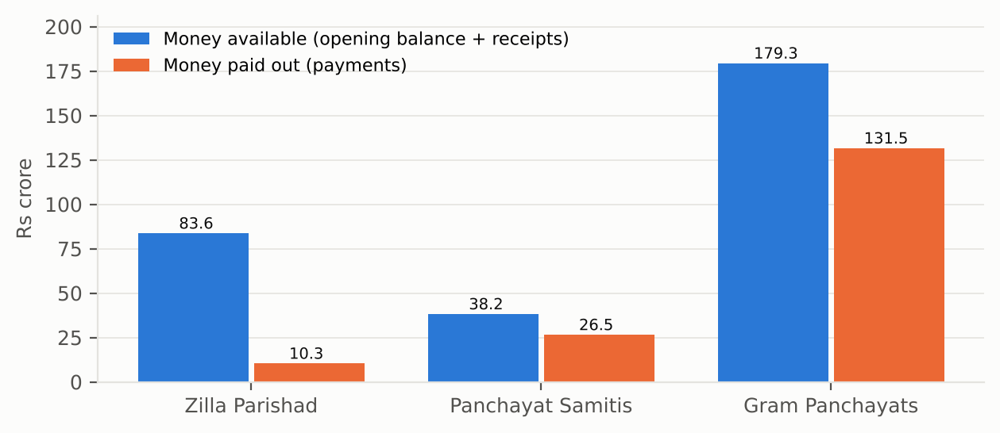
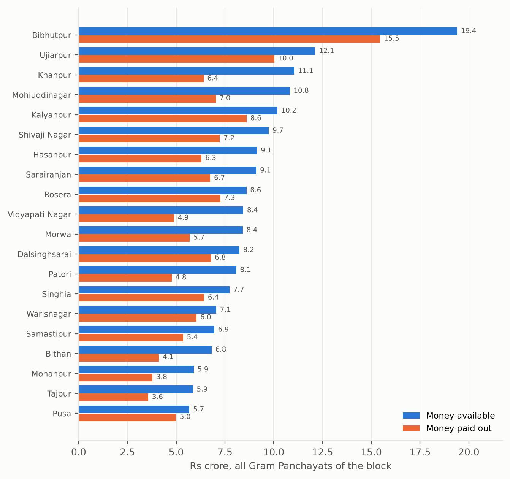
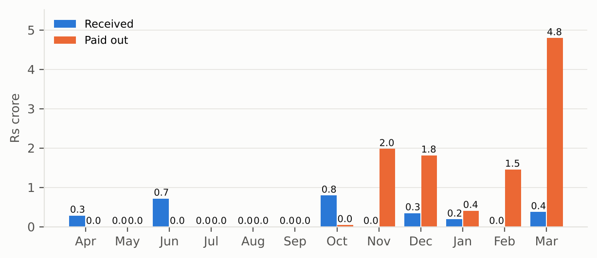

# Samastipur District: Panchayat Finances and Accounts, 2024-25

A plain-language district profile from the Government of India's eGramSwaraj system · India By Numbers · data as published by the portal (district statement generated November 21, 2026 12:59 AM)

## 1. The main points

- **Samastipur has 20 Panchayat Samitis (block councils) and 346 Gram Panchayats (village councils)** in the 2024-25 accounts, plus one Zilla Parishad (district council).
- **In 2024-25 its Panchayats together had Rs 301.12 crore available and paid out Rs 168.32 crore (56%).**
- **The Gram Panchayats had Rs 179.34 crore available and paid out Rs 131.52 crore (73%).** Rank among Bihar's districts: **5 of 38** for money available to Gram Panchayats, **3 of 38** for money paid out by them.
- **An average Gram Panchayat in Samastipur had about Rs 51.8 lakh available and paid out about Rs 38.0 lakh** in the year (district totals divided by 346 Gram Panchayats).
- **Almost all the money is the 15th Finance Commission grant** (scheme-wise statement, all levels). Sources listed for Samastipur: XV Finance Commission-XVFC 100.0%; own resources-OWN none.
- **Annual accounts are complete:** 346 of 346 Gram Panchayats, 20 of 20 Panchayat Samitis and the Zilla Parishad (closed) have closed their year book in the system.
- **Official figures for each of the 346 Gram Panchayats are in the Appendix.**

## 2. How to read the money words

| Term | Meaning |
|---|---|
| **Money available** (portal: *OB + Receipts*) | Money left from last year (opening balance) plus money received during the year |
| **Money paid out** (portal: *Payments*) | Payments made from the Panchayat's own accounts during the year |
| **Crore / lakh** | 1 crore = 100 lakh = Rs 1,00,00,000 |

Payments are only what passed through Panchayat accounts. They are **not** all government spending in the district (state departments pay for many works directly).

## 3. Money at each level of Panchayat

| Level | Bodies | Money available (Rs crore) | Paid out (Rs crore) | Paid out as share | Samastipur's share of Bihar (available) |
|---|---|---|---|---|---|
| Zilla Parishad (district council) | 1 | 83.611 | 10.334 | 12% | 4% of Rs 1,885 crore |
| Panchayat Samitis (block councils) | 20 | 38.162 | 26.474 | 69% | 4% of Rs 1,029 crore |
| Gram Panchayats (village councils) | 346 | 179.343 | 131.517 | 73% | 4% of Rs 4,222 crore |
| **All levels** | | **301.116** | **168.325** | **56%** | |

Source: District wise Receipt and Payment Statement, 2024-25, Bihar (generated November 21, 2026 12:59 AM).

## 4. Block by block

Figures for the Panchayat Samiti (block council) itself and for all Gram Panchayats of the block together.

| Block | Gram Panchayats | Gram Panchayats: available (Rs crore) | Gram Panchayats: paid out | Share paid | Panchayat Samiti: available | Panchayat Samiti: paid out |
|---|---|---|---|---|---|---|
| Bibhutpur | 29 | 19.406 | 15.456 | 80% | 2.104 | 2.070 |
| Bithan | 13 | 6.815 | 4.117 | 60% | 1.835 | 1.476 |
| Dalsinghsarai | 14 | 8.238 | 6.789 | 82% | 2.652 | 1.808 |
| Hasanpur | 20 | 9.142 | 6.300 | 69% | 1.743 | 1.270 |
| Kalyanpur | 29 | 10.185 | 8.614 | 85% | 1.289 | 0.938 |
| Khanpur | 19 | 11.055 | 6.402 | 58% | 1.062 | 0.751 |
| Mohanpur | 11 | 5.901 | 3.786 | 64% | 1.465 | 0.605 |
| Mohiuddinagar | 17 | 10.824 | 7.029 | 65% | 2.333 | 2.241 |
| Morwa | 18 | 8.410 | 5.701 | 68% | 3.055 | 1.556 |
| Patori | 14 | 8.080 | 4.770 | 59% | 1.969 | 1.584 |
| Pusa | 13 | 5.680 | 4.990 | 88% | 0.914 | 0.400 |
| Rosera | 15 | 8.603 | 7.263 | 84% | 3.625 | 2.656 |
| Samastipur | 14 | 6.949 | 5.356 | 77% | 1.487 | 1.021 |
| Sarairanjan | 17 | 9.105 | 6.748 | 74% | 2.876 | 1.779 |
| Shivaji Nagar | 17 | 9.745 | 7.238 | 74% | 1.424 | 1.054 |
| Singhia | 14 | 7.732 | 6.432 | 83% | 3.326 | 1.849 |
| Tajpur | 12 | 5.860 | 3.570 | 61% | 0.837 | 0.624 |
| Ujiarpur | 28 | 12.122 | 10.026 | 83% | 2.365 | 1.553 |
| Vidyapati Nagar | 14 | 8.438 | 4.890 | 58% | 1.332 | 1.044 |
| Warisnagar | 18 | 7.052 | 6.040 | 86% | 0.469 | 0.194 |

The blocks' Gram Panchayat figures add up to Rs 179.343 crore (district statement: Rs 179.343 crore). The largest is **Bibhutpur** (Rs 19.41 crore across 29 GPs), the smallest **Pusa** (Rs 5.68 crore). The share of money paid out ranges from 58% to 88% across the 20 blocks with money (middle block: 74%). Blocks differ in the number and size of their Panchayats, so a larger amount does not by itself mean better or worse performance.

## 5. The Zilla Parishad month by month

The district council (Zilla Parishad) started the year with **Rs 80.91 crore** carried over, received **Rs 2.70 crore** during the year and paid out **Rs 10.49 crore** (Rs 0.16 crore of payments were later cancelled or rejected, leaving Rs 10.33 crore). This matches the annual statement.

| Month | Received (Rs lakh) | Paid out (Rs lakh) | Payment vouchers |
|---|---|---|---|
| April, 2024 | 28.44 | 0.00 | 0 |
| May, 2024 | 0.00 | 0.00 | 0 |
| June, 2024 | 71.63 | 0.00 | 0 |
| July, 2024 | 0.00 | 0.00 | 0 |
| August, 2024 | 0.00 | 0.00 | 0 |
| September, 2024 | 0.00 | 0.00 | 0 |
| October, 2024 | 79.40 | 4.50 | 1 |
| November, 2024 | 0.00 | 197.69 | 21 |
| December, 2024 | 34.61 | 181.30 | 19 |
| Januaury, 2025 | 18.66 | 40.56 | 12 |
| February, 2025 | 0.00 | 145.33 | 60 |
| March, 2025 | 37.39 | 479.55 | 182 |

Month names are shown exactly as the portal prints them.

The busiest month for payments was **March, 2025** (Rs 4.80 crore). Source: Month Wise Payment and Receipt Statement (generated November 21, 2026 11:17 AM) and Month wise Summary Report (generated November 21, 2026 8:14 PM).

## 6. Where the money comes from

| Source (as named by the portal) | Zilla Parishad | Panchayat Samitis | Gram Panchayats |
|---|---|---|---|
| XV Finance Commission-XVFC | 100% of receipts | 100% of receipts | 100% of receipts |
| own resources-OWN | 0 | 0 | 0 |

Only the 2 source(s) above are listed for the district. Shares are calculated from the scheme-wise statement (generated March 7, 2025 12:45 AM; October 8, 2025 3:34 AM). The same report counts 1,720 receipt vouchers and 12,206 payment vouchers for Samastipur's Gram Panchayats under the XV FC grant.

## 7. How well the books are kept

| | Zilla Parishad | Panchayat Samitis | Gram Panchayats |
|---|---|---|---|
| Number | 1 | 20 | 346 |
| Masters and opening balance entered | yes / yes | 20 / 20 | 346 / 346 |
| Receipt vouchers recorded | 26 | 221 | 1,720 |
| Payment vouchers recorded | 295 | 2,469 | 12,206 |
| Day book closed | yes | 20 of 20 | 346 of 346 |
| Month book closed | yes | 20 of 20 | 346 of 346 |
| Year book (annual accounts) closed | yes | 20 of 20 | 346 of 346 |

On average each Gram Panchayat recorded about 35 payment vouchers in the year. Source: District Wise Summary Report (generated November 21, 2026 12:50 AM).

## 8. What this profile cannot tell you

| Not available | Why |
|---|---|
| Population or households of the district's Panchayats | Not in any open eGramSwaraj report, so no per-person figures |
| Who each payment went to (the payee or vendor of each voucher) | On the individual voucher page, behind a security check (CAPTCHA); not collected. The public voucher lists (number, date, type, amount) are collected so far only for Patna; for this district they can be collected from India with `scripts/run_vouchers.py` |
| Elected members of this district | Collected for Bihar as a whole only; district figures are a planned follow-up |
| Value of approved development plans | Only whether a plan was uploaded is public |
| Money left unspent at year end | Not printed as an official figure |

## 9. About these figures

- Every figure is copied from the government's own eGramSwaraj reports and was checked against the original pages in the data validation (Task 5). Totals in this profile add up to the portal's own totals.
- Each report is a snapshot taken on the date shown; later reports for the same year can differ slightly because accounts keep being updated.
- District code 208; block and Gram Panchayat codes are the portal's own. Data collected November 2026 from egramswaraj.gov.in. Machine-readable tables: `data/validated/egs/`.
- Reports for Samastipur in other years: `docs/district_reports/samastipur/index.md`; all districts: `docs/district_reports/README.md`.

## Appendix: every Gram Panchayat of Samastipur, 2024-25

Amounts in Rs lakh. **Official receipts / payments** are from the Village wise Receipt and Payment Statement (generated November 21, 2026 4:34 AM); they are the figures to quote. 346 Gram Panchayats are shown; the district statement counts 346.

| Block | Gram Panchayat | Code | Official receipts | Official payments |
|---|---|---|---|---|
| Bibhutpur | Alampur Kodaria | 100117 | 96.00 | 69.61 |
| Bibhutpur | Belsandi Tara | 100118 | 79.52 | 68.32 |
| Bibhutpur | Bharpura Patpara | 100119 | 74.56 | 69.07 |
| Bibhutpur | Bhuswar | 100120 | 49.09 | 44.40 |
| Bibhutpur | Bibhutipur East | 100122 | 73.54 | 66.32 |
| Bibhutpur | Bibhutipur North | 100121 | 74.33 | 58.68 |
| Bibhutpur | Bijidpur Bambaiya | 100123 | 56.31 | 41.54 |
| Bibhutpur | Boriya | 100124 | 55.71 | 31.85 |
| Bibhutpur | Chak Habib | 100125 | 100.16 | 67.87 |
| Bibhutpur | Chora Tabhaka | 100126 | 94.47 | 71.57 |
| Bibhutpur | Desari Karrakh | 100127 | 91.23 | 60.92 |
| Bibhutpur | Gangouli Manda | 100128 | 40.09 | 33.51 |
| Bibhutpur | Kaliyanpur North | 100129 | 109.59 | 55.52 |
| Bibhutpur | Kalyanpur South | 100130 | 36.01 | 32.60 |
| Bibhutpur | Kerai | 100131 | 65.19 | 52.10 |
| Bibhutpur | Khas Tabhaka North | 100133 | 41.07 | 35.31 |
| Bibhutpur | Khas Tabhaka South | 100132 | 59.46 | 53.20 |
| Bibhutpur | Mahathi South | 100134 | 81.72 | 77.13 |
| Bibhutpur | Maheshi | 100135 | 35.51 | 30.97 |
| Bibhutpur | Mahmadpur Sakra | 100136 | 79.16 | 57.46 |
| Bibhutpur | Mahthi North | 100137 | 69.82 | 51.29 |
| Bibhutpur | Mushtafapur | 100138 | 39.47 | 38.17 |
| Bibhutpur | Narhan | 100139 | 69.50 | 60.24 |
| Bibhutpur | Patelia | 100140 | 65.93 | 49.76 |
| Bibhutpur | Sakhmohan | 100141 | 59.18 | 49.92 |
| Bibhutpur | Singhia Bujurg North | 100143 | 86.12 | 73.64 |
| Bibhutpur | Singhia Bujurg South | 100142 | 36.16 | 32.26 |
| Bibhutpur | Surouli | 100144 | 58.70 | 52.32 |
| Bibhutpur | Tabhaka | 100145 | 63.03 | 60.06 |
| Bithan | Belsandi | 100146 | 41.91 | 38.68 |
| Bithan | Bithan | 100147 | 76.59 | 35.04 |
| Bithan | Jagmohra | 100148 | 73.00 | 40.60 |
| Bithan | Karanchi | 100149 | 52.48 | 20.35 |
| Bithan | Marthua | 100150 | 51.36 | 25.86 |
| Bithan | Narpa | 100151 | 50.95 | 35.85 |
| Bithan | Pusaho | 100152 | 50.18 | 36.27 |
| Bithan | Sakhwa | 100153 | 51.93 | 40.04 |
| Bithan | Salaha Bujurg | 100154 | 35.35 | 25.01 |
| Bithan | Salaha Chandan | 100155 | 42.88 | 25.14 |
| Bithan | Sihma | 100156 | 41.75 | 31.54 |
| Bithan | Sohma | 100157 | 50.87 | 24.74 |
| Bithan | Ujan | 100158 | 62.21 | 32.57 |
| Dalsinghsarai | Ajnaul | 100159 | 71.70 | 57.82 |
| Dalsinghsarai | Bambaiya Harlal | 100160 | 28.00 | 27.79 |
| Dalsinghsarai | Basaria | 100161 | 67.43 | 59.86 |
| Dalsinghsarai | Bulaki Pur | 100162 | 57.33 | 54.58 |
| Dalsinghsarai | Chak Bahauddin | 100163 | 23.59 | 21.02 |
| Dalsinghsarai | Hari Shankar Pur | 100164 | 60.60 | 38.82 |
| Dalsinghsarai | Kamrawan | 100165 | 38.90 | 37.49 |
| Dalsinghsarai | Kewata | 100166 | 71.34 | 66.60 |
| Dalsinghsarai | Malpur Purwari Patti | 100167 | 87.92 | 52.67 |
| Dalsinghsarai | Mokhtiyarpur Salkhani | 100168 | 99.55 | 77.68 |
| Dalsinghsarai | Nagargama | 100169 | 41.03 | 33.14 |
| Dalsinghsarai | Pagra | 100171 | 43.43 | 29.20 |
| Dalsinghsarai | Panr | 100172 | 66.81 | 59.19 |
| Dalsinghsarai | Sultanpur Ghataho | 100174 | 66.18 | 63.01 |
| Hasanpur | Ahilwar | 100175 | 36.25 | 28.87 |
| Hasanpur | Aura | 100176 | 25.99 | 25.35 |
| Hasanpur | Bargawan | 100177 | 53.95 | 50.65 |
| Hasanpur | Bhatwan | 100178 | 63.77 | 57.99 |
| Hasanpur | Deodha | 100179 | 49.35 | 36.26 |
| Hasanpur | Deora | 100180 | 39.84 | 11.35 |
| Hasanpur | Dudhpura | 100181 | 36.82 | 33.55 |
| Hasanpur | Fulhara | 100182 | 62.18 | 58.33 |
| Hasanpur | Hasanpur | 100183 | 43.69 | 15.71 |
| Hasanpur | Mangalgarh | 100184 | 42.56 | 33.59 |
| Hasanpur | Maranchi Ujagar | 100185 | 46.56 | 18.31 |
| Hasanpur | Mouji | 100186 | 48.96 | 47.70 |
| Hasanpur | Nakuni | 100187 | 29.19 | 24.72 |
| Hasanpur | Naya Nagar | 100188 | 33.23 | 25.05 |
| Hasanpur | Paridah | 100189 | 99.27 | 41.48 |
| Hasanpur | Paroriya | 100190 | 35.82 | 31.59 |
| Hasanpur | Rampur | 100191 | 59.04 | 20.69 |
| Hasanpur | Sakarpura | 100192 | 31.71 | 21.89 |
| Hasanpur | Shasan | 100193 | 42.73 | 19.87 |
| Hasanpur | Suraha Basantpur | 100194 | 33.29 | 27.01 |
| Kalyanpur | Ajna | 100195 | 67.37 | 59.82 |
| Kalyanpur | Barheta | 100196 | 31.67 | 27.03 |
| Kalyanpur | Basudeo Pur | 100197 | 73.11 | 67.02 |
| Kalyanpur | Belsandih | 100198 | 34.86 | 33.70 |
| Kalyanpur | Birsingpur | 100200 | 2.10 | 0.00 |
| Kalyanpur | Chakmaheshi | 100201 | 39.55 | 36.46 |
| Kalyanpur | Dhrubgama | 100202 | 22.97 | 17.92 |
| Kalyanpur | Gopalpur | 100203 | 60.29 | 58.92 |
| Kalyanpur | Gorai | 100204 | 16.87 | 16.33 |
| Kalyanpur | Govindpur Khajuri | 100205 | 31.82 | 26.48 |
| Kalyanpur | Hajpurva | 100206 | 25.28 | 22.80 |
| Kalyanpur | Jitwaria | 100207 | 29.53 | 20.98 |
| Kalyanpur | Kalaunzer | 100208 | 37.35 | 29.36 |
| Kalyanpur | Kalyanpur | 100209 | 42.45 | 36.75 |
| Kalyanpur | Kharsand East | 100210 | 26.54 | 19.56 |
| Kalyanpur | Kharsand West | 100211 | 86.91 | 54.30 |
| Kalyanpur | Kudhwa | 100212 | 22.24 | 19.62 |
| Kalyanpur | Ladaura | 100213 | 32.05 | 17.43 |
| Kalyanpur | Madhurapur | 100214 | 21.86 | 20.92 |
| Kalyanpur | Malinagar | 100215 | 29.78 | 27.63 |
| Kalyanpur | Namapur | 100217 | 43.04 | 31.03 |
| Kalyanpur | Purusottampur | 100218 | 56.09 | 54.65 |
| Kalyanpur | Rambhadrapur | 100219 | 24.18 | 22.17 |
| Kalyanpur | Ratwara | 100220 | 15.84 | 15.36 |
| Kalyanpur | Saidpur | 100221 | 25.57 | 23.79 |
| Kalyanpur | Simaria Bhindi | 100222 | 16.60 | 14.90 |
| Kalyanpur | Somnaha | 100223 | 26.25 | 22.97 |
| Kalyanpur | Sormar | 100224 | 35.57 | 26.48 |
| Kalyanpur | Tira | 100225 | 40.80 | 37.02 |
| Khanpur | Bachhauli | 100226 | 24.41 | 12.24 |
| Khanpur | Bhorejayram | 100227 | 35.19 | 28.57 |
| Khanpur | Bishanpur Abhi | 100228 | 32.41 | 11.04 |
| Khanpur | Dinmanpur North | 100229 | 87.95 | 60.00 |
| Khanpur | Dinmanpur South | 100230 | 89.90 | 26.18 |
| Khanpur | Hasanpur | 100231 | 48.85 | 35.03 |
| Khanpur | Jahangirpur | 100232 | 60.96 | 45.29 |
| Khanpur | Kanuvishanpur | 100233 | 91.84 | 29.22 |
| Khanpur | Khairi | 100234 | 33.83 | 22.42 |
| Khanpur | Khanpur North | 100235 | 45.05 | 28.73 |
| Khanpur | Khanpur South | 100236 | 47.12 | 34.08 |
| Khanpur | Natthudwar | 100237 | 92.82 | 63.41 |
| Khanpur | Purushotampur Annu | 100238 | 64.58 | 39.37 |
| Khanpur | Rebra | 100239 | 57.28 | 38.23 |
| Khanpur | Sadipur | 100240 | 76.29 | 53.14 |
| Khanpur | Shobhan | 100243 | 20.01 | 11.60 |
| Khanpur | Siwaisingpur | 100242 | 38.31 | 20.74 |
| Khanpur | Sripurgahar East | 100241 | 88.86 | 52.92 |
| Khanpur | Sripurgahar West | 100244 | 69.89 | 27.98 |
| Mohanpur | Baghra | 100245 | 71.01 | 53.38 |
| Mohanpur | Bishanpur Ber | 100246 | 30.80 | 22.23 |
| Mohanpur | Dasahra | 100247 | 56.45 | 47.61 |
| Mohanpur | Dharni Patti East | 100248 | 56.16 | 39.00 |
| Mohanpur | Dharni Patti West | 100249 | 30.22 | 18.31 |
| Mohanpur | Dumari North | 100250 | 70.97 | 64.56 |
| Mohanpur | Dumri South | 100251 | 28.56 | 22.83 |
| Mohanpur | Jalalpur | 100252 | 43.07 | 37.89 |
| Mohanpur | Madhupur Sarai | 100253 | 102.83 | 30.36 |
| Mohanpur | Mohanpur | 100254 | 24.29 | 19.86 |
| Mohanpur | Rajpur | 100255 | 75.73 | 22.60 |
| Mohiuddinagar | Bhadaia | 100256 | 52.36 | 43.12 |
| Mohiuddinagar | Bochaha | 100257 | 67.25 | 36.44 |
| Mohiuddinagar | Dubaha | 100258 | 71.28 | 31.98 |
| Mohiuddinagar | Harail | 100259 | 149.25 | 92.17 |
| Mohiuddinagar | Kalyanpur Basti West | 100260 | 69.90 | 46.22 |
| Mohiuddinagar | Karim Nagar | 100261 | 2.50 | 0.08 |
| Mohiuddinagar | Klyanpur Basti East | 100262 | 51.55 | 20.80 |
| Mohiuddinagar | Kursaha | 100263 | 69.57 | 45.44 |
| Mohiuddinagar | Maduda Bad | 100264 | 51.19 | 43.42 |
| Mohiuddinagar | Mohiuddinnagar North | 100265 | 51.63 | 43.36 |
| Mohiuddinagar | Mohiuddinnagar South | 100266 | 20.68 | 20.24 |
| Mohiuddinagar | Mohmadipur | 100267 | 67.94 | 41.29 |
| Mohiuddinagar | Raja Jan | 100268 | 46.23 | 41.13 |
| Mohiuddinagar | Raspur Patasia East | 100269 | 44.46 | 37.08 |
| Mohiuddinagar | Raspur Patasia West | 100270 | 71.17 | 50.18 |
| Mohiuddinagar | Sivaisingh Pur | 100271 | 125.67 | 62.14 |
| Mohiuddinagar | Tetar Pur | 100272 | 69.71 | 47.86 |
| Morwa | Banbeera | 100273 | 35.55 | 24.01 |
| Morwa | Chakpahar | 100274 | 63.24 | 56.34 |
| Morwa | Chaksikander | 100275 | 44.30 | 16.54 |
| Morwa | Dhrampur Bande | 100276 | 39.87 | 23.60 |
| Morwa | Gunai Basai | 100277 | 23.47 | 17.49 |
| Morwa | Harpur Bhindi | 100278 | 79.84 | 33.10 |
| Morwa | Indrawara | 100279 | 56.18 | 35.28 |
| Morwa | Keso Narayan Pur | 100280 | 40.59 | 31.31 |
| Morwa | Larua | 100281 | 39.10 | 30.30 |
| Morwa | Maricha | 100282 | 41.16 | 23.16 |
| Morwa | Morwa North | 100283 | 37.08 | 28.09 |
| Morwa | Morwa South | 100284 | 34.76 | 26.69 |
| Morwa | Nikaspur | 100285 | 63.24 | 61.87 |
| Morwa | Rariahi | 100286 | 49.75 | 30.59 |
| Morwa | Sarangpur East | 100287 | 30.96 | 25.51 |
| Morwa | Sarangpur West | 100288 | 40.77 | 27.19 |
| Morwa | Songer | 100289 | 35.13 | 24.53 |
| Morwa | Wajidpur Karnal | 100290 | 85.97 | 54.49 |
| Patori | Bahadurpur Patori | 100291 | 47.43 | 31.77 |
| Patori | Chaksaho | 100292 | 118.78 | 60.48 |
| Patori | Darwa | 100294 | 84.57 | 44.66 |
| Patori | Dhamoun North | 100295 | 64.68 | 24.46 |
| Patori | Dhamoun South | 100296 | 38.67 | 21.11 |
| Patori | Harpur Saidabad | 100297 | 64.86 | 23.00 |
| Patori | Hetanpur | 100299 | 102.39 | 54.91 |
| Patori | Imansari | 100300 | 54.88 | 41.56 |
| Patori | Inayatpur | 100301 | 50.74 | 41.62 |
| Patori | Jorpura | 100302 | 19.77 | 11.78 |
| Patori | Rupauli | 100303 | 53.61 | 39.47 |
| Patori | Shiura | 100305 | 42.69 | 39.95 |
| Patori | SIRDILPUR | 100306 | 18.84 | 9.57 |
| Patori | Tara Dhamoun | 100307 | 46.08 | 32.67 |
| Pusa | Bisanpur Bathua | 100308 | 22.02 | 19.56 |
| Pusa | Chaklewaini | 100309 | 56.53 | 44.46 |
| Pusa | Chandauli | 100310 | 33.64 | 29.31 |
| Pusa | Dakshin Harpur Pusa | 100311 | 62.02 | 54.70 |
| Pusa | Dhobgama | 100312 | 76.76 | 74.21 |
| Pusa | Dighra | 100313 | 31.59 | 30.91 |
| Pusa | Gangapur | 100314 | 27.43 | 21.99 |
| Pusa | Harpur Mahmada | 100315 | 78.91 | 65.38 |
| Pusa | Kubauli Ram | 100316 | 41.52 | 33.82 |
| Pusa | Mohamad Pur Koari | 100317 | 35.48 | 31.69 |
| Pusa | Mohmadpur Deopar | 100318 | 37.10 | 36.84 |
| Pusa | Morsand | 100319 | 44.65 | 37.48 |
| Pusa | Thahra | 100320 | 20.38 | 18.63 |
| Rosera | Bharwari | 100321 | 33.14 | 24.90 |
| Rosera | Bhiraha East | 100322 | 29.00 | 27.51 |
| Rosera | Bhirha South | 100323 | 41.21 | 36.69 |
| Rosera | Bhirha West | 100324 | 91.72 | 76.91 |
| Rosera | Chakthat East | 100325 | 66.14 | 57.26 |
| Rosera | Chakthat West | 100326 | 93.47 | 91.84 |
| Rosera | Haripur | 100327 | 67.51 | 29.93 |
| Rosera | Jahangir Pur South | 100328 | 46.85 | 46.31 |
| Rosera | Jahangirpur North | 100329 | 66.10 | 52.90 |
| Rosera | Mohiuddin Nagar Rosera East | 100330 | 64.19 | 49.88 |
| Rosera | Mohiuddinnagar Urf Rosera West | 100331 | 33.22 | 33.05 |
| Rosera | Mothipur | 100332 | 22.51 | 20.19 |
| Rosera | Rohua | 100333 | 33.62 | 29.01 |
| Rosera | Sonupur North | 100334 | 41.95 | 32.42 |
| Rosera | Thahar Basarhia | 100336 | 129.70 | 117.53 |
| Samastipur | Bazidpur | 100337 | 45.36 | 24.84 |
| Samastipur | Bejha Dih | 100338 | 20.48 | 18.63 |
| Samastipur | Bikrampur Bande | 100339 | 48.37 | 41.82 |
| Samastipur | Bisunpur | 100340 | 66.92 | 51.23 |
| Samastipur | Chhatauna | 100342 | 99.36 | 94.59 |
| Samastipur | Hakimabad | 100345 | 60.14 | 25.43 |
| Samastipur | Karpuri Gram | 100349 | 19.42 | 17.49 |
| Samastipur | Kewasnijamat | 100350 | 47.66 | 38.38 |
| Samastipur | Mordewa | 100354 | 103.92 | 76.57 |
| Samastipur | Nirpur | 100356 | 26.92 | 26.81 |
| Samastipur | Pokharaira | 100357 | 53.99 | 27.46 |
| Samastipur | Punas | 100358 | 40.96 | 37.41 |
| Samastipur | Rupnarayn Pur Bela | 100360 | 35.10 | 32.26 |
| Samastipur | Singhea Khurd | 100362 | 26.35 | 22.67 |
| Sarairanjan | Akhtiyarpur Balbhadra | 100363 | 65.78 | 39.13 |
| Sarairanjan | Bajitpur Meyari | 100364 | 80.56 | 50.91 |
| Sarairanjan | Barbatta | 100366 | 53.37 | 43.65 |
| Sarairanjan | Bhagwatpur | 100368 | 32.91 | 24.37 |
| Sarairanjan | Dharampur | 100370 | 46.81 | 44.58 |
| Sarairanjan | Ganga Pur | 100371 | 57.70 | 33.35 |
| Sarairanjan | Gangsara | 100372 | 42.42 | 38.89 |
| Sarairanjan | Harpur Barheta | 100373 | 56.54 | 45.00 |
| Sarairanjan | Jitwarpur Kumhira | 100375 | 49.92 | 43.98 |
| Sarairanjan | Kishanpur Yusuf | 100376 | 55.38 | 34.15 |
| Sarairanjan | Latbasepura | 100377 | 57.88 | 33.39 |
| Sarairanjan | Manikpur | 100378 | 46.60 | 38.85 |
| Sarairanjan | Musapur | 100379 | 48.89 | 34.25 |
| Sarairanjan | NARGHOGHI | 100380 | 50.29 | 38.83 |
| Sarairanjan | Nauachak | 100381 | 60.77 | 53.81 |
| Sarairanjan | Raipur Buzurg | 100382 | 54.67 | 46.36 |
| Sarairanjan | Rupauli Bujurg | 100383 | 50.01 | 31.28 |
| Shivaji Nagar | Ballipur | 100386 | 73.57 | 21.59 |
| Shivaji Nagar | Bandhar | 100387 | 112.10 | 106.49 |
| Shivaji Nagar | Bhataura | 100388 | 36.01 | 24.42 |
| Shivaji Nagar | Dasut | 100389 | 69.24 | 64.40 |
| Shivaji Nagar | Dumra Mohan | 100390 | 59.96 | 58.53 |
| Shivaji Nagar | Ghiwahi | 100391 | 67.70 | 60.17 |
| Shivaji Nagar | Jakhar Dharampur | 100392 | 84.20 | 70.37 |
| Shivaji Nagar | Kariyan | 100393 | 48.99 | 37.08 |
| Shivaji Nagar | Madhurapur | 100394 | 26.74 | 20.41 |
| Shivaji Nagar | Parsa | 100395 | 44.60 | 40.14 |
| Shivaji Nagar | Rahiyar North | 100396 | 50.48 | 38.95 |
| Shivaji Nagar | Rahiyar South | 100397 | 57.66 | 33.52 |
| Shivaji Nagar | Rahtauli | 100398 | 59.62 | 34.94 |
| Shivaji Nagar | Rajaur Rambhadrapur | 100399 | 41.96 | 31.02 |
| Shivaji Nagar | Raniparti | 100400 | 40.32 | 27.15 |
| Shivaji Nagar | Ranna Dahiyar | 100401 | 62.27 | 40.63 |
| Shivaji Nagar | Shankar Pur | 100402 | 39.11 | 14.03 |
| Singhia | Bangarhatta | 100403 | 56.39 | 53.27 |
| Singhia | Bishunpur Diha | 100404 | 33.11 | 28.54 |
| Singhia | Hardia | 100405 | 55.50 | 31.90 |
| Singhia | Jahangirpur | 100406 | 64.45 | 42.42 |
| Singhia | Keontahar | 100407 | 26.98 | 20.37 |
| Singhia | Kundal II | 100408 | 94.46 | 74.69 |
| Singhia | Kundal-I | 100409 | 48.92 | 36.18 |
| Singhia | Lilhaul | 100410 | 76.12 | 73.86 |
| Singhia | Mahara | 100411 | 47.20 | 43.03 |
| Singhia | Mahe | 100412 | 42.08 | 41.12 |
| Singhia | Nirpur Bhararia | 100413 | 53.43 | 41.42 |
| Singhia | Phulhara | 100414 | 50.35 | 45.64 |
| Singhia | Shalepur | 100415 | 63.71 | 56.89 |
| Singhia | Wari | 100419 | 60.50 | 53.84 |
| Tajpur | Adharpur | 100420 | 52.38 | 40.40 |
| Tajpur | Baghi | 100421 | 45.97 | 35.05 |
| Tajpur | Fatehpur Wala | 100423 | 31.09 | 19.46 |
| Tajpur | Gauspur Sarsona | 100424 | 40.04 | 24.96 |
| Tajpur | Kothia | 100427 | 25.18 | 23.99 |
| Tajpur | Madhopur Digharua | 100428 | 49.01 | 30.03 |
| Tajpur | Manpura | 100429 | 74.08 | 54.82 |
| Tajpur | Muradpur Bangra | 100430 | 61.79 | 41.86 |
| Tajpur | Rajwa | 100432 | 51.29 | 37.30 |
| Tajpur | Ramapur Maheshpur | 100433 | 20.42 | 3.51 |
| Tajpur | Sahpur Baghauni | 100434 | 121.02 | 40.25 |
| Tajpur | Sirsiya | 100425 | 13.70 | 5.38 |
| Ujiarpur | Angar Ghat | 100436 | 65.45 | 55.18 |
| Ujiarpur | Bela Megh | 100437 | 44.25 | 39.95 |
| Ujiarpur | Belari | 100438 | 39.98 | 32.53 |
| Ujiarpur | Bhagwanpur Desua | 100439 | 51.16 | 45.35 |
| Ujiarpur | Bhagwanpur Kamla | 100440 | 63.77 | 44.03 |
| Ujiarpur | Bikunth Pur Brandala | 100441 | 44.84 | 44.20 |
| Ujiarpur | Birnama Tula | 100442 | 29.49 | 26.93 |
| Ujiarpur | Chaita North | 100443 | 30.44 | 29.19 |
| Ujiarpur | Chaita South | 100444 | 28.06 | 25.00 |
| Ujiarpur | Chandchaur East | 100446 | 30.39 | 23.36 |
| Ujiarpur | Chandchaur Middle | 100445 | 34.26 | 31.46 |
| Ujiarpur | Chandchaur West | 100447 | 25.57 | 23.06 |
| Ujiarpur | Chandchour Karihara | 100448 | 58.82 | 41.39 |
| Ujiarpur | Dadhia Muriaro | 100449 | 70.12 | 64.32 |
| Ujiarpur | Gaupur | 100450 | 48.17 | 47.45 |
| Ujiarpur | Harpur Rewari | 100451 | 27.51 | 19.90 |
| Ujiarpur | Lakhanipur Mahesh Patti | 100452 | 38.52 | 32.78 |
| Ujiarpur | Lohagir | 100453 | 54.12 | 37.01 |
| Ujiarpur | Malti | 100454 | 30.27 | 26.33 |
| Ujiarpur | Mehsari | 100455 | 27.74 | 25.56 |
| Ujiarpur | Nazir Pur | 100456 | 32.49 | 27.51 |
| Ujiarpur | Nikas Pur | 100457 | 56.41 | 34.33 |
| Ujiarpur | Paroria | 100458 | 42.07 | 31.33 |
| Ujiarpur | Pataili East | 100460 | 20.30 | 18.92 |
| Ujiarpur | Pataili West | 100459 | 62.40 | 33.54 |
| Ujiarpur | Raipur | 100461 | 58.25 | 57.25 |
| Ujiarpur | Ram Chandrapur Andhail | 100462 | 37.25 | 31.12 |
| Ujiarpur | Satan Pur | 100463 | 60.14 | 53.65 |
| Vidyapati Nagar | Badauna | 100464 | 61.27 | 15.41 |
| Vidyapati Nagar | Balkrishnapur Morwa | 100465 | 55.81 | 34.26 |
| Vidyapati Nagar | Bangraha | 100466 | 43.36 | 26.46 |
| Vidyapati Nagar | Bazidpur | 100467 | 68.84 | 27.00 |
| Vidyapati Nagar | Garhsisai | 100468 | 53.56 | 18.50 |
| Vidyapati Nagar | Harpur Bochaha | 100469 | 120.62 | 62.80 |
| Vidyapati Nagar | Kancha | 100470 | 45.74 | 25.28 |
| Vidyapati Nagar | Maniyarpur | 100471 | 41.69 | 28.66 |
| Vidyapati Nagar | Moudhaneshpur North | 100472 | 35.10 | 23.69 |
| Vidyapati Nagar | Moudhaneshpur South | 100473 | 47.80 | 22.23 |
| Vidyapati Nagar | Sahit | 100474 | 91.98 | 78.36 |
| Vidyapati Nagar | Sherpur Dhepura | 100475 | 78.17 | 61.78 |
| Vidyapati Nagar | Simari | 100476 | 63.01 | 38.88 |
| Vidyapati Nagar | Sothgama | 100477 | 36.89 | 25.68 |
| Warisnagar | Basantpur Ramani | 100478 | 93.21 | 85.29 |
| Warisnagar | Chhatneswar | 100479 | 28.22 | 26.45 |
| Warisnagar | Darsur | 100480 | 53.99 | 38.43 |
| Warisnagar | Dhanhar | 100481 | 27.55 | 25.55 |
| Warisnagar | Dhurlakh | 100482 | 35.37 | 22.71 |
| Warisnagar | Gohi | 100483 | 23.13 | 22.34 |
| Warisnagar | Hansa | 100484 | 53.82 | 48.69 |
| Warisnagar | Kusaiya | 100485 | 27.92 | 2.56 |
| Warisnagar | Lakhanpatti | 100486 | 40.28 | 38.20 |
| Warisnagar | Maniyarpur | 100487 | 24.46 | 19.36 |
| Warisnagar | Mohiuddinpur | 100488 | 36.60 | 33.60 |
| Warisnagar | Purnahi | 100489 | 39.29 | 37.95 |
| Warisnagar | Rahua East | 100490 | 23.10 | 20.95 |
| Warisnagar | Rahua West | 100491 | 29.70 | 25.05 |
| Warisnagar | Raipur | 100492 | 36.04 | 34.67 |
| Warisnagar | Rampur Bisanpur | 100493 | 53.90 | 51.59 |
| Warisnagar | Satmalpur | 100495 | 40.42 | 37.63 |
| Warisnagar | Sekhopur | 100496 | 38.18 | 32.97 |

Official Gram Panchayat figures above add up to Rs 179.34 crore received and Rs 131.52 crore paid out.

