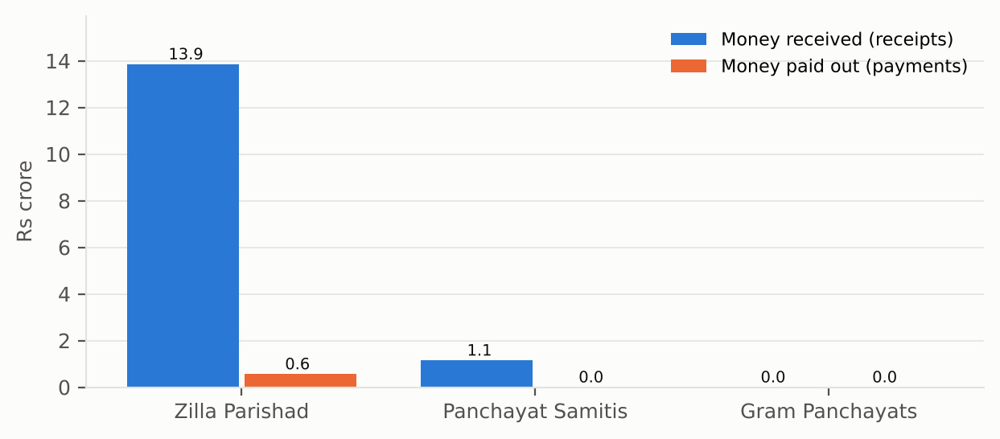
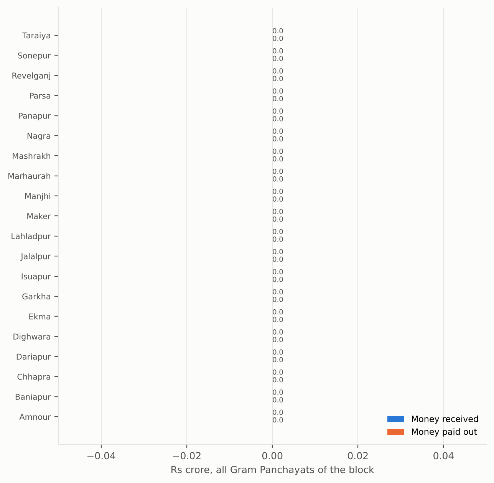
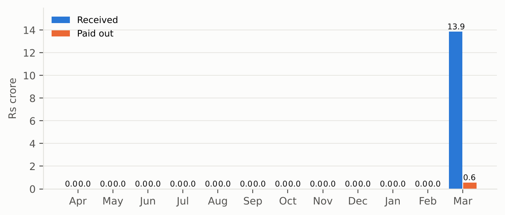

# Saran District: Panchayat Finances and Accounts, 2020-21

A plain-language district profile from the Government of India's eGramSwaraj system · India By Numbers · data as published by the portal (district statement generated July 18, 2022 2:27 AM)

## 1. The main points

- **Saran has 20 Panchayat Samitis (block councils) and 323 Gram Panchayats (village councils)** in the 2020-21 accounts, plus one Zilla Parishad (district council).
- **In 2020-21 its Panchayats together received Rs 15.01 crore and paid out Rs 0.56 crore.** (This year's statement uses a different measure from later years; see section 2.)
- **The Gram Panchayats had Rs 0.00 crore of receipts and paid out Rs 0.00 crore (—).** Rank among Bihar's districts: **none (4 of 38 districts show none)** for money received by Gram Panchayats, **none (26 of 38 districts show none)** for money paid out by them.
- **An average Gram Panchayat in Saran had about Rs 0.0 lakh of receipts and paid out about Rs 0.0 lakh** in the year (district totals divided by 323 Gram Panchayats).
- **Almost all the money is the 15th Finance Commission grant** (scheme-wise statement, all levels). Sources listed for Saran: XV Finance Commission-XVFC 100.0%.
- **Annual accounts are not complete:** 309 of 323 Gram Panchayats, 16 of 20 Panchayat Samitis and the Zilla Parishad (closed) have closed their year book in the system.
- **Official figures for each of the 323 Gram Panchayats are in the Appendix.**

## 2. How to read the money words

| Term | Meaning |
|---|---|
| **Money received** (portal: *Receipts*) | Money received during the year, as printed in rupees in the 2020-21 statement. The report does not say whether last year's balance is included |
| **Money paid out** (portal: *Payments*) | Payments made from the Panchayat's own accounts during the year |
| **Crore / lakh** | 1 crore = 100 lakh = Rs 1,00,00,000 |

**Important:** from 2021-22 the portal changed this statement to *OB + Receipts* in crore. The 2020-21 *Receipts* figure is a different measure, so it should not be compared directly with the *money available* of later years.

Payments are only what passed through Panchayat accounts. They are **not** all government spending in the district (state departments pay for many works directly).

## 3. Money at each level of Panchayat

| Level | Bodies | Money received (Rs crore) | Paid out (Rs crore) | Paid out as share | Saran's share of Bihar (received) |
|---|---|---|---|---|---|
| Zilla Parishad (district council) | 1 | 13.857 | 0.562 | 4% | 4% of Rs 321 crore |
| Panchayat Samitis (block councils) | 20 | 1.148 | 0.000 | 0% | 0% of Rs 375 crore |
| Gram Panchayats (village councils) | 323 | 0.000 | 0.000 | — | 0% of Rs 235 crore |
| **All levels** | | **15.005** | **0.562** | **4%** | |

Source: District wise Receipt and Payment Statement, 2020-21, Bihar (generated July 18, 2022 2:27 AM); amounts printed in rupees, shown here in crore.

## 4. Block by block

Figures for the Panchayat Samiti (block council) itself and for all Gram Panchayats of the block together.

| Block | Gram Panchayats | Gram Panchayats: received (Rs crore) | Gram Panchayats: paid out | Share paid | Panchayat Samiti: received | Panchayat Samiti: paid out |
|---|---|---|---|---|---|---|
| Amnour | 18 | 0.000 | 0.000 | — | 0.000 | 0.000 |
| Baniapur | 25 | 0.000 | 0.000 | — | 0.000 | 0.000 |
| Chhapra | 21 | 0.000 | 0.000 | — | 0.000 | 0.000 |
| Dariapur | 22 | 0.000 | 0.000 | — | 0.000 | 0.000 |
| Dighwara | 10 | 0.000 | 0.000 | — | 0.000 | 0.000 |
| Ekma | 18 | 0.000 | 0.000 | — | 0.000 | 0.000 |
| Garkha | 23 | 0.000 | 0.000 | — | 1.148 | 0.000 |
| Isuapur | 13 | 0.000 | 0.000 | — | 0.000 | 0.000 |
| Jalalpur | 15 | 0.000 | 0.000 | — | 0.000 | 0.000 |
| Lahladpur | 8 | 0.000 | 0.000 | — | 0.000 | 0.000 |
| Maker | 8 | 0.000 | 0.000 | — | 0.000 | 0.000 |
| Manjhi | 25 | 0.000 | 0.000 | — | 0.000 | 0.000 |
| Marhaurah | 21 | 0.000 | 0.000 | — | 0.000 | 0.000 |
| Mashrakh | 17 | 0.000 | 0.000 | — | 0.000 | 0.000 |
| Nagra | 10 | 0.000 | 0.000 | — | 0.000 | 0.000 |
| Panapur | 11 | 0.000 | 0.000 | — | 0.000 | 0.000 |
| Parsa | 13 | 0.000 | 0.000 | — | 0.000 | 0.000 |
| Revelganj | 9 | 0.000 | 0.000 | — | 0.000 | 0.000 |
| Sonepur | 23 | 0.000 | 0.000 | — | 0.000 | 0.000 |
| Taraiya | 13 | 0.000 | 0.000 | — | 0.000 | 0.000 |

The blocks' Gram Panchayat figures add up to Rs 0.000 crore (district statement: Rs 0.000 crore). The largest is **Amnour** (Rs 0.00 crore across 18 GPs), the smallest **Amnour** (Rs 0.00 crore). In 20 of 20 blocks the Gram Panchayats show no money at all for this year. Blocks differ in the number and size of their Panchayats, so a larger amount does not by itself mean better or worse performance.

## 5. The Zilla Parishad month by month

The district council (Zilla Parishad) started the year with **Rs 0.00 crore** carried over, received **Rs 13.86 crore** during the year and paid out **Rs 0.56 crore**. This matches the annual statement.

| Month | Received (Rs lakh) | Paid out (Rs lakh) | Payment vouchers |
|---|---|---|---|
| April, 2020 | 0.00 | 0.00 | 0 |
| May, 2020 | 0.00 | 0.00 | 0 |
| June, 2020 | 0.00 | 0.00 | 0 |
| July, 2020 | 0.00 | 0.00 | 0 |
| August, 2020 | 0.00 | 0.00 | 0 |
| September, 2020 | 0.00 | 0.00 | 0 |
| October, 2020 | 0.00 | 0.00 | 0 |
| November, 2020 | 0.00 | 0.00 | 0 |
| December, 2020 | 0.00 | 0.00 | 0 |
| Januaury, 2021 | 0.00 | 0.00 | 0 |
| February, 2021 | 0.00 | 0.00 | 0 |
| March, 2021 | 1,385.70 | 56.18 | 33 |

Month names are shown exactly as the portal prints them.

The busiest month for payments was **March, 2021** (Rs 0.56 crore). Source: Month Wise Payment and Receipt Statement (generated July 18, 2022 4:05 AM) and Month wise Summary Report (generated July 18, 2022 4:29 AM).

## 6. Where the money comes from

| Source (as named by the portal) | Zilla Parishad | Panchayat Samitis | Gram Panchayats |
|---|---|---|---|
| XV Finance Commission-XVFC | 100% of receipts | 100% of receipts | 0 |

Only the 1 source(s) above are listed for the district. Shares are calculated from the scheme-wise statement (generated August 20, 2021 6:50 AM). The same report counts 0 receipt vouchers and 0 payment vouchers for Saran's Gram Panchayats under the XV FC grant.

## 7. How well the books are kept

| | Zilla Parishad | Panchayat Samitis | Gram Panchayats |
|---|---|---|---|
| Number | 1 | 20 | 323 |
| Masters and opening balance entered | yes / yes | 19 / 16 | 309 / 309 |
| Receipt vouchers recorded | 5 | 2 | 0 |
| Payment vouchers recorded | 33 | 0 | 0 |
| Day book closed | yes | 16 of 20 | 309 of 323 |
| Month book closed | yes | 16 of 20 | 309 of 323 |
| Year book (annual accounts) closed | yes | 16 of 20 | 309 of 323 |

On average each Gram Panchayat recorded about 0 payment vouchers in the year. Source: District Wise Summary Report (generated July 18, 2022 2:31 AM).

## 8. What this profile cannot tell you

| Not available | Why |
|---|---|
| Population or households of the district's Panchayats | Not in any open eGramSwaraj report, so no per-person figures |
| Who each payment went to (the payee or vendor of each voucher) | On the individual voucher page, behind a security check (CAPTCHA); not collected. The public voucher lists (number, date, type, amount) are collected so far only for Patna; for this district they can be collected from India with `scripts/run_vouchers.py` |
| Elected members of this district | Collected for Bihar as a whole only; district figures are a planned follow-up |
| Value of approved development plans | Only whether a plan was uploaded is public |
| Money left unspent at year end | Not printed as an official figure |

## 9. About these figures

- Every figure is copied from the government's own eGramSwaraj reports and was checked against the original pages in the data validation (Task 5). Totals in this profile add up to the portal's own totals.
- Each report is a snapshot taken on the date shown; later reports for the same year can differ slightly because accounts keep being updated.
- District code 209; block and Gram Panchayat codes are the portal's own. Data collected November 2026 from egramswaraj.gov.in. Machine-readable tables: `data/validated/egs/`.
- Reports for Saran in other years: `docs/district_reports/saran/index.md`; all districts: `docs/district_reports/README.md`.

## Appendix: every Gram Panchayat of Saran, 2020-21

Amounts in Rs lakh. **Official receipts / payments** are from the Village wise Receipt and Payment Statement (generated July 18, 2022 3:58 AM); they are the figures to quote. 323 Gram Panchayats are shown; the district statement counts 323.

| Block | Gram Panchayat | Code | Official receipts | Official payments |
|---|---|---|---|---|
| Amnour | Amnour Harnarayan | 100497 | 0.00 | 0.00 |
| Amnour | Amnour Kalyan | 100498 | 0.00 | 0.00 |
| Amnour | Aphar | 100499 | 0.00 | 0.00 |
| Amnour | Basatpur | 100500 | 0.00 | 0.00 |
| Amnour | Dharhara Khurd | 100501 | 0.00 | 0.00 |
| Amnour | Dharmpur Jafar | 100502 | 0.00 | 0.00 |
| Amnour | Dhorlahi Khaithal | 100503 | 0.00 | 0.00 |
| Amnour | Husepur | 100504 | 0.00 | 0.00 |
| Amnour | Katsa | 100505 | 0.00 | 0.00 |
| Amnour | Koreyan | 100506 | 0.00 | 0.00 |
| Amnour | Madarpur | 100507 | 0.00 | 0.00 |
| Amnour | Manorpur Jhakhari | 100508 | 0.00 | 0.00 |
| Amnour | Paiga Mitrasen | 100509 | 0.00 | 0.00 |
| Amnour | Parsa | 100510 | 0.00 | 0.00 |
| Amnour | Raipura | 100511 | 0.00 | 0.00 |
| Amnour | Rasulpur | 100512 | 0.00 | 0.00 |
| Amnour | Shekhpura | 100513 | 0.00 | 0.00 |
| Amnour | Tarwar | 100514 | 0.00 | 0.00 |
| Baniapur | Baniyapur | 100515 | 0.00 | 0.00 |
| Baniapur | Bedauli | 100516 | 0.00 | 0.00 |
| Baniapur | Bhithi Sahabuddin | 100517 | 0.00 | 0.00 |
| Baniapur | Bhushaw | 100518 | 0.00 | 0.00 |
| Baniapur | Dhangarha | 100519 | 0.00 | 0.00 |
| Baniapur | Dhawri | 100520 | 0.00 | 0.00 |
| Baniapur | Goapiparpanti | 100521 | 0.00 | 0.00 |
| Baniapur | Harpur | 100522 | 0.00 | 0.00 |
| Baniapur | Kamta | 100523 | 0.00 | 0.00 |
| Baniapur | Kanhauli Manohar | 100524 | 0.00 | 0.00 |
| Baniapur | Karah | 100526 | 0.00 | 0.00 |
| Baniapur | Karahi | 100525 | 0.00 | 0.00 |
| Baniapur | Lauwa Kala | 100527 | 0.00 | 0.00 |
| Baniapur | Manikpura | 100528 | 0.00 | 0.00 |
| Baniapur | Manopali | 100529 | 0.00 | 0.00 |
| Baniapur | Maricha | 100530 | 0.00 | 0.00 |
| Baniapur | Paigambar Pur | 100531 | 0.00 | 0.00 |
| Baniapur | Pirauta Khas | 100532 | 0.00 | 0.00 |
| Baniapur | Pithauri | 100533 | 0.00 | 0.00 |
| Baniapur | Ramdhnaw | 100534 | 0.00 | 0.00 |
| Baniapur | Sahajitpur | 100535 | 0.00 | 0.00 |
| Baniapur | Sareya | 100536 | 0.00 | 0.00 |
| Baniapur | Satua | 100537 | 0.00 | 0.00 |
| Baniapur | Sisai | 100538 | 0.00 | 0.00 |
| Baniapur | Suraudha | 100539 | 0.00 | 0.00 |
| Chhapra | Badalu Tola | 100540 | 0.00 | 0.00 |
| Chhapra | Barhara Mahaji | 100541 | 0.00 | 0.00 |
| Chhapra | Bhairopur Nizamat | 100542 | 0.00 | 0.00 |
| Chhapra | Bishunpura | 100543 | 0.00 | 0.00 |
| Chhapra | Chirand | 100544 | 0.00 | 0.00 |
| Chhapra | Dumari | 100545 | 0.00 | 0.00 |
| Chhapra | Fakuli | 100555 | 0.00 | 0.00 |
| Chhapra | Jalalpur | 100546 | 0.00 | 0.00 |
| Chhapra | Karinga | 100547 | 0.00 | 0.00 |
| Chhapra | Khalpura Bala | 100548 | 0.00 | 0.00 |
| Chhapra | Kotawa Patti Rampur | 100549 | 0.00 | 0.00 |
| Chhapra | Lohari | 100550 | 0.00 | 0.00 |
| Chhapra | Maharajganj | 100551 | 0.00 | 0.00 |
| Chhapra | Mauna | 100552 | 0.00 | 0.00 |
| Chhapra | Musepur | 100553 | 0.00 | 0.00 |
| Chhapra | Naini | 100554 | 0.00 | 0.00 |
| Chhapra | Purvi Telpa | 100556 | 0.00 | 0.00 |
| Chhapra | Raipur Bingawan | 100557 | 0.00 | 0.00 |
| Chhapra | Sandha | 100558 | 0.00 | 0.00 |
| Chhapra | Sherpur Gheghata | 100559 | 0.00 | 0.00 |
| Chhapra | Tenua | 100560 | 0.00 | 0.00 |
| Dariapur | Akabarpur | 100561 | 0.00 | 0.00 |
| Dariapur | Bajahiyan | 100562 | 0.00 | 0.00 |
| Dariapur | Barwe | 100563 | 0.00 | 0.00 |
| Dariapur | Bela | 100564 | 0.00 | 0.00 |
| Dariapur | Dariapur | 100567 | 0.00 | 0.00 |
| Dariapur | Darihara | 100568 | 0.00 | 0.00 |
| Dariapur | Fatehpur Chain | 100569 | 0.00 | 0.00 |
| Dariapur | Harana | 100570 | 0.00 | 0.00 |
| Dariapur | Hariharpur | 100571 | 0.00 | 0.00 |
| Dariapur | Jitwarpur | 100572 | 0.00 | 0.00 |
| Dariapur | Kakarhat | 100573 | 0.00 | 0.00 |
| Dariapur | Khanpur | 100574 | 0.00 | 0.00 |
| Dariapur | Magarpal | 100575 | 0.00 | 0.00 |
| Dariapur | Mahmadpur | 100576 | 0.00 | 0.00 |
| Dariapur | Manpura | 100577 | 0.00 | 0.00 |
| Dariapur | Mujauna | 100578 | 0.00 | 0.00 |
| Dariapur | Natha Chhapra | 100579 | 0.00 | 0.00 |
| Dariapur | Paratappur | 100580 | 0.00 | 0.00 |
| Dariapur | Piraridih | 100581 | 0.00 | 0.00 |
| Dariapur | Sajuannupur Matihar | 100584 | 0.00 | 0.00 |
| Dariapur | Sutihar | 100585 | 0.00 | 0.00 |
| Dariapur | Vishambharpur | 100566 | 0.00 | 0.00 |
| Dighwara | Akilpur | 100586 | 0.00 | 0.00 |
| Dighwara | Barua | 100587 | 0.00 | 0.00 |
| Dighwara | Basti Jalal | 100588 | 0.00 | 0.00 |
| Dighwara | Haraji | 100589 | 0.00 | 0.00 |
| Dighwara | Jhauwa | 100590 | 0.00 | 0.00 |
| Dighwara | Kuraiya | 100591 | 0.00 | 0.00 |
| Dighwara | Manupur | 100592 | 0.00 | 0.00 |
| Dighwara | Rampur Ami | 100593 | 0.00 | 0.00 |
| Dighwara | Sitalpur | 100594 | 0.00 | 0.00 |
| Dighwara | Trilok Chak | 100595 | 0.00 | 0.00 |
| Ekma | Aamdadhi | 100596 | 0.00 | 0.00 |
| Ekma | Asahani | 100597 | 0.00 | 0.00 |
| Ekma | Atarsan | 100598 | 0.00 | 0.00 |
| Ekma | Baliya | 100599 | 0.00 | 0.00 |
| Ekma | Banpura | 100600 | 0.00 | 0.00 |
| Ekma | Binda Lal Ke Rampur | 100602 | 0.00 | 0.00 |
| Ekma | Chanchaura | 100603 | 0.00 | 0.00 |
| Ekma | Dakshini Parsa | 100604 | 0.00 | 0.00 |
| Ekma | Devpura | 100605 | 0.00 | 0.00 |
| Ekma | Eksar | 100607 | 0.00 | 0.00 |
| Ekma | Fuchati Kala | 100615 | 0.00 | 0.00 |
| Ekma | Hussepur | 100609 | 0.00 | 0.00 |
| Ekma | Mane | 100610 | 0.00 | 0.00 |
| Ekma | Nawada | 100611 | 0.00 | 0.00 |
| Ekma | Panchua | 100612 | 0.00 | 0.00 |
| Ekma | Parsa Purvi | 100613 | 0.00 | 0.00 |
| Ekma | Parsa Utari | 100614 | 0.00 | 0.00 |
| Ekma | Rasulpur | 100616 | 0.00 | 0.00 |
| Garkha | Bajit Pur | 100617 | 0.00 | 0.00 |
| Garkha | Ferusa | 100618 | 0.00 | 0.00 |
| Garkha | Garkha | 100619 | 0.00 | 0.00 |
| Garkha | Hasan Pura | 100620 | 0.00 | 0.00 |
| Garkha | Itwa | 100621 | 0.00 | 0.00 |
| Garkha | Jalal Basant | 100622 | 0.00 | 0.00 |
| Garkha | Kothia | 100623 | 0.00 | 0.00 |
| Garkha | Kudarbadha | 100624 | 0.00 | 0.00 |
| Garkha | Mahamad Pur | 100625 | 0.00 | 0.00 |
| Garkha | Mahamda | 100626 | 0.00 | 0.00 |
| Garkha | Mauzam Pur | 100631 | 0.00 | 0.00 |
| Garkha | Mirpur Juara | 100628 | 0.00 | 0.00 |
| Garkha | Mirza Pur | 100629 | 0.00 | 0.00 |
| Garkha | Mithe Pur | 100630 | 0.00 | 0.00 |
| Garkha | Motirajpur | 100632 | 0.00 | 0.00 |
| Garkha | Mukimpur | 100627 | 0.00 | 0.00 |
| Garkha | Naraon | 100633 | 0.00 | 0.00 |
| Garkha | Pachpatia | 100634 | 0.00 | 0.00 |
| Garkha | Pirauna | 100635 | 0.00 | 0.00 |
| Garkha | Ram Pur | 100636 | 0.00 | 0.00 |
| Garkha | Sadh Pur | 100637 | 0.00 | 0.00 |
| Garkha | Sargatti | 100638 | 0.00 | 0.00 |
| Garkha | Sripal Basant | 100639 | 0.00 | 0.00 |
| Isuapur | Aatanagar | 100641 | 0.00 | 0.00 |
| Isuapur | Agauthar Sundar | 100640 | 0.00 | 0.00 |
| Isuapur | Chakahan | 100642 | 0.00 | 0.00 |
| Isuapur | Chhapiya | 100643 | 0.00 | 0.00 |
| Isuapur | Datra Pursauli | 100644 | 0.00 | 0.00 |
| Isuapur | Isuapur | 100645 | 0.00 | 0.00 |
| Isuapur | Jaithar | 100646 | 0.00 | 0.00 |
| Isuapur | Kerwa | 100647 | 0.00 | 0.00 |
| Isuapur | Lauwa | 100648 | 0.00 | 0.00 |
| Isuapur | Nipaniya | 100649 | 0.00 | 0.00 |
| Isuapur | Ramchaura | 100650 | 0.00 | 0.00 |
| Isuapur | Rampur Atauli | 100651 | 0.00 | 0.00 |
| Isuapur | Sahwan | 100652 | 0.00 | 0.00 |
| Jalalpur | Anwal | 100653 | 0.00 | 0.00 |
| Jalalpur | Ashok Nagar | 100654 | 0.00 | 0.00 |
| Jalalpur | Bhatkesari | 100655 | 0.00 | 0.00 |
| Jalalpur | Bishunpura | 100656 | 0.00 | 0.00 |
| Jalalpur | Deuria | 100657 | 0.00 | 0.00 |
| Jalalpur | Kishunpur | 100658 | 0.00 | 0.00 |
| Jalalpur | KOPA | 100659 | 0.00 | 0.00 |
| Jalalpur | Kumna | 100660 | 0.00 | 0.00 |
| Jalalpur | Madho Pur | 100661 | 0.00 | 0.00 |
| Jalalpur | Nawada | 100662 | 0.00 | 0.00 |
| Jalalpur | Rampur Nur Nagar | 100663 | 0.00 | 0.00 |
| Jalalpur | Rewari | 100664 | 0.00 | 0.00 |
| Jalalpur | Samhota | 100666 | 0.00 | 0.00 |
| Jalalpur | Sanwari | 100667 | 0.00 | 0.00 |
| Jalalpur | Shankardih | 100665 | 0.00 | 0.00 |
| Lahladpur | Banpura | 100668 | 0.00 | 0.00 |
| Lahladpur | Basahi | 100669 | 0.00 | 0.00 |
| Lahladpur | Dandaspur | 100670 | 0.00 | 0.00 |
| Lahladpur | Dayalpur | 100671 | 0.00 | 0.00 |
| Lahladpur | Kateya | 100672 | 0.00 | 0.00 |
| Lahladpur | Kishunpur Lauwar | 100673 | 0.00 | 0.00 |
| Lahladpur | Mirzapur | 100674 | 0.00 | 0.00 |
| Lahladpur | Purushotampur | 100675 | 0.00 | 0.00 |
| Maker | Bagha Kol | 100676 | 0.00 | 0.00 |
| Maker | Bhatha | 100677 | 0.00 | 0.00 |
| Maker | Kaituka Lachhi | 100680 | 0.00 | 0.00 |
| Maker | Kaituka Nandan | 100679 | 0.00 | 0.00 |
| Maker | Maker | 100681 | 0.00 | 0.00 |
| Maker | Phulwariya | 100678 | 0.00 | 0.00 |
| Maker | Pir Maker | 100682 | 0.00 | 0.00 |
| Maker | Tara Amanour | 100683 | 0.00 | 0.00 |
| Manjhi | Baleshara | 100684 | 0.00 | 0.00 |
| Manjhi | Bangara | 100685 | 0.00 | 0.00 |
| Manjhi | Bareja | 100686 | 0.00 | 0.00 |
| Manjhi | Bhajauna Nachap | 100687 | 0.00 | 0.00 |
| Manjhi | Bhalua Bujurg | 100688 | 0.00 | 0.00 |
| Manjhi | Cheful | 100689 | 0.00 | 0.00 |
| Manjhi | Daudpur | 100690 | 0.00 | 0.00 |
| Manjhi | Dumari | 100691 | 0.00 | 0.00 |
| Manjhi | Enaitpur | 100692 | 0.00 | 0.00 |
| Manjhi | Ghorhat | 100693 | 0.00 | 0.00 |
| Manjhi | Gobarahi | 100694 | 0.00 | 0.00 |
| Manjhi | Jaitpur | 100695 | 0.00 | 0.00 |
| Manjhi | Kauru Dhauru | 100696 | 0.00 | 0.00 |
| Manjhi | Leguar | 100697 | 0.00 | 0.00 |
| Manjhi | Madan Sath | 100698 | 0.00 | 0.00 |
| Manjhi | Mahammdpur | 100699 | 0.00 | 0.00 |
| Manjhi | MANJHI PASCHIMI | 100700 | 0.00 | 0.00 |
| Manjhi | MANJHI PURVI | 100701 | 0.00 | 0.00 |
| Manjhi | Marahan | 100702 | 0.00 | 0.00 |
| Manjhi | Matiyar | 100703 | 0.00 | 0.00 |
| Manjhi | Mobarakpur | 100704 | 0.00 | 0.00 |
| Manjhi | Nasira | 100705 | 0.00 | 0.00 |
| Manjhi | Shitalpur | 100706 | 0.00 | 0.00 |
| Manjhi | Sonbarsa | 100707 | 0.00 | 0.00 |
| Manjhi | Tajpur | 100708 | 0.00 | 0.00 |
| Marhaurah | Agahara | 100709 | 0.00 | 0.00 |
| Marhaurah | Awari | 100710 | 0.00 | 0.00 |
| Marhaurah | Bahuwara Patti | 100711 | 0.00 | 0.00 |
| Marhaurah | Bardahia | 100712 | 0.00 | 0.00 |
| Marhaurah | Bhawalpur | 100713 | 0.00 | 0.00 |
| Marhaurah | Bhualpur | 100714 | 0.00 | 0.00 |
| Marhaurah | Gaura | 100715 | 0.00 | 0.00 |
| Marhaurah | Hasanpura | 100716 | 0.00 | 0.00 |
| Marhaurah | Hathisar | 100717 | 0.00 | 0.00 |
| Marhaurah | Israuli | 100718 | 0.00 | 0.00 |
| Marhaurah | Madhopur | 100719 | 0.00 | 0.00 |
| Marhaurah | Mirzapur | 100720 | 0.00 | 0.00 |
| Marhaurah | Mubarakpur | 100721 | 0.00 | 0.00 |
| Marhaurah | Narhar Pur | 100722 | 0.00 | 0.00 |
| Marhaurah | Nautan | 100723 | 0.00 | 0.00 |
| Marhaurah | Olhanpur | 100724 | 0.00 | 0.00 |
| Marhaurah | Rampur | 100725 | 0.00 | 0.00 |
| Marhaurah | Rasulpur | 100726 | 0.00 | 0.00 |
| Marhaurah | Salimapur | 100727 | 0.00 | 0.00 |
| Marhaurah | Shilhauri | 100728 | 0.00 | 0.00 |
| Marhaurah | Tejpurwa | 100729 | 0.00 | 0.00 |
| Mashrakh | Arana | 100730 | 0.00 | 0.00 |
| Mashrakh | Bahrauli | 100731 | 0.00 | 0.00 |
| Mashrakh | Bangra | 100732 | 0.00 | 0.00 |
| Mashrakh | Chand Kudariya | 100733 | 0.00 | 0.00 |
| Mashrakh | Dumarshan | 100734 | 0.00 | 0.00 |
| Mashrakh | Durgauli | 100735 | 0.00 | 0.00 |
| Mashrakh | Gangauli | 100736 | 0.00 | 0.00 |
| Mashrakh | Jajauli | 100737 | 0.00 | 0.00 |
| Mashrakh | Karn Kudariya | 100738 | 0.00 | 0.00 |
| Mashrakh | Kawalpura | 100739 | 0.00 | 0.00 |
| Mashrakh | Khajuri | 100740 | 0.00 | 0.00 |
| Mashrakh | Madarpur | 100741 | 0.00 | 0.00 |
| Mashrakh | MASHRAKH PASHCHIMI | 100742 | 0.00 | 0.00 |
| Mashrakh | MASHRAKH PURBI | 100743 | 0.00 | 0.00 |
| Mashrakh | Nawada | 100744 | 0.00 | 0.00 |
| Mashrakh | Semari | 100745 | 0.00 | 0.00 |
| Mashrakh | Sonauli | 100746 | 0.00 | 0.00 |
| Nagra | Aphaur | 100747 | 0.00 | 0.00 |
| Nagra | Dhupnagar Dhobwal | 100748 | 0.00 | 0.00 |
| Nagra | Dumari | 100749 | 0.00 | 0.00 |
| Nagra | Jagadishpur | 100750 | 0.00 | 0.00 |
| Nagra | Kadipur | 100751 | 0.00 | 0.00 |
| Nagra | Khaira | 100752 | 0.00 | 0.00 |
| Nagra | Koreya | 100753 | 0.00 | 0.00 |
| Nagra | Nagra | 100754 | 0.00 | 0.00 |
| Nagra | Takiya | 100755 | 0.00 | 0.00 |
| Nagra | Tujarpur | 100756 | 0.00 | 0.00 |
| Panapur | Bakwa | 100757 | 0.00 | 0.00 |
| Panapur | Basahiya | 100758 | 0.00 | 0.00 |
| Panapur | Belor | 245374 | 0.00 | 0.00 |
| Panapur | Bhoraha | 100760 | 0.00 | 0.00 |
| Panapur | Chakiya | 100761 | 0.00 | 0.00 |
| Panapur | Dhenuki | 100762 | 0.00 | 0.00 |
| Panapur | Kondha | 100763 | 0.00 | 0.00 |
| Panapur | Mahmad Pur | 100764 | 0.00 | 0.00 |
| Panapur | Rasauli | 100765 | 0.00 | 0.00 |
| Panapur | Satjora | 100766 | 0.00 | 0.00 |
| Panapur | Totaha Jagatpur | 100767 | 0.00 | 0.00 |
| Parsa | Anjani | 100768 | 0.00 | 0.00 |
| Parsa | Anyay | 100769 | 0.00 | 0.00 |
| Parsa | Bahar Marar | 100770 | 0.00 | 0.00 |
| Parsa | Baligawn | 100771 | 0.00 | 0.00 |
| Parsa | Banauta | 100772 | 0.00 | 0.00 |
| Parsa | Bheldi | 100773 | 0.00 | 0.00 |
| Parsa | Chandpura | 100774 | 0.00 | 0.00 |
| Parsa | Marar | 100775 | 0.00 | 0.00 |
| Parsa | Pachalakh | 100776 | 0.00 | 0.00 |
| Parsa | Pachrukhi | 100777 | 0.00 | 0.00 |
| Parsa | Parsauna | 100778 | 0.00 | 0.00 |
| Parsa | Saguni | 100779 | 0.00 | 0.00 |
| Parsa | Sobhepur | 100781 | 0.00 | 0.00 |
| Revelganj | Dakshniwari Chakki | 100782 | 0.00 | 0.00 |
| Revelganj | Diliya Rahim Pur | 100783 | 0.00 | 0.00 |
| Revelganj | Inai | 100784 | 0.00 | 0.00 |
| Revelganj | Kachanar | 100785 | 0.00 | 0.00 |
| Revelganj | Khairwar | 100786 | 0.00 | 0.00 |
| Revelganj | Mohabbat Parsa | 100787 | 0.00 | 0.00 |
| Revelganj | Mukrera | 100788 | 0.00 | 0.00 |
| Revelganj | Sitab Diyara | 100789 | 0.00 | 0.00 |
| Revelganj | Tekniwas | 100790 | 0.00 | 0.00 |
| Sonepur | Bharpura | 100791 | 0.00 | 0.00 |
| Sonepur | Chatur Pur | 100792 | 0.00 | 0.00 |
| Sonepur | Dudhaila | 100793 | 0.00 | 0.00 |
| Sonepur | Dumari Bujurg | 100794 | 0.00 | 0.00 |
| Sonepur | Gangajal | 100795 | 0.00 | 0.00 |
| Sonepur | Gopal Pur | 100796 | 0.00 | 0.00 |
| Sonepur | Govind Chak | 100797 | 0.00 | 0.00 |
| Sonepur | Hasilpur | 100798 | 0.00 | 0.00 |
| Sonepur | Jahagir Pur | 100799 | 0.00 | 0.00 |
| Sonepur | Kalyan Pur | 100800 | 0.00 | 0.00 |
| Sonepur | Kasamar | 100801 | 0.00 | 0.00 |
| Sonepur | Kharika | 100802 | 0.00 | 0.00 |
| Sonepur | Nagarmira | 100803 | 0.00 | 0.00 |
| Sonepur | Nayagaon | 100804 | 0.00 | 0.00 |
| Sonepur | Permanand Pur | 100805 | 0.00 | 0.00 |
| Sonepur | Rasulpur | 100806 | 0.00 | 0.00 |
| Sonepur | Sabalpur Middle | 100807 | 0.00 | 0.00 |
| Sonepur | Sabalpur Pachami | 100808 | 0.00 | 0.00 |
| Sonepur | Sabalpur Purbi | 100809 | 0.00 | 0.00 |
| Sonepur | Sabalpur Utri | 100810 | 0.00 | 0.00 |
| Sonepur | Sahapur Diara | 100811 | 0.00 | 0.00 |
| Sonepur | Shaidpur | 100812 | 0.00 | 0.00 |
| Sonepur | Sikarpur | 100813 | 0.00 | 0.00 |
| Taraiya | Bhagwatpur | 100814 | 0.00 | 0.00 |
| Taraiya | Bhatgai | 100815 | 0.00 | 0.00 |
| Taraiya | Chainpur | 100816 | 0.00 | 0.00 |
| Taraiya | Chanchaliya | 100817 | 0.00 | 0.00 |
| Taraiya | Deodhi | 100818 | 0.00 | 0.00 |
| Taraiya | Dumri | 100819 | 0.00 | 0.00 |
| Taraiya | Madhopur | 100820 | 0.00 | 0.00 |
| Taraiya | Narayanpur | 100821 | 0.00 | 0.00 |
| Taraiya | Pachbhinda | 100823 | 0.00 | 0.00 |
| Taraiya | Pachraur | 100822 | 0.00 | 0.00 |
| Taraiya | Pokherara | 100824 | 0.00 | 0.00 |
| Taraiya | Saraiya Ratnakar | 100825 | 0.00 | 0.00 |
| Taraiya | Taraiya | 100826 | 0.00 | 0.00 |

Official Gram Panchayat figures above add up to Rs 0.00 crore received and Rs 0.00 crore paid out.

