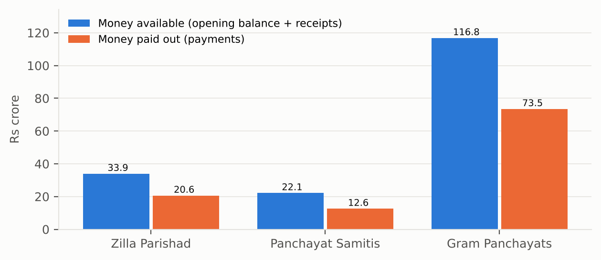
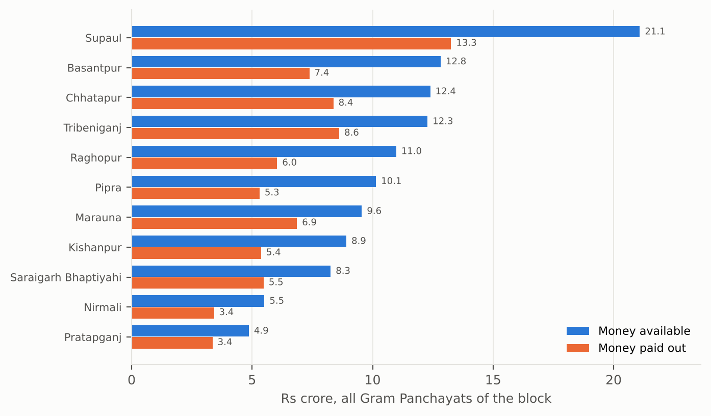
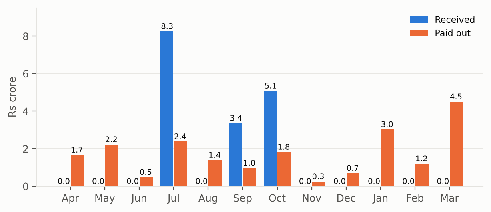

# Supaul District: Panchayat Finances and Accounts, 2024-25

A plain-language district profile from the Government of India's eGramSwaraj system · India By Numbers · data as published by the portal (district statement generated November 21, 2026 12:59 AM)

## 1. The main points

- **Supaul has 11 Panchayat Samitis (block councils) and 174 Gram Panchayats (village councils)** in the 2024-25 accounts, plus one Zilla Parishad (district council).
- **In 2024-25 its Panchayats together had Rs 172.90 crore available and paid out Rs 106.65 crore (62%).**
- **The Gram Panchayats had Rs 116.81 crore available and paid out Rs 73.47 crore (63%).** Rank among Bihar's districts: **17 of 38** for money available to Gram Panchayats, **18 of 38** for money paid out by them.
- **An average Gram Panchayat in Supaul had about Rs 67.1 lakh available and paid out about Rs 42.2 lakh** in the year (district totals divided by 174 Gram Panchayats).
- **Almost all the money is the 15th Finance Commission grant** (scheme-wise statement, all levels). Sources listed for Supaul: XV Finance Commission-XVFC 100.0%; own resources-OWN none.
- **Annual accounts are complete:** 174 of 174 Gram Panchayats, 11 of 11 Panchayat Samitis and the Zilla Parishad (closed) have closed their year book in the system.
- **Official figures for each of the 174 Gram Panchayats are in the Appendix.**

## 2. How to read the money words

| Term | Meaning |
|---|---|
| **Money available** (portal: *OB + Receipts*) | Money left from last year (opening balance) plus money received during the year |
| **Money paid out** (portal: *Payments*) | Payments made from the Panchayat's own accounts during the year |
| **Crore / lakh** | 1 crore = 100 lakh = Rs 1,00,00,000 |

Payments are only what passed through Panchayat accounts. They are **not** all government spending in the district (state departments pay for many works directly).

## 3. Money at each level of Panchayat

| Level | Bodies | Money available (Rs crore) | Paid out (Rs crore) | Paid out as share | Supaul's share of Bihar (available) |
|---|---|---|---|---|---|
| Zilla Parishad (district council) | 1 | 33.942 | 20.599 | 61% | 2% of Rs 1,885 crore |
| Panchayat Samitis (block councils) | 11 | 22.146 | 12.583 | 57% | 2% of Rs 1,029 crore |
| Gram Panchayats (village councils) | 174 | 116.811 | 73.466 | 63% | 3% of Rs 4,222 crore |
| **All levels** | | **172.899** | **106.648** | **62%** | |

Source: District wise Receipt and Payment Statement, 2024-25, Bihar (generated November 21, 2026 12:59 AM).

## 4. Block by block

Figures for the Panchayat Samiti (block council) itself and for all Gram Panchayats of the block together.

| Block | Gram Panchayats | Gram Panchayats: available (Rs crore) | Gram Panchayats: paid out | Share paid | Panchayat Samiti: available | Panchayat Samiti: paid out |
|---|---|---|---|---|---|---|
| Basantpur | 14 | 12.826 | 7.378 | 58% | 2.043 | 1.034 |
| Chhatapur | 23 | 12.396 | 8.374 | 68% | 1.934 | 1.166 |
| Kishanpur | 16 | 8.912 | 5.374 | 60% | 2.343 | 1.456 |
| Marauna | 13 | 9.552 | 6.862 | 72% | 1.325 | 0.833 |
| Nirmali | 7 | 5.511 | 3.418 | 62% | 1.069 | 0.440 |
| Pipra | 15 | 10.141 | 5.309 | 52% | 1.238 | 0.519 |
| Pratapganj | 9 | 4.866 | 3.358 | 69% | 1.646 | 0.772 |
| Raghopur | 16 | 10.979 | 6.039 | 55% | 3.283 | 1.679 |
| Saraigarh Bhaptiyahi | 12 | 8.260 | 5.479 | 66% | 1.944 | 0.997 |
| Supaul | 26 | 21.089 | 13.258 | 63% | 2.793 | 1.913 |
| Tribeniganj | 23 | 12.281 | 8.615 | 70% | 2.526 | 1.774 |

The blocks' Gram Panchayat figures add up to Rs 116.811 crore (district statement: Rs 116.811 crore). The largest is **Supaul** (Rs 21.09 crore across 26 GPs), the smallest **Pratapganj** (Rs 4.87 crore). The share of money paid out ranges from 52% to 72% across the 11 blocks with money (middle block: 63%). Blocks differ in the number and size of their Panchayats, so a larger amount does not by itself mean better or worse performance.

## 5. The Zilla Parishad month by month

The district council (Zilla Parishad) started the year with **Rs 17.24 crore** carried over, received **Rs 16.71 crore** during the year and paid out **Rs 20.69 crore** (Rs 0.09 crore of payments were later cancelled or rejected, leaving Rs 20.60 crore). This matches the annual statement.

| Month | Received (Rs lakh) | Paid out (Rs lakh) | Payment vouchers |
|---|---|---|---|
| April, 2024 | 0.00 | 167.61 | 81 |
| May, 2024 | 0.00 | 223.14 | 106 |
| June, 2024 | 0.00 | 48.47 | 26 |
| July, 2024 | 825.70 | 238.69 | 124 |
| August, 2024 | 0.00 | 140.33 | 225 |
| September, 2024 | 336.69 | 96.86 | 230 |
| October, 2024 | 508.29 | 183.21 | 434 |
| November, 2024 | 0.00 | 25.42 | 144 |
| December, 2024 | 0.00 | 69.84 | 131 |
| Januaury, 2025 | 0.00 | 303.47 | 238 |
| February, 2025 | 0.00 | 120.90 | 59 |
| March, 2025 | 0.00 | 450.63 | 80 |

Month names are shown exactly as the portal prints them.

The busiest month for payments was **March, 2025** (Rs 4.51 crore). Source: Month Wise Payment and Receipt Statement (generated November 21, 2026 11:17 AM) and Month wise Summary Report (generated November 21, 2026 8:14 PM).

## 6. Where the money comes from

| Source (as named by the portal) | Zilla Parishad | Panchayat Samitis | Gram Panchayats |
|---|---|---|---|
| XV Finance Commission-XVFC | 100% of receipts | 100% of receipts | 100% of receipts |
| own resources-OWN | 0 | 0 | 0 |

Only the 2 source(s) above are listed for the district. Shares are calculated from the scheme-wise statement (generated March 7, 2025 12:45 AM; October 8, 2025 3:34 AM). The same report counts 792 receipt vouchers and 11,547 payment vouchers for Supaul's Gram Panchayats under the XV FC grant.

## 7. How well the books are kept

| | Zilla Parishad | Panchayat Samitis | Gram Panchayats |
|---|---|---|---|
| Number | 1 | 11 | 174 |
| Masters and opening balance entered | yes / yes | 11 / 11 | 174 / 174 |
| Receipt vouchers recorded | 9 | 78 | 792 |
| Payment vouchers recorded | 1,878 | 1,287 | 11,547 |
| Day book closed | yes | 11 of 11 | 174 of 174 |
| Month book closed | yes | 11 of 11 | 174 of 174 |
| Year book (annual accounts) closed | yes | 11 of 11 | 174 of 174 |

On average each Gram Panchayat recorded about 66 payment vouchers in the year. Source: District Wise Summary Report (generated November 21, 2026 12:50 AM).

## 8. What this profile cannot tell you

| Not available | Why |
|---|---|
| Population or households of the district's Panchayats | Not in any open eGramSwaraj report, so no per-person figures |
| Who each payment went to (the payee or vendor of each voucher) | On the individual voucher page, behind a security check (CAPTCHA); not collected. The public voucher lists (number, date, type, amount) are collected so far only for Patna; for this district they can be collected from India with `scripts/run_vouchers.py` |
| Elected members of this district | Collected for Bihar as a whole only; district figures are a planned follow-up |
| Value of approved development plans | Only whether a plan was uploaded is public |
| Money left unspent at year end | Not printed as an official figure |

## 9. About these figures

- Every figure is copied from the government's own eGramSwaraj reports and was checked against the original pages in the data validation (Task 5). Totals in this profile add up to the portal's own totals.
- Each report is a snapshot taken on the date shown; later reports for the same year can differ slightly because accounts keep being updated.
- District code 214; block and Gram Panchayat codes are the portal's own. Data collected November 2026 from egramswaraj.gov.in. Machine-readable tables: `data/validated/egs/`.
- Reports for Supaul in other years: `docs/district_reports/supaul/index.md`; all districts: `docs/district_reports/README.md`.

## Appendix: every Gram Panchayat of Supaul, 2024-25

Amounts in Rs lakh. **Official receipts / payments** are from the Village wise Receipt and Payment Statement (generated November 21, 2026 4:34 AM); they are the figures to quote. 174 Gram Panchayats are shown; the district statement counts 174.

| Block | Gram Panchayat | Code | Official receipts | Official payments |
|---|---|---|---|---|
| Basantpur | Balbhadrapur | 101484 | 109.22 | 61.13 |
| Basantpur | Banaili Patti | 101485 | 104.66 | 47.03 |
| Basantpur | Basantpur | 101486 | 103.85 | 39.50 |
| Basantpur | Bhagwanpur | 101487 | 80.95 | 35.57 |
| Basantpur | Bhimnagar | 101488 | 82.95 | 56.62 |
| Basantpur | Dinbandi | 101490 | 143.68 | 119.55 |
| Basantpur | Hirday Nagar | 101491 | 93.55 | 48.75 |
| Basantpur | Kochgama | 101492 | 89.92 | 42.31 |
| Basantpur | Kushar | 101493 | 68.10 | 55.60 |
| Basantpur | Nirmali | 101494 | 78.19 | 44.44 |
| Basantpur | Parmanandpur | 101495 | 75.45 | 51.55 |
| Basantpur | Ratanpur | 101496 | 81.34 | 31.46 |
| Basantpur | Satanpatti | 101497 | 65.75 | 37.02 |
| Basantpur | Vishanpur Shivram | 101489 | 104.99 | 67.33 |
| Chhatapur | Balua | 101498 | 51.13 | 35.93 |
| Chhatapur | Bhimpur | 101499 | 42.36 | 27.12 |
| Chhatapur | Charna | 101500 | 33.30 | 24.97 |
| Chhatapur | Chatapur | 101501 | 71.15 | 40.67 |
| Chhatapur | Chunni | 101502 | 50.74 | 32.51 |
| Chhatapur | Deharia | 101503 | 77.66 | 53.18 |
| Chhatapur | Ghibaha | 101504 | 54.03 | 25.49 |
| Chhatapur | Guwalpara | 101505 | 76.70 | 61.05 |
| Chhatapur | Jhakhar Garh | 101506 | 58.27 | 27.46 |
| Chhatapur | Jibachh Pur | 101507 | 45.74 | 30.50 |
| Chhatapur | Kathara | 101508 | 52.62 | 37.27 |
| Chhatapur | Lalganj | 101509 | 69.78 | 39.92 |
| Chhatapur | Laxaminia | 101510 | 75.30 | 62.69 |
| Chhatapur | Laxamipur Khuti | 101511 | 46.25 | 21.36 |
| Chhatapur | Madhopur | 101512 | 52.70 | 40.83 |
| Chhatapur | Madhubani | 101513 | 44.53 | 26.57 |
| Chhatapur | Mohamad Ganj | 101514 | 55.14 | 35.10 |
| Chhatapur | Rajeshwari East | 101515 | 45.26 | 33.21 |
| Chhatapur | Rajeshwari West | 101516 | 41.68 | 17.82 |
| Chhatapur | Rampur | 101517 | 52.49 | 40.67 |
| Chhatapur | Sohatha | 101518 | 55.06 | 49.13 |
| Chhatapur | Thuthi | 101519 | 33.49 | 27.23 |
| Chhatapur | Udhampur | 101520 | 54.16 | 46.70 |
| Kishanpur | Andauli | 101521 | 118.03 | 44.32 |
| Kishanpur | Bouraha | 101522 | 56.34 | 37.18 |
| Kishanpur | Dubiyahi | 101523 | 34.80 | 22.09 |
| Kishanpur | Karai Hiya | 101525 | 42.08 | 24.11 |
| Kishanpur | Katahara Kadampura | 101524 | 47.21 | 22.71 |
| Kishanpur | Kishanpur North | 101527 | 49.09 | 36.59 |
| Kishanpur | Kishanpur South | 101526 | 51.37 | 32.52 |
| Kishanpur | Maladh | 101528 | 76.06 | 46.90 |
| Kishanpur | Meha Simar | 101529 | 64.47 | 23.74 |
| Kishanpur | Moujaha | 101530 | 48.95 | 23.69 |
| Kishanpur | Nauwabakhar | 101531 | 35.93 | 19.57 |
| Kishanpur | Parsamadho | 101532 | 37.30 | 17.64 |
| Kishanpur | Rajpur | 101533 | 66.04 | 58.65 |
| Kishanpur | Shivpuri | 101534 | 65.93 | 52.67 |
| Kishanpur | Sukhasan | 101535 | 53.93 | 44.65 |
| Kishanpur | Tulapatti | 101536 | 43.66 | 30.42 |
| Marauna | Barhara | 101537 | 71.19 | 66.48 |
| Marauna | Belahi | 101538 | 56.32 | 51.88 |
| Marauna | Ganaura | 101539 | 54.37 | 37.27 |
| Marauna | Ghogharariya | 101540 | 158.73 | 110.78 |
| Marauna | Harari | 101541 | 116.31 | 71.22 |
| Marauna | Kadmaha | 101542 | 61.08 | 25.37 |
| Marauna | Kamrail | 101543 | 49.57 | 48.54 |
| Marauna | Lalmaniya | 101544 | 61.98 | 51.14 |
| Marauna | Marauna North | 101545 | 30.39 | 29.27 |
| Marauna | Marauna South | 101546 | 83.85 | 69.50 |
| Marauna | Parikonch | 101547 | 55.64 | 22.44 |
| Marauna | Sarojabela | 101548 | 49.19 | 42.92 |
| Marauna | Sisonee | 101549 | 106.59 | 59.37 |
| Nirmali | Bela Singar Moti | 101550 | 54.35 | 24.41 |
| Nirmali | Dagmara | 101551 | 130.69 | 88.85 |
| Nirmali | Dighiya | 101552 | 81.07 | 39.24 |
| Nirmali | Haryahi | 101553 | 48.55 | 26.62 |
| Nirmali | Kamalpur | 101554 | 104.87 | 83.85 |
| Nirmali | Kunaolee | 101555 | 75.15 | 54.08 |
| Nirmali | Majari | 101556 | 56.39 | 24.78 |
| Pipra | Amaha | 101557 | 57.31 | 45.24 |
| Pipra | Basaha | 101558 | 123.18 | 43.06 |
| Pipra | Dinapatti | 101559 | 83.07 | 47.10 |
| Pipra | Dubiyahi | 101560 | 81.51 | 36.24 |
| Pipra | Kataiya Mahe | 101561 | 84.01 | 24.88 |
| Pipra | Maheshpur | 101562 | 48.15 | 35.46 |
| Pipra | Nirmali | 101563 | 107.25 | 47.26 |
| Pipra | Pathara Dakshin | 101565 | 37.22 | 10.67 |
| Pipra | Pathara Uttar | 101564 | 45.60 | 34.56 |
| Pipra | Ramnagar | 101567 | 91.09 | 54.11 |
| Pipra | Rampur | 101568 | 44.44 | 36.05 |
| Pipra | Ratauli | 101569 | 85.79 | 55.76 |
| Pipra | Thadhi Bhawanipur | 101570 | 57.91 | 28.82 |
| Pipra | Thumha | 101571 | 27.84 | 17.81 |
| Pipra | Tullapatti | 101572 | 39.76 | 13.90 |
| Pratapganj | Bhawani Pur South | 101573 | 55.93 | 37.16 |
| Pratapganj | Bhawanipur North | 101574 | 55.93 | 51.41 |
| Pratapganj | Chilauni South | 101575 | 71.35 | 52.13 |
| Pratapganj | Chilauni Uttar | 101576 | 40.45 | 31.88 |
| Pratapganj | Gobindpur | 101577 | 49.66 | 41.16 |
| Pratapganj | Sripur | 101578 | 27.83 | 24.57 |
| Pratapganj | Sukha Nagar | 101579 | 34.73 | 29.70 |
| Pratapganj | Suryapur | 101580 | 45.38 | 29.33 |
| Pratapganj | Tekuna | 101581 | 105.33 | 38.45 |
| Raghopur | Bauraha | 101582 | 57.59 | 30.88 |
| Raghopur | Bayasi | 101583 | 80.87 | 52.61 |
| Raghopur | Bisanpur Daulat | 101584 | 42.17 | 26.16 |
| Raghopur | Champa Nagar | 101585 | 86.86 | 58.34 |
| Raghopur | Dewipur | 101586 | 82.22 | 40.73 |
| Raghopur | Dharahara | 101587 | 77.09 | 50.65 |
| Raghopur | Dumari | 101588 | 43.37 | 8.70 |
| Raghopur | Finglash | 101589 | 52.94 | 37.25 |
| Raghopur | Haripur | 101590 | 56.91 | 26.94 |
| Raghopur | Hariraha | 101591 | 54.77 | 24.99 |
| Raghopur | Hulash | 101592 | 86.43 | 51.42 |
| Raghopur | Karjain | 101593 | 95.39 | 65.84 |
| Raghopur | Motipur | 101594 | 108.83 | 33.68 |
| Raghopur | Permanand Pur | 101595 | 60.67 | 36.74 |
| Raghopur | Raghopur | 101597 | 88.91 | 45.04 |
| Raghopur | Ram Bishanpur | 101598 | 22.90 | 13.93 |
| Saraigarh Bhaptiyahi | Banainiya | 101600 | 139.00 | 89.20 |
| Saraigarh Bhaptiyahi | Bhaptiyahi | 101601 | 34.72 | 34.45 |
| Saraigarh Bhaptiyahi | Chandpipar | 101602 | 46.63 | 37.39 |
| Saraigarh Bhaptiyahi | Chhithi Hanuman Nagar | 101603 | 47.95 | 35.72 |
| Saraigarh Bhaptiyahi | Dholi | 101604 | 149.93 | 39.09 |
| Saraigarh Bhaptiyahi | Jhilladumari | 101605 | 121.83 | 72.68 |
| Saraigarh Bhaptiyahi | Lalgang Begwa Tengraha | 101606 | 29.08 | 25.85 |
| Saraigarh Bhaptiyahi | Laukaha | 101607 | 70.07 | 56.69 |
| Saraigarh Bhaptiyahi | Murli | 101608 | 44.54 | 39.24 |
| Saraigarh Bhaptiyahi | Pipra Khurd | 101609 | 38.67 | 36.56 |
| Saraigarh Bhaptiyahi | Sariagarh | 101610 | 45.09 | 33.09 |
| Saraigarh Bhaptiyahi | Shahpur Prithvi Patti | 101611 | 58.47 | 47.93 |
| Supaul | Amha | 101612 | 22.77 | 18.48 |
| Supaul | Bairiya | 101613 | 65.50 | 52.01 |
| Supaul | Bairo | 101614 | 91.30 | 68.09 |
| Supaul | Bakaur | 101615 | 46.52 | 40.02 |
| Supaul | Balha | 101616 | 32.29 | 19.60 |
| Supaul | Balwa | 101617 | 87.47 | 50.80 |
| Supaul | Baruari | 101618 | 76.53 | 35.98 |
| Supaul | Basbitti | 101619 | 61.54 | 52.66 |
| Supaul | Bina | 101620 | 80.90 | 30.42 |
| Supaul | Chain Singh Patti | 101621 | 79.13 | 54.02 |
| Supaul | Ekma | 101622 | 82.97 | 45.66 |
| Supaul | Ghuran | 101623 | 94.24 | 73.70 |
| Supaul | Gopalpur Sire | 101624 | 52.48 | 42.77 |
| Supaul | Goth Baruary | 101625 | 93.73 | 58.99 |
| Supaul | Hardi East | 101627 | 82.34 | 73.37 |
| Supaul | Hardi West | 101626 | 94.03 | 67.06 |
| Supaul | Kariho | 101628 | 52.74 | 28.55 |
| Supaul | Karnpur | 101629 | 113.50 | 83.66 |
| Supaul | Laukaha | 101630 | 54.70 | 42.14 |
| Supaul | Lourdh | 101631 | 36.09 | 22.13 |
| Supaul | Malhani | 101632 | 37.48 | 24.99 |
| Supaul | Pasarna-Parsoni | 101633 | 59.61 | 44.40 |
| Supaul | Pipra Khurd | 101634 | 138.43 | 111.18 |
| Supaul | Ramdatt Patti | 101635 | 46.15 | 42.80 |
| Supaul | Sukhpur-Solhani | 101636 | 89.82 | 58.81 |
| Supaul | Telwa | 101637 | 336.59 | 83.54 |
| Tribeniganj | Baghely | 101639 | 57.22 | 51.03 |
| Tribeniganj | Barhakurba | 101640 | 63.25 | 40.08 |
| Tribeniganj | Gonha | 101642 | 50.86 | 30.03 |
| Tribeniganj | Guria | 101643 | 47.98 | 39.96 |
| Tribeniganj | Harihar Patti | 101644 | 51.34 | 40.33 |
| Tribeniganj | Jadia | 101645 | 116.64 | 53.69 |
| Tribeniganj | Karharwa | 101646 | 31.80 | 24.16 |
| Tribeniganj | Koria Patti East | 101647 | 89.59 | 51.54 |
| Tribeniganj | Koria Patti West | 101648 | 54.49 | 32.23 |
| Tribeniganj | Kushaha | 101649 | 73.82 | 69.67 |
| Tribeniganj | Latona South | 101651 | 35.94 | 18.63 |
| Tribeniganj | Maheshuwa | 101652 | 86.20 | 72.49 |
| Tribeniganj | Manganj East | 101653 | 33.80 | 28.23 |
| Tribeniganj | Manganj West | 101654 | 34.27 | 30.36 |
| Tribeniganj | Mirjawa | 101655 | 62.46 | 34.83 |
| Tribeniganj | Nandana | 101656 | 20.49 | 11.40 |
| Tribeniganj | Orlaha | 101657 | 38.13 | 27.39 |
| Tribeniganj | Parsa Gharhi South | 101658 | 49.05 | 38.97 |
| Tribeniganj | Parsagarhi North | 101659 | 17.89 | 16.91 |
| Tribeniganj | Patharagour Dhoe | 101660 | 41.83 | 30.22 |
| Tribeniganj | Piluwaha | 101661 | 61.78 | 31.38 |
| Tribeniganj | Simaria | 101662 | 62.84 | 47.10 |
| Tribeniganj | Thalhagarhia North | 101663 | 46.41 | 40.89 |

Official Gram Panchayat figures above add up to Rs 116.81 crore received and Rs 73.47 crore paid out.

