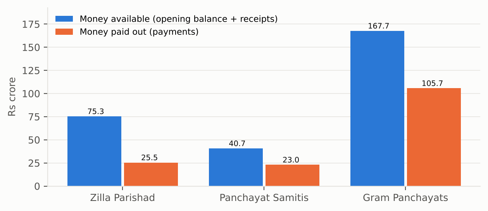
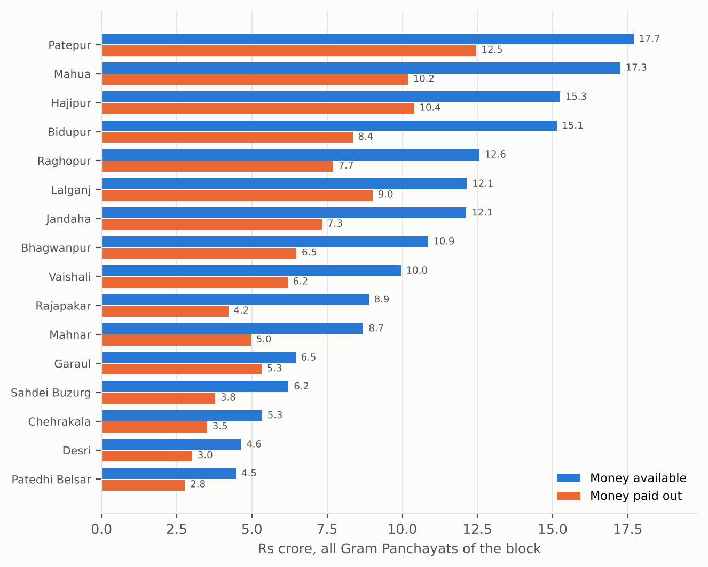
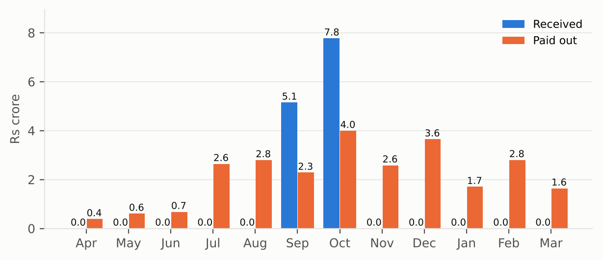

# Vaishali District: Panchayat Finances and Accounts, 2024-25

A plain-language district profile from the Government of India's eGramSwaraj system · India By Numbers · data as published by the portal (district statement generated November 21, 2026 12:59 AM)

## 1. The main points

- **Vaishali has 16 Panchayat Samitis (block councils) and 278 Gram Panchayats (village councils)** in the 2024-25 accounts, plus one Zilla Parishad (district council).
- **In 2024-25 its Panchayats together had Rs 283.77 crore available and paid out Rs 154.22 crore (54%).**
- **The Gram Panchayats had Rs 167.70 crore available and paid out Rs 105.69 crore (63%).** Rank among Bihar's districts: **6 of 38** for money available to Gram Panchayats, **8 of 38** for money paid out by them.
- **An average Gram Panchayat in Vaishali had about Rs 60.3 lakh available and paid out about Rs 38.0 lakh** in the year (district totals divided by 278 Gram Panchayats).
- **Almost all the money is the 15th Finance Commission grant** (scheme-wise statement, all levels). Sources listed for Vaishali: XV Finance Commission-XVFC 100.0%; own resources-OWN none.
- **Annual accounts are complete:** 278 of 278 Gram Panchayats, 16 of 16 Panchayat Samitis and the Zilla Parishad (closed) have closed their year book in the system.
- **Official figures for each of the 278 Gram Panchayats are in the Appendix.**

## 2. How to read the money words

| Term | Meaning |
|---|---|
| **Money available** (portal: *OB + Receipts*) | Money left from last year (opening balance) plus money received during the year |
| **Money paid out** (portal: *Payments*) | Payments made from the Panchayat's own accounts during the year |
| **Crore / lakh** | 1 crore = 100 lakh = Rs 1,00,00,000 |

Payments are only what passed through Panchayat accounts. They are **not** all government spending in the district (state departments pay for many works directly).

## 3. Money at each level of Panchayat

| Level | Bodies | Money available (Rs crore) | Paid out (Rs crore) | Paid out as share | Vaishali's share of Bihar (available) |
|---|---|---|---|---|---|
| Zilla Parishad (district council) | 1 | 75.349 | 25.484 | 34% | 4% of Rs 1,885 crore |
| Panchayat Samitis (block councils) | 16 | 40.723 | 23.047 | 57% | 4% of Rs 1,029 crore |
| Gram Panchayats (village councils) | 278 | 167.701 | 105.690 | 63% | 4% of Rs 4,222 crore |
| **All levels** | | **283.773** | **154.221** | **54%** | |

Source: District wise Receipt and Payment Statement, 2024-25, Bihar (generated November 21, 2026 12:59 AM).

## 4. Block by block

Figures for the Panchayat Samiti (block council) itself and for all Gram Panchayats of the block together.

| Block | Gram Panchayats | Gram Panchayats: available (Rs crore) | Gram Panchayats: paid out | Share paid | Panchayat Samiti: available | Panchayat Samiti: paid out |
|---|---|---|---|---|---|---|
| Bhagwanpur | 21 | 10.855 | 6.480 | 60% | 2.223 | 1.181 |
| Bidupur | 24 | 15.135 | 8.352 | 55% | 3.274 | 2.577 |
| Chehrakala | 12 | 5.340 | 3.512 | 66% | 1.275 | 0.811 |
| Desri | 8 | 4.634 | 3.015 | 65% | 1.088 | 0.687 |
| Garaul | 12 | 6.455 | 5.318 | 82% | 1.710 | 0.611 |
| Hajipur | 23 | 15.250 | 10.395 | 68% | 1.732 | 1.658 |
| Jandaha | 21 | 12.132 | 7.335 | 60% | 2.471 | 0.917 |
| Lalganj | 21 | 12.147 | 9.015 | 74% | 1.967 | 0.909 |
| Mahnar | 14 | 8.706 | 4.964 | 57% | 2.012 | 0.383 |
| Mahua | 23 | 17.252 | 10.187 | 59% | 6.663 | 4.750 |
| Patedhi Belsar | 9 | 4.477 | 2.774 | 62% | 1.150 | 0.343 |
| Patepur | 30 | 17.693 | 12.453 | 70% | 5.642 | 2.738 |
| Raghopur | 20 | 12.563 | 7.703 | 61% | 3.818 | 2.693 |
| Rajapakar | 13 | 8.889 | 4.217 | 47% | 2.779 | 1.227 |
| Sahdei Buzurg | 11 | 6.218 | 3.781 | 61% | 1.066 | 0.558 |
| Vaishali | 16 | 9.954 | 6.188 | 62% | 1.853 | 1.003 |

The blocks' Gram Panchayat figures add up to Rs 167.701 crore (district statement: Rs 167.701 crore). The largest is **Patepur** (Rs 17.69 crore across 30 GPs), the smallest **Patedhi Belsar** (Rs 4.48 crore). The share of money paid out ranges from 47% to 82% across the 16 blocks with money (middle block: 62%). Blocks differ in the number and size of their Panchayats, so a larger amount does not by itself mean better or worse performance.

## 5. The Zilla Parishad month by month

The district council (Zilla Parishad) started the year with **Rs 62.43 crore** carried over, received **Rs 12.92 crore** during the year and paid out **Rs 25.75 crore** (Rs 0.27 crore of payments were later cancelled or rejected, leaving Rs 25.48 crore). This matches the annual statement.

| Month | Received (Rs lakh) | Paid out (Rs lakh) | Payment vouchers |
|---|---|---|---|
| April, 2024 | 0.00 | 38.47 | 14 |
| May, 2024 | 0.00 | 60.64 | 97 |
| June, 2024 | 0.00 | 67.91 | 22 |
| July, 2024 | 0.00 | 263.86 | 110 |
| August, 2024 | 0.00 | 279.51 | 175 |
| September, 2024 | 514.93 | 228.39 | 116 |
| October, 2024 | 777.39 | 399.43 | 265 |
| November, 2024 | 0.00 | 258.25 | 138 |
| December, 2024 | 0.00 | 364.85 | 148 |
| Januaury, 2025 | 0.00 | 170.32 | 62 |
| February, 2025 | 0.00 | 279.97 | 74 |
| March, 2025 | 0.00 | 163.84 | 83 |

Month names are shown exactly as the portal prints them.

The busiest month for payments was **October, 2024** (Rs 3.99 crore). Source: Month Wise Payment and Receipt Statement (generated November 21, 2026 11:17 AM) and Month wise Summary Report (generated November 21, 2026 8:14 PM).

## 6. Where the money comes from

| Source (as named by the portal) | Zilla Parishad | Panchayat Samitis | Gram Panchayats |
|---|---|---|---|
| XV Finance Commission-XVFC | 100% of receipts | 100% of receipts | 100% of receipts |
| own resources-OWN | 0 | 0 | 0 |

Only the 2 source(s) above are listed for the district. Shares are calculated from the scheme-wise statement (generated March 7, 2025 12:45 AM; October 8, 2025 3:34 AM). The same report counts 1,391 receipt vouchers and 9,001 payment vouchers for Vaishali's Gram Panchayats under the XV FC grant.

## 7. How well the books are kept

| | Zilla Parishad | Panchayat Samitis | Gram Panchayats |
|---|---|---|---|
| Number | 1 | 16 | 278 |
| Masters and opening balance entered | yes / yes | 16 / 16 | 278 / 278 |
| Receipt vouchers recorded | 81 | 201 | 1,391 |
| Payment vouchers recorded | 1,304 | 1,096 | 9,001 |
| Day book closed | yes | 16 of 16 | 278 of 278 |
| Month book closed | yes | 16 of 16 | 278 of 278 |
| Year book (annual accounts) closed | yes | 16 of 16 | 278 of 278 |

On average each Gram Panchayat recorded about 32 payment vouchers in the year. Source: District Wise Summary Report (generated November 21, 2026 12:50 AM).

## 8. What this profile cannot tell you

| Not available | Why |
|---|---|
| Population or households of the district's Panchayats | Not in any open eGramSwaraj report, so no per-person figures |
| Who each payment went to (the payee or vendor of each voucher) | On the individual voucher page, behind a security check (CAPTCHA); not collected. The public voucher lists (number, date, type, amount) are collected so far only for Patna; for this district they can be collected from India with `scripts/run_vouchers.py` |
| Elected members of this district | Collected for Bihar as a whole only; district figures are a planned follow-up |
| Value of approved development plans | Only whether a plan was uploaded is public |
| Money left unspent at year end | Not printed as an official figure |

## 9. About these figures

- Every figure is copied from the government's own eGramSwaraj reports and was checked against the original pages in the data validation (Task 5). Totals in this profile add up to the portal's own totals.
- Each report is a snapshot taken on the date shown; later reports for the same year can differ slightly because accounts keep being updated.
- District code 215; block and Gram Panchayat codes are the portal's own. Data collected November 2026 from egramswaraj.gov.in. Machine-readable tables: `data/validated/egs/`.
- Reports for Vaishali in other years: `docs/district_reports/vaishali/index.md`; all districts: `docs/district_reports/README.md`.

## Appendix: every Gram Panchayat of Vaishali, 2024-25

Amounts in Rs lakh. **Official receipts / payments** are from the Village wise Receipt and Payment Statement (generated November 21, 2026 4:34 AM); they are the figures to quote. 278 Gram Panchayats are shown; the district statement counts 278.

| Block | Gram Panchayat | Code | Official receipts | Official payments |
|---|---|---|---|---|
| Bhagwanpur | Akbar Malahi | 101665 | 102.87 | 30.63 |
| Bhagwanpur | Asoee Lachhiram | 101666 | 33.63 | 19.42 |
| Bhagwanpur | Bafapur Banthu | 101667 | 70.33 | 24.78 |
| Bhagwanpur | Harwanshpur Banthu | 101668 | 51.41 | 29.00 |
| Bhagwanpur | Husaina Khurd | 101669 | 52.02 | 32.28 |
| Bhagwanpur | Jahangirpur Patedha | 101670 | 74.81 | 47.21 |
| Bhagwanpur | Karhari | 101671 | 33.20 | 16.41 |
| Bhagwanpur | Kiratpur Raja Ram | 101672 | 59.66 | 44.94 |
| Bhagwanpur | Madhopur Mahodat | 101673 | 64.43 | 59.25 |
| Bhagwanpur | Madhopur Ram | 101674 | 32.22 | 21.94 |
| Bhagwanpur | Mahamdabad | 101675 | 36.37 | 31.74 |
| Bhagwanpur | Majhauli Mahmadpur Buzurg | 101676 | 91.41 | 65.78 |
| Bhagwanpur | Manganpur | 101677 | 56.28 | 30.83 |
| Bhagwanpur | Miya Bairo | 101678 | 57.94 | 46.41 |
| Bhagwanpur | Prataptand East | 101679 | 61.30 | 11.95 |
| Bhagwanpur | Prataptand West | 101680 | 18.98 | 5.33 |
| Bhagwanpur | Raghunathpur Imadpur | 101681 | 23.23 | 15.35 |
| Bhagwanpur | Ratanpura | 101682 | 57.44 | 30.24 |
| Bhagwanpur | Sahatha | 101683 | 41.85 | 33.47 |
| Bhagwanpur | Shahmiya Rohua | 101684 | 34.78 | 29.68 |
| Bhagwanpur | Shambhopur Kowari | 101685 | 31.36 | 21.40 |
| Bidupur | Amer | 101686 | 217.74 | 87.30 |
| Bidupur | Bajitpur Saidat | 101687 | 69.75 | 57.51 |
| Bidupur | Bidupur | 101688 | 40.25 | 11.96 |
| Bidupur | Chakath Kursi Kushiyari | 101689 | 55.19 | 36.24 |
| Bidupur | Chaksikandar (Kalyanpur) | 101690 | 61.28 | 27.38 |
| Bidupur | Chechar | 101691 | 42.31 | 22.53 |
| Bidupur | Daud Nagar | 101692 | 42.91 | 27.20 |
| Bidupur | Dilawarpur Gobardhan | 101693 | 29.26 | 26.35 |
| Bidupur | Jurawanpur | 101694 | 42.28 | 28.06 |
| Bidupur | Kanchanpur | 101695 | 37.14 | 15.13 |
| Bidupur | Kathaulia | 101696 | 45.55 | 45.38 |
| Bidupur | Khanpur Pakri | 101697 | 36.04 | 7.75 |
| Bidupur | Khilwat | 101698 | 62.64 | 49.22 |
| Bidupur | Kutubpur | 101699 | 41.87 | 17.18 |
| Bidupur | Maile | 101700 | 44.50 | 35.18 |
| Bidupur | Majhauli | 101701 | 60.32 | 26.72 |
| Bidupur | Majlispur | 101702 | 44.63 | 31.05 |
| Bidupur | Mathura | 101703 | 27.11 | 13.05 |
| Bidupur | Nawanagar | 101704 | 68.74 | 58.85 |
| Bidupur | Rahimapur | 101705 | 165.06 | 87.16 |
| Bidupur | Rajasan | 101706 | 73.91 | 47.99 |
| Bidupur | Saidpur Ganesh | 101707 | 108.58 | 34.26 |
| Bidupur | Shahdullahpur | 101708 | 29.96 | 16.68 |
| Bidupur | Sitalpur Kamalpur | 101709 | 66.49 | 25.10 |
| Chehrakala | Abavakarpur | 101710 | 25.22 | 16.65 |
| Chehrakala | Akhtiyarpur Sehan | 101711 | 51.29 | 44.26 |
| Chehrakala | Basti Sarsikan | 101712 | 24.82 | 21.70 |
| Chehrakala | Chehra Kalan | 101713 | 43.77 | 36.46 |
| Chehrakala | Chhaurahi | 101714 | 36.42 | 31.73 |
| Chehrakala | Karhatiya Buzurg | 101715 | 31.91 | 19.15 |
| Chehrakala | Khaje Chand Chhapra | 101716 | 110.86 | 28.49 |
| Chehrakala | Mansurpur Halaiya | 101717 | 51.41 | 39.22 |
| Chehrakala | Mathna Milik | 101718 | 19.86 | 12.96 |
| Chehrakala | Rasulpur Fatah | 101719 | 61.20 | 47.77 |
| Chehrakala | Shahpur Khurd | 101720 | 27.81 | 24.43 |
| Chehrakala | Vishunpur Arra | 101721 | 49.41 | 28.33 |
| Desri | Azampur | 101722 | 60.88 | 43.46 |
| Desri | Bhikhanpura | 101723 | 72.26 | 38.19 |
| Desri | Desri | 101724 | 59.81 | 30.59 |
| Desri | Dharampur Ramrai | 101725 | 81.52 | 66.75 |
| Desri | Jafrabad | 101726 | 34.20 | 27.55 |
| Desri | Jahangirpur Sham | 101727 | 67.67 | 42.96 |
| Desri | Rasulpur Habib | 101728 | 60.38 | 42.94 |
| Desri | Uphraul | 101729 | 26.70 | 9.09 |
| Garaul | Baksama | 101730 | 59.89 | 47.72 |
| Garaul | Bhanpur Barewa | 101731 | 35.90 | 33.02 |
| Garaul | Bhualpur Urf Bahadurpur | 101732 | 36.01 | 31.92 |
| Garaul | Ismailpur | 101735 | 60.25 | 48.99 |
| Garaul | Katar Mala | 101738 | 72.90 | 61.56 |
| Garaul | Lodi Pur | 101739 | 46.02 | 33.15 |
| Garaul | Mohamadpur Pojha | 101740 | 66.39 | 47.83 |
| Garaul | Pirapur Mathura | 101741 | 44.55 | 43.71 |
| Garaul | Piroi Shamsuddin | 101742 | 42.87 | 37.15 |
| Garaul | Rasulpur Korigawan | 101743 | 61.98 | 47.39 |
| Garaul | Rasulpur Turki | 101744 | 35.21 | 33.83 |
| Garaul | Sondho Dullah | 101745 | 83.56 | 65.52 |
| Hajipur | Afajalpur Dhobghatti | 101746 | 40.26 | 24.15 |
| Hajipur | Andharwara | 101747 | 59.36 | 47.54 |
| Hajipur | Ararah | 101748 | 33.61 | 22.60 |
| Hajipur | Bahuara | 101749 | 64.81 | 58.27 |
| Hajipur | Bishunpur Baladhari | 101750 | 121.80 | 62.75 |
| Hajipur | Bishunpur Basant | 101751 | 54.82 | 38.30 |
| Hajipur | Chakunda Urf Milki | 101752 | 64.29 | 61.64 |
| Hajipur | Daulat Pur Dewaria | 101753 | 47.52 | 33.42 |
| Hajipur | Daulatpur Chandi | 101754 | 50.29 | 31.12 |
| Hajipur | Dayalpur | 101755 | 59.05 | 31.44 |
| Hajipur | Gadai Sarai | 101758 | 74.40 | 57.90 |
| Hajipur | Gauspur Izra | 101759 | 51.36 | 43.46 |
| Hajipur | Hilalpur | 101760 | 63.41 | 26.17 |
| Hajipur | Ismailpur | 101761 | 81.54 | 71.49 |
| Hajipur | Kashipur Chakbibi | 101762 | 51.64 | 43.61 |
| Hajipur | Manua | 101764 | 40.59 | 28.05 |
| Hajipur | Pahetiya | 101765 | 66.74 | 55.67 |
| Hajipur | Panapur Langa | 101766 | 65.66 | 23.14 |
| Hajipur | Sahdullahpur Satan | 101768 | 63.36 | 50.93 |
| Hajipur | Senduari | 101767 | 126.20 | 80.03 |
| Hajipur | Sultanpur | 101769 | 46.73 | 40.31 |
| Hajipur | Thathan Buzurg | 101770 | 100.46 | 38.09 |
| Hajipur | Vishunpur Vasant Urf Shubhai | 101771 | 97.15 | 69.42 |
| Jandaha | Adalpur | 101772 | 65.63 | 37.45 |
| Jandaha | Bahsi Saidpur | 101774 | 32.65 | 13.21 |
| Jandaha | Basantpur | 101775 | 54.29 | 41.37 |
| Jandaha | Borhan Urf Rasulpur Gaus | 101776 | 42.35 | 14.52 |
| Jandaha | Chand Sarai | 101777 | 94.52 | 54.29 |
| Jandaha | Dih Buchauli | 101778 | 90.56 | 52.92 |
| Jandaha | Harprasad | 101779 | 57.64 | 13.19 |
| Jandaha | Khopi | 101781 | 46.98 | 37.40 |
| Jandaha | Laxmipur Barhbatta | 101782 | 42.57 | 30.49 |
| Jandaha | Loma | 101783 | 56.50 | 35.43 |
| Jandaha | Mahipura | 101784 | 56.02 | 36.76 |
| Jandaha | Mahisaur | 101785 | 59.20 | 28.43 |
| Jandaha | Mansinghpur Bijhrauli | 101786 | 47.85 | 26.40 |
| Jandaha | Mohiuddinpur Garahi | 101787 | 65.70 | 30.32 |
| Jandaha | Mukundpur Bhath | 101788 | 48.18 | 33.50 |
| Jandaha | Nari Khurd | 101789 | 58.01 | 32.22 |
| Jandaha | Peerapur | 101790 | 80.68 | 65.82 |
| Jandaha | Rasulpur Purshottam | 101791 | 46.41 | 34.28 |
| Jandaha | Said Mohammad Urf Salha | 101792 | 47.42 | 17.80 |
| Jandaha | Sohrathi | 101793 | 62.40 | 47.68 |
| Jandaha | Vishunpur Bedauliya | 101794 | 57.62 | 50.02 |
| Lalganj | Anawarpur | 101795 | 70.58 | 57.17 |
| Lalganj | Atwarpur Sisaula | 101796 | 34.31 | 19.19 |
| Lalganj | Basanta Jahanabad | 101797 | 38.07 | 26.88 |
| Lalganj | Bhautauli Bhagwan | 101798 | 57.14 | 53.16 |
| Lalganj | Ghataro Chaturbhuj Middle | 101799 | 65.08 | 51.26 |
| Lalganj | Ghataro Chaturbhuj South | 101800 | 47.72 | 30.45 |
| Lalganj | Gurmiya | 101801 | 77.99 | 50.66 |
| Lalganj | Jalalpur | 101802 | 57.09 | 52.79 |
| Lalganj | Karataha Buzurg | 101803 | 44.85 | 30.07 |
| Lalganj | Kharauna | 101804 | 59.03 | 10.42 |
| Lalganj | Laxmi Narayanpur | 101805 | 71.96 | 55.69 |
| Lalganj | Paura Madan Singh | 101806 | 41.09 | 33.78 |
| Lalganj | Purainia | 101807 | 120.88 | 84.31 |
| Lalganj | Puran Tand | 101808 | 66.70 | 59.27 |
| Lalganj | Purkhauli | 101809 | 59.22 | 57.37 |
| Lalganj | Rikhar | 101810 | 56.03 | 45.26 |
| Lalganj | Sararia | 101811 | 64.77 | 39.17 |
| Lalganj | Shahdullahpur | 101812 | 28.87 | 25.07 |
| Lalganj | Shital Bhakurahar | 101813 | 58.54 | 35.60 |
| Lalganj | Sirsa Biran | 101814 | 49.94 | 42.73 |
| Lalganj | Yusufpur | 101815 | 44.84 | 41.21 |
| Mahnar | Alipur Hatta | 101816 | 77.69 | 44.00 |
| Mahnar | Basudevpur Chandel | 101817 | 75.55 | 30.64 |
| Mahnar | Chamarhara | 101818 | 45.39 | 31.24 |
| Mahnar | Dedhpura | 101819 | 75.63 | 50.57 |
| Mahnar | Gorigama | 101820 | 47.80 | 23.69 |
| Mahnar | Hasanpur North | 101821 | 104.38 | 60.88 |
| Mahnar | Hasanpur South | 101822 | 26.30 | 12.59 |
| Mahnar | Karnauti | 101823 | 52.23 | 33.98 |
| Mahnar | Lavapur Mahnar | 101824 | 61.81 | 19.23 |
| Mahnar | Lavapur Narayan | 101825 | 59.10 | 41.37 |
| Mahnar | Mahindwara | 101826 | 91.46 | 58.40 |
| Mahnar | Mohmadpur | 101827 | 63.47 | 27.69 |
| Mahnar | Paharpur Vishunpur | 101828 | 53.50 | 30.23 |
| Mahnar | Sarmastpur | 101829 | 36.33 | 31.88 |
| Mahua | Bhadwas | 101830 | 70.03 | 45.02 |
| Mahua | Fatahpur Pakri | 101831 | 73.43 | 54.73 |
| Mahua | Fulwaria | 101832 | 52.46 | 41.21 |
| Mahua | Gauspur Chakmazahid | 101833 | 50.82 | 41.37 |
| Mahua | Govindpur | 101834 | 82.14 | 39.83 |
| Mahua | Hasanpur Osti | 101835 | 78.32 | 57.57 |
| Mahua | Jahangirpur Salkhanni | 101836 | 107.91 | 44.33 |
| Mahua | Jalalpur Gangti | 101837 | 34.91 | 22.69 |
| Mahua | Kanhauli Dhanraj | 101736 | 187.62 | 54.57 |
| Mahua | Kanhauli Vishanparsi | 101737 | 71.25 | 51.35 |
| Mahua | Laxmi Narayanpur | 101838 | 101.16 | 64.26 |
| Mahua | Mangurahi | 101841 | 35.09 | 30.09 |
| Mahua | Mirza Nagar | 101842 | 24.47 | 15.06 |
| Mahua | Rampur Chandrabhan Urf Dagru | 101843 | 78.62 | 34.90 |
| Mahua | Rasalpur Urf Madhaul | 101844 | 175.97 | 93.56 |
| Mahua | Rasulpur Mobarak | 101845 | 42.53 | 28.26 |
| Mahua | Samaspura | 101846 | 72.43 | 36.35 |
| Mahua | Sherpur Manikpur | 101848 | 78.15 | 51.22 |
| Mahua | Singhara North | 101849 | 65.64 | 54.18 |
| Mahua | Singhara South | 101850 | 44.15 | 42.64 |
| Mahua | Supaul Taria | 101851 | 100.18 | 54.26 |
| Mahua | Tajpur Buzurg | 101852 | 61.27 | 34.31 |
| Mahua | Vishunpur Hiraram Urf Paharpur | 101853 | 36.62 | 26.89 |
| Patedhi Belsar | Belsar | 101854 | 55.77 | 34.31 |
| Patedhi Belsar | Chak Gulamuddin | 101855 | 42.90 | 37.52 |
| Patedhi Belsar | Jarang Rampur | 101856 | 61.72 | 34.60 |
| Patedhi Belsar | Karnezi | 101857 | 51.47 | 17.58 |
| Patedhi Belsar | Manora | 101858 | 66.24 | 38.13 |
| Patedhi Belsar | Mishraulia Afzalpur | 101859 | 33.27 | 28.50 |
| Patedhi Belsar | Nagwa | 101860 | 45.93 | 35.35 |
| Patedhi Belsar | Saine | 101861 | 48.01 | 18.24 |
| Patedhi Belsar | Sorhattha | 101862 | 42.34 | 33.21 |
| Patepur | Agrail Khurd | 101863 | 111.95 | 56.42 |
| Patepur | Alinagar Lewdhan | 101864 | 45.66 | 30.40 |
| Patepur | Azizpur Chande | 101866 | 49.97 | 31.93 |
| Patepur | Bahuara | 101867 | 51.67 | 24.14 |
| Patepur | Bakadh | 101868 | 25.09 | 19.46 |
| Patepur | Baligaon | 101869 | 35.86 | 27.61 |
| Patepur | Bardiha Turki | 101870 | 64.45 | 36.95 |
| Patepur | Bela Dargah | 101871 | 82.60 | 73.18 |
| Patepur | Bhairokhara | 101872 | 97.20 | 82.03 |
| Patepur | Chakjado | 101873 | 63.54 | 41.96 |
| Patepur | Chandpur Fatah | 101874 | 49.88 | 39.31 |
| Patepur | Dabhaich | 101875 | 61.25 | 46.29 |
| Patepur | Dadhua | 101876 | 73.32 | 56.81 |
| Patepur | Govindpur Bela | 101877 | 70.07 | 44.98 |
| Patepur | Harlochanpur Sukki | 101878 | 47.54 | 36.95 |
| Patepur | Khoyajpur Basti | 101880 | 53.77 | 33.92 |
| Patepur | Ladho | 101881 | 49.08 | 33.23 |
| Patepur | Mahthi Dhramchand | 101882 | 37.83 | 15.78 |
| Patepur | Malpur | 101883 | 41.22 | 37.07 |
| Patepur | Mandai Dih | 101884 | 72.89 | 52.00 |
| Patepur | Marui | 101885 | 64.03 | 36.97 |
| Patepur | Maudah Bujurg | 101886 | 72.58 | 53.19 |
| Patepur | Maudah Chatur | 101887 | 64.44 | 51.59 |
| Patepur | Nilo Rukundpur | 101888 | 50.22 | 46.69 |
| Patepur | Nirpur | 101889 | 50.90 | 44.54 |
| Patepur | Raghopur Narsanda | 101890 | 76.17 | 42.54 |
| Patepur | Saidpur Dumra | 101891 | 44.03 | 31.20 |
| Patepur | Simarwara | 101892 | 56.60 | 35.12 |
| Patepur | Teknari | 101893 | 52.75 | 40.26 |
| Patepur | Tisiauta Dharmpur | 101894 | 52.72 | 42.83 |
| Raghopur | Bahrampur | 101895 | 79.15 | 66.95 |
| Raghopur | Chaksingar | 101896 | 47.36 | 23.76 |
| Raghopur | Chandpura | 101897 | 90.30 | 83.30 |
| Raghopur | Fatehpur | 101898 | 57.10 | 13.44 |
| Raghopur | Jafrabad | 101899 | 80.52 | 5.73 |
| Raghopur | Jahangirpur Tok | 101900 | 68.60 | 5.82 |
| Raghopur | Juravanpur Barari | 101901 | 32.07 | 31.19 |
| Raghopur | Juravanpur Karari | 101902 | 19.74 | 15.03 |
| Raghopur | Mallikpur | 101903 | 57.29 | 48.62 |
| Raghopur | Mohanpur | 101904 | 80.15 | 36.40 |
| Raghopur | Paharpur Paschimi | 101905 | 64.66 | 38.39 |
| Raghopur | Paharpur Purvi | 101906 | 40.20 | 21.73 |
| Raghopur | Raghopur Paschimi | 101907 | 30.30 | 21.08 |
| Raghopur | Raghopur Purvi | 101908 | 59.91 | 14.65 |
| Raghopur | Rampur Shyamchand | 101909 | 95.83 | 75.25 |
| Raghopur | Rustampur | 101910 | 69.88 | 61.91 |
| Raghopur | Saidabad | 101911 | 119.18 | 76.30 |
| Raghopur | Saraypur Urf Diwan Tok | 101912 | 37.23 | 34.28 |
| Raghopur | Terasiya | 101913 | 85.25 | 57.67 |
| Raghopur | Veerpur | 101914 | 41.63 | 38.75 |
| Rajapakar | Baikunth Pur | 101915 | 43.16 | 25.48 |
| Rajapakar | Bakarpur | 101916 | 51.43 | 30.93 |
| Rajapakar | Bakhri Barai | 101917 | 70.81 | 51.43 |
| Rajapakar | Berai | 101918 | 57.22 | 28.63 |
| Rajapakar | Bhalui | 101919 | 39.19 | 19.47 |
| Rajapakar | Jafarpatti | 101920 | 88.30 | 14.86 |
| Rajapakar | Lagurao Vilnupur | 101921 | 143.40 | 18.28 |
| Rajapakar | Mirpur Patadh | 101922 | 50.65 | 38.42 |
| Rajapakar | Narayanpur Buzurg | 101923 | 47.40 | 33.26 |
| Rajapakar | Rajapakar North | 101924 | 47.22 | 40.07 |
| Rajapakar | Rajapakar South | 101925 | 58.03 | 41.93 |
| Rajapakar | Rampur Ratnakar | 101926 | 140.44 | 58.54 |
| Rajapakar | Vishunpur Balbhdra Urf Gauspur | 101927 | 51.62 | 20.43 |
| Sahdei Buzurg | Bajitpur Chak Kasturi | 101928 | 71.49 | 69.27 |
| Sahdei Buzurg | Chak Jamal | 101929 | 27.73 | 17.48 |
| Sahdei Buzurg | Chakfaiz | 101930 | 43.89 | 32.68 |
| Sahdei Buzurg | Mazrohi Urf Saharia | 101931 | 61.34 | 17.66 |
| Sahdei Buzurg | Murauatpur | 101932 | 36.18 | 28.20 |
| Sahdei Buzurg | Naya Gaon West | 101933 | 88.58 | 44.71 |
| Sahdei Buzurg | Nayagaon East | 101934 | 97.43 | 53.61 |
| Sahdei Buzurg | Pohiyar Buzurg | 101935 | 63.92 | 24.72 |
| Sahdei Buzurg | Sahdei Buzurg | 101936 | 40.03 | 31.14 |
| Sahdei Buzurg | Salha | 101937 | 60.16 | 34.55 |
| Sahdei Buzurg | Sultanpur | 101938 | 31.06 | 24.04 |
| Vaishali | Abulhasanpur | 101939 | 46.55 | 33.50 |
| Vaishali | Amritpur | 101940 | 42.76 | 31.32 |
| Vaishali | Bhagwanpur Ratti | 101941 | 102.69 | 40.65 |
| Vaishali | Bhagwatpur | 101942 | 37.37 | 28.99 |
| Vaishali | Chak Alahdad | 101943 | 82.21 | 47.10 |
| Vaishali | Chintamanipur | 101944 | 47.33 | 42.68 |
| Vaishali | Daudnagar | 101945 | 33.61 | 14.67 |
| Vaishali | Jatkauli | 101946 | 71.54 | 50.37 |
| Vaishali | Madarna | 101947 | 30.90 | 30.88 |
| Vaishali | Majhauli | 101948 | 90.18 | 54.50 |
| Vaishali | Mataiya | 101949 | 45.94 | 44.21 |
| Vaishali | Mohammadpur | 101950 | 64.78 | 45.99 |
| Vaishali | Phulad | 101951 | 74.89 | 35.97 |
| Vaishali | Rahimpur | 101952 | 32.97 | 28.06 |
| Vaishali | Salempur | 101953 | 52.24 | 31.07 |
| Vaishali | Vaishali | 101954 | 139.45 | 58.86 |

Official Gram Panchayat figures above add up to Rs 167.70 crore received and Rs 105.69 crore paid out.

