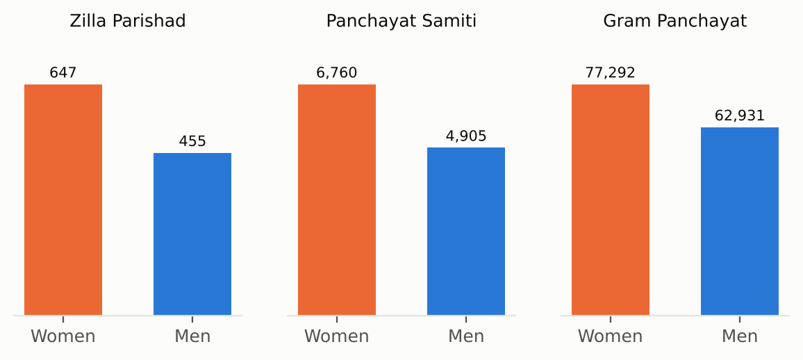
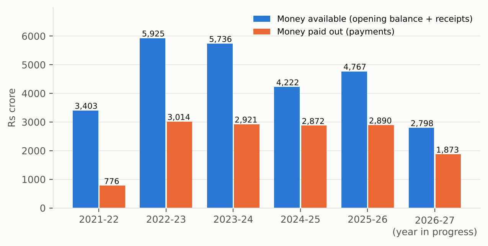
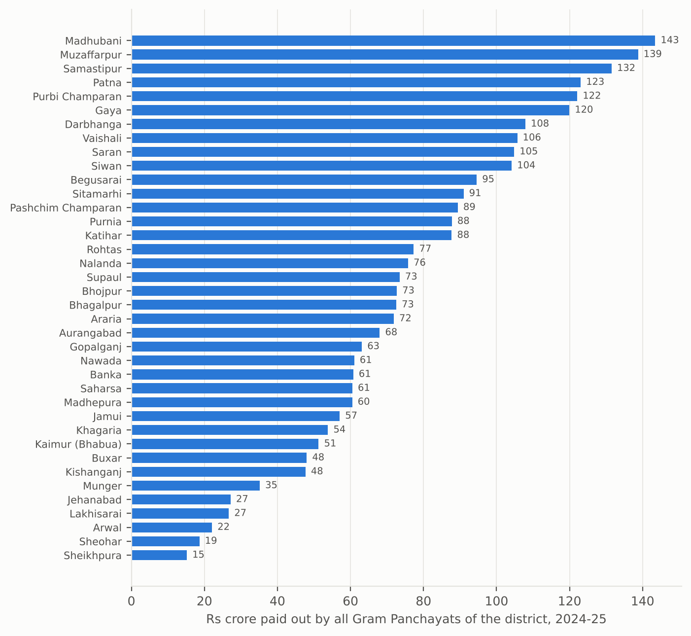
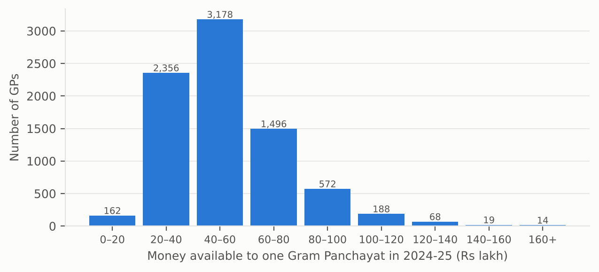

# Bihar's Panchayats in eGramSwaraj: What the Data Tells Us

A plain-language guide to the government data on Bihar's village councils · India By Numbers · November 2026

## 1. The main points

- **eGramSwaraj** is the Government of India's online system in which every Panchayat (village council) in India keeps its accounts, its development plans and its basic profile. We collected everything that is publicly available in it for Bihar.
- **Bihar has three levels of Panchayat:**
  - 38 Zilla Parishads (district level);
  - 534 Panchayat Samitis (block level);
  - about 8,050 Gram Panchayats (village level).
- **About 1.5 lakh people are elected to these councils, and most of them are women:**
  - 55% of Gram Panchayat members;
  - 58% at block level;
  - 59% at district level.
- **Bihar's Panchayats began keeping their accounts in eGramSwaraj only in 2020-21.** Earlier years show zero because nothing was recorded, not because nothing was spent.
- **In 2024-25 the Gram Panchayats had Rs 4,222 crore available and paid out Rs 2,872 crore,** about two-thirds of the money they had.
- **Nearly all the money in the Gram Panchayats' books comes from one source:** the grant of the 15th Finance Commission (a central government grant). The Panchayats' own income recorded in the system is very small.
- **A typical Gram Panchayat had about Rs 48 lakh available in 2024-25 and paid out about Rs 33 lakh.** Most had between Rs 20 lakh and Rs 80 lakh.
- **Bookkeeping is nearly complete.** In 2024-25, 8,053 of 8,054 Gram Panchayats closed their annual accounts in the system.
- **Every Gram Panchayat uploaded its development plan for 2024-25,** and almost all had their accounts audited.
- **The data does not tell us:**
  - how many people live in each Panchayat;
  - what each Panchayat spent its money on, item by item. Those detailed reports are protected by a security check and were not collected;
  - what approved plans were worth.
- **We checked every figure against the original government pages, and they match.** Figures for the same year can differ slightly between reports produced on different dates, so each figure should be quoted with its date.

## 2. What eGramSwaraj is

eGramSwaraj (egramswaraj.gov.in) is run by the Ministry of Panchayati Raj. Every Panchayat in the country uses it for its accounting, much as a business uses accounting software:

- money received;
- money paid out;
- vouchers (receipts and bills);
- closing the books at the end of each day, month and year.

Panchayats also upload their yearly development plan (called the GPDP) and keep a basic profile in it.

Many of its reports are open to the public. They can be read only from within India, so we collected them from a computer in India between 20 and 22 November 2026. A separate government site, **AuditOnline**, records the audit of Panchayat accounts. We collected it too, but we keep it separate.

## 3. Bihar's Panchayats at a glance

| Level | Official name | Number | What it covers |
|---|---|---|---|
| District | Zilla Parishad | 38 | One per district |
| Block | Panchayat Samiti | 534 | One per block |
| Village | Gram Panchayat | 8,051 (2026-27) | A village or a group of villages |

The number of Gram Panchayats has fallen over the years in the government's records:

| Year | Gram Panchayats |
|---|---|
| 2012-13 | 8,474 |
| 2018-19 | 8,386 |
| 2021-22 | 8,221 |
| 2024-25 | 8,054 |
| 2026-27 | 8,051 |

The system does not explain why; it may reflect villages being merged into towns or boundary changes. Comparisons between years should therefore use each Panchayat's official code number, not its name.

## 4. Who runs the Panchayats: elected members

| Level | Elected members | Women | Men | Other | Share of women |
|---|---|---|---|---|---|
| Zilla Parishad | 1,103 | 647 | 455 | 1 | 59% |
| Panchayat Samiti | 11,666 | 6,760 | 4,905 | 1 | 58% |
| Gram Panchayat | 1,40,248 | 77,292 | 62,931 | 25 | 55% |

At every level more women than men are elected members. These figures describe the **elected members only, not the population**. eGramSwaraj has no information on how many men or women live in a Panchayat.

## 5. How to read the money words

The accounts use a few terms. A household example helps:

| Term in the reports | Meaning | Household example |
|---|---|---|
| **Opening balance** | Money left over from last year, at the start of the year | Savings in the bank on 1 April |
| **Receipts** | Money received during the year (grants, own income) | Salary received during the year |
| **OB + Receipts** | Opening balance plus receipts: everything available to spend that year | Savings + salary |
| **Payments** | Money actually paid out from the Panchayat's accounts | What was spent during the year |
| **Crore / lakh** | 1 crore = 100 lakh = 10 million rupees; 1 lakh = 100,000 rupees | |

**Two important points:**

1. **"Payments" are only what passed through the Panchayat's own accounts.** Many government schemes in a village (roads built by a state department, for example) are paid directly by other offices. They do not appear here. So this is **not** all government spending in a village.
2. **Money "available" is not money "allocated" or "approved".** It is what reached the Panchayat's accounts.

## 6. Money in Gram Panchayat accounts, year by year

| Year | Money available (Rs crore) | Paid out (Rs crore) | Paid out as share of available |
|---|---|---|---|
| 2021-22 | 3,403 | 776 | 23% |
| 2022-23 | 5,925 | 3,014 | 51% |
| 2023-24 | 5,736 | 2,921 | 51% |
| 2024-25 | 4,222 | 2,872 | 68% |
| 2025-26 | 4,767 | 2,890 | 61% |
| 2026-27 (year in progress) | 2,798 | 1,873 | — |

These are figures for all Gram Panchayats of Bihar together, taken from the district-wise statement. Each year's report was produced on its own date, between Oct 2024 and Nov 2026.

**Before 2021-22:**

- **2020-21** was Bihar's first year in the system. Rs 235 crore was received, but almost nothing was paid out through it (Rs 0.21 crore). The report for that year also uses a different column ("Receipts" without the opening balance), so it is not shown in the chart.
- **2012-13 to 2019-20:** the system shows zero for Bihar. This means **accounts were not kept in eGramSwaraj** in those years. It does **not** mean Panchayats received or spent nothing.

## 7. Where the money comes from

eGramSwaraj also splits accounts by scheme, meaning the source of the money. For Bihar's Gram Panchayats in 2024-25:

| Source | Received (Rs crore) | Paid out (Rs crore) |
|---|---|---|
| **15th Finance Commission grant (XV FC)** | 4,221 | 2,872 |
| Own resources (taxes and fees collected by the Panchayat) | 0.45 | 0 |

So **almost the entire money in Gram Panchayat accounts is the 15th Finance Commission grant.** This is a grant given by the central government to Panchayats on the recommendation of the Finance Commission. The Panchayats' own income recorded in the system is very small.

At block level the picture is the same. At district level (Zilla Parishads) own resources are larger, Rs 475 crore received in 2024-25, but the 15th Finance Commission grant is still the main source, at Rs 3,579 crore.

Other schemes, such as MGNREGA, do not appear under Bihar's Panchayat accounts in this system.

## 8. Districts

In 2024-25:

- **largest:** Madhubani (Rs 143 crore), Muzaffarpur (Rs 139 crore) and Samastipur (Rs 132 crore);
- **smallest:** Sheikhpura (Rs 15 crore), Sheohar (Rs 19 crore) and Arwal (Rs 22 crore).

**Caution:** districts differ greatly in size and in the number of Panchayats. eGramSwaraj has no population figures, so these amounts **cannot be turned into "per person" figures** from this data alone. A bigger amount does not mean better or worse performance.

## 9. A typical Gram Panchayat

For each of the 8,053 Gram Panchayats in 2024-25, the system shows the money it had and the money it paid out:

- **The middle Gram Panchayat** had about **Rs 48 lakh** available and paid out about **Rs 33 lakh**. The middle Panchayat paid out about 73% of its money.
- **Most Gram Panchayats (7,030 of 8,053, or 87%)** had between Rs 20 lakh and Rs 80 lakh.
- **289 Gram Panchayats** had more than Rs 1 crore.
- **Example:** Araria Basti Gram Panchayat (Araria block, Araria district) had Rs 38.8 lakh available and paid out Rs 23.5 lakh in 2024-25.

Panchayat-level figures were collected for **2020-21 and 2024-25**. The other years are available on the portal and can be collected next.

## 10. How well the books are kept

eGramSwaraj records whether each Panchayat has done its basic bookkeeping:

- entered its master data and opening balance;
- recorded its vouchers;
- closed its day book, month book and year book. The year book is the annual accounts.

| Measure (Gram Panchayats) | 2020-21 | 2024-25 |
|---|---|---|
| Year book closed | 8,108 of 8,387 | 8,053 of 8,054 |
| Payment vouchers recorded (all GPs) | 332 | 3,38,469 |
| Receipt vouchers recorded (all GPs) | 9,749 | 39,706 |
| Payment vouchers per GP (middle GP) | 0 | 30 |

**By 2024-25, bookkeeping in the system is close to complete.** Almost every Gram Panchayat records its transactions and closes its annual accounts. In 2020-21 most payments were not yet being recorded.

## 11. Planning, assets and profiles

| Indicator | Figure | What it means |
|---|---|---|
| Development plan (GPDP) uploaded, 2024-25 | 8,053 of 8,053 Gram Panchayats; 533 of 534 Panchayat Samitis; 38 of 38 Zilla Parishads | Every Gram Panchayat uploaded its plan. The value of the plans and what was approved are **not** in the open reports |
| Gram Panchayats with ongoing works, 2024-25 | 7,850 | Panchayats with at least one ongoing activity recorded |
| Geo-tagging of assets, 2024-25 | 8,006 Gram Panchayats; 92,212 assets tagged | Photos with location of works and assets |
| Panchayat profile filled, 2026-27 | 7,661 of 8,051 | Only whether a profile exists; its contents (such as population) are behind a security check |

## 12. Audit of Panchayat accounts (AuditOnline)

The audit of Panchayat accounts is recorded in a separate government system, AuditOnline. It does not contain rupee amounts.

| Year audited | Gram Panchayats in the audit plan | Audit reports issued | Audit observations raised |
|---|---|---|---|
| 2020-21 | 8,149 | 8,069 | 67,545 |
| 2022-23 | 8,060 | 8,053 | 77,441 |
| 2024-25 | 8,053 | 8,049 | 81,208 |

An "observation" is a point raised by the auditor, such as a grant not used on time or a missing document. In 2024-25 the auditors raised about 10 observations per Gram Panchayat. Almost no settlement of these observations is recorded in the system yet.

## 13. What the data does NOT contain

| Not available | Why |
|---|---|
| Population, households, SC/ST numbers of a Panchayat | Not in any open report. The profile pages that might hold them are behind a security check (CAPTCHA), which we did not bypass |
| Item-by-item spending (cash book, ledger, vendors paid, works done) | Behind the same security check; viewable by a person one at a time, not collected in bulk |
| Value of approved development plans | Only "plan uploaded or not" is open |
| Money left unspent at year end | Not printed as a figure. Available minus paid out gives a rough idea, but that is not an official balance |
| All government spending in a village | Only money passing through the Panchayat's own accounts is recorded |
| Bihar figures before 2020-21 | Bihar did not use the system then |

## 14. How reliable is this data?

**What we checked:**

- **The numbers match the government pages exactly.** We re-checked every one of about 3.7 lakh figures against the original pages and found no mismatch.
- **Totals add up.** Where a report prints a total, the individual rows add up to it in every case we checked.
- **Names and codes were verified.** Each district, block and Gram Panchayat was matched to its official code using the government's own lists. 48 Gram Panchayats from 2020-21 could not be matched with certainty; they are listed separately rather than guessed.

**What needs care:**

- **Reports are snapshots.** Each report carries the date it was produced. Two reports for the same year, produced on different dates, can show different totals because accounts keep being updated. For example, the state summary for 2024-25 was produced in October 2024, halfway through that year, so it shows less money than the later district report.
- **The current year (2026-27) is still in progress.**
- **The reports changed format in 2021-22.** "Receipts" became "Opening balance + Receipts", and amounts moved from rupees to crore. Figures from before and after 2021-22 should not be compared directly.

## 15. Five rules for using these numbers

1. **Always quote the year and the report date**, e.g. "Rs 2,872 crore paid out in 2024-25 (report of 21 Nov 2026)".
2. **Say "money paid out by Panchayats", not "government spending in villages".**
3. **Treat zero before 2020-21 as "not recorded", not as "nothing spent".**
4. **Do not compare 2020-21 or earlier with later years** without explaining the change in format.
5. **Do not make per-person comparisons** from this data. It has no population figures.

## 16. Glossary

| Word | Meaning |
|---|---|
| Panchayat | Elected local council in rural areas |
| Gram Panchayat (GP) | Village-level council |
| Panchayat Samiti / Block Panchayat (BP) | Block-level council |
| Zilla Parishad (ZP) | District-level council |
| eGramSwaraj | Ministry of Panchayati Raj's online system for Panchayat accounts and plans |
| GPDP | Gram Panchayat Development Plan: the yearly plan of works |
| XV FC / 15th Finance Commission grant | Money given by the central government to Panchayats on the Finance Commission's recommendation |
| Own resources | Panchayat's own income (local taxes and fees) |
| Voucher | A record of one transaction: receipt voucher (money in), payment voucher (money out) |
| Day / month / year book closed | The Panchayat has finalised its accounts for that day, month or year |
| Opening balance (OB) | Money carried over from the previous year |
| AuditOnline | Separate government system for auditing Panchayat accounts |
| Crore / lakh | 1 crore = 100 lakh = 1,00,00,000 rupees |

## 17. Where to find more

Detailed technical reports, all in the project repository (`ayushjha4wd/ibn-collector`):

| Report | Contents |
|---|---|
| `docs/task4/TASK4_REPORT.pdf` | What is in eGramSwaraj and how it was collected |
| `docs/task5/TASK5_REPORT.pdf` | How every figure was checked |
| `docs/IBN_FULL_REPORT.pdf` | All project tasks together |
| `data/validated/egs/` | All checked figures, as spreadsheets (CSV) |
